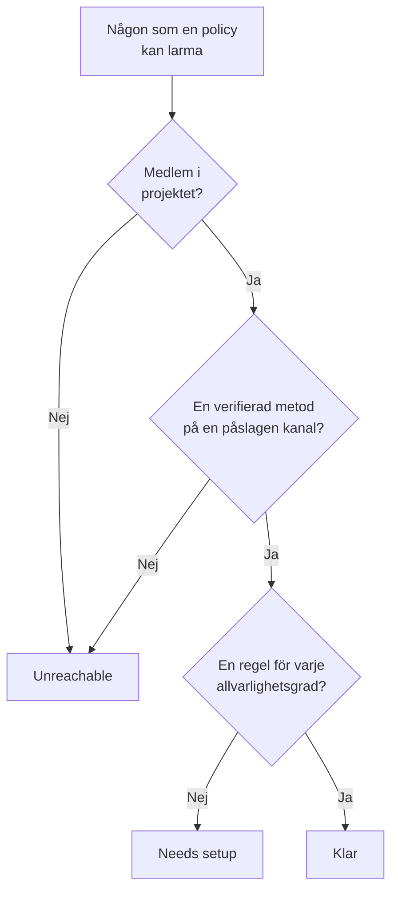

# Beredskap och rapporter

Beredskap besvarar en fråga innan en incident gör det: om något utlöstes just nu, skulle då alla som dina jourpolicyer larmar faktiskt nås? Sidan listar varje mottagare i projektet, säger vem som är klar och vem som inte är det, och låter dig påminna personer om att slutföra sina inställningar. Rapporten **Användarens jourtid** visar sedan hur länge varje person hade jour.

:::cards
- [Så avgörs en status](#så-avgörs-en-status): Klar, Needs setup eller Unreachable, och varför.
- [Sidan Beredskap](#sidan-beredskap): Varje mottagare i projektet, i en lista.
- [Påminn personer om att slutföra inställningarna](#påminn-personer-om-att-slutföra-inställningarna): Ett e-postmeddelande som säger vad som saknas.
- [Användarens jourtid](#användarens-jourtid): Hur länge varje person hade jour.
:::

## Så avgörs en status

En mottagare är vem som helst som en jourpolicy kan larma: en person som nämns i en eskaleringsregel, en medlem i ett team som en regel larmar, någon i ett lager i ett schema som en regel larmar, och den som täcker upp i en användaråsidosättning som inte har tagit slut. Ett schema som ingen policy larmar lägger inte till någon.

| Status | Vad den betyder |
| --- | --- |
| **Klar** | Personen har en verifierad metod på en kanal som projektet har slagit på, och en regel för varje allvarlighetsgrad, på varje flik i sina jourregler. |
| **Behöver konfigureras** | Personen kan nås, men vissa allvarlighetsgrader saknar regel. Raden räknar dessa luckor. |
| **Onåbar** | Inget når personen: ingen verifierad metod, varje verifierad metod finns på en kanal som projektet har stängt av, eller personen är inte medlem i projektet. |

En lucka är en allvarlighetsgrad utan regel, på fliken för incidenter, incidentepisoder, larm eller larmepisoder. En regel som avsiktligt stänger av en allvarlighetsgrad är ingen lucka. En utlarmning som träffar en lucka når ändå personen på hens verifierade metoder, om inte projektet har stängt av den reservlösningen: se [När ingen regel matchar](/docs/notifications/index#när-ingen-regel-matchar).

## Sidan Beredskap

Öppna **Jourtjänst → Beredskap**. Kortet **On-call readiness** listar alla som någon jourpolicy i projektet kan nå, med de som behöver något först. Alla i projektet kan öppna den.

Ovanför listan räknar rutorna **Mottagare**, **Klar**, **Behöver konfigureras** och **Onåbar**. Klicka på **Klar**, **Behöver konfigureras** eller **Onåbar** för att bara lista de mottagarna, och klicka igen för att lista alla.

| Kolumn | Vad den visar |
| --- | --- |
| **Mottagare** | Personen, med e-postadress. |
| **Status** | **Klar**, **Onåbar**, eller hur många luckor personen har. |
| **Kanaler** | Ett segment per kanal: ifyllt för en verifierad metod, ihåligt för en som inte är verifierad än. |
| **Coverage** | Hur många allvarlighetsgrader som har en regel, på varje flik, av alla. |
| **Reached via** | Hur policyerna når personen: varje team som larmar personen via en eskaleringsregel, med sitt namn, eller **Direct**, **Schema** eller **Åsidosättning**. |

**Coverage** på en rad visar personens aviseringsmetoder, varför hen har sin status och ett rutnät över varje allvarlighetsgrad med eller utan regel. Tratten filtrerar listan efter **Mottagare**, **Status**, **Team** eller **Reached via**. Svaret kan vara en minut gammalt: **Uppdatera** avgör det på nytt.

## Påminn personer om att slutföra inställningarna

Bara personen själv kan lägga till och verifiera sina aviseringsmetoder och regler, så lösningen är att be hen göra det.

:::steps
1. Markera mottagarna som ska påminnas på sidan Beredskap. Mottagare som är klara kan inte markeras: det finns inget att påminna dem om.
2. Klicka på **Skicka påminnelse om konfiguration**. Bekräftelsen nämner alla som är på väg att få ett e-postmeddelande.
3. Bekräfta. Varje person får ett e-postmeddelande som säger vad som saknas i hens egna inställningar, med en länk till sidan där det åtgärdas.
:::

En banner visar sedan hur många påminnelser som skickades, hoppades över eller misslyckades, och varför för varje som inte skickades. Ingen påminns mer än en gång per 24 timmar, och en omgång påminner högst 250 personer. För att skicka påminnelser krävs **Projektägare**, **Projektadministratör** eller **Jouradministratör**, eller **Edit On-Call Duty Policy** i en anpassad roll.

## Beredskap på andra sidor

- På en policys **Översikt** listar **Mottagarnas beredskap** alla som den policyn kan larma och som behöver åtgärdas, och **Kontrollera igen** läser det igen. Din egen rad har en knapp till sidan som åtgärdar det; någon annans rad öppnar ett e-postmeddelande till personen i ditt eget e-postprogram, med åtgärden i.
- På en policys **Eskaleringsregler** säger en nivå det på sitt kort om inte alla dess mottagare kan larmas. Se [Eskaleringsöversikten](/docs/on-call/escalation-rules#eskaleringsöversikten).
- Under **Användare** öppnar du en medlem, och sedan **Beredskap** i avsnittet **Jour**: personens status, metoder och rutnät över täckning.
- För dina egna inställningar guidar **Användarinställningar → Checklista för konfiguration** dig igenom dem. Se [Checklistan för konfiguration](/docs/notifications/index#checklistan-för-konfiguration).

## Det veckovisa e-postmeddelandet om beredskap

En gång i veckan kontrollerar OneUptime varje projekt som har en jourpolicy. När någon där är **Onåbar** eller **Behöver konfigureras** får projektets ägare ett e-postmeddelande som listar dem i två grupper, vem som inte kan larmas alls och vem som kan nås med luckor, upp till 20 namn i varje, med en länk till sidan Beredskap.

En vecka då alla är klara skickas inget, så e-postmeddelandet betyder alltid att något behöver åtgärdas. När någon inte kan larmas alls börjar ämnesraden med `[Action Required]`.

## Användarens jourtid

**Jourtjänst → Rapporter → Användarens jourtid** visar hur länge varje person hade jour, under en period du väljer: **Senaste månaden** till att börja med.

| Kolumn | Vad den visar |
| --- | --- |
| **Användare** | Personen. |
| **Tid som användaren var i jour** | Personens tid i jour under perioden, i timmar och minuter. |

Tiden registreras när personer går på och av jour: från det att ett schema som en regel larmar ger dem ett pass, eller de läggs till i en regel direkt eller via ett team, tills överlämningen eller tills de tas bort. Jourtid via två policyer samtidigt räknas en gång, och tid som fortfarande pågår räknas fram till nu.

**Tidslinje för jourscheman** och kalenderflödena visar tidigare pass så som rotationen är inställd i dag. Den här rapporten skrivs medan det händer, så använd den för rättvis fördelning och jourersättning.

> [!NOTE]
> I OneUptime Cloud kräver rapporten abonnemanget **Growth**, och tid som tog slut för mer än 200 dagar sedan tas bort. En egen installation behåller allt.

## Felsökning

:::details Någon kan inte nås men har ett verifierat telefonnummer
Personens metoder kan alla finnas på kanaler som projektet har stängt av: SMS, samtal, WhatsApp och Telegram är avstängda i ett nytt projekt. Se [Slå på en kanal för ditt projekt](/docs/notifications/notification-methods#slå-på-en-kanal-för-ditt-projekt).
:::

:::details Någon saknas i listan
Listan innehåller bara personer som en jourpolicy kan larma. En teammedlem som inte har accepterat sin inbjudan, någon i ett schema som ingen policy larmar, och någon som täcker upp i en åsidosättning som har tagit slut finns inte med.
:::

:::details Ägarna får aldrig det veckovisa e-postmeddelandet
Det skickas bara en vecka då någon är **Onåbar** eller **Behöver konfigureras**, och bara till projektets ägare.
:::

## Nästa steg

:::cards
- [Så når OneUptime dig](/docs/notifications/index): Metoderna, reglerna och reservlösningen bakom varje status.
- [Aviseringsmetoder](/docs/notifications/notification-methods): Lägg till och verifiera sätten som OneUptime når någon på.
- [Personliga jourregler](/docs/notifications/on-call-rules): Täpp till luckorna, allvarlighetsgrad för allvarlighetsgrad.
:::
