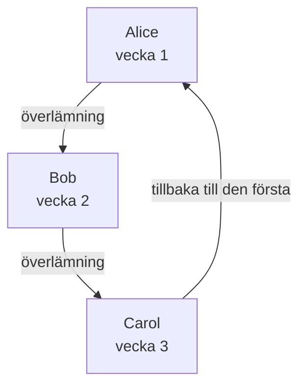
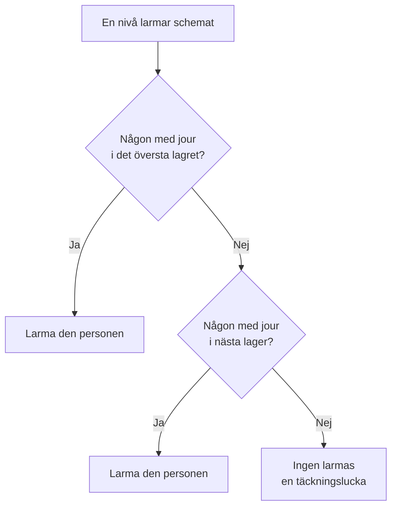

# Jourscheman

Ett jourschema bestämmer vem som har jour vid varje tidpunkt. Personer turas om i det: var och en har jour en tid, sedan tar nästa över. Lägg till ett schema i en jourpolicys eskaleringsregler, så larmar policyn den som har jour i det när den nivån körs.

> [!NOTE]
> På OneUptime Cloud ingår jourscheman i planen **Growth** och högre. Ett schema som ett projekt fortfarande har fortsätter att larma personerna i det, via de eskaleringsregler som nämner det, efter att en provperiod för Growth har tagit slut eller planen har sänkts. Under **Growth** visar därför sidan **Jourscheman** anteckningen om planen med de scheman som fortfarande är inställda under den, där du kan ta bort dem. Att skapa eller ändra ett schema kräver **Growth**.

:::cards
- [Vilka som turas om](#vilka-som-turas-om): Skapa ett schema med dess första rotation.
- [Lager](#lager): Stapla rotationer, begränsa jourtiderna och lägg till reservtäckning.
- [När någon är borta](#när-någon-är-borta): Hoppa över någon i rotationen tills hen är tillbaka.
- [API och Terraform](#skapa-scheman-med-apiet-eller-terraform): Skapa scheman och deras rotationer som kod.
:::

## Vilka som turas om

När du skapar ett schema på sidan **Jourscheman** frågar formuläret efter dess **Namn** och **Vilka turas om?**. De personer du väljer blir schemats första lager, **Layer 1**, med jour dygnet runt.

:::steps
1. Gå till **Jour** > **Jourscheman** och klicka på **Skapa jourschema**.
2. Ange ett **Namn**. Ett namn som ett annat schema i projektet redan har avvisas, oavsett stora och små bokstäver och mellanslag, så att varje väljare skiljer schemana åt.
3. Klicka på **Lägg till användare** under **Vilka turas om?** och välj personerna i den ordning de turas om.
4. Öppna eventuellt **Fler fält** för att ändra hur länge varje pass varar, tidszonen, beskrivningen eller etiketterna.
5. Klicka på **Skapa jourschema**. Det nya schemat öppnas sedan på sin sida **Lager**, där du kan ändra rotationen eller lägga till fler lager.
:::

Personerna turas om en i taget, och den första har jour så snart schemat har skapats:



**Vilka turas om?** är valfritt. Lämnar du det tomt börjar schemat utan lager: det sätter ingen på jour förrän du lägger till ett lager på dess sida **Lager**. Frågan ställs bara till dem som får lägga till lager.

Allt annat finns under **Fler fält**, hopfällt tills du öppnar det:

| Fält | Vad det gör |
| --- | --- |
| **Varje pass varar** | **1 dag**, **1 vecka**, **2 veckor** eller **1 månad**, och **1 vecka** om du inte ändrar det. Det frågas efter så snart någon turas om. Varje person har jour så länge, sedan tar nästa över, vid den tid på dygnet då schemat skapades. |
| **Tidszon** | Den tidszon som överlämningstider och jourtider hålls i. Den börjar på din. Ändras den senare står varje tid kvar som den står: en överlämning 09:00 förblir 09:00, och ett fönster på måndag förblir på måndag. Varje tidszon följer de gällande reglerna i sin region: America/Vancouver (British Columbia) ligger kvar på UTC-7 hela året från 2026. |
| **Beskrivning** | Anteckningar om schemat. |
| **Etiketter** | Etiketter för att hitta och gruppera schemat. |

Så länge någon turas om och inget under **Fler fält** har ändrats säger den hopfällda rubriken vad som kommer att hända: varje person har jour i en vecka, sedan tar nästa över.

Även någon som är inbjuden till projektet men ännu inte har gått med kan turas om, men inget larmar hen förrän hen har accepterat sin inbjudan, och hen får inte veta något. Turen är en täckningslucka, och kanalerna och flödet för varje jourpolicy som larmar schemat säger det och nämner hen med namnet som skrevs med inbjudan, aldrig med e-postadressen: "⚠️ Nobody is paged for Payments through schedule Primary until tomorrow at 5:50 PM, when @bob takes over: Ivy is on call but hasn't joined the project yet." `/oneuptime oncall` i Slack och `oncall` i Microsoft Teams säger det också. När hen går med når larmen fram, hen får veta vilka jourpolicyer som larmar hen nu, och kanalerna får "📞 Ivy has joined the project and is now on call for Payments until tomorrow at 5:50 PM, then @bob." Fram till dess visar [Beredskap och rapporter](/docs/on-call/readiness) hen, med vad som behöver göras.

## Lager

Ett schemas rotation består av lager, på dess sida **Lager**. Lagren läses uppifrån och ned: det översta lagret där någon har jour är det som larmar, så lägg huvudrotationen överst och reservtäckningen under den.



**Lägg till lager** lägger till ett lager som börjar som det första: jour från och med nu, varje person en vecka, dygnet runt. Expandera ett lager för att lägga till personer i det och för att ändra när det börjar, hur ofta det lämnar över, när det lämnar över första gången och de tider det har jour:

| Fält | Vad det anger |
| --- | --- |
| **Lagernamn** | Vad lagret täcker, till exempel "Primär vardagar". |
| **Rotationen börjar** | Det datum och den tid då lagrets rotation börjar. |
| **Rotera varje** | Hur ofta jouren går över till nästa person i lagret. |
| **Tid för första överlämning** | Den första överlämningen till nästa person, vid eller efter starten. Senare överlämningar följer varje rotationsintervall. |
| **Begränsningar** | De tider lagret har jour (**Aktiva tider**): **Inga begränsningar**, **Specifika tider på dygnet** eller **Specifika tider i veckan**, i schemats tidszon. Utanför dem tar lägre lager över. |

Ett fönster under **Specifika tider i veckan** löper från dagen och tiden under **Från:** till dagen och tiden under **Till:**, och dagarna det visar är dagarna det har jour. Ett fönster vars tider infaller på andra dagar än dem det sparades med, till exempel ett som skrivits via API:et med tiderna daterade på andra dagar, eller ett som sparades innan schemats tidszon ändrades, är markerat med **Aktiva tider att kontrollera** på sitt lager och visar under sig vilka dagar det sparades som. Det har fortfarande jour de visade dagarna, och **Spara lager** håller det kvar där: välj de dagar du menar innan du sparar.

Med aktiva tider är varje tidsfönster ett eget pass. Från 17:00 till 07:00 är ett pass, som slutar 07:00 nästa morgon: i **Tidslinje för jourscheman**, i mejlen, i mobilappen och i Slack och Microsoft Teams på samma sätt, i schemats tidszon och även de nätter klockan ställs om. En persons tur är alla hens tidsfönster fram till nästa överlämning, och hen får besked en gång åt varje håll: "You are now on-call" när det första fönstret i turen börjar, med när fönstret slutar och när turen gör det, och "You are no longer on-call" när det sista fönstret slutar, inte vid varje fönster. Vill du bli påmind före varje fönster väljer du en tid under **Påminn mig före pass**, som [Kalenderflöden](/docs/on-call/calendar-feeds#påminnelser-och-meddelanden-om-ny-tilldelning) beskriver. När någon annan har jour mellan två av fönstren, genom en åsidosättning eller ett lägre lager, eller en ändring av lagren ger nästa fönster till någon annan, är det en överlämning och meddelas som en. Jourtiden registreras fortfarande fönster för fönster, och jourpolicyns kanaler och flöde säger fortfarande varje gång vem som har jour.

För att ändra vilket lager som kommer först använder du pilarna på ett lagers kort: **Flytta lager uppåt (högre prioritet)** eller **Flytta lager nedåt (lägre prioritet)**.

Ändringar i vem som turas om väntar tills du sparar dem, så att du kan göra flera och kontrollera dem innan någons pass flyttas. Dra personer i en ny ordning, lägg till eller ta bort personer, flytta ett lager uppåt eller nedåt eller radera ett, så visar sidan varje ändring innan den sparas:

- Den du lade till är märkt **Ny** och den du drog till en ny plats **Flyttad**. Personerna du tog bort listas under **Tas bort när du sparar**, var och en med **Ångra**.
- Ett lager du raderar visar att det raderas när du sparar, med **Ångra**.
- Varje lager och det slutliga schemat visar rotationen som den blir. Det slutliga schemat är märkt **Innehåller osparade ändringar**.
- En list längst ned på sidan räknar upp ändringarna, med **Spara ändringar** och **Kasta**.

**Spara ändringar** sparar alla ändringar på en gång. Vem som har jour räknas sedan ut en gång, för lagren som de sparades: den som går på eller av jour, eller är näst på tur, får veta det en gång, inte en gång per ändring. **Kasta** återställer lagren till hur de senast sparades. Om du lämnar sidan innan du sparar får du en fråga först: **Spara ändringar** sparar och lämnar sedan sidan, **Fortsätt redigera** stannar kvar på sidan, och **Kasta ändringar** lämnar den utan att spara.

Om någon annan ändrade lagren efter att du öppnade sidan sparas inte dina ändringar över deras. Listen säger det, och **Läs in lager igen** visar lagren som de är nu, så att du kan göra dina ändringar igen. **Lägg till lager** lägger till lagret direkt, och ett lagers inställningar sparas med lagrets egen knapp **Spara lager**.

Varje person behåller en färg överallt, så att du kan följa personen med en blick: i varje lager, i det slutliga schemat och dess åsidosättningar och på **Tidslinje för jourscheman**.

## När någon är borta

När någon åker på semester hoppar du över personen tills hen är tillbaka. Fäll ut ett lager på schemats sida **Lager** och klicka på **Hoppa över till…** bredvid personens namn. Det öppnar formuläret för frånvaro med personen under **Vem är borta?**, **Nästa person i rotationen** under **Vem täcker upp?** och **Börjar** från nu: ställ in **Slutar** på när hen är tillbaka och spara. Har personen redan frånvaro då säger formuläret det bredvid tiderna medan du väljer dem, med **Redigera den åsidosättningen** för att ändra den andra i stället.

Medan personen är borta:

- Vart och ett av personens pass går till nästa person i lagret som inte är borta, i varje schema som hen ingår i. Ingen annans pass flyttas, och personens pass är hens igen så snart hen är tillbaka.
- Om alla i ett lager är borta har lagret ingen i jour, och lagren under tar över. Lagret visar **Alla i det här lagret är borta just nu**.
- Eskaleringsregler som larmar personen direkt eller via ett team hoppar över hen. Policyns körning visar att hen är borta, och till när.
- Personens rad i lagret visar när hen är tillbaka, och det slutliga schemat och **Tidslinje för jourscheman** visar vem som har vart och ett av hens pass.

Väljer du i stället någon under **Vem täcker upp?** får den personen alla hens larm, från varje schema och varje policy, i stället för att rotationen tar hens pass.

Frånvaro som läggs till på det här sättet gäller för alla jourpolicyer, så den kräver behörigheten för åsidosättningar över hela projektet. Är ditt teams roll begränsad till dess egna policyer eller till några etiketter läggs den i stället på de policyer i det här schemat som du får lägga till åsidosättningar på, med en åsidosättning per policy, som listas på varje policys egen sida **Användaråsidosättningar**; är de flera markerar du dem under **Jourpolicyer**. **Hoppa över till…** är bara låst och säger varför där du inte får på någon av dem. Den listas under **Jour** > **Scheman** > **Användaråsidosättningar**, och bland schemats användaråsidosättningar på dess sida **Lager**, där **Avsluta nu** tar tillbaka personen tidigare. För att hoppa över någon i bara en policy lägger du till åsidosättningen på den policyns sida **Användaråsidosättningar** och låter **Vem täcker upp?** vara som det är. Se [Användaråsidosättningar](/docs/on-call/user-overrides).

Via API:et hoppar en användaråsidosättning (`/api/on-call-duty-policy-user-override`) som skapas utan `routeAlertsToUserId` över personen i `overrideUserId` från `startsAt` till `endsAt`.

Ett schemas **Översikt** har kortet **Används av**: jourpolicyerna vars eskaleringsregler larmar den som har jour, med reglerna som gör det. Gör ingen det säger kortet det och länkar till jourpolicyerna. När du tar bort schemat, på dess sida eller från listan, sägs först vilka policyer som larmar via det. Policyer du inte får öppna räknas men namnges inte. Ett schema som har samma namn som ett annat schema, från tiden innan namn behövde skilja sig åt, är märkt med **Samma namn som ett annat schema** i listan **Jourscheman**, som visar hur många det är: jämför deras lager och byt sedan namn på ett av dem med **Byt namn** på dess rad.

## Skapa scheman med API:et eller Terraform

Jourscheman är resursen `/api/on-call-duty-policy-schedule`; deras lager och personerna i dem är resurserna `/api/on-call-duty-schedule-layer` och `/api/on-call-duty-schedule-layer-user`.

- Att skapa ett schema med `firstLayerUsers` (en lista med användar-id:n, i den ordning de turas om) i dess `miscDataProps` ger det dess första lager, som instrumentpanelen gör: **Layer 1**, med jour från och med nu, dygnet runt. `firstLayerRotation` anger hur länge varje pass varar, som en rotation som `{"_type": "Recurring", "value": {"intervalType": "Week", "intervalCount": 1}}`; utan den en vecka. Varje användare måste vara medlem i projektet och anroparen måste få skapa lager, annars skapas inte schemat.
- Ett schema som skapas utan dem har inga lager, som tidigare; Terraforms resurs för scheman skickar dem inte.
- Ett lager som skapas utan `rotation` lämnar över varje vecka, och ett utan `restrictionTimes` har jour dygnet runt, som ett nytt lager i instrumentpanelen börjar.
- Ett lagers `restrictionTimes`, dess aktiva tider, anger typen under `restrictionType`: `None` (jour dygnet runt), `Daily` eller `Weekly`. `restictionType`, den äldre stavningen utan det andra "r", läses också, och varje svar har typen under båda, så att en klient eller en Terraform-konfiguration skriven med någon av dem fortsätter att fungera; lagret sparas med `restrictionType`. `restictionType` i svar är inaktuell: svar har den fram till den första huvudversionen som släpps den 1 juni 2027 eller senare, och skrivningar kommer alltid att läsa den. Skriv `restrictionType`.
- Ett `Weekly`-fönster, `{"startDay", "startTime", "endDay", "endTime"}`, har jour de dagar det nämner: dess `startTime` och `endTime` måste infalla på dess `startDay` och `endDay` i schemats tidszon. Ett fönster vars tid infaller på en annan dag avvisas med en `400` som nämner fönstret, dagen tiden infaller på och en tid på den nämnda dagen att skicka i stället. En dag som utelämnas är dagen tiden infaller på. Ett fönster som skickas tillbaka exakt som lagret har det bedöms inte på nytt, så en klient som läser ett lager och skriver tillbaka det avvisas inte för det. I ett schema utan tidszon, vars tider läses i serverns, avvisas en tid bara när den inte infaller på sin dag i någon tidszon.
- En uppgradering av OneUptime flyttar varje sparat fönster vars tider infaller på andra dagar än dem det nämner, och inte på de dagarna i någon tidszon, till dagarna det nämner, vid samma tid på dygnet, och räknar på nytt ut vem som har jour. Ett fönster vars tider infaller på dess dagar i en annan tidszon, som de kan för ett fönster som satts i en annan zon eller sparats innan schemats tidszon ändrades, lämnas orört, så att det larmar som förut, och markeras med **Aktiva tider att kontrollera**.
- Ändras ett schemas `timezone` från en zon till en annan flyttas dess lagers `startsAt`, `handOffTime` och `restrictionTimes` över till den nya zonens klocka: var och en visar där samma datum, dag och tid på dygnet som förut. Får ett schema sin första tidszon, eller tas den bort, behålls tidpunkterna som de är.
- En skrivning som skulle ge ett lager jour vid ingen tidpunkt avvisas med en `400` som nämner nyckeln: en typ som saknas, är okänd eller skiljer sig mellan de två stavningarna (en uppdatering tar den som avviker från lagrets nuvarande typ); ett `Daily`-fönster vars `startTime` och `endTime` inte är datum och tider (`"09:00"` ensamt avvisas); en `Weekly`-begränsning utan `weeklyRestrictionTimes`; eller ett fönster som öppnar och stänger vid samma tid. En `rotation` vars `intervalType` inte är `Hour`, `Day`, `Week`, `Month` eller `Year` avvisas på samma sätt.
- Ett lager som sparades innan sådana skrivningar avvisades, utan en typ som lästes, hade aldrig jour. En uppgradering av OneUptime läser varje sådant lager efter de tider det innehåller, sparar det så och räknar på nytt ut vem som har jour i dess schema, så att dess personer larmas från och med då och får besked om det.
- En ändring av ett schemas lager och personerna i dem, gjord med API:et eller Terraform, meddelas som en ändring: vem som har jour räknas ut när lagren har varit oförändrade i en halv minut, och den som går på eller av jour, eller är näst på tur, får veta det en gång, inte en gång per lager eller person som skrivs. Larm går till den som lagren sätter i jour så snart varje ändring är sparad.
- För att ändra på en gång vem som tar pass i ett schemas lager, som **Spara ändringar** på sidan **Lager** gör, läser du lagren med `GET /api/on-call-duty-policy-schedule/<schedule-id>/layers` och skickar tillbaka dem, ändrade, till `POST /api/on-call-duty-policy-schedule/<schedule-id>/save-layers`. De anger varje lager som schemat behåller, det med högst prioritet först, vart och ett med sina personer i passordning: den som redan är i ett lager med sitt `layerUserId`, den som läggs till med bara `userId`. `deletedLayerIds` anger de lager som ska tas bort.
- En sparning skrivs helt eller inte alls, och vem som har jour räknas ut en gång, direkt. En som görs efter att någon annan har ändrat lagren avvisas med 409, eftersom dess `basedOnVersion` inte längre är lagrens: läs lagren igen och gör ändringen på det som finns nu. Terraform-resursen `oneuptime_on_call_schedule_layers` sparar ett schemas lager på det här sättet.

```bash
curl -X POST https://oneuptime.com/api/on-call-duty-policy-schedule \
  -H "apikey: $ONEUPTIME_API_KEY" \
  -H "Content-Type: application/json" \
  -d '{
    "data": {
      "projectId": "<project-id>",
      "name": "Primary on-call",
      "timezone": "Europe/Berlin"
    },
    "miscDataProps": {
      "firstLayerUsers": ["<user-id-1>", "<user-id-2>", "<user-id-3>"],
      "firstLayerRotation": {"_type": "Recurring", "value": {"intervalType": "Week", "intervalCount": 1}}
    }
  }'
```

```bash
curl -X POST https://oneuptime.com/api/on-call-duty-schedule-layer \
  -H "apikey: $ONEUPTIME_API_KEY" \
  -H "Content-Type: application/json" \
  -d '{
    "data": {
      "name": "Nights",
      "onCallDutyPolicyScheduleId": "<schedule-id>",
      "startsAt": "2026-11-23T08:00:00.000Z",
      "handOffTime": "2026-11-30T08:00:00.000Z",
      "rotation": {"_type": "Recurring", "value": {"intervalType": "Week", "intervalCount": {"_type": "PositiveNumber", "value": 1}}},
      "restrictionTimes": {"_type": "RestrictionTimes", "value": {
        "restrictionType": "Daily",
        "dayRestrictionTimes": {
          "startTime": {"_type": "DateTime", "value": "2026-01-05T17:00:00+01:00"},
          "endTime": {"_type": "DateTime", "value": "2026-01-05T07:00:00+01:00"}
        }
      }}
    }
  }'
```

```bash
curl -X PUT https://oneuptime.com/api/on-call-duty-schedule-layer/<layer-id> \
  -H "apikey: $ONEUPTIME_API_KEY" \
  -H "Content-Type: application/json" \
  -d '{
    "data": {
      "restrictionTimes": {"_type": "RestrictionTimes", "value": {
        "restrictionType": "Weekly",
        "weeklyRestrictionTimes": [{
          "startDay": "Monday",
          "startTime": {"_type": "DateTime", "value": "2026-01-05T09:00:00+01:00"},
          "endDay": "Friday",
          "endTime": {"_type": "DateTime", "value": "2026-01-09T17:00:00+01:00"}
        }]
      }}
    }
  }'
```

```bash
curl https://oneuptime.com/api/on-call-duty-policy-schedule/<schedule-id>/layers \
  -H "apikey: $ONEUPTIME_API_KEY"

curl -X POST https://oneuptime.com/api/on-call-duty-policy-schedule/<schedule-id>/save-layers \
  -H "apikey: $ONEUPTIME_API_KEY" \
  -H "Content-Type: application/json" \
  -d '{
    "basedOnVersion": "<the version the read answered>",
    "layers": [
      {
        "layerId": "<layer-id>",
        "users": [
          {"layerUserId": "<row-of-user-2>", "userId": "<user-id-2>"},
          {"layerUserId": "<row-of-user-1>", "userId": "<user-id-1>"},
          {"userId": "<user-id-4>"}
        ]
      }
    ],
    "deletedLayerIds": []
  }'
```

## Nästa steg

:::cards
- [Eskaleringsregler](/docs/on-call/escalation-rules): Låt en nivå i en jourpolicy larma det här schemat.
- [Tidslinje för jourscheman](/docs/on-call/schedule-timeline): Se alla scheman sida vid sida, med täckningsluckorna.
- [Kalenderflöden](/docs/on-call/calendar-feeds): Lägg in pass i Google Kalender, Outlook eller Apple Kalender.
- [Så når man mig](/docs/notifications/on-call-rules): Bestäm hur ett larm når dig medan du har jour.
:::
