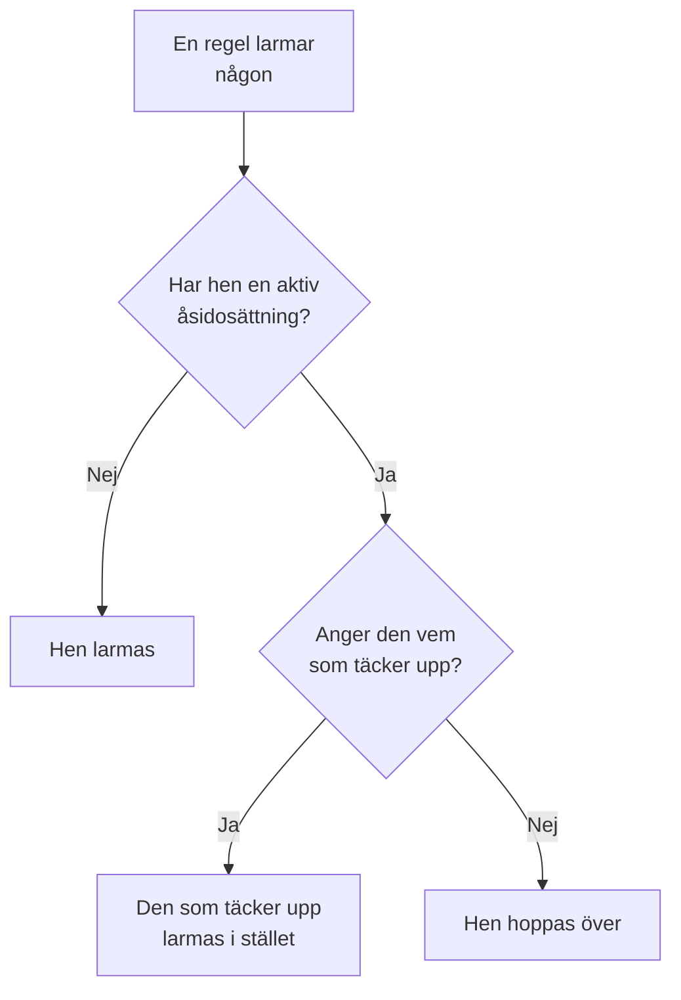

# Användaråsidosättningar

Medan någon är borta skickar en användaråsidosättning de utlarmningar som skulle ha nått personen till den som täcker upp för hen, under en bestämd tid. Om ingen är utsedd att täcka upp hoppar den i stället över personen: vart och ett av hens pass i ett jourschema går till nästa person i rotationen. Använd en för en semester, en sjukdag eller ett bytt pass.

:::cards
- [Så ändrar en åsidosättning en utlarmning](#så-ändrar-en-åsidosättning-en-utlarmning): Vem som larmas i stället, och när.
- [Lägg till en åsidosättning](#lägg-till-en-åsidosättning): Vem som är borta, vem som täcker upp, från när och till när.
- [Varje policy, eller en](#varje-policy-eller-en): Var du lägger till en åsidosättning, och vilken som vinner.
- [Andra sätt att lägga till en](#andra-sätt-att-lägga-till-en): Från ett schema och från dina kommande pass.
:::

## Så ändrar en åsidosättning en utlarmning



Medan en åsidosättning gäller, från dess start till dess slut:

- Står någon under **Vem täcker upp?** får den personen alla utlarmningar till den som är borta, från varje schema, team och regel som åsidosättningen gäller för. Utlarmningen når hen via hens egna personliga jourregler.
- Finns ingen som täcker upp hoppas personen över. I ett jourschema går vart och ett av hens pass till nästa person i rotationen som inte är borta; om alla i ett lager är borta tar lagren under över. En regel som nämner personen direkt, eller via ett team, larmar inte hen, och policyns körning visar att hen är borta, och till när.
- Åsidosättningar kedjas inte. Om den som täcker upp också är borta är det ändå hen som larmas för den person hen täcker upp för.

När åsidosättningen tar slut är utlarmningarna personens egna igen. **Tidslinje för jourscheman**, ett schemas lager och kalenderflödena visar alla vem som har varje pass som täcks upp.

## Lägg till en åsidosättning

:::steps
### Öppna åsidosättningarna

Gå till **Jourtjänst → Avancerad → Användaråsidosättningar** för att täcka upp för någon i varje jourpolicy, eller till en policys egen sida **Användaråsidosättningar**, under **Avancerad**, för att täcka upp för personen bara i den policyn. Klicka på **Lägg till Användaråsidosättning**.

### Ange vem som är borta

**Vem är borta?** börjar med dig, eftersom det vanligaste är att lägga in din egen ledighet. Välj någon annan för att ordna ersättare åt hen.

### Ange vem som täcker upp

Låt **Vem täcker upp?** stå kvar på **Nästa person i rotationen** för att hoppa över personen, eller välj kollegan som tar alla hens utlarmningar. Den som är borta erbjuds inte.

### Ställ in tiden

**Börjar** är nu om du inte väljer en annan tid. Ställ in **Slutar** på när personen är tillbaka: det måste vara efter starten. Klicka på **Lägg till Användaråsidosättning**.
:::

Varje åsidosättning är en rad: **Borta**, **Täcks av**, **Börjar** och **Slutar**, filtrerad efter start och slut. **Täcks av** visar **Nästa person i rotationen** när personen hoppas över. En åsidosättning kan inte redigeras: ta bort den och lägg till en ny, eller ta bort den för att få tillbaka någon tidigare.

## Varje policy, eller en

| Tillagd under | Kort | Gäller för |
| --- | --- | --- |
| **Jourtjänst → Avancerad → Användaråsidosättningar** | **Globala användaråsidosättningar** | Varje jourpolicy i projektet |
| En policys **Användaråsidosättningar** | **Jourpolicyns användaråsidosättningar** | Bara den policyn |

När två åsidosättningar för samma person överlappar vinner policyns egen över en global, och en som anger vem som täcker upp vinner över en som hoppar över. En utlarmning utan policy, från ett arbetsflöde eller från chatt, följer bara de globala åsidosättningarna.

## Andra sätt att lägga till en

- Från ett schema: fäll ut ett lager på schemats sida **Lager** och klicka på **Hoppa över till…** bredvid en person. Det öppnar samma formulär med personen borta och rotationen som täcker upp, som en global åsidosättning. Se [När någon är borta](/docs/on-call/schedules#när-någon-är-borta).
- Från dina kommande pass: **Hitta ersättare** på ett av dina pass, under **Användarinställningar → Kalender → Kalenderflöde**, öppnar formuläret med dig som borta under passets tider, så att bara **Vem täcker upp?** återstår. Se [Kommande pass och ersättare](/docs/on-call/calendar-feeds#kommande-pass-och-ersättare).

När någon lämnar projektet tas varje åsidosättning som nämner hen och inte har tagit slut än bort, på båda sidor.

## Vem som får lägga till åsidosättningar

**Projektägare**, **Projektadministratör**, **Projektmedlem**, **Jouradministratör** och **Jourmedlem** får lägga till och ta bort åsidosättningar; **Tittare** och **Jourtittare** får se dem. I en anpassad roll heter behörigheterna **Create On-Call Duty Policy User Override**, **Delete On-Call Duty Policy User Override** och **Read On-Call Duty Policy User Override**. På **Tidslinje för jourscheman** ser bara personer som får läsa åsidosättningar vems pass som täcks upp.

I OneUptime Cloud kräver användaråsidosättningar abonnemanget **Growth**.

## API

Användaråsidosättningar är resursen `/api/on-call-duty-policy-user-override`:

| Fält | Vad det innehåller |
| --- | --- |
| `overrideUserId` | Personen som är borta. Obligatoriskt. |
| `routeAlertsToUserId` | Personen som täcker upp. Utelämna det för att i stället hoppa över personen. |
| `startsAt`, `endsAt` | När åsidosättningen börjar och slutar. Båda är obligatoriska, och slutet kommer efter starten. |
| `onCallDutyPolicyId` | Policyn den gäller för. Utelämna det för en global åsidosättning. |

```bash
curl -X POST https://oneuptime.com/api/on-call-duty-policy-user-override \
  -H "apikey: $ONEUPTIME_API_KEY" \
  -H "Content-Type: application/json" \
  -d '{
    "data": {
      "projectId": "<project-id>",
      "overrideUserId": "<away-user-id>",
      "routeAlertsToUserId": "<cover-user-id>",
      "startsAt": "2026-12-22T09:00:00Z",
      "endsAt": "2027-01-05T09:00:00Z"
    }
  }'
```

En åsidosättning där personen som är borta och den som täcker upp är samma person avvisas, liksom en som slutar innan den börjar.

## Felsökning

:::details Personen på semester larmades ändå
Kontrollera var åsidosättningen lades till. En på en policys sida **Användaråsidosättningar** gäller bara den policyn, och andra policyer larmar fortfarande personen: lägg till den under **Jourtjänst → Avancerad → Användaråsidosättningar** för att täcka varje policy. Kontrollera också **Börjar** och **Slutar**: tiderna visas i din tidszon.
:::

:::details Den som täcker upp larmades inte heller
Hen nås via sina egna personliga jourregler och verifierade metoder. Slå upp hen under **Jourtjänst → Beredskap**, och kontrollera körningen i policyns **Exekveringsloggar**.
:::

:::details Jag kan inte lägga till en åsidosättning
Det kräver en av rollerna ovan, och i OneUptime Cloud abonnemanget **Growth**.
:::

## Nästa steg

:::cards
- [Jourscheman](/docs/on-call/schedules): Rotationer, lager och att hoppa över någon i ett lager.
- [Tidslinje för jourscheman](/docs/on-call/schedule-timeline): Se varje pass som täcks upp i alla scheman.
- [Kalenderflöden](/docs/on-call/calendar-feeds): Hitta en ersättare för ett av dina egna pass.
:::
