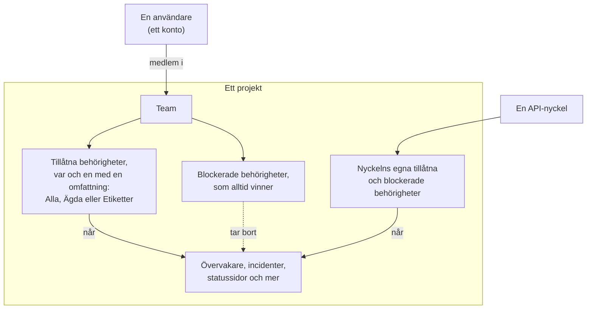
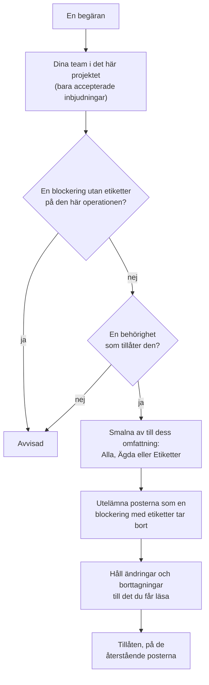

# Användare, team och behörigheter

Allt i OneUptime finns inuti ett **projekt**. Vem som får göra vad i projektet avgörs av tre saker: **användarna** i det, de **team** användarna tillhör och de **behörigheter** som teamen har fått.

> [!IMPORTANT]
> **Användare har aldrig behörigheter direkt.** En användares åtkomst är unionen av behörigheterna från alla team hen tillhör i projektet. Vill du ändra vad någon får göra ändrar du hens teammedlemskap eller teamets behörigheter.

**Ägare** är en separat idé. En ägare är den som ansvarar för en viss resurs — en övervakare, en incident, en instrumentpanel. Ägare aviseras om sina resurser, och behörigheter kan om du vill smalnas av till "bara det jag äger".

## Så fungerar åtkomst

| Begrepp | Vad det är |
| --- | --- |
| Användare | Ett enda OneUptime-konto. En inloggning, valfritt antal projekt. |
| Projekt | Hyresgästgränsen. Övervakare, incidenter, team och data hör till exakt ett projekt. |
| Team | En namngiven grupp i ett projekt som bär behörigheter. |
| Teammedlem | En användare som har bjudits in till ett team och accepterat. |
| Behörighet | En enskild förmåga, t.ex. `CreateProjectMonitor`, eller en roll som samlar många, t.ex. `MonitorAdmin`. |
| Omfattning | Hur långt en tillåten behörighet når: alla resurser, bara ägda eller bara etiketterade. |
| Ägare | En användare eller ett team som har markerats som ansvarig för en viss resurs. |
| Etikett | En märkning du sätter på resurser, som används för att begränsa behörigheter och för att organisera. |

## Användare

Ett användarkonto är globalt för OneUptime-instansen — samma inloggning fungerar i alla projekt som användaren har bjudits in till.

En användare är "i" ett projekt när hen är medlem i **minst ett team** i det. Det finns inget separat steg "lägg till användare i projekt": att bjuda in någon till ett projekt är att bjuda in hen till ett team.

:::steps
1. Öppna **Användare** i menyn **Produkter**, under **Inställningar**, och klicka på **Bjud in användare**. Listan visar alla i projektet och status för deras inbjudningar.
2. Skriv in personens **E-post**. Den som ännu inte har ett OneUptime-konto får också ange ett **Namn**.
3. Välj personens **Team**, som avgör vad hen får göra, och klicka på **Bjud in**.
4. Personen accepterar via klockan uppe till höger, på **Projektinbjudningar**, och är med i projektet från och med då.
:::

- Inbjudningar skapar en väntande teammedlem. Användaren räknas som projektmedlem — och får någon behörighet alls — **först efter att ha accepterat inbjudan.**
- **Bjud in användare** börjar på projektets medlemsteam: teamet som har `ProjectMember` för hela projektet, alltså **Members** om du inte har döpt om det. Välj ett annat team för att ge personen mer eller mindre åtkomst. Inget är valt när du själv inte skulle få bjuda in till det teamet — att bjuda in någon lämnar vidare teamets behörigheter, och du kan bara lämna vidare behörigheter som du själv har — eller när projektet inte har något sådant team. Administratörspanelen börjar på samma team överallt där en administratör av instansen lägger till någon i ett projekt: **Bjud in användare** på ett projekt, **Lägg till i projekt** på en användare och på flera användare samtidigt, och projekten som är kopplade till en [global SSO-leverantör](/docs/identity/global-sso).
- Tar du bort en användare från alla team i ett projekt förlorar hen åtkomsten till projektet från sin nästa begäran — även medan hen är inloggad. Kontot och hens andra projekt påverkas inte. Hen tas bort från projektets jourscheman, eskaleringsregler och åsidosättningar, från rollerna i dess öppna incidenter och episoder och från ägarna av dess resurser; lösta incidenter behåller uppgiften om vem som ägde och ledde dem.
- Den som lämnar ett projekt får inte längre dess aviseringar. Personens egna aviseringsmetoder, -regler och -inställningar för projektet tas bort tillsammans med det sista teamet — e-post, SMS, samtal, WhatsApp, Telegram, push, webhook, Slack och Microsoft Teams, e-postsammanfattningen och det ännu inte skickade e-postmeddelandet, numret för inkommande samtal och jourpåminnelserna —, så den som går med igen börjar från standardinställningarna. Det som fortfarande nämner personen, till exempel användaren som en regel för inkommande samtal ringer eller en ägare som behålls på en löst incident, aviserar inte längre personen: ingenting skickas för ett projekts räkning till någon som inte är medlem, och en väntande inbjudan är ännu inget medlemskap. De ställena visar **Inte längre medlem** bredvid namnet, så att du kan sätta in någon annan. Den som är inbjuden och inte har accepterat än visar i stället **Inbjudan inte accepterad än**. Om en åsidosättning skickar någons larm vidare till en person som har lämnat projektet larmas i stället den som åsidosättningen täcker. Att lämna projektet kopplar också bort de MCP-klienter som personen har anslutit till projektet, och personens personliga länk till jourkalendern visar därefter en tom kalender. På OneUptime Cloud bekräftar den som kommer tillbaka via projektets enkel inloggning (SSO) den på nytt från sin e-postkorg.
- Om projektet kräver SSO och en användare ännu inte autentiserat sig via identitetsleverantören behandlas hen som obehörig SSO-användare och ser ingenting förrän det skett. Se [SSO](/docs/identity/sso).
- Med SCIM konfigurerat kan din identitetsleverantör skapa, uppdatera och ta bort användare och deras teammedlemskap automatiskt. Se [SCIM](/docs/identity/scim).

## Team

Team är vägen som behörigheter tar till människor. Varje nytt projekt börjar med tre:

| Team | Behörighet det har | Redigerbart |
| --- | --- | --- |
| Owners | `ProjectOwner` | Nej. Har alltid minst en medlem. |
| Admin | `ProjectAdmin` | Nej |
| Members | `ProjectMember` | Ja — det här är en utgångspunkt, ändra det fritt |

Teamen **Owners** och **Admin** är avsiktligt låsta: deras behörigheter går inte att redigera och teamen kan varken tas bort eller döpas om. Det är detta som hindrar ett projekt från att av misstag låsa ut sig självt. Owners-teamet måste alltid behålla minst en medlem.

`ProjectOwner` är den högsta åtkomstnivån: fakturering, radera projektet och allt en administratör kan göra. `ProjectAdmin` täcker allt utom fakturering och radering av projektet.

Att slå på eller av SMS, telefonsamtal, WhatsApp eller Telegram för projektet räknas som fakturering, eftersom varje meddelande kostar pengar. Bara `ProjectOwner`, rollen `BillingAdmin` (**Billing Admin**) och behörigheten `ManageProjectBilling` (**Manage Billing**) kan ändra de reglagen, under **Projektinställningar > Aviseringar > Aviseringsinställningar** — inte `ProjectAdmin`.

Att fylla på projektets förbetalda saldon räknas också som fakturering. På OneUptime Cloud betalas SMS, telefonsamtal, WhatsApp och Telegram från saldot under **Projektinställningar > Aviseringar > Aviseringsinställningar**, och AI från AI-krediterna under **Projektinställningar > AI > AI-krediter**. Bara en projektägare eller någon med **Manage Billing** kan fylla på dem eller ändra deras **Automatisk påfyllning** — inte en projektadministratör. Ett meddelande om ett saldo som håller på att ta slut säger vem som kan fylla på det, och bara de personerna får en knapp **Fyll på saldo** som fungerar, eller en länk till sidan.

Skapa hur många extra team du vill — "Frontend-jour", "Support", "Skrivskyddade granskare" — och ge varje team de behörigheter det behöver. På OneUptime Cloud kräver det Scale-planen att skapa ett team och ändra dess behörigheter.

**Att skapa ett team** frågar efter ett namn och teamets **Åtkomst**, alltså vad teamets medlemmar får göra:

| Åtkomst | Vad teamets medlemmar får göra |
| --- | --- |
| Projektadministratör | Skapa, ändra och ta bort allt i projektet, även dess inställningar. Inte fakturering, och inte radering av projektet. |
| Projektmedlem | Skapa, ändra och ta bort övervakare, incidenter, statussidor och projektets övriga resurser. |
| Tittare | Läsa allt i projektet och inte ändra något. |
| Välj behörigheter senare | Inget ännu. Valt från början. |

:::steps
1. Öppna **Team** i menyn **Produkter**, under **Inställningar**, och klicka på **Skapa team**.
2. Skriv in teamets **Namn** och välj dess **Åtkomst**. Beskrivningen finns under **Fler fält**.
3. Skapa teamet. Ett team med en roll öppnas på sin sida **Medlemmar**, redo att bjuda in personer; med **Välj behörigheter senare** öppnas det på sin sida **Behörigheter**, där du lägger till en smalare roll som `IncidentMember` eller enstaka behörigheter.
:::

Rollen du väljer blir teamets första behörighet, för alla resurser i projektet, så snart teamet finns — precis som om du hade lagt till den med **Lägg till roll** på teamets sida Behörigheter. Du erbjuds bara de roller du själv har, eftersom alla du bjuder in till teamet får dess behörigheter, och den som får skapa team men inte ändra vad de får göra tillfrågas inte. Om rollen inte kan läggas till skapas teamet ändå, och ett meddelande ovanför listan länkar till det.

Var du hittar det: öppna ett team under **Team** för att nå **Medlemmar** och **Behörigheter**; **Blockera behörigheter** finns under **Fler inställningar** längst ned på sidan Behörigheter, vars hopfällda rubrik visar hur många teamet har.

## Behörigheter

En behörighet är en enskild förmåga. Det finns två sätt att dela ut dem, och båda finns på teamets flik **Behörigheter**.

### Roller

En roll samlar ett helt produktområde på en av tre nivåer:

- **Admin** — det som Member gör, plus områdets egen konfiguration, som allvarlighetsgrader och tillstånd för incidenter och larm, övervakarstatusar och underhållstillstånd.
- **Member** — det dagliga arbetet: skapa, ändra och ta bort områdets resurser, med anteckningar, ägare och mallar. För statussidor och jour gör Member allt som Admin gör.
- **Viewer** — bara läsning.

`MonitorAdmin`, `IncidentMember`, `StatusPageViewer` och så vidare. Roller är nästan alltid det du vill ha — de förblir korrekta i takt med att OneUptime lägger till funktioner, eftersom en ny övervakarrelaterad tabell läggs till i de befintliga övervakarrollerna i stället för att kräva en ny tilldelning från dig.

Arbetsflöden och runbooks är undantaget. Båda kör kod i ditt projekt — ett arbetsflöde sina steg, en runbook sina skript på dina Runners —, så `WorkflowMember` öppnar arbetsflöden och deras körningar och kör dem manuellt, och `RunbookMember` öppnar runbooks och deras körningar och kör dem: den startar en körning, slutför eller hoppar över dess steg och avbryter den. Ingen av dem skapar, ändrar eller tar bort det den kör; `WorkflowAdmin` och `RunbookAdmin` bygger dem. En roll kör bara de runbooks som dess omfattning når, så en `RunbookMember` som är begränsad till några etiketter kör de runbooks som bär dem. Se [Behörigheter för arbetsflöden](/docs/workflows/configuration#behörigheter) och [Behörigheter för runbooks](/docs/runbooks/configuration#behörigheter).

Ett områdes regler (etikett-, ägar-, jour-, grupperings- och påminnelseregler), anpassade fält, SLA:er och hemligheter är projektkonfiguration: de kräver `ProjectAdmin`, oavsett vilken områdesroll någon har. Detsamma gäller API-nycklar, team och deras behörigheter, etiketter, SSO och domäner — Settings-rollerna tar hand om projektets tjänster, prober, infrastruktur och integrationer, inte om vem som får göra vad.

Fakturering har tre egna roller. `BillingViewer` läser projektets fakturering — planen och prenumerationen, fakturor, användning, saldon, AI-krediter, betalningsmetoder och faktureringskontaktuppgifterna — och ändrar ingenting. `BillingMember` laddar dessutom ned fakturor och ändrar faktureringskontaktuppgifterna. `BillingAdmin` gör det som `BillingMember` gör och slår på och av SMS, telefonsamtal, WhatsApp och Telegram. Att ändra planen, betalningsmetoderna eller saldona och att betala fakturor kräver `ProjectOwner` eller **Manage Billing**; på faktureringssidorna är de knapparna låsta för alla andra och säger vem som får använda dem.

Alla {{PERMISSION_ROLE_COUNT}} roller finns i [Behörighetsreferensen](/docs/permissions/reference).

### Granulära behörigheter

Varje enskild förmåga kan också tilldelas ensam — `CreateProjectMonitor`, `ReadProjectIncident`, `DeleteProjectStatusPage` och {{PERMISSION_TOTAL_COUNT}} andra. Använd dem när en roll är för bred och du behöver dela ut exakt en sak.

En behörighet att ändra eller ta bort något når bara det du också får läsa, så ge motsvarande läsbehörighet tillsammans med den: `EditProjectIncident` ändrar ingen incident utan `ReadProjectIncident`. En post som läses genom en annan, till exempel en anteckning på en incident, behöver också en behörighet att läsa den andra posten: `ReadIncidentInternalNote` når ingen anteckning utan en behörighet att läsa incidenter, och `CreateIncidentInternalNote` lägger bara till en anteckning på en incident du får läsa. Rollerna har redan båda.

Det här är också nycklarna du använder när du skapar API-nycklar, och de som API:et och Terraform-providern förväntar sig.

Hela listan finns i [Behörighetsreferensen](/docs/permissions/reference).

### Tillåt och blockera

Varje team har två listor:

- **Behörigheter** (tillåt) — vad det här teamet får göra.
- **Blockera behörigheter** — vad det här teamet aldrig får göra, oavsett någon tillåtande post.

Båda finns på teamets sida **Behörigheter**. Få team behöver en blockering, så blockerade behörigheter är hopfällda under **Fler inställningar** längst ned på sidan.

> [!WARNING]
> **Blockering vinner alltid.** En blockeringspost utan etiketter tar bort förmågan helt för teamet. En blockeringspost med etiketter tar bara bort den för resurser som bär de etiketterna — användbart för "det här teamet får redigera övervakare, utom de med etiketten Production".

En behörighet kan inte bära begränsningsetiketter i båda listorna samtidigt; OneUptime avvisar den andra med en förklaring.

En användares tillåtande poster läggs ihop över alla hens team, men en blockering gäller allt användaren gör: en blockering utan etiketter i ett team tar bort förmågan även där ett annat team tillåter den, och en blockeringspost ger aldrig något. Har någon mindre åtkomst än du väntar dig, leta efter en blockering i vart och ett av hens team; har hen mer, leta efter en tillåtelse i varje team.

### Ändra ett tillstånd

En incident, ett larm, en larm- eller incidentepisod och ett schemalagt underhåll byter tillstånd, och en övervakare byter status, genom en ny rad på deras tillståndstidslinje. **Bekräfta**, **Lös**, **Ändra tillstånd**, sidan **Tillståndstidslinje**, API:et och arbetsflöden lägger alla till en. Att lägga till den kräver tidslinjens egen skapandebehörighet, tillsammans med en behörighet att läsa posten som den ändrar:

| För att ändra tillståndet för | Krävs |
| --- | --- |
| En incident | **Create Incident State Timeline** |
| Ett larm | **Create Alert State Timeline** |
| En larmepisod | **Create Alert Episode State Timeline** |
| En incidentepisod | **Create Incident Episode State Timeline** |
| Ett schemalagt underhåll | **Create Scheduled Maintenance State Timeline** |
| En övervakare (dess status) | **Create Monitor Status Timeline** |

Posten får sedan det nya tillståndet från OneUptime självt, med det som hör till, som när en episod löstes eller när ett underhåll nästa gång påminner sina prenumeranter. En ändring kräver alltså inte också en behörighet att redigera posten: en anpassad roll med **Create Incident State Timeline** men utan **Edit Incident** ändrar en incidents tillstånd. För att hindra ett team från att ändra tillstånd blockerar du tidslinjens skapandebehörighet; en blockering av **Edit Incident** låter tillståndsändringar vara. Etiketter, ägare och privata poster smalnar av tidslinjens skapandebehörighet som de smalnar av alla andra, genom posten vars tillstånd den ändrar: se reglerna för omfattning nedan.

Bara tillståndet skrivs åt dig. En anteckning som skickas med en ändring skickas som du och kräver anteckningens egen behörighet, som beskrivs i [Meddela statussidans prenumeranter om en tillståndsändring](/docs/incidents/states-and-severities#meddela-statussidans-prenumeranter-om-en-tillståndsändring). Att bekräfta en incidents larm medan du deklarerar den kräver detsamma som att bekräfta vart och ett av dem på sin egen sida: **Create Alert State Timeline**, avsmalnad genom varje larm, och ingen **Edit Alert**. Se [Bekräfta larmen medan du deklarerar](/docs/incidents/linked-alerts#bekräfta-larmen-medan-du-deklarerar).

## Omfattning: hur långt en tillåten behörighet når

Varje tillåten behörighet ges med en omfattning, vald under **Omfattning** när du lägger till den:

| Omfattning | Betydelse |
| --- | --- |
| Alla resurser i projektet | Standard. Behörigheten gäller för alla matchande resurser. |
| Ägda av det här teamet eller dess medlemmar | Behörigheten gäller bara resurser där det här teamet, eller den agerande användaren, står som ägare. |
| Begränsa efter etiketter (avancerat) | Behörigheten gäller bara resurser som bär minst en av de valda etiketterna. |

**Ägda** är det enklaste sättet att bygga en modell där "ni sköter era egna tjänster": ge ett team `MonitorAdmin` med omfattningen Ägda och gör sedan teamet till ägare av de övervakare det ansvarar för. Det smalnar bara av resurser som faktiskt kan ha ägare — övervakare, incidenter, instrumentpaneler, tjänster och liknande. Projektkonfiguration (incidenttillstånd, etiketter, själva teamen) har ingen ägare, så en roll med omfattningen Ägda beter sig normalt där.

**Etiketter** är den mer manuella varianten av samma idé: märk resurser och ge sedan behörigheter som är begränsade till de märkningarna.

**Att agera på hela projektet kräver en behörighet som når det.** En regels **Run Now** tillämpar regeln på alla resurser i projektet, och ett nätverks regler för platstilldelning, enhetsetiketter och automatisk import på alla nätverksenheter eller skanningar, så det kräver behörigheter med omfattning över alla resurser i projektet: en behörighet som är begränsad till etiketter eller till ägda resurser räcker inte, och en blockering med etiketter på resurserna som en körning ändrar avvisar körningen, eftersom den också skulle ändra resurserna med de etiketterna.

Vissa roller gäller per definition hela projektet och erbjuder ingen omfattning alls, eftersom en avgränsning vore meningslös — "Billing Admin, men bara för den fakturering jag äger" beskriver ingenting:

{{PERMISSION_SCOPE_EXEMPT_ROLES}}

## Ägare

En ägare är en användare eller ett team som är kopplat till en viss resurs. De flesta resurser som representerar något du driver — övervakare, incidenter, larm, schemalagda underhåll, jourpolicyer, instrumentpaneler, tjänster, statussidor, arbetsflöden, runbooks och SLO:er — har en flik **Ägare**.

Ägare har två uppgifter:

1. **Avisering.** Ägare är de som OneUptime meddelar när något händer med resursen — en övervakare går ned, en incident skapas, ett SLO börjar förbruka sin felbudget.
2. **Åtkomst, när du ber om det.** Ägarskap är det som behörighetsomfattningen `Owned` (Ägda) löses mot. En användare matchar om hen personligen är ägare, eller om något av hens team är ägare.

Ägarskap i sig ger ingenting. Att äga en övervakare ger inte rätt att redigera den om inte något av dina team också har en övervakarbehörighet. Ägarskap smalnar av åtkomst; det vidgar den aldrig.

Vem som äger en resurs läses genom resursen. Ägarna till en övervakare eller till någon annan resurs visas, läses, läggs till och tas bort bara av någon som får läsa resursen, och en behörighet för enbart ägare når inte ägarna till någon resurs som du inte får läsa.

## Etiketter

Etiketter är projektövergripande märkningar som du sätter på resurser. De har två syften: filtrering och gruppering i instrumentpanelen, och begränsning av behörigheter som beskrivs ovan.

En etikettbegränsning är uppfylld om resursen bär **minst en** av behörighetens etiketter. En resurs helt utan etiketter uppfyller ingen etikettbegränsad behörighet.

En post utan egna etiketter, till exempel en anteckning på en incident, ett meddelande på en statussida eller en AI-insikt om en tjänst, bär etiketterna från de poster den hör till eller handlar om. En behörighet som är begränsad till etiketter når den när någon av de posterna bär någon av behörighetens etiketter, och en blockering med etiketter tar bort den när någon av dem bär en blockerad etikett, vid läsning, ändring och borttagning lika. En post som inte handlar om någon av dem, till exempel en AI-insikt som inte handlar om någon tjänst, hör till projektet: en etikettbegränsning avgränsar den inte, och en blockering med etiketter tar inte bort den.

Var du hittar det: **Projektinställningar > Grundläggande > Etiketter**. En ny etiketts färg är redan vald när dess formulär öppnas, en färg som etiketterna på sidan ännu inte använder; välj en annan om du vill. På OneUptime Cloud kräver det Growth-planen att skapa och ändra etiketter.

## Telemetri

Loggar, spår, mätvärden, undantag, profiler och sessionsuppspelningar hör till resursen som skickade dem: en tjänst, en värd, ett Kubernetes-kluster, en monitor, en RUM-applikation och liknande. En telemetribehörighet läser så långt som dess omfattning når:

- **Alla resurser** läser telemetrin från alla resurser i projektet.
- **Ägda** läser telemetrin från de resurser som du eller något av dina team äger, och telemetri som inte nämner någon resurs.
- **Etiketter** läser telemetrin från de resurser som bär någon av behörighetens etiketter.

En blockering med etiketter på en telemetribehörighet utelämnar telemetrin från de resurser som bär de etiketterna, oavsett vad du annars har. Det gäller överallt där telemetri läses: utforskarna med sina diagram, filter och attributlistor, exporter, sessionsuppspelningar och det som AI-assistenten läser åt dig. Listan över mätvärdesnamn visar de mätvärden som en tjänst du får läsa rapporterar, och de mätvärden som ingen tjänst rapporterar, till exempel värd- och klustermätvärden. Får du också läsa telemetri från andra slags resurser, till exempel värdar eller kluster, visar den alla mätvärdesnamn.

Borttagning av telemetri håller sig till samma resurser: en borttagning når raderna från de resurser som både din behörighet att läsa signalen och din behörighet att ta bort den når, utom de som en blockering med etiketter på någon av dem tar bort, och den görs i ett projekt i taget.

Monitorloggar, SLO-historik, nätverksflöden och kostnadsfördelningar för Kubernetes läses på samma sätt, genom den monitor, det SLO, den nätverksenhet eller det kluster de hör till: Ägda och Etiketter når raderna för de poster du får läsa, och en blockering med etiketter utelämnar raderna för de poster som bär de etiketterna. Granskningsloggen och hotunderrättelseindikatorerna läses i hela projektet av den som får läsa dem.

## API-nycklar

API-nycklar får behörigheter direkt, på själva nyckeln — de hör inte till team och påverkas inte av teammedlemskap.

- Tilldela samma granulära behörigheter och roller som du skulle ge ett team.
- Nycklar stöder **blockerade behörigheter** och **etikettbegränsningar**, på samma sätt som team.
- Nycklar stöder **inte** omfattningen Ägda. Ägarskap löses mot en användare, och en nyckel är ingen användare, så ge nycklar den åtkomst de behöver uttryckligen.

**Att skapa en nyckel** frågar efter ett namn och nyckelns **Åtkomst**:

| Åtkomst | Vad nyckeln får göra |
| --- | --- |
| Projektadministratör | Skapa, ändra och ta bort allt i projektet, även dess inställningar. Inte fakturering, och inte radering av projektet. |
| Projektmedlem | Skapa, ändra och ta bort övervakare, incidenter, statussidor och projektets övriga resurser, som en projektmedlem kan. |
| Tittare | Läsa allt i projektet och inte ändra något. |
| Välj behörigheter senare | Inget ännu. Valt från början. |

:::steps
1. Öppna **Projektinställningar > Avancerad > API-nycklar** och klicka på **Skapa API-nyckel**. På OneUptime Cloud kräver API-nycklar Growth-planen.
2. Skriv in nyckelns **Namn** och välj dess **Åtkomst**. Beskrivningen och utgångsdatumet finns under **Fler fält**; en nyckel går ut ett år efter dagen den skapas, om du inte väljer ett annat datum, och det hopfällda avsnittet säger det.
3. Skapa nyckeln. Den öppnas på sin sida, där du kopierar den.
:::

Rollen du väljer blir nyckelns första behörighet så snart nyckeln finns, precis som om du hade lagt till den på nyckelns sida. Du erbjuds bara de roller du själv har — en nyckel kan aldrig få mer än personen som ger den har — och den som får skapa nycklar men inte ändra vad de får göra tillfrågas inte.

På en nyckels sida lägger **Lägg till roll** till en roll från samma lista som ett teams flik Behörigheter erbjuder, och **Lägg till behörighet** (i kortets meny **⋯**) lägger till en enskild granulär behörighet. **Blockera behörigheter** finns under **Fler inställningar** längst ned på sidan, vars hopfällda rubrik visar hur många nyckeln har.

> [!TIP]
> Ge varje integration en egen nyckel med den smalaste uppsättning behörigheter som fungerar, så att du kan återkalla en utan att störa de andra.

## Så avgör OneUptime om en begäran är tillåten

För en inloggad användare, i ordning:

1. Hitta de team användaren tillhör i det här projektet — bara accepterade inbjudningar räknas. En begäran når bara posterna i det här projektet: en post i ett annat projekt, angiven med sitt id eller i ett filter, behandlas som om den inte fanns.
2. Samla alla behörighetsrader från dessa team — tillåtna och blockerade, var och en med etiketter och omfattning.
3. Kontrollera blockeringslistan först. En blockering utan etiketter på någon behörighet som måltabellen accepterar för den här operationen avvisar begäran direkt, oavsett vilket team den är satt på.
4. Kontrollera tillåtelselistan. Begäran behöver minst en behörighet som måltabellen accepterar för den här operationen. För en driftresurs — en övervakare, en incident, en instrumentpanel och liknande — räknas även motsvarande **All Operational Resources**-behörighet (Create, Read, Edit eller Delete), om den inte själv är blockerad.
5. Tillämpa omfattningen. Tilldelningar med omfattningen Ägda smalnar av frågan till ägda resurser; etikettbaserade smalnar av till matchande etiketter. Är någon annan tilldelning för samma operation bredare vinner den bredare. En post utan egna etiketter, till exempel en anteckning på en incident, matchar en etikettbaserad tilldelning när någon av posterna den hör till bär någon av tilldelningens etiketter. En **All Operational Resources**-behörighet som är begränsad till etiketter smalnar av på samma sätt: den når de driftsresurser som bär någon av dess etiketter, som resursens egen behörighet begränsad till samma etiketter skulle göra. Ett skapande avgränsas på samma sätt: en behörighet att skapa statussidor som är begränsad till etiketter skapar bara statussidor som bär någon av dess etiketter, och en behörighet att skapa anteckningar på incidenter som är begränsad till etiketter lägger bara till anteckningar på incidenter som bär någon av dem, om inte en annan behörighet för skapandet når hela projektet; ett skapande utanför dem avvisas med ett meddelande som nämner de tillåtna etiketterna. En behörighet att skapa med omfattningen Ägda skapar en resurs med egna ägare, till exempel en övervakare eller en statussida, bara för en person, som blir dess ägare, och en anteckning bara på en incident som du eller något av dina team äger. En ändring av de etiketter en post bär avgränsas på samma sätt: med en behörighet att ändra den som är begränsad till etiketter behåller posten minst en av dem, om inte en annan behörighet att ändra den når hela projektet, och en ändring som tar bort den sista av dem avvisas med ett meddelande som nämner de tillåtna etiketterna. När din behörighet att skapa en typ av post bara når det du äger görs du till ägare av det du skapar innan något annat händer med det, och om det inte går avvisas skapandet utan att något blir kvar.
6. Tillämpa etikettblockeringar. En blockering med etiketter avvisar begäran om målresursen bär någon av dem. En blockering med etiketter på en **All Operational Resources**-behörighet tar bort resurserna som bär de etiketterna från det som behörigheten ger. När en post inte har egna etiketter, till exempel en anteckning på en incident eller ett meddelande på en statussida, utelämnar en blockering med etiketter posten vid läsning, ändring och borttagning om en post som den hör till bär någon av de etiketterna. En lista med poster från alla dina projekt på en gång, till exempel incidenterna på din startsida, avgränsar varje projekts poster med dina blockeringar och tilldelningar i det projektet. En blockering med etiketter på en behörighet att skapa avvisar en ny post som bär någon av dess etiketter eller, för en post utan egna etiketter, hör till en post som bär någon av dem. En blockering med etiketter på en behörighet att ändra hindrar dig från att ge en post någon av dess etiketter eller, för en post utan egna etiketter, från att peka den mot en post som bär någon av dem.
7. Håll ändringar och borttagningar till det du får läsa. En ändring eller borttagning avgränsas av dina läsbehörigheter såväl som av behörigheten för ändringen: en post du inte får läsa — utanför dina etiketter eller ägare, eller med en etikett som en blockering av läsning tar bort — är inte en som du får ändra eller ta bort, och en blockering utan etiketter av läsning av en sorts post tar också bort ändring och borttagning av den. En post som läses genom en annan, till exempel en anteckning på en incident eller ett meddelande på en statussida, nås bara genom en post du får läsa: utan behörighet att läsa incidenter når en behörighet för anteckningar ingen anteckning, en blockering med etiketter av läsning av incidenter utelämnar anteckningarna på de incidenter som bär dem, och när din behörighet att läsa incidenter har omfattningen Ägda når en behörighet för anteckningar bara anteckningarna på de incidenter som du eller något av dina team äger. En sådan post skapas också bara under en post du får läsa: en anteckning bara på en incident du får läsa, och ett meddelande bara på statussidor du får läsa, var och en av dem; att ange en post som du inte får läsa avvisas som om den inte fanns. En ändring följer samma regel: en post som flyttas under en annan, till exempel ett meddelande som läggs på en annan statussida, hamnar bara under en post du får läsa, och det den redan hör under förblir som det är. De poster som ett skapande eller en ändring listar, till exempel övervakarna för en incident eller tjänsterna för ett larm, håller sig till din behörighet att läsa dem när du har en, och alltid till en blockering med etiketter av läsning av dem: en post utanför dem avvisas som om den inte fanns, medan en post som listan redan har står kvar. Den enda post som ett skapande eller en ändring anger i ett eget fält, till exempel övervakaren för ett larm eller övervakaren som en statussida visar, följer samma regel, och det gör även de poster som en mall fyller i, till exempel övervakarna och statussidorna som en incidentmall lägger till en incident som deklareras utifrån den; OneUptimes globala prober och AI-agenter förblir öppna för alla projekt. En ändring eller borttagning av en post, angiven med sitt ID, som inte når något besvaras som om posten inte fanns (`404`) när du inte får läsa den, och avvisas när du får läsa den men inte ändra den. En läsning av en post med dess ID besvaras med `404` på samma sätt när posten inte finns eller du inte får läsa den.

Varje fält i en post läses med postens egen läsbehörighet: en behörighet för en annan sorts post öppnar det aldrig. Vissa fält är avsiktligt snävare. Hemligheter läses bara av personer som får redigera eller administrera posten de hör till, till exempel en monitors nycklar för inkommande förfrågningar och inkommande e-post och dess serveragentnyckel, eller ett arbetsflödes webhook- och e-postnycklar. Att titta på inspelningen av en sessionsuppspelning kräver **Watch Session Replays**, inte bara **List Session Replays**. Telemetri läses signal för signal: **Read Telemetry Service Log** läser loggar, **Read Telemetry Service Traces** läser spår och **Read Telemetry Service Metrics** läser mätvärden, mätvärdesdiagram inräknade.

Fält följer samma regel. En blockering utan etiketter på ett fälts behörighet tar bort fältet, och för en driftresurs öppnar motsvarande **All Operational Resources**-behörighet varje fält som alla som får läsa eller ändra posten får öppna — men inte ett fält som är avsiktligt snävare, som en hemlig nyckel.

En inställning som innehåller inloggningsuppgifter anges bara av någon som får läsa den. Ett skapande eller en ändring anger en SMTP-server, en leverantör för samtal och SMS, inloggningsuppgifter för runbooks, SNMP-inloggningsuppgifter, en videosamtalsanslutning eller en API-nyckel – som SMTP-servern en statussida skickar e-post med, eller inloggningsuppgifterna ett runbook-steg körs med – bara när du får läsa den sortens inställning; en som du inte får läsa avvisas som om den inte fanns, medan en post behåller den den redan anger. Att söka efter nummer att köpa hos en leverantör för samtal och SMS, eller visa numren den äger, kräver samma läsbehörighet. Att godkänna en AI-kommandoplan med ett SSH-kommando, som körs med inloggningsuppgifter för runbooks som OneUptime AI valde bland dem på sin Runner, kräver läsbehörigheten för inloggningsuppgifter för runbooks (**Read Runbook Credential**; Project Owners och Project Admins får), och det gör även att spara en regel för automatisk åtgärd som låter OneUptime AI köra sina kommandon utan att fråga, när sparandet slår på det eller lägger till tillåtelselistemönster eller Runners, att slå på **Kör AI-åtgärdskommandon** för en Runner som har SSH-inloggningsuppgifter, eller att tilldela SSH-inloggningsuppgifter till en Runner som kör OneUptime AI:s kommandon. Ett arbetsflödessteg agerar som en Project Admin men får aldrig låna läsbehörigheten för en inställning som innehåller inloggningsuppgifter: det anger ingen av dem och gör ingen av dessa ändringar; det måste en person som får läsa dem göra.

Samma regel avgör allt annat som frågar om du har en behörighet: åtgärder som inte är en enkel läsning eller skrivning — att lägga till SMS-, samtals- eller AI-kredit, betala en faktura eller testa en aviseringsregel — och knapparna som OneUptime visar. En knapp du inte får använda visas låst och säger varför; är en blockering i ett av dina team orsaken, namnger den den blockerade behörigheten.

Liveuppdateringar följer samma regel. När en post skapas, ändras eller tas bort meddelar OneUptime de öppna sidorna hos de personer som får läsa posten, och ingen annan. Det som begränsar vad du får läsa begränsar också dina liveuppdateringar: etiketter, ägare, en blockering med etiketter, en privat incident eller någon annans AI-konversation. När en ändring tar ifrån dig åtkomsten till en post, till exempel när den görs privat, meddelas även dina öppna sidor, så att de slutar visa den. En ändring av dina behörigheter, en blockering eller att du inte längre är master admin når dina öppna sidor direkt.

Liveuppdateringar upphör också med inloggningen som startade dem. När du loggar ut, byter lösenord eller blir blockerad stoppas liveuppdateringarna på dina öppna sidor direkt. En öppen sida förnyar sin inloggning var 15:e minut och fortsätter sedan med sina liveuppdateringar; om inloggningen inte kan förnyas skickar den dig till inloggningssidan. Ett projekt som kräver SSO skickar liveuppdateringar bara till sidor som är inloggade med SSO, precis som med allt annat.

Varje inloggad användare har dessutom en liten uppsättning automatiska behörigheter som täcker sådant som att läsa sin egen profil och sina egna aviseringsregler. Det är inga administratörsbehörigheter och de ger inte åtkomst till någon annans data.

Upplösta behörigheter cachas per användare och projekt och uppdateras när teammedlemskap eller teambehörigheter ändras. Om du ändrar behörigheter och en användare inte ser ändringen direkt, be hen ladda om.

## Recept

**Ett team som bara tittar.** Skapa teamet med **Tittare** under **Åtkomst**. För bara vissa områden väljer du **Välj behörigheter senare** och lägger till de områdesvisa `*Viewer`-rollerna som teamet ska se.

**Jouringenjörer som sköter sina egna tjänster.** Ge teamet `MonitorAdmin`, `IncidentMember` och `OnCallMember` med omfattningen **Ägda**, och lägg sedan till teamet som ägare av övervakarna det driver.

**Konsulter som hålls borta från produktion.** Ge teamet de roller det behöver med omfattningen **Alla**, och lägg sedan till en **blockerad behörighet** (under **Fler inställningar** på teamets sida Behörigheter) för de känsliga förmågorna, begränsad till etiketten `Production`.

**En CI-pipeline som bara rapporterar driftsättningar.** Skapa en API-nyckel med **Välj behörigheter senare**, och lägg sedan bara till de granulära behörigheter den behöver på dess sida — inga roller.

**Någon som inte ska ändra faktureringen eller se fakturor.** Ge hen `ProjectMember`, inte `ProjectAdmin`: en projektadministratör kan inte ändra planen, betalningsmetoderna eller saldona, men läser och laddar ned fakturor. För att låta någon läsa faktureringssidorna utan att ändra något, ge hen `BillingViewer`.

När åtkomsten inte är som du väntar dig:

:::details Någon kan inte se eller ändra något som hen borde kunna
Kontrollera att hen har accepterat inbjudan: en väntande teammedlem har inga behörigheter. Öppna sedan vart och ett av hens team: en blockering utan etiketter i vilket team som helst tar bort förmågan, och en omfattning Ägda eller med etiketter når bara ägda eller etiketterade resurser. En låst knapp nämner behörigheten den kräver, eller blockeringen som avvisar den.
:::

:::details Någon får göra mer än du väntar dig
Hens åtkomst är unionen av alla team hen är med i, så leta efter en tillåtelse i varje team, även **Admin** och **Owners**. För att ta bort en förmåga oavsett vad hens team tillåter lägger du till en blockerad behörighet i ett av hens team.
:::

## Nästa steg

:::cards
- [Behörighetsreferens](/docs/permissions/reference): Alla roller och alla granulära behörigheter, genererade från OneUptimes källkod.
- [SSO](/docs/identity/sso): Låt personer logga in med din identitetsleverantör.
- [SCIM](/docs/identity/scim): Skapa användare och teammedlemskap från din identitetsleverantör.
- [API-referens](/docs/api-reference/api-reference): Anropa API:et med en API-nyckel och dess behörigheter.
:::
