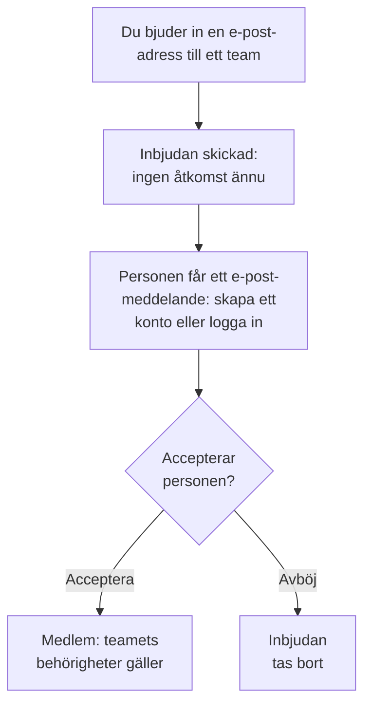

# Bjud in personer

Personer kommer in i ett projekt genom en inbjudan. Du bjuder in en persons e-postadress till ett team, personen accepterar, och därefter bestämmer teamet vad personen kan göra. Den här sidan visar hur du bjuder in personer, vad de ser och hur du ändrar eller avslutar deras åtkomst senare.

:::cards
- [Bjud in någon](#bjud-in-någon): En e-postadress och ett team.
- [Acceptera en inbjudan](#acceptera-en-inbjudan): Vad den inbjudna ser och gör.
- [Ändra någons team](#ändra-någons-team): Ge mer åtkomst, eller mindre.
- [Ta bort någon](#ta-bort-någon-från-projektet): Vad det innebär att lämna projektet.
:::

## Så fungerar en inbjudan

- **Teamet bestämmer vad personen kan göra.** Ingen har egna behörigheter: en person kan göra det som teamen personen är med i tillåter. Se [Användare, team och behörigheter](/docs/permissions/index).
- **Ingenting ges innan personen accepterar.** En väntande inbjudan visas som **Inbjudan skickad** och ger ingen åtkomst till projektet.
- **En accept gäller hela projektet.** När en inbjudan accepteras, accepteras också alla personens andra inbjudningar till samma projekt. En medlem som du senare lägger till i ett annat team är med direkt, utan något att acceptera.

## Innan du börjar

- **En roll som kan bjuda in.** Project Owner, Project Admin eller en roll med behörigheten **Invite New Members**. Du kan bara bjuda in personer till ett team där du själv har behörigheterna, eftersom en inbjudan ger dem teamets åtkomst. En Project Admin utan någon blockering räknas här som innehavare av allt Project Admin redan kan: de kan bjuda in personer till **Members** eller till ett team med en snävare roll, men inte till ett team som har Project Owner, en faktureringsbehörighet, **Delete Project**, **Edit Project**, **Edit Team** eller **Invite New Members**.
- **I OneUptime Cloud: plats i din plan.** Varje person i projektet är en plats på fakturan, från det ögonblick personen bjuds in. Free-planen har plats för en person. Se [Fakturering och användning](/docs/configuration/billing#din-plan-och-dina-platser).
- **Inga SCIM Push Groups.** Så länge din identitetsleverantör styr projektets team via SCIM Push Groups bjuder du in och tar bort personer där, inte i OneUptime.

## Bjud in någon

:::steps
### Öppna Användare

Gå till **Produkter → Inställningar → Användare**. Listan **Användare** visar alla i projektet, deras team och om de har gått med.

### Klicka på Bjud in användare

Klicka på **Bjud in användare**. Dialogen **Bjud in ny användare** öppnas.

### Ange e-postadressen

Skriv adressen i **E-post**. Om inget OneUptime-konto använder den ännu ber dialogen också om ett **Namn**, som det nya kontot börjar med.

### Välj teamet

**Team** börjar på projektets medlemsteam: teamet som har Project Member för hela projektet, annars det som heter Members. Välj ett annat team för att ge mer eller mindre åtkomst. **Team** är tomt när projektet inte har något sådant team, eller när du inte själv kunde bjuda in någon till det.

### Skicka inbjudan

Klicka på **Bjud in**. OneUptime skickar inbjudan via e-post och öppnar personens sida. Personen visas som **Inbjudan skickad** tills inbjudan har accepterats.
:::

> [!TIP]
> Bjud in personer till det minsta team som låter dem göra sitt jobb. Du kan lägga till dem i fler team senare, och varje team de går med i utökar vad de kan göra.

## Acceptera en inbjudan

Inbjudningsmeddelandet nämner projektet. Knappen i det är **Create Your Account** för den som inte har ett OneUptime-konto ännu, och **Sign In to OneUptime** för den som har ett. Efter inloggningen accepterar personen på ett av två ställen:

| Var personen är | Vad personen ser | Vad personen klickar på |
| --- | --- | --- |
| Ännu inte med i något projekt | Inbjudan, på sidan personen kommer till efter inloggningen | **Accept & Join** eller **Decline** |
| Redan med i ett annat projekt | Den väntande inbjudan vid klockan uppe till höger, som öppnar **Projektinbjudningar** | **Acceptera** eller **Avvisa** |

När personen accepterar är den med i projektet direkt, med teamets behörigheter och de aviseringsinställningar som alla medlemmar börjar med: se [Det här börjar du med](/docs/notifications/index#det-här-börjar-du-med). Att avböja tar bort inbjudan, så det krävs en ny för att gå med senare.

## Se vem som är med i projektet

**Användare** har en rad per person:

| Kolumn | Vad den visar |
| --- | --- |
| **Användare** | Namn och e-postadress. |
| **Team** | Vart och ett av projektets team som personen är med i eller inbjuden till. |
| **Status** | **Medlem** när personen har gått med, med antalet inbjudningar till andra team som inte har accepterats ännu. **Inbjudan skickad** fram till dess. |

Filtrera listan efter **Användare**, **Status** eller **Team**. Klicka på en rad för att öppna personens sida:

| Sida | Vad den används till |
| --- | --- |
| **Profil** | Namn, e-postadress, bild och användar-ID. |
| **Team** | Teamen personen är med i. Lägg till eller ta bort ett team här. |
| **Beredskap**, **Aviseringsmetoder**, **Jourregler** | Om personen kan larmas, och hur. Visas för Project Owners, Project Admins, personen själv och alla som kan läsa andras aviseringsregler. Se [Beredskap och rapporter](/docs/on-call/readiness). |
| **Anpassade fält** | Projektets anpassade fält för personer, om det har några. |
| **Ta bort från projekt** | Ta bort personen från projektet. |

## Ändra någons team

:::steps
### Öppna personens Team-sida

Under **Användare** klickar du på personen och sedan på **Team**.

### Lägg till personen i ett team

Klicka på **Bjud in**, välj **Team** och klicka på **Bjud in** i dialogen. En medlem är med i det nya teamet direkt. Den som inte har gått med ännu får en inbjudan till, och när den ena accepteras, accepteras båda.

### Ta bort personen från ett team

Klicka på **Ta bort** i teamets rad. Om det är det sista teamet personen har gått med i tar borttagningen bort personen från projektet, och dialogen säger det innan något ändras.
:::

Owners-teamet behåller alltid minst en medlem som har gått med, så att ett projekt aldrig förlorar sin sista ägare.

## Ta bort någon från projektet

Under **Användare** öppnar du personens radmeny, **⋯**, och klickar på **Ta bort från projekt**. Eller öppna personen och välj **Ta bort från projekt** i sidomenyn. För att ta bort flera personer på en gång markerar du deras rader och tar bort urvalet: var och en tas bort på samma sätt.

Att ta bort någon tar bort personen från alla projektets team. Personen förlorar åtkomsten direkt, även om den är inloggad, tas bort från jourscheman och eskaleringsregler och får inte längre projektets aviseringar. OneUptime-kontot tas inte bort, och du kan bjuda in personen igen. [Användare, team och behörigheter](/docs/permissions/index#användare) visar allt som det innebär att lämna ett projekt.

## Andra sätt att gå med

- **Single sign-on.** Den som loggar in med projektets identitetsleverantör för första gången går med i de team som leverantören anger. Se [Roller och team för SSO-användare](/docs/identity/sso#roller-och-team-för-sso-användare).
- **SCIM.** Din identitetsleverantör skapar personer och lägger till dem i anslutningens standardteam. Se [SCIM](/docs/identity/scim#så-etableras-en-projektanvändare).
- **Admin Dashboard.** På en självhostad installation kan en huvudadministratör lägga till någon i ett projekt och acceptera inbjudan åt personen. Se [Användare, team och behörigheter](/docs/permissions/index#användare).

## Felsökning

:::details "This user has already been invited to this team"
Personen är redan med i teamet, som medlem eller med en inbjudan som inte har accepterats. Öppna personen under **Användare** för att se teamen, eller bjud in personen till ett annat team.
:::

:::details "You have reached the user limit for the free plan"
I OneUptime Cloud har ett projekt på Free-planen plats för en person. Byt plan och bjud in igen. Se [Byt plan](/docs/configuration/billing#byt-plan).
:::

:::details "Too many invitations were sent to this email address in the last hour"
En adress kan få 10 inbjudningar i timmen, till projekt och privata statussidor tillsammans, oavsett vem som skickar dem. Vänta en timme och bjud sedan in personen igen.
:::

:::details Inbjudningsmeddelandet kom aldrig fram, eller länken har gått ut
Inbjudan beror inte på e-postmeddelandet. Be personen registrera sig med den inbjudna adressen: OneUptime skickar en ny länk till den adressen för att slutföra kontot. Den som redan har ett konto loggar in och hittar inbjudan.
:::

:::details Bjud in användare säger att användarna hanteras av SCIM Push Groups
Din identitetsleverantör styr projektets team. Bjud in eller ta bort personer i identitetsleverantören, eller stäng av Push Groups under **Projektinställningar → Säkerhet → SCIM** för att hantera dem här.
:::

## Nästa steg

:::cards
- [Användare, team och behörigheter](/docs/permissions/index): Bestäm vad varje team kan göra.
- [Projektinställningar](/docs/configuration/project-settings): Allt som gäller för hela projektet.
- [Ditt konto](/docs/introduction/your-account): Inloggning, profil och projekten du är med i.
- [SCIM](/docs/identity/scim): Låt din identitetsleverantör hantera personer och team.
:::
