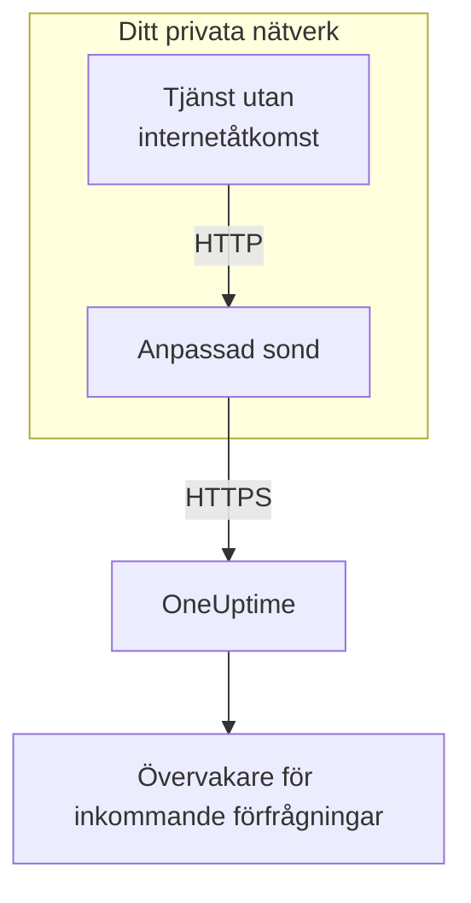

# Ingress för inkommande förfrågningar

En tjänst utan internetåtkomst kan ändå skicka heartbeats till en [övervakare för inkommande förfrågningar](/docs/monitor/incoming-request-monitor). Den skickar dem i stället till en [anpassad sond](/docs/probe/custom-probe) i sitt eget nätverk, och sonden skickar dem vidare till OneUptime.

:::cards
- [Så fungerar det](#så-fungerar-det): Från din tjänst, via sonden, till övervakaren.
- [Slå på lyssnaren](#slå-på-lyssnaren): En enda inställning på sonden, för Docker, Docker Compose eller Kubernetes.
- [Skicka förfrågningar till sonden](#skicka-förfrågningar-till-sonden): Ändra URL:en som din tjänst skickar till, och ingenting annat.
- [Felsökning](#felsökning): Vad sonden loggar när en förfrågan inte kommer fram.
:::

## Så fungerar det



1. **Din tjänst skickar förfrågan till sonden.** Samma `GET` eller `POST`, med samma hemliga nyckel, som den skulle skicka till OneUptime, till en port som sonden lyssnar på.
2. **Sonden svarar direkt.** Den svarar `200` innan den skickar förfrågan vidare, så din tjänst väntar aldrig på OneUptime.
3. **Sonden skickar den vidare.** Den skickar förfrågan vidare till OneUptime med metod, huvuden och body, och lägger till ett huvud `OneUptime-Probe-Id` som anger sonden.
4. **OneUptime läser den som vanligt.** Övervakarens kriterier ser förfrågan som om tjänsten hade skickat den direkt.

Lyssnaren körs på en egen port, skild från sondens hälsokontroller, så du kan öppna den mot ditt privata nätverk utan att öppna något annat.

## När du använder den

Använd lyssnaren när:

- Dina tjänster körs i ett isolerat nätverkssegment utan utgående HTTPS-åtkomst
- Du måste hålla all övervakningstrafik inom ditt VPC eller ditt lokala nätverk
- Du vill ha en enda utgångspunkt, sonden, som får nå OneUptime
- Du redan har driftsatt en [anpassad sond](/docs/probe/custom-probe) och vill återanvända den för inkommande heartbeats

Om dina tjänster redan kan nå `https://oneuptime.com` (eller din självhostade URL) direkt behöver du **inte** den här funktionen: anropa heartbeat-URL:en direkt från tjänsten.

## Innan du börjar

- **En anpassad sond som körs.** Dess **Status** visar **Ansluten**. Se [Anpassade probes](/docs/probe/custom-probe) för att installera en.
- **En övervakare för inkommande förfrågningar.** Dess heartbeat-URL innehåller den hemliga nyckel som din tjänst skickar: se [Övervakning av inkommande förfrågningar](/docs/monitor/incoming-request-monitor).
- **En port på sondens värd som dina tjänster kan nå.** Exemplen använder `3875`.

## Slå på lyssnaren

Sätt `PROBE_INGRESS_PORT` till porten som lyssnaren ska använda. Alla värden större än `0` slår på den; inte satt, eller `0`, lämnar den avstängd.

:::tabs
@tab Docker
```bash
docker run --name oneuptime-probe --network host \
  -e PROBE_KEY=<probe-key> \
  -e PROBE_ID=<probe-id> \
  -e ONEUPTIME_URL=https://oneuptime.com \
  -e PROBE_INGRESS_PORT=3875 \
  -d oneuptime/probe:release
```

Utan `--network host` publicerar du porten med `-p 3875:3875`.
@tab Docker Compose
```yaml title="docker-compose.yml"
services:
  oneuptime-probe:
    image: oneuptime/probe:release
    container_name: oneuptime-probe
    environment:
      - PROBE_KEY=<probe-key>
      - PROBE_ID=<probe-id>
      - ONEUPTIME_URL=https://oneuptime.com
      - PROBE_INGRESS_PORT=3875
    network_mode: host
    restart: always
```

Utan `network_mode: host` publicerar du porten under `ports:` som `"3875:3875"`.
@tab Kubernetes
```yaml title="oneuptime-probe.yaml"
apiVersion: apps/v1
kind: Deployment
metadata:
  name: oneuptime-probe
spec:
  selector:
    matchLabels:
      app: oneuptime-probe
  template:
    metadata:
      labels:
        app: oneuptime-probe
    spec:
      containers:
        - name: oneuptime-probe
          image: oneuptime/probe:release
          env:
            - name: PROBE_KEY
              value: "<probe-key>"
            - name: PROBE_ID
              value: "<probe-id>"
            - name: ONEUPTIME_URL
              value: "https://oneuptime.com"
            - name: PROBE_INGRESS_PORT
              value: "3875"
          ports:
            - name: ingress
              containerPort: 3875
---
apiVersion: v1
kind: Service
metadata:
  name: oneuptime-probe-ingress
spec:
  selector:
    app: oneuptime-probe
  ports:
    - name: ingress
      port: 3875
      targetPort: 3875
  type: ClusterIP
```

Tjänster i klustret skickar då till `http://oneuptime-probe-ingress.<namespace>.svc.cluster.local:3875/heartbeat/<secret-key>`.
:::

När lyssnaren är igång står det i sondens logg `Probe ingress listener started on port 3875 (heartbeat / incoming-request endpoints)`.

## Skicka förfrågningar till sonden

Din tjänst skickar till sonden i stället för till OneUptime. Ersätt den offentliga heartbeat-URL:en:

```text
https://oneuptime.com/heartbeat/<secret-key>
```

med sondens ingress-URL:

```text
http://<probe-host>:<PROBE_INGRESS_PORT>/heartbeat/<secret-key>
```

Sökväg, metod, body och huvuden är annars desamma, så befintlig klientkod behöver bara byta bas-URL. Sonden tar också emot `/incoming-request/<secret-key>`, som fungerar på samma sätt.

```bash
# GET heartbeat
curl http://probe.internal:3875/heartbeat/YOUR_SECRET_KEY

# POST heartbeat with JSON body
curl -X POST http://probe.internal:3875/heartbeat/YOUR_SECRET_KEY \
  -H "Content-Type: application/json" \
  -d '{"status": "healthy", "version": "1.2.3"}'

# Cron job
*/5 * * * * curl -s http://probe.internal:3875/heartbeat/YOUR_SECRET_KEY > /dev/null
```

## Så skickas förfrågningar vidare

| Vad | Hur sonden hanterar det |
| --- | --- |
| Svaret | `200` med ett tomt JSON-objekt (`{}`), skickat innan förfrågan skickas vidare. Som hos OneUptime skickas det vad som än händer sedan: även en felaktig hemlig nyckel får det. |
| Metoder | `POST` skickas vidare som `POST`. `GET`, och `HEAD`, skickas vidare som `GET`. Andra metoder får `404` från sonden. |
| Huvuden | Alla utom hop-by-hop-huvudena (`Host`, `Connection`, `Content-Length`, `Transfer-Encoding`, `Keep-Alive`, `Proxy-Authenticate`, `Proxy-Authorization`, `TE`, `Trailer`, `Upgrade`) och `Content-Encoding`, eftersom sonden vidarebefordrar bodyn okomprimerad. Sonden lägger till `OneUptime-Probe-Id`. |
| Body | JSON- och formulär-body på upp till 50 MB, som när du skickar direkt till OneUptime. Precis som där når varje annan body övervakaren tom. |
| Nya försök | När en vidarebefordran misslyckas försöker sonden igen upp till `PROBE_INGRESS_FORWARD_RETRY_LIMIT` gånger och väntar 2 s, sedan 4 s, sedan 8 s, och aldrig mer än 15 s. Sedan loggar den felet och släpper förfrågan. |
| Proxyer | Vidarebefordran går via sondens proxy när `HTTP_PROXY_URL` eller `HTTPS_PROXY_URL` är satt. |
| Vart den går | `ONEUPTIME_URL` följt av `/incoming-request-ingest/incoming-request/<secret-key>`. |

## Miljövariabler

| Variabel | Standard | Vad den gör |
| --- | --- | --- |
| `PROBE_INGRESS_PORT` | inte satt (av) | Porten som lyssnaren använder. Alla värden större än `0` slår på den. |
| `PROBE_INGRESS_FORWARD_TIMEOUT_MS` | `10000` | Hur lång tid varje vidarebefordran till OneUptime får ta, i millisekunder. Ett värde under `1000` faller tillbaka till standardvärdet. |
| `PROBE_INGRESS_FORWARD_RETRY_LIMIT` | `3` | Hur många gånger en misslyckad vidarebefordran görs om. `0` stänger av nya försök. |

Sondens vanliga variabler (`PROBE_KEY`, `PROBE_ID`, `ONEUPTIME_URL` och proxyvariablerna) gäller alla: se [Anpassade probes](/docs/probe/custom-probe) för hela listan.

## Säkerhetsöverväganden

- **Slutpunkten saknar autentisering med flit**: den hemliga nyckeln i URL-sökvägen *är* autentiseringen, precis som på den offentliga slutpunkten `oneuptime.com`. Behandla den hemliga nyckeln som ett lösenord.
- **Håll lyssnaren på ditt privata nätverk.** Den ska inte kunna nås från internet. Använd en network policy, en brandväggsregel eller en `ClusterIP`-tjänst för att begränsa vem som kan nå den.
- **Sätt TLS framför om du behöver kryptering på ditt nätverk.** Lyssnaren talar vanlig HTTP. Placera den bakom en intern lastbalanserare eller ingress controller för att få TLS på den sträckan. Vidarebefordran från sonden till OneUptime använder HTTPS när `ONEUPTIME_URL` börjar med `https://`.
- **Begränsa body-storleken själv om 50 MB är för mycket.** Placera en omvänd proxy med en lägre gräns framför lyssnaren.

## Felsökning

:::details Sondens logg säger aldrig att lyssnaren har startat
`PROBE_INGRESS_PORT` är inte satt, är `0` eller är inget tal. Sätt den till ett portnummer och starta om sonden. Loggraden är `Probe ingress listener started on port <port> (heartbeat / incoming-request endpoints)`.
:::

:::details Sonden loggar `Probe ingress: failed to forward to <url> after N attempts`
Sonden kunde inte nå OneUptime, inte ens efter sina nya försök. Kontrollera sondens utgående anslutning, dess proxyinställningar och värdet på `ONEUPTIME_URL`. Visar sonden också **Frånkopplad**, se [Anpassade probes](/docs/probe/custom-probe) för att hitta var dess förfrågningar fastnar.
:::

:::details Sonden loggar `Probe ingress: probe ID not available, forwarding without it`
Sonden har inte anslutit klart till OneUptime ännu, så den skickar förfrågan vidare utan huvudet `OneUptime-Probe-Id`. Förfrågan når ändå övervakaren.
:::

:::details Övervakaren får förfrågningarna, men inte via sonden
Din tjänst skickar fortfarande till den offentliga URL:en. Kontrollera att den skickar till `http://<probe-host>:<port>/...`: ett DNS-namn eller en post i `/etc/hosts` som pekar någon annanstans är den vanliga orsaken.
:::

:::details Övervakaren får ingenting, och sonden loggar ingenting
Förfrågan nådde aldrig sonden. Kontrollera att tjänsten kan nå sondens värd på porten: en brandväggsregel, en port som inte är publicerad eller en Kubernetes-Service som inte väljer sondens podd.
:::

## Nästa steg

:::cards
- [Övervakning av inkommande förfrågningar](/docs/monitor/incoming-request-monitor): Bestäm vad som räknas som ett friskt heartbeat.
- [Anpassade probes](/docs/probe/custom-probe): Installera sonden, och se varje inställning den läser.
:::
