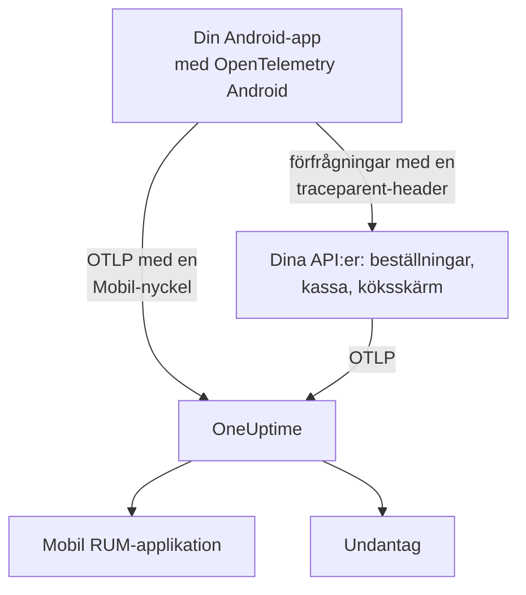

# Android-konfiguration

Instrumentera en inbyggd Android-app med OpenTelemetry Android så att den rapporterar till OneUptime som en mobil RUM-applikation: dess krascher och ANR:er, långsamma och frusna bildrutor, appstarter, skärmar, sessioner och nätverksförfrågningar, spårade hela vägen till din backend.

:::cards
- [Lägg till OpenTelemetry Android](#lägg-till-opentelemetry-android): Ett Gradle-beroende och några rader när appen startar.
- [Vad den rapporterar](#vad-den-rapporterar): Krascher, ANR:er, frusna bildrutor, starter och sessioner, och var de hamnar.
- [Spåra förfrågningar till din backend](#spåra-förfrågningar-till-din-backend): Ett span för varje OkHttp-anrop, med en `traceparent` på det.
- [Spåra dina egna arbetsflöden](#spåra-dina-egna-arbetsflöden): En beställning från menyn till köket, en betalterminal, en skrivare.
- [Kiosker och andra enheter du äger](#kiosker-och-andra-enheter-du-äger): Namnge varje enhet, konfigurera den från din MDM, behåll data medan den är offline.
:::

## Så fungerar det

OpenTelemetry Android körs inne i din app. Den skickar spår, loggar och mätvärden till OneUptime över OTLP med en **Mobil**-intagningsnyckel, fäst vid din app, och lägger till en W3C-header `traceparent` på de förfrågningar som din app gör, så att din backends spans ansluter till appens spår.



## Innan du börjar

- En Android-app vars `minSdk` är 23 eller högre, byggd med `compileSdk` 34 eller högre. Med en `minSdk` under 26 slår du på [core library desugaring](https://developer.android.com/studio/write/java8-support#library-desugaring), med Android Gradle Plugin 8.3.0 eller senare och `android.useFullClasspathForDexingTransform=true` i `gradle.properties`.
- En **Mobil**-intagningsnyckel, skapad under **Projektinställningar → Telemetri och APM → Intagningsnycklar** med **Skapa intagningsnyckel**, med appens `service.name` som **Fäst tjänstnamn**. En **Webbläsare**-nyckel avvisas från en app: Den kontrolleras mot headern `Origin`, som en app inte skickar.
- De här OTLP-inställningarna. Om du driftar OneUptime själv byter du `https://oneuptime.com` mot din egen värd.

| Inställning | Värde |
| --- | --- |
| OTLP-endpoint | `https://oneuptime.com/otlp` |
| Header | `x-oneuptime-token: YOUR_TELEMETRY_INGESTION_TOKEN` |

> [!WARNING]
> Nyckeln följer med i din app, och en app kan packas upp, så utgå från att någon kopierar den. Sätt ett **Fäst tjänstnamn**, en **Gräns för förfrågningar per minut** och ett datum under **Upphör** på nyckelns sida, och byt nyckeln med dina releaser.

## Lägg till OpenTelemetry Android

:::steps
### Lägg till beroendet

```kotlin title="app/build.gradle.kts"
dependencies {
    implementation("io.opentelemetry.android:android-agent:1.8.1")
}
```

Agenten tar med sig instrumenteringen för krascher, ANR:er, långsam rendering, aktiviteter, fragment, nätverk och sessioner. Kolla [dess releaser](https://github.com/open-telemetry/opentelemetry-android/releases) efter en nyare version.

### Starta den när appen startar

```kotlin title="KioskApplication.kt"
import android.app.Application
import io.opentelemetry.android.OpenTelemetryRum
import io.opentelemetry.android.agent.OpenTelemetryRumInitializer

class KioskApplication : Application() {
    lateinit var otelRum: OpenTelemetryRum

    override fun onCreate() {
        super.onCreate()

        otelRum = OpenTelemetryRumInitializer.initialize(this) {
            httpExport {
                baseUrl = "https://oneuptime.com/otlp"
                baseHeaders = mapOf("x-oneuptime-token" to BuildConfig.ONEUPTIME_TOKEN)
            }
            resource {
                put("service.name", "kiosk-ordering")
                put("deployment.environment.name", "production")
            }
        }
    }
}
```

`baseUrl` är endpointen utan signal: Agenten lägger till `/v1/traces`, `/v1/logs` och `/v1/metrics` på den. Sätt `service.name`, annars namnges appen efter sin launcher-etikett. Det är applikationens identitet i OneUptime, så håll det oförändrat från release till release.

Ange klassen i `android:name` för manifestets `<application>`-element. `BuildConfig.ONEUPTIME_TOKEN` står för det ställe där ditt bygge förvarar nyckeln; en flotta kan i stället få den från sin MDM, som [Kiosker och andra enheter du äger](#kiosker-och-andra-enheter-du-äger) visar.

### Starta appen och kontrollera att det kommer in

```bash
curl -i https://oneuptime.com/otlp/v1/validate \
  -H "x-oneuptime-token: YOUR_TELEMETRY_INGESTION_TOKEN"
```

`200` med `"valid": true` betyder att nyckeln godtas. Starta sedan appen och använd den en stund: Den visas under **Produkter → Resurser → Övervakning av verkliga användare**, namngiven efter sitt `service.name`. Agenten skriver telemetrin till disk innan den skickar den, så den första batchen kan ta en minut att komma in.
:::

## Vad den rapporterar

OpenTelemetry Android registrerar allt detta av sig självt. Enhetsattributen som den sätter, `device.model.identifier`, `device.model.name` och `device.manufacturer`, arkiverar appen som en mobil RUM-applikation och fyller dess sida **Klienter**. Den sätter också `os.name`, `os.version` och ett `app.installation.id` för varje installation, och inget `device.id`.

| Vad | Hur agenten skickar det | Var det visas i OneUptime |
| --- | --- | --- |
| Krascher | En `app.crash`-händelse med undantagets typ, meddelande och stackspårning | **Undantag**, som ohanterade |
| ANR:er | En `device.anr`-händelse med huvudtrådens stack, så snart appen slutar svara i ungefär 5 sekunder | **Undantag**, som ohanterade, under typen `ANR` |
| Långsamma och frusna bildrutor | En `app.jank`-händelse med `app.jank.frame_count`, de bildrutor som är långsammare än 16 ms (`app.jank.threshold` är `0.016`) eller 700 ms (`0.7`) | **Loggar**, med `@event.name:app.jank` |
| Appstarter | Ett `AppStart`-span, med `start.type` satt till `cold`, `warm` eller `hot` | **Spår** |
| Skärmar | Ett span för varje steg i en aktivitets eller ett fragments livscykel, och `app.screen.name` på varje span och logg | **Spår** |
| Sessioner | `session.id` på varje span och logg, och händelserna `session.start` och `session.end` | **Spår** och **Loggar**, sökta med `@session.id:` |
| Nätverksändringar | En `network.change`-händelse, och `network.connection.type` på varje span och logg | **Loggar** |

Krascher och ANR:er når **Undantag** som ohanterade, grupperade efter sina stackspårningar, med sessionen de inträffade i. Agenten sparar en krasch till disk medan appen dör och skickar den därifrån, så en krasch som inträffar offline kommer ändå in när appen körs igen med nätverk.

Applikationens sida **Översikt** läser av dessa åt dig: **Sessioner**, **Kraschfria sessioner**, **Krascher**, **ANR:er**, **Appstarter**, **Kallstart (p95)** och **Frusna bildrutor**, som var och en öppnar de undantag, spans eller händelser den räknar. Tills appen skickar appstarter eller bildrutor visar deras diagram vad som slår på dem. Dess sida **Rekommendationer** erbjuder monitorer för krascher, ANR:er, långsamma kallstarter, frusna bildrutor, och en app eller en av dess enheter som slutar rapportera.

Under **Kraschfria sessioner** visar raden samma andel av installationerna: det `app.installation.id` som OpenTelemetry Android 1.1 och senare sätter på varje span och logg, ett id som behålls så länge appen är installerad och därför kan stå för appens användare. För en app med hundratals sessioner i timmen, där en krasch om dagen är normalt, larmar **App Crash Rate** och **App ANR Rate** om andelen av en timmes sessioner som kraschade eller frös, över Android vitals gränser på 1,09 % och 0,47 %, i stället för om varje enskild krasch. **Daily Crash Rate** och **Daily ANR Rate** larmar om andelen av en dags installationer som kraschade eller frös, över samma 1,09 % och 0,47 % av minst 250 installationer: de användarupplevda frekvenser som Android vitals bedömer och Play Console visar.

En session tar slut efter 15 minuter i bakgrunden, eller efter 4 timmar. En app som aldrig går till bakgrunden, som en kiosk, behåller en session i 4 timmar, så spåra varje kunds besök som ett eget span, som [Spåra dina egna arbetsflöden](#spåra-dina-egna-arbetsflöden) visar.

Appens egna `android.util.Log`-anrop blir också loggar när du lägger till `android-log-library` och `android-log-agent` bredvid OkHttp-modulerna nedan: Varje anrops tagg hamnar i `android.log.tag`, och ett anrop med en throwable är ett undantag i **Undantag**. OpenTelemetry Android läser inte Logcat.

## Spåra förfrågningar till din backend

Lägg till OkHttp-instrumenteringen och ByteBuddy-pluginet som den byggs med:

```kotlin title="app/build.gradle.kts"
plugins {
    // ...the plugins your app already applies, then:
    id("net.bytebuddy.byte-buddy-gradle-plugin") version "1.18.15"
}

dependencies {
    implementation("io.opentelemetry.android:android-agent:1.8.1")
    implementation("io.opentelemetry.android.instrumentation:okhttp3-library:1.8.1-alpha")
    byteBuddy("io.opentelemetry.android.instrumentation:okhttp3-agent:1.8.1-alpha")
}
```

Pluginet instrumenterar själva klassen `OkHttpClient`, så varje klient i appen spåras, även de som bibliotek skapar. Varje förfrågan blir ett klient-span som namnges efter sin metod, med sin URL, statuskod och varaktighet, och bär en W3C-header `traceparent`. En backend som är instrumenterad med [OpenTelemetry](/docs/telemetry/open-telemetry) fortsätter spåret från den headern, så beställnings-API:t, kassabryggan och köksskärmstjänsten lägger sina spans i samma spår som trycket på kiosken.

- `HttpURLConnection` har samma par moduler: `httpurlconnection-library` och `httpurlconnection-agent`.
- Utan pluginet omsluter du en klient själv: `OkHttpTelemetry.builder(otelRum.openTelemetry).build().createCallFactory(client)`, från `io.opentelemetry.instrumentation:opentelemetry-okhttp-3.0`.
- Ett span som öppnas i din kod, som i nästa avsnitt, är förälder till de förfrågningar som görs inuti det.

## Spåra dina egna arbetsflöden

Hämta en tracer från agenten och skapa ett span för en kunds beställning, med ett barn-span för varje steg i den. Varje steg har då sin egen varaktighet och sina egna fel, och beställningen säger hur den slutade:

```kotlin title="OrderTrace.kt"
import io.opentelemetry.api.trace.Span
import io.opentelemetry.api.trace.StatusCode
import io.opentelemetry.api.trace.Tracer
import io.opentelemetry.context.Context

class OrderTrace(private val tracer: Tracer) {
    // order.session: from the first tap to the order reaching the kitchen.
    private val order: Span = tracer.spanBuilder("order.session").startSpan()
    private val parent: Context = Context.current().with(order)

    // One step: menu.browse, cart.customize, payment.process, pos.inject.
    fun <T> step(name: String, block: (Span) -> T): T {
        val span = tracer.spanBuilder(name).setParent(parent).startSpan()
        return try {
            span.makeCurrent().use { block(span) }
        } catch (error: Throwable) {
            span.recordException(error)
            span.setStatus(StatusCode.ERROR)
            throw error
        } finally {
            span.end()
        }
    }

    fun complete() = finish("completed")

    fun abandon(reason: String) {
        order.setAttribute("order.abandon_reason", reason)
        finish("abandoned")
    }

    private fun finish(outcome: String) {
        order.setAttribute("order.outcome", outcome)
        order.end()
    }
}
```

```kotlin title="CheckoutFlow.kt"
val order = OrderTrace(otelRum.openTelemetry.getTracer("kiosk.ordering"))

order.step("cart.customize") { span ->
    span.setAttribute("cart.items", cart.size.toLong())
}
order.step("payment.process") { terminal.charge(cart.total) }
order.step("pos.inject") { posApi.submit(cart) } // its OkHttp span is a child
order.complete()
```

Omslut varje anrop till SDK:t för en betalterminal, en skrivare, en skanner eller en NFC-läsare på samma sätt, och ange vilken enhet det var, så att en långsam eller felande enhet blir ett långsamt eller felande span:

```kotlin title="ReceiptPrinter.kt"
order.step("printer.print") { span ->
    span.setAttribute("peripheral.type", "printer")
    span.setAttribute("peripheral.model", printer.model)
    span.setAttribute("peripheral.connection", "usb")
    printer.print(receipt, timeoutMillis = 10_000)
}
```

Attributnamnen väljer du själv: Håll dem likadana i varje app, så att ett filter hittar varje skrivare. Ge varje anrop en timeout, eftersom ett span bara avslutas när dess anrop returnerar. Ett steg som sträcker sig över flera skärmar, som att bläddra i menyn, är ett span som du startar när skärmen öppnas och avslutar när den stängs, med samma förälder. För ett faktum utan varaktighet, som att en skrivare får slut på papper, skickar du en händelse: `otelRum.emitEvent("printer.paper_low")`.

I **Spår** filtrerar du på ett stegs namn för att se hur lång tid det tar och hur ofta det misslyckas, och på `@order.outcome:abandoned` för att hitta de beställningar som aldrig slutfördes.

## Kiosker och andra enheter du äger

### Namnge varje enhet

OneUptime arkiverar en mobilapp per applikation, aldrig per enhet, så en app på tusentals telefoner listar aldrig sina användares telefoner. För enheter du äger namnger du var och en i `host.name`. Varje enhet visas då i **Inventarie** som en värd, bredvid dina andra maskiner, med det märke, den modell och den OS-version som agenten rapporterar, det du lägger till nedan och när den senast sågs:

```kotlin title="KioskApplication.kt"
resource {
    put("service.name", "kiosk-ordering")
    put("host.name", deviceName)
    put("host.serial_number", serialNumber)
    put("device.type", "kiosk")
    put("device.location", "Store 0412")
}
```

Appens telemetri stannar hos dess RUM-applikation, och enheten blir inte en värd i **Värdar**: En app rapporterar inga värdmätvärden, så det skulle inte finnas något att visa där. Enhetens sida i **Inventarie** visar dess egna loggar, spår och undantag, och `@resource.host.name:` hittar dem i **Spår** och **Loggar**. En enhet som inte skickar något på 30 dagar försvinner från **Inventarie**. För att se själva enheten, dess minne, lagring och omstarter och krascherna i alla appar på den, lägger du till [Android-agent](/docs/telemetry/android-agent) och ger den samma namn i dess `device_name`: Enheten blir då också en värd i **Värdar**, och är fortfarande en enda post i **Inventarie**.

### Få veta när en enhet tystnar

Applikationens sida **Rekommendationer** erbjuder **Device Stopped Reporting**: ett larm för varje enhet som inte skickar några spans på en timme efter att ha skickat några den senaste veckan, åtskilda med det `app.installation.id` som agenten sätter. Varje enhets larm namnger enheten efter det `host.name` som dess senaste spans bar, som i [Namnge varje enhet](#namnge-varje-enhet), och efter dess modell, med dess installation bredvid; en enhet som inte skickar något `host.name` namnges bara efter sin installation. Att byta namn på en enhet ändrar bara vad dess larm säger: det är fortfarande en enhet, med ett larm, som löses så snart enheten rapporterar igen. När alla enheter tystnar samtidigt, till exempel när en butiks nätverk går ner, larmar ingen enhet: **App Stopped Reporting** rapporterar det en gång för hela appen.

En kiosk som står kvar på en och samma skärm skickar ingenting förrän någon använder den. Skicka ett span med några minuters mellanrum medan appen körs, så att en oanvänd kiosk inte tas för en som har tystnat:

```kotlin title="KioskHeartbeat.kt"
import android.os.Handler
import android.os.Looper
import io.opentelemetry.api.trace.Tracer

class KioskHeartbeat(private val tracer: Tracer) {
    private val handler = Handler(Looper.getMainLooper())

    private val beat = object : Runnable {
        override fun run() {
            tracer.spanBuilder("kiosk.heartbeat").startSpan().end()
            handler.postDelayed(this, 5 * 60 * 1000L)
        }
    }

    fun start() = handler.post(beat)

    fun stop() = handler.removeCallbacks(beat)
}
```

Starta den när agenten har startat, med `KioskHeartbeat(otelRum.openTelemetry.getTracer("kiosk.heartbeat")).start()`. Ett span var femte minut håller en fungerande kiosk med god marginal inom timmen.

### Konfigurera flottan från din MDM

En app kan läsa Androids hanterade konfigurationer, som varje tjänst för enhetshantering skickar ut till sina enheter. Läs nyckeln och enhetens namn från dem, i stället för att bygga in dem i appen:

```kotlin title="KioskApplication.kt"
import android.content.RestrictionsManager

val restrictions = (getSystemService(RESTRICTIONS_SERVICE) as RestrictionsManager)
    .applicationRestrictions
val token = restrictions.getString("oneuptime_token").orEmpty()
val deviceName = restrictions.getString("device_name") ?: android.os.Build.MODEL
val serialNumber = restrictions.getString("device_serial").orEmpty()
```

Lämna sedan `token` till `baseHeaders` i stället för `BuildConfig.ONEUPTIME_TOKEN`, och `deviceName` och `serialNumber` till resursen ovan. I Esper klistrar du in konfigurationen nedan under appens **Managed Configuration** i en blueprint. Esper fyller i platshållarna på varje enhet, med Esper Agent 8.00.0764 eller senare:

```json title="Managed configuration"
{
  "oneuptime_token": "YOUR_TELEMETRY_INGESTION_TOKEN",
  "device_name": "${esper.deviceName}",
  "device_serial": "${esper.serialNumber}"
}
```

Konvergera enheterna efter en ändring, så att de läser de nya värdena. Deklarera samma nycklar i en `app_restrictions.xml` om din MDM begär ett schema. Esper avvisar en APK som saknar v1-signatur, så signera releasen med v1-schemat utöver v2 eller v3.

### Importera flottan från Esper

Anslut din Esper-tenant till inventariet, så listas varje enhet som Esper registrerar, även de enheter vars app aldrig har startat, med det som bara Esper vet: dess grupp, Android-version, säkerhetspatchnivå, serienummer, batteri, lagring, installerade appar och senaste incheckning. En enhet som slutar checka in visas som offline, med hur länge sedan den senast gjorde det. Se [Importera enheter från Esper](/docs/inventory/overview#importera-enheter-från-esper).

En enhet vars app namnger den som ovan är ett enda objekt med det som appen skickar: `host.name` är dess namn i Esper. OneUptime hittar en enhets objekt efter `host.name` och sedan efter `host.serial_number`, så ge varje enhet samma namn och serienummer i varje app som rapporterar från den, och i inställningarna `device_name` och `device_serial` i Android Agent.

### Behåll det som registreras offline

Agenten skriver varje span, logg och mätvärde till disk innan den skickar dem. Medan nätverket ligger nere behåller den dem där, och skickar dem när det är tillbaka, upp till 18 timmar senare. Den behåller 10 MB; höj det för en enhet som ofta är offline:

```kotlin title="KioskApplication.kt"
diskBuffering {
    maxCacheSize = 50 * 1024 * 1024
}
```

## Felsökning

:::details Appen visas under Tjänster i stället för Övervakning av verkliga användare
OpenTelemetry Android sätter `device.model.identifier` själv, så appen konfigurerades med ett annat SDK, eller så ersattes dess resurs med `resource(Resource)`, som tappar agentens egna attribut. Använd blocket `resource { }`, som kompletterar dem. Tjänsten som redan har skapats blir inte en RUM-applikation, så radera den under **Produkter → Tjänster** när RUM-telemetrin kommer in.
:::

:::details Ingenting kommer in, eller nyckeln avvisas
Kör nyckelkontrollen i [Lägg till OpenTelemetry Android](#lägg-till-opentelemetry-android). En `401` betyder att nyckeln är okänd, återkallad, avstängd eller har gått ut. En **Webbläsare**-nyckel avvisas från en app: Använd en **Mobil**-nyckel. Kontrollera att `baseUrl` slutar på `/otlp`, utan `/v1/traces`: Agenten lägger till sökvägen själv.
:::

:::details En krasch eller en ANR finns inte i Undantag
En krasch sparas medan appen dör, och en ANR så snart huvudtråden har varit fast i ungefär 5 sekunder. Båda väntar på disk tills enheten kan skicka dem, så titta igen efter att appen har körts i en minut med nätverk. Starta agenten högst upp i `onCreate` i din `Application`, före allt som kan krascha, så att dess kraschhanterare är på plats först.
:::

:::details En enhet saknas i Inventarie
Bara en enhet vars app sätter `host.name` listas. Kontrollera värdet i ett spans resursattribut: Ett tomt värde namnger ingen enhet, och två enheter med samma namn blir en rad.
:::

## Nästa steg

:::cards
- [Mobilkonfiguration](/docs/rum/mobile-setup): iOS, React Native och de andra plattformarna.
- [Android-agent](/docs/telemetry/android-agent): Övervaka själva enheten: dess hälsa, omstarter, installerade appar och alla appars krascher.
- [Undantag](/docs/telemetry/exceptions): Triagera de krascher och ANR:er som din app rapporterar.
- [Spårutforskare](/docs/telemetry/traces-explorer): Följ en beställning från kiosken till köket.
- [Hantera applikationer](/docs/rum/applications): Namn, etiketter, ägare och lagring.
:::
