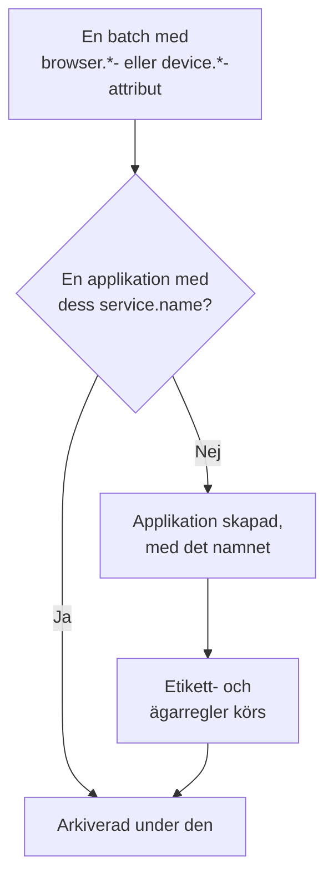

# Hantera applikationer

OneUptime skapar en RUM-applikation första gången telemetrin från din app kommer in. Den här sidan täcker det du hanterar därifrån: applikationens namn, etiketter och ägare, hur länge dess data lagras, arkivering, vem som kan se den och aviseringar.

:::cards
- [Så skapas en applikation](#så-skapas-en-applikation): Känns igen på sitt `service.name` och skapas med sin första batch.
- [Etiketter](#etiketter): Gruppera applikationer och bestäm vem som kan nå dem.
- [Lagring](#lagring): Hur länge telemetri och inspelningar lagras.
- [Behörigheter](#behörigheter): Vem som kan se applikationer och vem som kan titta på inspelningar.
:::

## Så skapas en applikation

Du behöver inte skapa en RUM-applikation. När en batch telemetri med webbläsar- eller enhetsattribut och ett `service.name` kommer in arkiverar OneUptime den under applikationen med det `service.name`, och skapar applikationen om projektet inte har någon.



- `service.name` är applikationens identitet och jämförs utan skillnad på stora och små bokstäver: `Storefront-Web` och `storefront-web` är en enda applikation.
- Ett nytt `service.name` startar en ny applikation. Den gamla behåller sin historik och går över till **Frånkopplad**, den nya börjar tom, och de två slås aldrig ihop.
- Använd ett `service.name` per app, inte ett per miljö. Skilj miljöer åt med en etikett som `oneuptime.label.env=production`, så att de delar en applikation och en historik.

### Byt namn på en applikation

**Visningsnamn** börjar som `service.name`. För att ändra det öppnar du applikationens sida **Inställningar** och klickar på **Redigera detaljer** på kortet **Applikationsdetaljer**, där du också redigerar dess beskrivning och etiketter. Telemetri matchas på **Appnamn (service.name)**, som kortet visar och som aldrig ändras, så det är säkert att byta namn.

### Lägg till en applikation själv

Skapa en applikation själv när du vill att dess etiketter, ägare eller uppspelningspolicy ska vara klara innan den första besökaren kommer.

:::steps
#### Öppna listan över applikationer

Gå till **Produkter → Resurser → Övervakning av verkliga användare** och klicka på **Skapa RUM-applikation**.

#### Ange appnamnet

Fyll i **Appnamn (service.name)** med det `service.name` som din app kommer att skicka, exakt som den skickar det.

#### Ge den ett namn och spara

Applikationen får namnet på sin app, precis som en upptäckt applikation. För att visa ett annat namn öppnar du **Fler fält** och anger ett **Visningsnamn**; beskrivningen och etiketterna finns också där. Spara sedan formuläret.
:::

Sedan öppnas dess installationsguide av sig själv, med appnamnet som kodsnuttens `service.name`. Dess sista steg, **Vänta på anslutningen**, visar när de första data kommer in.

Om projektet redan har en applikation med det `service.name`, upptäckt, tillagd tidigare eller arkiverad, säger formuläret det i stället för att skapa en till.

## Anslutningsstatus

En applikation visar **Ansluten** medan telemetri kommer in och **Frånkopplad** efter 15 minuter utan någon. Både OpenTelemetry-telemetri och trafik från sessionsuppspelning räknas.

**Senast sedd** uppdateras med några minuters mellanrum i stället för vid varje batch, så den kan ligga upp till ungefär fem minuter efter den verkliga trafiken, och de 15 minuterna ger utrymme för det. Tid då OneUptime självt låg nere eller höll på att hinna ikapp sin intagningskö räknas inte.

**Frånkopplad** är inte ett fel i sig: ett internt verktyg utan besökare på natten är verkligen frånkopplat. Om folk använder appen kan du läsa [RUM-felsökning](/docs/rum/troubleshooting).

## Etiketter

Etiketter grupperar applikationer i listor och filter. De avgör också vad en medlem som är begränsad till vissa etiketter kan nå: den medlemmen ser bara applikationer som har någon av de etiketterna. En applikation får etiketter på tre sätt:

| Hur | Var |
| --- | --- |
| Manuellt | I formuläret för att skapa, under **Fler fält**, eller senare med **Redigera detaljer** på kortet **Applikationsdetaljer** på applikationens sida **Inställningar**. För flera på en gång markerar du dem i listan och väljer **Add Labels** under **Massåtgärder**. |
| Från telemetri | Ett resursattribut med namnet `oneuptime.label.<name>` lägger till etiketten `<name>:<value>`, som visas nedan. |
| Från en etikettregel | En regel lägger till etiketter på varje ny applikation som matchar den. Se [Etikettregler och ägarregler](#etikettregler-och-ägarregler). |

Sätt attributen på samma resurs som `service.name`, till exempel i filen `src/telemetry.ts` från [Webbläsarkonfiguration](/docs/rum/browser-setup):

```ts
const resource = defaultResource().merge(
  resourceFromAttributes({
    [ATTR_SERVICE_NAME]: "storefront-web",
    "oneuptime.label.team": "payments",
    "oneuptime.label.env": "production",
  }),
);
```

Det här lägger till etiketterna `team:payments` och `env:production` och skapar dem i projektet om de inte finns. Eftersom attributnamnet står i etiketten hålls `oneuptime.label.team=prod` och `oneuptime.label.env=prod` isär. En etikett som är längre än 100 tecken kortas till 100, och ett tomt värde eller ett värde som inte är en sträng lägger inte till något.

## Etikettregler och ägarregler

En regel lägger till etiketter eller ägare på varje ny applikation som matchar den. Öppna **Övervakning av verkliga användare → Inställningar → Etikettregler**, eller **Ägarregler**, och skapa regeln i två steg:

1. Under **Matcha** matchar **Alla RUM-applikationer**, som en ny regel börjar på, alla applikationer. För att snäva in regeln väljer du **Endast RUM-applikationer som uppfyller villkoren** och lägger till villkor på **Applikationsetiketter** (har någon, alla eller ingen av de etiketter du väljer), **Applikationsnamn** eller **Applikationsbeskrivning** (är lika med, innehåller, börjar med, slutar med eller matchar ett mönster).
2. Under **Etiketter**, eller **Ägare** för en ägarregel, väljer du vad regeln lägger till. En ny regel måste lägga till minst en etikett eller ägare. **Namn** fylls i utifrån det du väljer, som _Add team:payments_ eller _Add Payments as owners_, tills du skriver ett eget. **Beskrivning**, och **Avisera ägare** för en ägarregel, väntar under **Fler fält**.

Regler körs när en applikation skapas, även när den har upptäckts. För att tillämpa en regel på applikationer du redan har öppnar du radens meny **⋯** och väljer **Run Now**: se [Köra regler på befintliga resurser](/docs/configuration/run-rules-now). En regel som en redigering har lämnat utan något att lägga till markeras med **Lägger inte till något** i listan. [Etikett- och ägarregler](/docs/configuration/label-and-owner-rules) täcker de fullständiga formulären.

### Ägare

Ägare är de personer och team som ansvarar för en applikation. Ägarregler lägger till dem på nya applikationer. För att lägga till eller ta bort dem manuellt markerar du applikationer i listan och väljer **Add Owner** eller **Remove Owner** under **Massåtgärder**; API:t lägger till dem via `/rum-application-owner-user` och `/rum-application-owner-team`. Med **Avisera ägare** påslaget, vilket är standard, aviseras varje ägare som en regel lägger till. Stäng av det innan du kör en regel på många applikationer om ingen ska aviseras.

## Lagring

En applikations telemetri och dess inspelningar lagras olika länge:

| Data | Lagras | Ställs in på |
| --- | --- | --- |
| Loggar, mätvärden, spår och profiler | Projektets lagring, om inte applikationen åsidosätter den | Applikationens sida **Inställningar** |
| Inspelningar från sessionsuppspelning | 7 dagar som standard, eller 1, 14, 30 eller 90 dagar | **Replay Policy**, med **Edit Policy → Limits** |

### Lagring av telemetri

Som standard lagras en applikations telemetri under projektets lagringstid, som ställs in under **Projektinställningar → Telemetri och APM → Datalagring**. Två kort på applikationens sida **Inställningar** åsidosätter den:

- **Datalagring för telemetri** innehåller **Behåll telemetridata i (dagar)**, ett värde för all telemetri i applikationen. Lämna det tomt för att använda projektets lagring.
- **Lagring efter telemetrityp** innehåller ett standardvärde för loggar, spår, mätvärden och profiler, och för loggar efter allvarlighetsgrad och spår efter status. Ett värde som lämnas tomt faller tillbaka på applikationens värde och sedan på projektets.

Åsidosättningar av lagring ingår i [Enterprise Edition](/docs/self-hosted/enterprise) och i Scale-abonnemanget och högre på OneUptime Cloud. Utan dem visar korten vad abonnemanget lägger till, och applikationen behåller projektets lagring.

På ett lägre Cloud-abonnemang fortsätter en åsidosättning som finns kvar från en provperiod att gälla för ny telemetri. Sidan **Inställningar** visar den på ett kort **Åsidosättning för lagring** med en knapp **Ta bort åsidosättning**, som fungerar på alla abonnemang: därefter behåller applikationen projektets lagring, och det som redan är lagrat behåller den lagring det lagrades med. Att ställa in en åsidosättning igen kräver Scale-abonnemanget.

### Lagring av sessionsuppspelningar

Inspelningar har sin egen lagring, som ställs in på applikationens sida **Replay Policy** med **Edit Policy → Limits**: 7 dagar som standard, eller 1, 14, 30 eller 90 dagar. Den är kort med avsikt, eftersom en inspelning är mycket känsligare, och mycket större, än ett span. Kortet **Session Replay Retention** på sidan **Inställningar** visar den (_Session replays are kept for 7 days._), och dess knapp **Redigera i Replay Policy** öppnar policyn.

En längre lagring av telemetri behåller inte inspelningar längre. En sessions räkningar, signaler och enhet upphör tillsammans med dess inspelning; bara sessionens loggar, spans och undantag följer telemetrins lagring. Se [Lagring och radering](/docs/telemetry/session-replay#lagring-och-radering).

> [!TIP]
> RUM är ofta den mest omfattande telemetrin i ett projekt, eftersom den växer med dina användare och inte med dina servrar. En kortare lagring här, och en längre på dina backend-tjänster, är en vanlig uppsättning.

## Arkivering och radering

**Arkivera** döljer en applikation i **Alla applikationer** medan den fortsätter att samla in telemetri. Arkivera en applikation som du inte längre bevakar men vars historik du vill behålla.

- Klicka på **Arkivera** på applikationens sida **Inställningar**, eller välj flera applikationer i listan och arkivera dem tillsammans.
- Arkiverade applikationer finns under **Övervakning av verkliga användare → Avancerad → Arkiverad**. **Avancerad** är hopfälld i sidomenyn från början: klicka på den för att visa **Arkiverad**. Använd **Avarkivera** där på en applikation, eller på flera på en gång.

**Radera applikation**, i avsnittet **Avancerad** i applikationens sidomeny, raderar applikationen permanent. Om appen fortfarande skickar telemetri återskapar nästa batch applikationen utan några av dess inställningar, så stoppa instrumenteringen först.

För att radera en persons data i stället för en hel applikation skickar du in en raderingsbegäran: se [Radera sessioner](/docs/telemetry/session-replay#radera-sessioner).

## Behörigheter

Alla med projektets Viewer-roll kan se RUM-applikationer och deras telemetri. Sessionsuppspelning hålls utanför den rollen med avsikt: att lista inspelningar, titta på en och läsa vem som tittade på den är separata behörigheter. Projektägare och administratörer har alla. Behörighetsväljarna visar varje behörighet med dess titel, här visad i kursiv stil.

| Behörighet | Låter en medlem |
| --- | --- |
| `ReadRumApplication` (_Read RUM Application_) | Se applikationer och deras telemetrisidor. |
| `CreateRumApplication`, `EditRumApplication`, `DeleteRumApplication` | Lägga till, redigera och radera applikationer. |
| `ReadRumSessionReplay` (_List Session Replays_) | Lista inspelade sessioner och deras detaljer utan att spela upp dem eller veta vem användaren var. |
| `ReadRumSessionReplayPayload` (_Watch Session Replays_) | Spela upp inspelningar och läsa den identifierade användarens referens och egenskaper. |
| `ReadRumSessionReplayAudit` (_Read Session Replay Audit_) | Läsa **Replay Access Log**: vem som tittade på vilken inspelning. |
| `DeleteRumSessionReplay` (_Delete Session Replays_) | Radera inspelningar. |
| `CreateRumSessionErasureRequest`, `ReadRumSessionErasureRequest` | Skicka in raderingsbegäranden och följa upp dem. |
| `ReadRumApplicationLabelRule`, `ReadRumApplicationOwnerRule` (och deras Create, Edit och Delete) | Hantera etikettregler och ägarregler. |
| `ReadRumApplicationOwnerUser`, `ReadRumApplicationOwnerTeam` (och deras Create, Edit och Delete) | Lägga till och ta bort ägare via API:t. |

En användbar uppdelning: ge en supporttekniker `ReadRumApplication` och `ReadRumSessionReplay`. Hen kan då se vilka sessioner som hade fel utan att se någons skärm eller veta vem användaren var. Ge `ReadRumSessionReplayPayload` bara till de personer som behöver det; medlemmar med `ReadRumSessionReplayAudit` ser då varje visning på applikationens sida **Replay Access Log**. [Vem kan titta på en inspelning](/docs/telemetry/session-replay#vem-kan-titta-på-en-inspelning) visar vad varje behörighet låser upp i sessionslistan och spelaren.

## Aviseringar på RUM-data

RUM-telemetri är vanliga loggar, mätvärden och spår, så det finns ingen separat RUM-övervakning: de vanliga övervakningarna fungerar med den. Det snabbaste sättet att komma igång är applikationens sida **Recommendations**, som erbjuder övervakningar som redan är avgränsade till applikationen:

| Grupp | Rekommendationer |
| --- | --- |
| Core Web Vitals | Poor Largest Contentful Paint, Poor Interaction to Next Paint, Poor Cumulative Layout Shift, Slow First Contentful Paint och Slow Time to First Byte. Se [Core Web Vitals](/docs/rum/web-vitals). |
| Fel | Failed User Operations och Unhandled Browser Exceptions. |
| Sessionsuppspelning | De fyra [aviseringarna för lagringsbudgeten](/docs/telemetry/session-replay#aviseringar-för-lagringsbudgeten), som varnar innan projektets dagliga gräns eller applikationens månadsbudget är förbrukad. De erbjuds så snart applikationen har spelat in en uppspelning, och månadsparet när den också har en månadsbudget. |

För att skapa en egen övervakning väljer du den som läser signalen:

- [Metrikövervakning](/docs/monitor/metrics-monitor): en Core Web Vital, eller något annat mätvärde som din app skickar.
- [Spårningsövervakning](/docs/monitor/traces-monitor): felfrekvens eller latens på klientsidan.
- [Loggövervakning](/docs/monitor/logs-monitor): ett mönster i webbläsarloggar.
- [Undantagsövervakning](/docs/monitor/exceptions-monitor): nya eller snabbt ökande undantag på klientsidan.

Avgränsa övervakningen du skapar till applikationen, så att en backend-tjänst med en liknande signatur inte utlöser den.

## Nästa steg

:::cards
- [Sessionsuppspelning](/docs/telemetry/session-replay): Spela in vad användarna såg, med egen policy och lagring.
- [Etikett- och ägarregler](/docs/configuration/label-and-owner-rules): De två regelformulären, steg för steg.
- [Köra regler på befintliga resurser](/docs/configuration/run-rules-now): Tillämpa en ny regel på de applikationer du redan har.
- [RUM-felsökning](/docs/rum/troubleshooting): När en applikation saknas, är tom eller visar Frånkopplad.
:::
