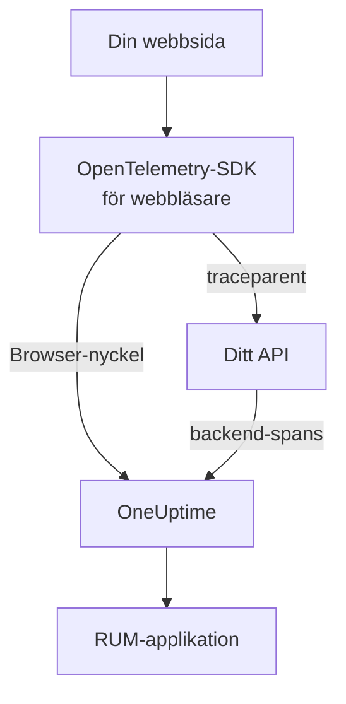

# Webbläsarkonfiguration

Instrumentera en webbapp med OpenTelemetry-SDK:t för webbläsare så att den rapporterar till OneUptime som en RUM-applikation. Sidladdningar och förfrågningar kommer in som spår, och samma konfiguration bär även dina fel, loggar, mätvärden och Core Web Vitals.

:::cards
- [Konfigurera](#konfigurera): Sex steg från en Browser-nyckel till din första sidladdning.
- [Koppla till din backend](#koppla-till-dina-backend-spår): Knyt webbläsarens spans till de backend-spår de startar.
- [Rapportera fel](#rapportera-ohanterade-fel): Skicka ohanterade fel till vyn Undantag.
- [Felsökning](#felsökning): Vad du kontrollerar när ingenting kommer in.
:::

## Så fungerar det

SDK:t körs i dina besökares webbläsare. Det registrerar ett span för varje sidladdning och varje förfrågan och exporterar dem direkt till OneUptime med en **Webbläsare**-intagningsnyckel, utan egen collector eller proxy emellan.



## Innan du börjar

- En webbapp vars kod du kan ändra och distribuera om, med beroenden installerade via npm.
- De ursprung som dina sidor serveras från, till exempel `https://app.example.com`. En Browser-nyckel tar bara emot förfrågningar från de ursprung du anger på den.
- En roll som får skapa intagningsnycklar: Projektägare och -administratörer får det, och det får även alla med behörigheten **Create Telemetry Ingestion Key**.

## Konfigurera

:::steps
### Skapa en Browser-intagningsnyckel

1. Gå till **Produkter → Projektinställningar**.
2. Fäll ut **Telemetri och APM** i sidomenyn och välj **Intagningsnycklar**.
3. Klicka på **Skapa ingestion-nyckel** och välj **Webbläsare** som **Nyckeltyp**.
4. Ange dina ursprung under **Tillåtna ursprung** i steget **Webbläsarinställningar** som en JSON-array, till exempel `["https://app.example.com"]`, och skapa sedan nyckeln. På OneUptime Clouds gratisplan visar ett sista steg **Fakturering** först priset för telemetri.


Den nya nyckeln öppnas på en egen sida. Kopiera dess **Hemlig nyckel**: Det är den token som SDK:t skickar som `x-oneuptime-token`.


### Installera paketen

```bash
npm install @opentelemetry/api \
  @opentelemetry/sdk-trace-web \
  @opentelemetry/resources \
  @opentelemetry/semantic-conventions \
  @opentelemetry/opentelemetry-browser-detector \
  @opentelemetry/exporter-trace-otlp-http \
  @opentelemetry/context-zone \
  @opentelemetry/instrumentation \
  @opentelemetry/instrumentation-document-load \
  @opentelemetry/instrumentation-fetch \
  @opentelemetry/instrumentation-xml-http-request
```

### Skapa telemetrifilen

Skapa `src/telemetry.ts`. `browserDetector` lägger till de `browser.*`-attribut som klassar telemetrin som RUM, och `service.name` namnger applikationen.

```ts title="src/telemetry.ts"
import {
  WebTracerProvider,
  BatchSpanProcessor,
} from "@opentelemetry/sdk-trace-web";
import { OTLPTraceExporter } from "@opentelemetry/exporter-trace-otlp-http";
import { ZoneContextManager } from "@opentelemetry/context-zone";
import { registerInstrumentations } from "@opentelemetry/instrumentation";
import { DocumentLoadInstrumentation } from "@opentelemetry/instrumentation-document-load";
import { FetchInstrumentation } from "@opentelemetry/instrumentation-fetch";
import { XMLHttpRequestInstrumentation } from "@opentelemetry/instrumentation-xml-http-request";
import {
  defaultResource,
  detectResources,
  resourceFromAttributes,
} from "@opentelemetry/resources";
import { browserDetector } from "@opentelemetry/opentelemetry-browser-detector";
import { ATTR_SERVICE_NAME } from "@opentelemetry/semantic-conventions";

const ONEUPTIME_URL = "https://oneuptime.com";
// Public: it ships in your page. It must be a Browser ingestion key.
const ONEUPTIME_TOKEN = "YOUR_TELEMETRY_INGESTION_TOKEN";

/*
 * browserDetector supplies the browser.* attributes. Without them this
 * telemetry is classified as a backend Service, not a RUM application.
 * The attributes set last win, so service.name here overrides the
 * "unknown_service" that defaultResource() provides.
 */
const resource = defaultResource()
  .merge(detectResources({ detectors: [browserDetector] }))
  .merge(
    resourceFromAttributes({
      [ATTR_SERVICE_NAME]: "storefront-web",
    }),
  );

const provider = new WebTracerProvider({
  resource: resource,
  spanProcessors: [
    new BatchSpanProcessor(
      new OTLPTraceExporter({
        url: `${ONEUPTIME_URL}/otlp/v1/traces`,
        headers: { "x-oneuptime-token": ONEUPTIME_TOKEN },
      }),
    ),
  ],
});

provider.register({
  contextManager: new ZoneContextManager(),
});

registerInstrumentations({
  instrumentations: [
    new DocumentLoadInstrumentation(),
    new FetchInstrumentation({
      // See "Linking to your backend traces" before widening this.
      propagateTraceHeaderCorsUrls: [/^https:\/\/api\.example\.com/],
    }),
    new XMLHttpRequestInstrumentation({
      propagateTraceHeaderCorsUrls: [/^https:\/\/api\.example\.com/],
    }),
  ],
});
```

### Importera den först

Gör den till den första importen i din app. Instrumenteringarna patchar `fetch` och `XMLHttpRequest`, och en förfrågan som görs före patchen spåras inte.

```ts
// src/index.tsx (React), src/main.ts (Vue / Angular), etc.
import "./telemetry";
import React from "react";
// ... the rest of your app
```

### Kontrollera nyckeln

Fråga OneUptime om nyckeln godtas innan du letar någon annanstans:

```bash
curl -i https://oneuptime.com/otlp/v1/validate \
  -H "x-oneuptime-token: YOUR_TELEMETRY_INGESTION_TOKEN"
```

`200` med `"valid": true` betyder att nyckeln godtas; för en Browser-nyckel lägger meddelandet till att den bara fungerar från en webbläsare, från ett av dess tillåtna ursprung. `401` betyder att nyckeln är okänd, återkallad, avstängd eller har gått ut.

### Ladda en sida

Öppna din webbplats. Inom en minut visas applikationen under **Produkter → Resurser → Övervakning av verkliga användare**, namngiven efter sitt `service.name`.
:::

## Vad en Browser-nyckel tillåter

Allt i snippetet skickas till dina besökare, så vem som helst kan kopiera token från din sida. En Browser-nyckel begränsar vad en kopia kan göra:

| Inställning | Vad den gör |
| --- | --- |
| **Tillåtna ursprung** | Förfrågningar tas bara emot från dessa ursprung, vart och ett med sitt schema och eventuell port. En värd får börja med ett enda jokertecken `*.`: `https://*.example.com` täcker alla underdomäner till `example.com`, men inte `example.com` självt. |
| **Requests Per Minute Limit** | Ett tak för alla besökare som använder nyckeln: 6000 förfrågningar per minut, om du inte sätter ett eget. |
| **Fäst tjänstnamn** | Tvingar fram `service.name` på allt som nyckeln skriver, så att en kopia inte kan låta sin telemetri se ut att komma från en av dina backend-tjänster. |
| **Upphör** | Efter det här datumet godtas nyckeln inte längre. |
| **Aktiverad** | Stäng av den för att genast stoppa en läckt nyckel. |

En Browser-nyckel skriver OTLP-spår, -loggar och -mätvärden samt sessionsuppspelningar; alla andra intagsvägar avvisar den. Du ändrar inställningarna på nyckelns egen sida. Nyckeltypen kan inte ändras efter att nyckeln har skapats.

> [!WARNING]
> Lägg aldrig en **Server**-nyckel i en sida. En Server-nyckel skriver all slags telemetri varifrån som helst, utan ursprungskontroll, så den som läser din sida skulle kunna skriva in i ditt projekt.

## Sätt `browser.*` utan detektorn

`browserDetector` läser [UA Client Hints-API:t](https://wicg.github.io/ua-client-hints/), som bara Chromium-webbläsare har. I Safari och Firefox sätter den `browser.language` och `user_agent.original`, men inte `browser.platform`, `browser.brands` eller `browser.mobile`.

Det räcker ändå för att klassa telemetrin som RUM, eftersom `browser.language` ensamt markerar en batch som webbläsar-RUM. Sidan **Klienter** listar dock plattformar utifrån `browser.platform`, så besök från Safari och Firefox lägger inte till någon rad där.

För att hoppa över detektorn, eller för att ge varje webbläsare en plattform, sätter du attributen själv:

```ts
const resource = defaultResource().merge(
  resourceFromAttributes({
    [ATTR_SERVICE_NAME]: "storefront-web",
    // browser.language or browser.platform marks the telemetry as browser RUM.
    "browser.language": navigator.language,
    "browser.platform":
      (navigator as any).userAgentData?.platform ?? "unknown",
    "browser.mobile": (navigator as any).userAgentData?.mobile ?? false,
    "user_agent.original": navigator.userAgent,
  }),
);
```

Håll `browser.platform` grovt. Varje distinkt värde blir en rad på sidan **Klienter**, så en fullständig user-agent-sträng eller ett värde per användare ger en oändlig lista där och är dessutom ett integritetsproblem.

## Spåra routebyten

`DocumentLoadInstrumentation` spårar bara den första laddningen. I en ensidesapp förblir routebyten osynliga tills du registrerar dem, vilket kräver några rader i din router:

```ts
import { trace } from "@opentelemetry/api";

const tracer = trace.getTracer("app-router");

function onRouteChange(to: string): void {
  const span = tracer.startSpan("route-change", {
    attributes: { "app.route": to },
  });
  // End it when the route's data has loaded and the view has painted.
  requestAnimationFrame(() => {
    return span.end();
  });
}
```

Lägg till `@opentelemetry/instrumentation-user-interaction` för att även spåra klick och andra DOM-händelser. För INP per route, se [Ensidesappar](/docs/rum/web-vitals#ensidesappar).

## Koppla till dina backend-spår

`propagateTraceHeaderCorsUrls` avgör vilka förfrågningar mellan ursprung som får en W3C-header `traceparent`, som knyter webbläsarens span till det backend-spår det startade. Förfrågningar till sidans eget ursprung får den utan någon konfiguration.

> [!WARNING]
> Sätt den inte till `/.*/`. Headern gör en enkel förfrågan mellan ursprung till en med preflight, så varje tredjeparts-API som inte har `traceparent` i sin `Access-Control-Allow-Headers` börjar misslyckas.

Ange bara ursprung som du kontrollerar och har konfigurerat:

```ts
new FetchInstrumentation({
  propagateTraceHeaderCorsUrls: [
    /^https:\/\/api\.example\.com/,
    /^https:\/\/auth\.example\.com/,
  ],
});
```

Med [Sessionsuppspelning](/docs/telemetry/session-replay) installerat bär förfrågningar till ditt eget ursprung även uppspelningens sessions-id, som arkiverar din backend-telemetri under inspelningen: se [Koppla spår till sessionsuppspelning](#koppla-spår-till-sessionsuppspelning).

## Koppla spår till sessionsuppspelning

Om du också kör [Sessionsuppspelning](/docs/telemetry/session-replay) ansluter telemetrin från din **backend** till inspelningen utan kod här. Medan en session laddas upp lägger inspelaren till en `tracestate`-medlem med sessions-id:t på de förfrågningar som din sida gör till sitt eget ursprung, och lämnar `traceparent` till din `FetchInstrumentation` / `XMLHttpRequestInstrumentation`. Din backends spans får sessions-id:t vid intaget, i varje tjänst som för W3C-spårkontexten vidare, och dess loggar och undantag ansluter till inspelningen via spår-id:t. Se [Korrelera med resten av din telemetri](/docs/telemetry/session-replay#korrelera-med-resten-av-din-telemetri) för hur det fungerar, vad det inte täcker och reglaget som stänger av det.

Inspelaren läser också tillbaka den `traceparent` som dina instrumenteringar sätter, oavsett om anropet skickar en URL (med eller utan init-objekt) eller ett `Request`-objekt, så att varje förfrågningsrad i uppspelningen länkar till sitt backend-spår. Ett API på ett annat ursprung anger du i `propagateTraceHeaderCorsUrls` ovan; dess förfrågningar bär inget sessions-id och ansluter till inspelningen via spår-id:t. **Ursprung för spårvidarebefordran** i applikationens uppspelningspolicy gör samma sak för sidor *utan* detta SDK.

Det som headrarna inte når är detta SDK:s egna webbläsar-spans: dokumentladdningar, routebyten och de fel du rapporterar. För att även arkivera dem under inspelningen sätter du `session.id` på varje span när det startar. Inspelaren ger dig id:t via `onSessionChange`, som utlöses direkt om en session redan finns och igen varje gång id:t ändras: när besökaren kommer tillbaka efter 30 minuters inaktivitet, vid taket på 4 timmar, när `identify()` anger en annan användare, eller när en annan flik hos samma besökare ändrade det först.

```ts title="src/replaySession.ts"
import type { Context } from "@opentelemetry/api";
import type {
  ReadableSpan,
  Span,
  SpanProcessor,
} from "@opentelemetry/sdk-trace-web";

declare global {
  interface Window {
    OneUptimeReplayQueue?: Array<Array<unknown>>;
  }
}

let replaySessionId: string | null = null;

// The recorder script loads asynchronously. The queue is applied the
// moment it starts and stays live afterwards, so this works either way.
(window.OneUptimeReplayQueue = window.OneUptimeReplayQueue || []).push([
  "onSessionChange",
  (sessionId: string): void => {
    replaySessionId = sessionId;
  },
]);

export class ReplaySessionSpanProcessor implements SpanProcessor {
  public onStart(span: Span, _parentContext: Context): void {
    if (replaySessionId) {
      span.setAttribute("session.id", replaySessionId);
    }
  }

  public onEnd(_span: ReadableSpan): void {}

  public forceFlush(): Promise<void> {
    return Promise.resolve();
  }

  public shutdown(): Promise<void> {
    return Promise.resolve();
  }
}
```

Lägg den sedan först bland providerns span-processorer i `src/telemetry.ts`:

```ts
import { ReplaySessionSpanProcessor } from "./replaySession";

const provider = new WebTracerProvider({
  resource: resource,
  spanProcessors: [
    new ReplaySessionSpanProcessor(),
    new BatchSpanProcessor(
      new OTLPTraceExporter({
        url: `${ONEUPTIME_URL}/otlp/v1/traces`,
        headers: { "x-oneuptime-token": ONEUPTIME_TOKEN },
      }),
    ),
  ],
});
```

Spans som startas därefter bär id:t, uppspelarens flik **Spår** listar dem på inspelningens klocka, och vart och ett av dem länkar i instrumentpanelen tillbaka till ögonblicket i uppspelningen. En span-processor stämplar varje span med det id som gällde när det startade; att skriva id:t i `resource.attributes` i stället skulle märka om spans som fortfarande väntade i exportbatchen när sessionen byttes. Lyssnaren får id:t så snart inspelaren startar, före samtycke eller en inspelningsutlösare, så om det spelar roll bör du stämpla först när din sida har samtycke.

## Content Security Policy

Om din webbplats skickar en Content Security Policy blockerar webbläsaren exportörens förfrågningar tills du tillåter OneUptime i `connect-src`. Ingenting misslyckas synligt: Sidan rapporterar helt enkelt ingenting.

```text
connect-src 'self' https://oneuptime.com;
```

Slå ihop det med ditt befintliga `connect-src`-direktiv. Om du driftar OneUptime själv använder du din egen värd.

## Rapportera ohanterade fel

OpenTelemetry-SDK:t för webbläsare fångar inte ohanterade fel. Rapportera dem själv, så visas de under **Undantag** bredvid dina backend-fel:

```ts
import { trace, SpanStatusCode } from "@opentelemetry/api";

const tracer = trace.getTracer("app-errors");

window.addEventListener("error", (event: ErrorEvent) => {
  const span = tracer.startSpan("window.onerror");
  span.recordException(event.error ?? new Error(event.message));
  span.setStatus({ code: SpanStatusCode.ERROR });
  span.end();
});

window.addEventListener("unhandledrejection", (event: PromiseRejectionEvent) => {
  const span = tracer.startSpan("unhandledrejection");
  span.recordException(
    event.reason instanceof Error ? event.reason : new Error(String(event.reason)),
  );
  span.setStatus({ code: SpanStatusCode.ERROR });
  span.end();
});
```

Med [Sessionsuppspelning](/docs/telemetry/session-replay) fångar inspelaren också ohanterade fel och markerar dem på uppspelningens tidslinje. Undantagets sida visar då ett kort **Watch what the user saw**, som öppnar uppspelningen tio sekunder före felet. Med standardpolicyn spelas varje session in, oavsett om något går fel eller inte; felet avgör bara var kortet öppnas.

## Lägg till loggar och mätvärden

Spår räcker för att fylla översikten. Lägg till pipelines för loggar och mätvärden när du vill ha webbläsarloggar i OneUptime, eller för att skicka [Core Web Vitals](/docs/rum/web-vitals):

```bash
npm install @opentelemetry/api-logs @opentelemetry/sdk-logs \
  @opentelemetry/exporter-logs-otlp-http \
  @opentelemetry/sdk-metrics @opentelemetry/exporter-metrics-otlp-http
```

```ts
import { LoggerProvider, BatchLogRecordProcessor } from "@opentelemetry/sdk-logs";
import { OTLPLogExporter } from "@opentelemetry/exporter-logs-otlp-http";
import { MeterProvider, PeriodicExportingMetricReader } from "@opentelemetry/sdk-metrics";
import { OTLPMetricExporter } from "@opentelemetry/exporter-metrics-otlp-http";
import { logs } from "@opentelemetry/api-logs";
import { metrics } from "@opentelemetry/api";

const headers = { "x-oneuptime-token": ONEUPTIME_TOKEN };

logs.setGlobalLoggerProvider(
  new LoggerProvider({
    resource: resource,
    processors: [
      new BatchLogRecordProcessor({
        exporter: new OTLPLogExporter({
          url: `${ONEUPTIME_URL}/otlp/v1/logs`,
          headers,
        }),
      }),
    ],
  }),
);

metrics.setGlobalMeterProvider(
  new MeterProvider({
    resource: resource,
    readers: [
      new PeriodicExportingMetricReader({
        exporter: new OTLPMetricExporter({
          url: `${ONEUPTIME_URL}/otlp/v1/metrics`,
          headers,
        }),
        exportIntervalMillis: 30000,
      }),
    ],
  }),
);
```

Bygg dem med samma `resource`-objekt. En pipeline för loggar eller mätvärden vars resurs saknar `browser.*` arkiveras som en separat backend-tjänst.

## Endpoint-referens

| Signaltyp | Endpoint | Header |
| --- | --- | --- |
| Spår | `POST {host}/otlp/v1/traces` | `x-oneuptime-token: <token>` |
| Mätvärden | `POST {host}/otlp/v1/metrics` | `x-oneuptime-token: <token>` |
| Loggar | `POST {host}/otlp/v1/logs` | `x-oneuptime-token: <token>` |

`{host}` är `https://oneuptime.com`, eller din egen värd om du kör OneUptime själv; ändra den i OTLP-URL:erna och i posten i Content Security Policy. OneUptime tar emot OTLP/JSON och OTLP/protobuf. Endpointen svarar på förfrågningar mellan ursprung från vilket ursprung som helst och tillåter headern `x-oneuptime-token`, så en webbläsare exporterar direkt till dem.

## Felsökning

:::details Ingen förfrågan till OneUptime på fliken Nätverk
Öppna webbläsarens utvecklarverktyg, gå till fliken Nätverk och filtrera på `otlp`: Du letar efter `POST /otlp/v1/traces`. Ingen förfrågan alls betyder att SDK:t aldrig startade:

- `telemetry.ts` är inte den första importen, eller så har din bundler tagit bort den.
- Batchprocessorn har inte exporterat än. Den väntar några sekunder för att fylla en batch, så vänta, eller gå till en annan sida, innan du drar slutsatsen att ingenting skickas.
- En miljövariabel från bygget blev `undefined`, så exportörens URL är trasig. Logga URL:en en gång vid start.
:::

:::details Webbläsaren blockerar förfrågan
- Ett fel från Content Security Policy i konsolen betyder att `connect-src` ännu inte tillåter OneUptime: se [Content Security Policy](#content-security-policy).
- Ett CORS-fel betyder nästan alltid att förfrågan aldrig nådde OneUptime, vars endpoints tillåter alla ursprung: Leta efter en företagsproxy, en annonsblockerare eller ett stavfel i värden.
:::

:::details OneUptime avvisar förfrågan
- `422` med `Origin https://app.example.com is not allowed for this browser ingestion key.` betyder att sidans exakta ursprung (schema, värd och port) saknas i nyckelns **Tillåtna ursprung**.
- `422` med `This telemetry ingestion key has been disabled.` betyder att någon har stängt av nyckeln. Slå på den igen, eller använd en annan nyckel.
- `401` betyder att nyckeln är okänd, återkallad eller har gått ut. Kör nyckelkontrollen i [Konfigurera](#konfigurera) och skapa sedan en giltig Browser-nyckel.
- `404` betyder att URL:en är fel. Spårexportören behöver hela sökvägen, `/otlp/v1/traces`.
:::

:::details Appen visas under Tjänster i stället för Övervakning av verkliga användare
Resursen saknar `browser.*`-attribut, så telemetrin arkiverades som en backend-tjänst. Lägg till `browserDetector`, eller sätt attributen som i [Sätt `browser.*` utan detektorn](#sätt-browser-utan-detektorn).

Kontrollera på fliken Nätverk, i förfrågans nyttolast, vad du skickar: `resourceSpans[0].resource.attributes` är listan som avgör det. Tjänsten som redan har skapats blir inte en RUM-applikation, så radera den under **Produkter → Tjänster** när RUM-telemetrin kommer in.
:::

:::details Sidan Klienter är tom i Safari eller Firefox
Klientrader kommer från `browser.platform`, som `browserDetector` bara sätter i Chromium-webbläsare. Sätt det själv för att lista besök från Safari och Firefox: se [Sätt `browser.*` utan detektorn](#sätt-browser-utan-detektorn).
:::

## Nästa steg

:::cards
- [Core Web Vitals](/docs/rum/web-vitals): Skicka LCP, INP, CLS, FCP och TTFB från samma sida.
- [Sessionsuppspelning](/docs/telemetry/session-replay): Spela in vad användaren såg, bredvid dessa spår.
- [Hantera applikationer](/docs/rum/applications): Namn, etiketter, ägare och lagring.
- [RUM-felsökning](/docs/rum/troubleshooting): Varje kontroll, i den ordning problem brukar uppstå.
:::
