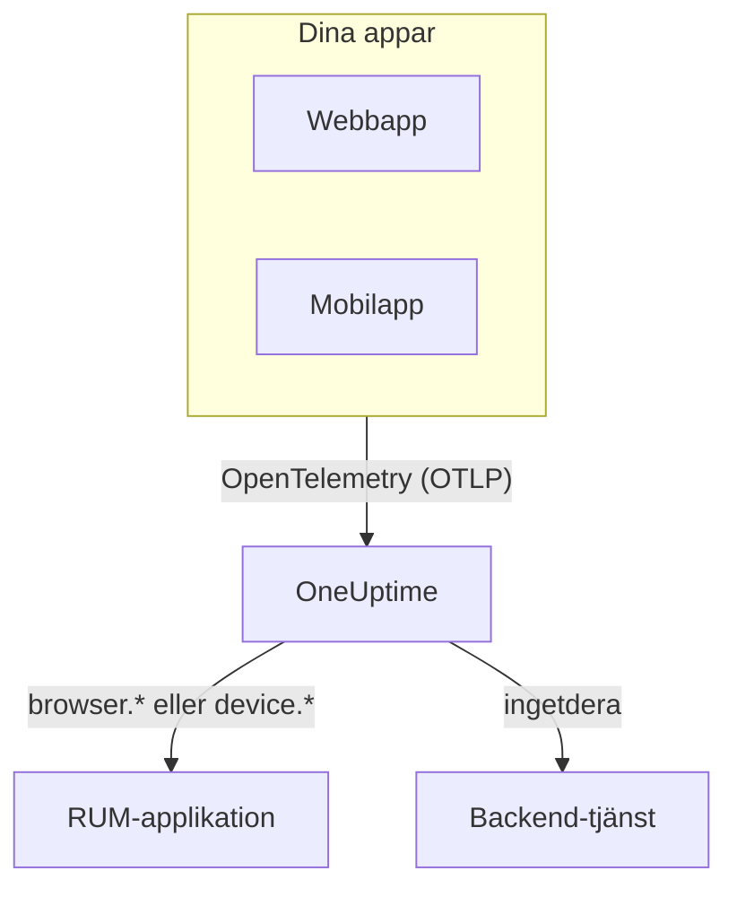

# RUM – Översikt

Övervakning av verkliga användare (RUM) visar vad riktiga användare upplever i dina webb- och mobilappar: sidladdningar, förfrågningar, fel och Core Web Vitals, rapporterade av appen själv i stället för av en sond. OneUptime samlar den telemetrin i en RUM-applikation som du kan visa i diagram, söka i och bevaka med larm.

:::cards
- [Så fungerar det](#så-fungerar-det): En OpenTelemetry-pipeline, klassad som RUM när den kommer in.
- [Så känner OneUptime igen RUM](#så-känner-oneuptime-igen-rum): Resursattributen som avgör det.
- [Det här får du](#det-här-får-du): Översikten, vitals, utforskarna och uppspelningarna.
- [Kom igång](#kom-igång): Från en intagningsnyckel till din första sidladdning.
:::

## Så fungerar det

RUM använder samma OpenTelemetry-pipeline som resten av OneUptime. Det finns ingen RUM-agent och inget eget överföringsformat: Du riktar ett OpenTelemetry-SDK för webbläsare eller mobil mot OneUptime, och telemetrin klassas som RUM när den kommer in.

- **En applikation per app.** Dess identitet är det `service.name` som ditt SDK rapporterar, och OneUptime skapar applikationen vid första telemetribatchen.
- **Räknas aldrig två gånger.** Klienttelemetri hör bara till sin RUM-applikation; den visas inte också som backend-tjänst.
- **Session Replay är ett separat, valfritt lager.** Det har ett eget snippet och egna sekretessinställningar: se [Sessionsuppspelning](/docs/telemetry/session-replay).

## Var du hittar det

Öppna **Produkter → Resurser → Övervakning av verkliga användare**. **Alla applikationer** listar dina applikationer med **Klienttyp**, **Status** och **Senast sedd**. Två andra avsnitt i sidomenyn är hopfällda från början:

- **Inställningar**: **Ägarregler**, **Etikettregler** och projektets gemensamma **Session Replay**-reglage.
- **Avancerad**: **Arkiverad**, de applikationer du har arkiverat.

En applikations egen sidomeny grupperar dess sidor så här; **Inställningar**, **Utvecklare** och **Avancerad** är hopfällda från början:

| Avsnitt | Sidor |
| --- | --- |
| **Grundläggande** | **Översikt**, **Recommendations**, **Dokumentation** |
| **Observerbarhet** | **Mätvärden**, **Loggar**, **Spår**, **Klienter** |
| **Session Replay** | **Session Replay**, **User Flows**, **Replay Users**, **Health**, **Replay Policy**, **Replay Access Log**, **Dokumentation** |
| **Inställningar** | **Inställningar** |
| **Utvecklare** | **Terraform**, **API**, **AI-assistenter** |
| **Avancerad** | **Radera applikation** |

## Så känner OneUptime igen RUM

De flesta frågor av typen ”min app dyker inte upp” slutar här. OneUptime avgör för varje telemetribatch när den kommer in, utifrån batchens **resursattribut**:

1. En batch vars resurs har `browser.platform`, `browser.language` eller ett icke-tomt `browser.brands` är **webbläsar**-RUM.
2. Annars är en batch med `device.id` eller `device.model.identifier` **mobil**-RUM.
3. Annars är en batch med `device.manufacturer` och utan värdidentitet (`host.name`, `host.id` eller `k8s.node.name`) också **mobil**-RUM.
4. Allt annat är en backend-tjänst.

Backend-SDK:er sätter aldrig `browser.*`, `device.id` eller `device.model.identifier`, så det är tydliga signaler. `device.manufacturer` är undantaget: En värds inventarie rapporterar också en maskins tillverkare med det, så det räknas bara på en resurs utan värdidentitet. Se [Inventarieattribut](/docs/telemetry/host-otel-collector#inventarieattribut-ip-mac-serienummer-tillverkare-modell-firmware).

| Attribut | Krävs | Vad det gör |
| --- | --- | --- |
| `service.name` | **Ja** | Applikationens identitet, till exempel `storefront-web`. Utan det skapas ingen RUM-applikation. |
| `browser.platform`, `browser.language`, `browser.brands` | Ett av dem, på webben | Markerar batchen som webbläsar-RUM. `browser.platform` fyller också sidan **Klienter**. |
| `device.id`, `device.model.identifier` | Ett av dem, på mobil | Markerar batchen som mobil-RUM. `device.model.identifier` fyller också sidan **Klienter**. |
| `device.manufacturer` | Nej | Markerar bara batchen som mobil-RUM när resursen saknar värdidentitet. |
| `telemetry.sdk.language` | Nej | Visas i översikten, till exempel `webjs` eller `swift`. |
| `telemetry.sdk.version` | Nej | Visas som SDK-version; saknas det läses `oneuptime.agent.version`. |
| `oneuptime.label.<name>` | Nej | Lägger till projektetiketten `<name>:<value>` på applikationen. |

OneUptime hittar applikationen utifrån `service.name`, utan hänsyn till skiftläge, och skapar den när projektet inte har någon. Ett nytt `service.name` startar en ny applikation, så håll det stabilt och skilj på miljöer med en etikett i stället för med ett nytt namn. [Hantera applikationer](/docs/rum/applications) tar upp namn, etiketter, ägare och lagring.

> [!IMPORTANT]
> OpenTelemetry-SDK:t för webbläsare lägger inte till några `browser.*`-attribut om du inte lägger till webbläsarens resursdetektor eller sätter dem själv. Med bara `service.name` blir telemetrin en backend-tjänst, inte en RUM-applikation. [Webbläsarkonfiguration](/docs/rum/browser-setup) visar båda sätten.

## Det här får du

| Var | Vad det visar |
| --- | --- |
| **Översikt** | Rutor för **Page loads**, **Page load time (p95)**, **Händelser**, **Felfrekvens**, **Event duration (p95)**, **Undantag**, **Klienter** och **Sessions recorded**, och trenddiagram över det tidsintervall du väljer. |
| **Core Web Vitals** | Ett kort i översikten med LCP, INP, CLS, FCP och TTFB, var och en bedömd mot Googles gränser, och INP för varje route i en ensidesapp. Se [Core Web Vitals](/docs/rum/web-vitals) och [Ensidesappar](/docs/rum/web-vitals#ensidesappar). |
| **Mätvärden**, **Loggar**, **Spår** | Telemetriutforskarna, begränsade till den här applikationen. |
| **Klienter** | De webbläsarplattformar och enhetsmodeller som applikationen har använts på: en kort lista per plattform, aldrig en rad per användare. |
| **Session Replay** | Inspelningar av riktiga sessioner, bredvid deras fel, spår och loggar: se [Sessionsuppspelning](/docs/telemetry/session-replay). |
| **Recommendations** | Färdiga övervakare för applikationen: dåliga Core Web Vitals, misslyckade förfrågningar, webbläsarundantag och, så snart den spelar in, budgetar för Session Replay. |

Siffrorna kommer från de spans som din instrumentering skickar. **Page loads** räknar det `documentLoad`-span som instrumenteringen för sidladdning registrerar vid varje fullständig laddning, så ett routebyte i en ensidesapp är ingen sidladdning.

En applikation visar **Ansluten** så länge telemetri kommer in och **Frånkopplad** efter 15 minuter utan. Tid då OneUptime självt var nere eller betade av sin intagningskö räknas inte in i de 15 minuterna.

## Kom igång

:::steps
### Skapa en intagningsnyckel

Öppna **Projektinställningar → Telemetri och APM → Intagningsnycklar** och klicka på **Skapa ingestion-nyckel**. En webbapp behöver en **Browser**-nyckel, som bara fungerar från de ursprung du anger. En mobilapp behöver en **Server**-nyckel, eftersom ett mobil-SDK inte skickar någon `Origin`-header.

### Instrumentera din app

Följ [Webbläsarkonfiguration](/docs/rum/browser-setup) för en webbapp, eller [Mobilkonfiguration](/docs/rum/mobile-setup) för Android, iOS, React Native och andra plattformar.

### Öppna en sida

Ladda en sida på din webbplats eller starta din app. Applikationen visas under **Produkter → Resurser → Övervakning av verkliga användare** vid första telemetribatchen, namngiven efter sitt `service.name`. Du behöver inte skapa den först.

### Lägg till vitals och uppspelningar

När grunderna kommer in skickar du [Core Web Vitals](/docs/rum/web-vitals) och lägger till [Sessionsuppspelning](/docs/telemetry/session-replay). Båda är valfria.
:::

Om ingenting dyker upp går [RUM-felsökning](/docs/rum/troubleshooting) igenom orsakerna i den ordning de brukar uppstå.

## Nästa steg

:::cards
- [Webbläsarkonfiguration](/docs/rum/browser-setup): Instrumentera en webbapp med OpenTelemetry-SDK:t för webbläsare.
- [Mobilkonfiguration](/docs/rum/mobile-setup): Android, iOS, React Native och alla andra OpenTelemetry-SDK:er.
- [Core Web Vitals](/docs/rum/web-vitals): Skicka LCP, INP, CLS, FCP och TTFB, och läs INP route för route.
- [Sessionsuppspelning](/docs/telemetry/session-replay): Se vad användaren såg, bredvid användarens fel och spår.
:::
