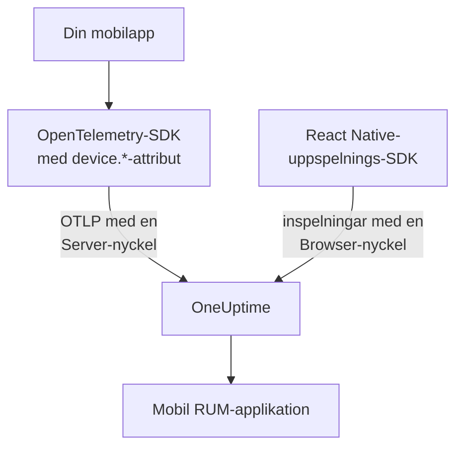

# Mobilkonfiguration

Instrumentera en Android-, iOS- eller React Native-app med OpenTelemetry så att den rapporterar till OneUptime som en mobil RUM-applikation. Alla andra plattformar med ett OpenTelemetry-SDK fungerar på samma sätt.

:::cards
- [Vad OneUptime behöver](#vad-oneuptime-behöver): Två resursattribut, skickade med en Server-nyckel.
- [Konfigurera din plattform](#konfigurera-din-plattform): Android, iOS, React Native och resten.
- [Kontrollera att det kommer in](#kontrollera-att-det-kommer-in): Testa nyckeln och hitta sedan appen.
- [Session Replay på mobil](#session-replay-på-mobil): Inspelningar för React Native-appar.
:::

## Så fungerar det

Din app exporterar OTLP direkt till OneUptime med en **Server**-intagningsnyckel. Det är `device.*`-attributen på dess resurs som klassar den som mobil-RUM i stället för som backend-tjänst.



## Vad OneUptime behöver

Två resursattribut, på varje batch som din app exporterar:

| Attribut | Vad det är |
| --- | --- |
| `service.name` | Applikationens identitet, till exempel `storefront-android`. |
| `device.id` eller `device.model.identifier` | Markerar telemetrin som mobil-RUM. `device.model.identifier` fyller också sidan **Klienter**. |

Utan ett enhetsattribut kommer telemetrin ändå in och du kan fråga efter den, men den arkiveras som en backend-tjänst i stället för en RUM-applikation.

`device.manufacturer` markerar också en batch som mobil, men bara på en resurs utan värdidentitet, eftersom en värds inventarie rapporterar en maskins tillverkare med det. Sätt även `device.id` eller `device.model.identifier`, som varje recept nedan gör, så spelar det aldrig någon roll.

Gör `device.id` till ett id per installation, aldrig ett annons-id eller något annat som identifierar en person. OneUptime läser det bara för att känna igen mobiltelemetri.

## Innan du börjar

- En app med ett OpenTelemetry-SDK: OpenTelemetry Java SDK eller OpenTelemetry Android, opentelemetry-swift eller OpenTelemetry JavaScript SDK för React Native.
- En **Server**-intagningsnyckel, skapad under **Projektinställningar → Telemetri och APM → Intagningsnycklar** med **Skapa ingestion-nyckel**. En **Browser**-nyckel avvisas från en mobilapp: Den kontrolleras mot headern `Origin`, som mobil-SDK:er inte skickar.
- De här OTLP-inställningarna. Om du driftar OneUptime själv byter du `https://oneuptime.com` mot din egen värd.

| Inställning | Värde |
| --- | --- |
| OTLP-endpoint | `https://oneuptime.com/otlp` |
| Header | `x-oneuptime-token: YOUR_TELEMETRY_INGESTION_TOKEN` |
| Spår | `POST https://oneuptime.com/otlp/v1/traces` |
| Mätvärden | `POST https://oneuptime.com/otlp/v1/metrics` |
| Loggar | `POST https://oneuptime.com/otlp/v1/logs` |

> [!WARNING]
> Nyckeln följer med i din app, och en app kan packas upp, så utgå från att någon kopierar den. Sätt ett **Pinned Service Name** på nyckelns sida så att en kopia inte kan skriva under dina backend-tjänsters namn, lägg till en **Requests Per Minute Limit** och ett datum under **Upphör**, och byt nyckeln med dina releaser.

## Konfigurera din plattform

Snippetarna visar formen på konfigurationen. Mobil-SDK:erna för OpenTelemetry ändrar sina API:er mellan versioner, så kontrollera metodnamnen mot den version du låser. Det OneUptime behöver ändras aldrig: endpointen, headern, `service.name` och ett `device.*`-attribut.

:::tabs
@tab Android
Använd OpenTelemetry Java SDK och dess OTLP-exportör, som körs på Android:

```kotlin title="app/build.gradle.kts"
dependencies {
    implementation(platform("io.opentelemetry:opentelemetry-bom:<latest>"))
    implementation("io.opentelemetry:opentelemetry-sdk")
    implementation("io.opentelemetry:opentelemetry-exporter-otlp")
}
```

```kotlin title="StorefrontApplication.kt"
import android.app.Application
import android.os.Build
import io.opentelemetry.exporter.otlp.http.trace.OtlpHttpSpanExporter
import io.opentelemetry.sdk.OpenTelemetrySdk
import io.opentelemetry.sdk.resources.Resource
import io.opentelemetry.sdk.trace.SdkTracerProvider
import io.opentelemetry.sdk.trace.export.BatchSpanProcessor

class StorefrontApplication : Application() {
    override fun onCreate() {
        super.onCreate()

        val resource = Resource.getDefault().toBuilder()
            .put("service.name", "storefront-android")
            .put("device.manufacturer", Build.MANUFACTURER)
            .put("device.model.identifier", Build.MODEL)
            .build()

        val exporter = OtlpHttpSpanExporter.builder()
            .setEndpoint("https://oneuptime.com/otlp/v1/traces")
            .addHeader("x-oneuptime-token", BuildConfig.ONEUPTIME_TOKEN)
            .build()

        OpenTelemetrySdk.builder()
            .setTracerProvider(
                SdkTracerProvider.builder()
                    .setResource(resource)
                    .addSpanProcessor(BatchSpanProcessor.builder(exporter).build())
                    .build()
            )
            .buildAndRegisterGlobal()
    }
}
```

Agenten [OpenTelemetry Android](https://github.com/open-telemetry/opentelemetry-android) lägger till automatisk instrumentering ovanpå och sätter enhetsattribut på sin egen resurs. Om du använder den riktar du dess exportör mot samma endpoint och header, och kontrollerar att `device.model.identifier` når resursen i din version.
@tab iOS
Använd [opentelemetry-swift](https://github.com/open-telemetry/opentelemetry-swift) och sätt enhetsattributen själv: Den resurs som varje version lägger till av sig själv har ändrats mellan versioner.

```swift
let resource = Resource(attributes: [
    "service.name": .string("storefront-ios"),
    "device.model.identifier": .string(UIDevice.current.model),
    "device.manufacturer": .string("Apple"),
    "telemetry.sdk.language": .string("swift"),
])

let exporter = OtlpHttpTraceExporter(
    endpoint: URL(string: "https://oneuptime.com/otlp/v1/traces")!,
    config: OtlpConfiguration(
        headers: [("x-oneuptime-token", oneUptimeToken)]
    )
)

OpenTelemetry.registerTracerProvider(
    tracerProvider: TracerProviderBuilder()
        .with(resource: resource)
        .add(spanProcessor: BatchSpanProcessor(spanExporter: exporter))
        .build()
)
```

`UIDevice.current.model` ger ett kort namn som `iPhone`, vilket håller sidan **Klienter** till en rad per enhetstyp.
@tab React Native
React Native kör OpenTelemetry JavaScript SDK, så bygg providern, OTLP-exportören och batchprocessorn som i [Webbläsarkonfiguration](/docs/rum/browser-setup), med tre ändringar: Skicka med en **Server**-nyckel, utelämna `browserDetector` och `DocumentLoadInstrumentation`, och sätt enhetsattributen själv.

```ts
import { Platform } from "react-native";
import * as Device from "expo-device"; // or react-native-device-info
import {
  defaultResource,
  resourceFromAttributes,
} from "@opentelemetry/resources";

const resource = defaultResource().merge(
  resourceFromAttributes({
    "service.name": "storefront-mobile",
    "device.manufacturer": Device.manufacturer ?? Platform.OS,
    "device.model.identifier":
      Device.modelId ?? Device.modelName ?? "unknown",
    "telemetry.sdk.language": "webjs",
  }),
);
```

`Device.modelId` sätts bara på iOS, så Android faller tillbaka på `Device.modelName`.
@tab Andra plattformar
Flutter, Unity, .NET MAUI, en inbäddad klient eller en egen OTLP-skrivare fungerar alla, så länge resursen bär `service.name` och ett `device.*`-attribut. Ett SDK som läser OpenTelemetrys vanliga miljövariabler tar dessa som de är:

```bash
OTEL_EXPORTER_OTLP_ENDPOINT="https://oneuptime.com/otlp"
OTEL_EXPORTER_OTLP_HEADERS="x-oneuptime-token=YOUR_TELEMETRY_INGESTION_TOKEN"
OTEL_RESOURCE_ATTRIBUTES="service.name=storefront-mobile,device.manufacturer=Acme,device.model.identifier=AC-100"
```

SDK:t lägger själv till `/v1/traces`, `/v1/metrics` och `/v1/logs` på endpointen.
:::

## Kontrollera att det kommer in

:::steps
### Testa nyckeln

Innan du går igenom SDK:ts inställningar frågar du OneUptime om nyckeln godtas:

```bash
curl -i https://oneuptime.com/otlp/v1/validate \
  -H "x-oneuptime-token: YOUR_TELEMETRY_INGESTION_TOKEN"
```

`200` med `"valid": true` betyder att nyckeln godtas. En Browser-nyckel svarar också `200`, men dess meddelande säger att den bara fungerar från en webbläsare: En mobilapp behöver en Server-nyckel. `401` betyder att nyckeln är okänd, återkallad, avstängd eller har gått ut, och ingen SDK-inställning åtgärdar det.

### Starta appen

Kör appen och använd den en stund. Den visas under **Produkter → Resurser → Övervakning av verkliga användare** vid första telemetribatchen, namngiven efter sitt `service.name`.

### Öppna sidan Klienter

Öppna applikationens sida **Klienter**: Varje enhetsmodell från `device.model.identifier` har en rad. Om sidan förblir tom medan **Spår** fylls når enhetsattributen inte fram till resursen.
:::

## Session Replay på mobil

React Native-appar kan spela in sessioner med `@oneuptime/react-native-replay`. Det spelar in det inbyggda vyträdet som en trådram, aldrig skärmbilder eller texten på skärmen, och dess inspelningar öppnas i samma spelare som webbinspelningar. Det skickar med en **Browser**-nyckel vars **Allowed Origins** anger din app som `app://` följt av dess Android-applikations-id eller iOS-bundle-id: en annan nyckel än den Server-nyckel som ditt OpenTelemetry-SDK använder. [Installera i React Native](/docs/telemetry/session-replay#install-in-react-native) går igenom hur.

Inbyggda Android- och iOS-appar och de andra plattformarna har ingen sessionsinspelare: Deras sida **Session Replay** förblir tom, medan spår, loggar, mätvärden, undantag och sidan **Klienter** fungerar som vanligt.

## Felsökning

:::details Nyckelkontrollen ger 401, eller nyckeln avvisas
En `401` betyder att nyckeln är okänd, återkallad, avstängd eller har gått ut: Skapa en Server-nyckel och bygg om appen med den.

En Browser-nyckel klarar kontrollen, men varje export från en mobilapp avvisas med en `422` som lyder `This request did not send an Origin header, so it cannot be checked against the allowed origins of this browser ingestion key. Use a server ingestion key for requests that are not sent by a browser.` Använd en **Server**-nyckel.
:::

:::details Appen visas under Tjänster i stället för Övervakning av verkliga användare
Resursen saknar både `device.id` och `device.model.identifier`, så telemetrin arkiverades som en backend-tjänst. Sätt dem som i [Konfigurera din plattform](#konfigurera-din-plattform).

Tjänsten som redan har skapats blir inte en RUM-applikation, så radera den under **Produkter → Tjänster** när RUM-telemetrin kommer in.
:::

:::details Sidan Klienter är tom
Klientrader kommer bara från `device.model.identifier`. Ett SDK som bara sätter `device.id` eller `device.manufacturer` arkiverar appen som mobil-RUM, men listar inga klienter: Sätt även `device.model.identifier`.
:::

:::details Statusen säger Frånkopplad medan folk använder appen
Statusen växlar till **Frånkopplad** efter 15 minuter utan telemetri. Om folk använder appen:

- En sampler kanske kastar allt: Leta efter en always-off-sampler eller en mycket låg kvot.
- Appen kanske bara skickar telemetri för åtgärder som ingen utförde under den tiden.
- Nyckeln kan ha återkallats, eller ha gått ut, sedan releasen: Testa den som i [Kontrollera att det kommer in](#kontrollera-att-det-kommer-in).
:::

## Nästa steg

:::cards
- [Sessionsuppspelning](/docs/telemetry/session-replay): Spela in React Native-sessioner bredvid deras spår.
- [Hantera applikationer](/docs/rum/applications): Namn, etiketter, ägare och lagring.
- [OpenTelemetry](/docs/telemetry/open-telemetry): OTLP-endpoints, gränser och fel i detalj.
- [RUM-felsökning](/docs/rum/troubleshooting): Varje kontroll, i den ordning problem brukar uppstå.
:::
