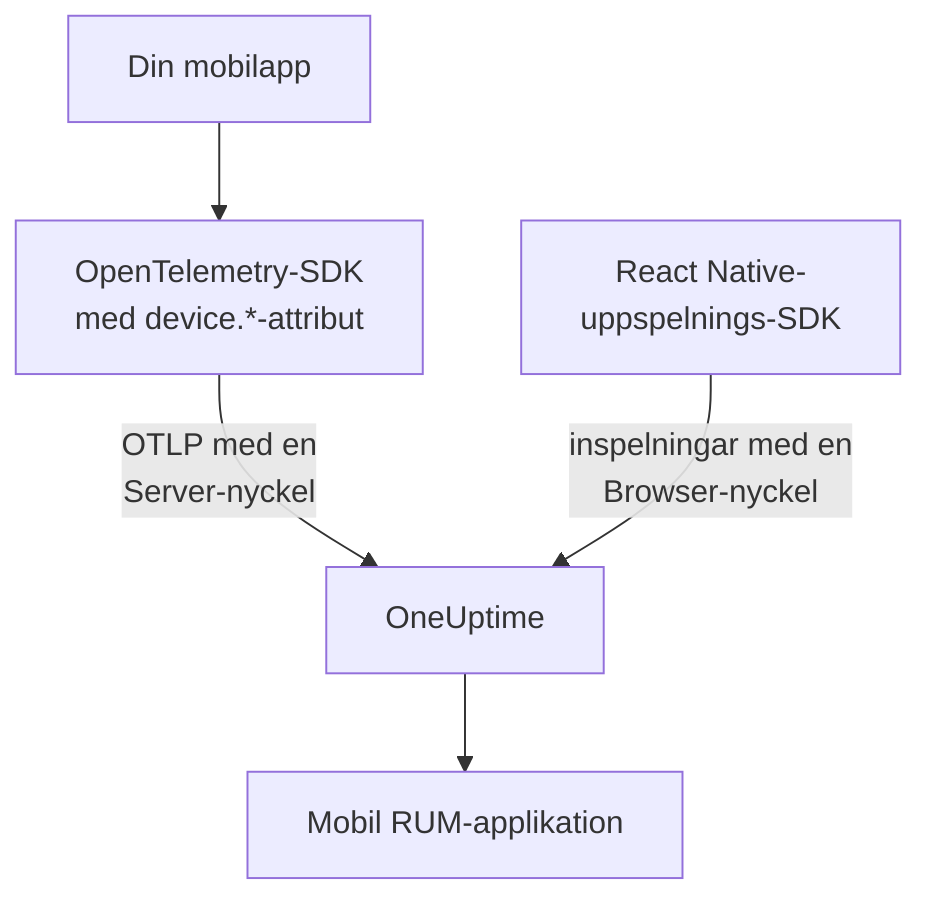

# Mobilkonfiguration

Instrumentera en Android-, iOS- eller React Native-app med OpenTelemetry så att den rapporterar till OneUptime som en mobil RUM-applikation. Alla andra plattformar med ett OpenTelemetry-SDK fungerar på samma sätt.

:::cards
- [Vad OneUptime behöver](#vad-oneuptime-behöver): Två resursattribut, skickade med en Server-nyckel.
- [Konfigurera din plattform](#konfigurera-din-plattform): Android, iOS, React Native och resten.
- [Krascher och hängningar på iOS](#krascher-och-hängningar-på-ios): Rapporter från MetricKit och KSCrash i Undantag, namngivna av dina dSYM-filer.
- [Kontrollera att det kommer in](#kontrollera-att-det-kommer-in): Testa nyckeln och hitta sedan appen.
- [Session Replay på mobil](#session-replay-på-mobil): Inspelningar för React Native-appar.
:::

## Så fungerar det

Din app exporterar OTLP direkt till OneUptime med en **Server**-intagningsnyckel. Det är `device.*`-attributen på dess resurs som klassar den som mobil-RUM i stället för som backend-tjänst.



## Vad OneUptime behöver

Två resursattribut, på varje batch som din app exporterar:

| Attribut | Vad det är |
| --- | --- |
| `service.name` | Applikationens identitet, till exempel `storefront-android`. |
| `device.id` eller `device.model.identifier` | Markerar telemetrin som mobil-RUM. `device.model.identifier` fyller också sidan **Klienter**. |

Utan ett enhetsattribut kommer telemetrin ändå in och du kan fråga efter den, men den arkiveras som en backend-tjänst i stället för en RUM-applikation.

`device.manufacturer` markerar också en batch som mobil, men bara på en resurs utan värdidentitet, eftersom en värds inventarie rapporterar en maskins tillverkare med det. Sätt även `device.id` eller `device.model.identifier`, som varje recept nedan gör, så spelar det aldrig någon roll.

Gör `device.id` till ett id per installation, aldrig ett annons-id eller något annat som identifierar en person. OneUptime läser det bara för att känna igen mobiltelemetri.

## Innan du börjar

- En app med ett OpenTelemetry-SDK: OpenTelemetry Java SDK eller OpenTelemetry Android, opentelemetry-swift eller OpenTelemetry JavaScript SDK för React Native.
- En **Server**-intagningsnyckel, skapad under **Projektinställningar → Telemetri och APM → Intagningsnycklar** med **Skapa intagningsnyckel**. En **Webbläsare**-nyckel avvisas från en mobilapp: Den kontrolleras mot headern `Origin`, som mobil-SDK:er inte skickar.
- De här OTLP-inställningarna. Om du driftar OneUptime själv byter du `https://oneuptime.com` mot din egen värd.

| Inställning | Värde |
| --- | --- |
| OTLP-endpoint | `https://oneuptime.com/otlp` |
| Header | `x-oneuptime-token: YOUR_TELEMETRY_INGESTION_TOKEN` |
| Spår | `POST https://oneuptime.com/otlp/v1/traces` |
| Mätvärden | `POST https://oneuptime.com/otlp/v1/metrics` |
| Loggar | `POST https://oneuptime.com/otlp/v1/logs` |

> [!WARNING]
> Nyckeln följer med i din app, och en app kan packas upp, så utgå från att någon kopierar den. Sätt ett **Fäst tjänstnamn** på nyckelns sida så att en kopia inte kan skriva under dina backend-tjänsters namn, lägg till en **Requests Per Minute Limit** och ett datum under **Upphör**, och byt nyckeln med dina releaser.

## Konfigurera din plattform

Snippetarna visar formen på konfigurationen. Mobil-SDK:erna för OpenTelemetry ändrar sina API:er mellan versioner, så kontrollera metodnamnen mot den version du låser. Det OneUptime behöver ändras aldrig: endpointen, headern, `service.name` och ett `device.*`-attribut.

:::tabs
@tab Android
Använd OpenTelemetry Java SDK och dess OTLP-exportör, som körs på Android:

```kotlin title="app/build.gradle.kts"
dependencies {
    implementation(platform("io.opentelemetry:opentelemetry-bom:<latest>"))
    implementation("io.opentelemetry:opentelemetry-sdk")
    implementation("io.opentelemetry:opentelemetry-exporter-otlp")
}
```

```kotlin title="StorefrontApplication.kt"
import android.app.Application
import android.os.Build
import io.opentelemetry.exporter.otlp.http.trace.OtlpHttpSpanExporter
import io.opentelemetry.sdk.OpenTelemetrySdk
import io.opentelemetry.sdk.resources.Resource
import io.opentelemetry.sdk.trace.SdkTracerProvider
import io.opentelemetry.sdk.trace.export.BatchSpanProcessor

class StorefrontApplication : Application() {
    override fun onCreate() {
        super.onCreate()

        val resource = Resource.getDefault().toBuilder()
            .put("service.name", "storefront-android")
            .put("device.manufacturer", Build.MANUFACTURER)
            .put("device.model.identifier", Build.MODEL)
            .build()

        val exporter = OtlpHttpSpanExporter.builder()
            .setEndpoint("https://oneuptime.com/otlp/v1/traces")
            .addHeader("x-oneuptime-token", BuildConfig.ONEUPTIME_TOKEN)
            .build()

        OpenTelemetrySdk.builder()
            .setTracerProvider(
                SdkTracerProvider.builder()
                    .setResource(resource)
                    .addSpanProcessor(BatchSpanProcessor.builder(exporter).build())
                    .build()
            )
            .buildAndRegisterGlobal()
    }
}
```

Agenten [OpenTelemetry Android](https://github.com/open-telemetry/opentelemetry-android) lägger till krascher, ANR:er, långsamma och frusna bildrutor och appstarter ovanpå, och sätter `device.model.identifier` och `device.manufacturer` på sin egen resurs. [Android-konfiguration](/docs/rum/android-setup) konfigurerar den i stället för koden ovan.
@tab iOS
Använd [opentelemetry-swift](https://github.com/open-telemetry/opentelemetry-swift) och sätt enhetsattributen själv: Den resurs som varje version lägger till av sig själv har ändrats mellan versioner.

```swift
let resource = Resource(attributes: [
    "service.name": .string("storefront-ios"),
    "device.model.identifier": .string(UIDevice.current.model),
    "device.manufacturer": .string("Apple"),
    "device.id": .string(UIDevice.current.identifierForVendor?.uuidString ?? ""),
    "telemetry.sdk.language": .string("swift"),
])

let exporter = OtlpHttpTraceExporter(
    endpoint: URL(string: "https://oneuptime.com/otlp/v1/traces")!,
    config: OtlpConfiguration(
        headers: [("x-oneuptime-token", oneUptimeToken)]
    )
)

OpenTelemetry.registerTracerProvider(
    tracerProvider: TracerProviderBuilder()
        .with(resource: resource)
        .add(spanProcessor: BatchSpanProcessor(spanExporter: exporter))
        .build()
)
```

`UIDevice.current.model` ger ett kort namn som `iPhone`, vilket håller sidan **Klienter** till en rad per enhetstyp. `identifierForVendor` är den installation som OneUptime räknar kraschfria installationer efter, som [Märk sessionerna](#märk-sessionerna) beskriver.
@tab React Native
React Native kör OpenTelemetry JavaScript SDK, så bygg providern, OTLP-exportören och batchprocessorn som i [Webbläsarkonfiguration](/docs/rum/browser-setup), med tre ändringar: Skicka med en **Server**-nyckel, utelämna `browserDetector` och `DocumentLoadInstrumentation`, och sätt enhetsattributen själv.

```ts
import { Platform } from "react-native";
import * as Device from "expo-device"; // or react-native-device-info
import {
  defaultResource,
  resourceFromAttributes,
} from "@opentelemetry/resources";

const resource = defaultResource().merge(
  resourceFromAttributes({
    "service.name": "storefront-mobile",
    "device.manufacturer": Device.manufacturer ?? Platform.OS,
    "device.model.identifier":
      Device.modelId ?? Device.modelName ?? "unknown",
    "telemetry.sdk.language": "webjs",
  }),
);
```

`Device.modelId` sätts bara på iOS, så Android faller tillbaka på `Device.modelName`.
@tab Andra plattformar
Flutter, Unity, .NET MAUI, en inbäddad klient eller en egen OTLP-skrivare fungerar alla, så länge resursen bär `service.name` och ett `device.*`-attribut. Ett SDK som läser OpenTelemetrys vanliga miljövariabler tar dessa som de är:

```bash
OTEL_EXPORTER_OTLP_ENDPOINT="https://oneuptime.com/otlp"
OTEL_EXPORTER_OTLP_HEADERS="x-oneuptime-token=YOUR_TELEMETRY_INGESTION_TOKEN"
OTEL_RESOURCE_ATTRIBUTES="service.name=storefront-mobile,device.manufacturer=Acme,device.model.identifier=AC-100"
```

SDK:t lägger själv till `/v1/traces`, `/v1/metrics` och `/v1/logs` på endpointen.
:::

## Krascher och hängningar på iOS

opentelemetry-swift 2.3 och senare rapporterar en iOS-apps krascher och hängningar via sin MetricKit-instrumentering, som lämnar över var och en av Apples diagnostiker till OpenTelemetry som en loggpost. OneUptime arkiverar dem som det arkiverar krascher och ANR:er från OpenTelemetry Android, så de visas i **Undantag** och på applikationens sida **Översikt**:

| Apples diagnostik | Händelsenamn | I Undantag |
| --- | --- | --- |
| En krasch | `metrickit.diagnostic.crash` | Ett ohanterat undantag, med typ efter det som avslutade appen: Objective-C-undantaget på iOS 17 och senare, annars Mach-undantaget (`EXC_BAD_ACCESS`), annars signalen (`SIGSEGV`) |
| En hängning | `metrickit.diagnostic.hang` | Ett ohanterat undantag av typen **Hang**, iOS motsvarighet till en ANR, som behåller hur länge hängningen varade |

Översiktens ruta **Krascher** räknar krascherna, och dess ruta **ANR:er** räknar hängningarna tillsammans med Androids ANR:er. Varje stackspårning ritas som trådarna i en kraschrapport, med tråden som kraschade eller hängde sig först. En stackram i din apps kod namnges efter sin funktion, till exempel `CartViewController.checkout()`, när dSYM-filen för dess bygge har laddats upp, som i [Ladda upp dina dSYM-filer](#ladda-upp-dina-dsym-filer). Alla andra stackramar anger sin binärfil och hur långt in i den koden låg, och **Binary Images** listar varje binärfils UUID, som visar vilket bygges dSYM som namnger den.

Krascher och hängningar grupperas efter din apps stackramar på tråden som kraschade eller hängde sig: efter deras funktioner där en dSYM-fil namngav dem, så att en krasch förblir ett undantag från en version till nästa, och efter deras förskjutningar i binärfilen där ingen gjorde det, vilka ändras med varje bygge. En rapport namnges när den kommer in, så ladda upp ett bygges dSYM-filer innan du släpper det: en krasch som kom in före sin dSYM-fil behåller sina förskjutningar.

:::steps
### Exportera loggar utöver spans

MetricKit rapporterar diagnostik som loggposter, så registrera en logger provider bredvid tracer providern, med samma resurs, endpoint och header:

```swift
let logExporter = OtlpHttpLogExporter(
    endpoint: URL(string: "https://oneuptime.com/otlp/v1/logs")!,
    config: OtlpConfiguration(
        headers: [("x-oneuptime-token", oneUptimeToken)]
    )
)

OpenTelemetry.registerLoggerProvider(
    loggerProvider: LoggerProviderBuilder()
        .with(resource: resource)
        .with(processors: [
            BatchLogRecordProcessor(logRecordExporter: logExporter),
        ])
        .build()
)
```

### Registrera MetricKit-instrumenteringen

Lägg till produkten `MetricKitInstrumentation` från opentelemetry-swift och registrera den hos MetricKit när logger providern har registrerats:

```swift
import MetricKit
import MetricKitInstrumentation

// MXMetricManager keeps only a weak reference: hold this for the app's lifetime.
let metricKitInstrumentation = MetricKitInstrumentation()
MXMetricManager.shared.add(metricKitInstrumentation)
```

### Märk sessionerna

Rutorna **Sessioner** och **Kraschfria sessioner** räknar `session.id` på dina spans. Produkten `Sessions` i opentelemetry-swift sätter det: lägg till `SessionSpanProcessor` i tracer providern och slå in loggprocessorn i `SessionLogRecordProcessor`, så att diagnostiken också bär en session.

Raden under **Kraschfria sessioner** visar andelen installationer som inte kraschade, och **Daily Crash Rate** och **Daily ANR Rate** larmar utifrån andelen som gjorde det. En installation är `device.id` i resursen ovan, appens leverantörs-id: ett per enhet för alla dina appar, som behålls så länge någon av dem är installerad, så att installera om din enda app ger en ny installation medan att installera om en av två inte gör det. En version av opentelemetry-swift som sätter `app.installation.id` räknas efter det i stället.

### Ladda upp dina dSYM-filer

Xcode skriver en dSYM-fil för var och en av appens binärfiler när den arkiverar appen, och App Store Connect lämnar tillbaka dem under **Download dSYMs**. Ladda upp dem efter varje arkivering, från CI eller en byggfas i Xcode, med [OneUptime CLI](/docs/cli/index) och en Server-nyckel som hör till ditt bygge: en nyckel med ett **Fäst tjänstnamn**, som den din app levereras med, avvisas, eftersom en dSYM-fil namnger stackramarna i varje app i projektet som levererar dess binärfil.

```bash
oneuptime dsym upload "$ARCHIVE_PATH/dSYMs" --app storefront-ios --url https://oneuptime.com --ingestion-key YOUR_TELEMETRY_INGESTION_TOKEN
```

CLI:t läser `.dSYM`-paket, mappar och zip-filer med dem, och DWARF-filer där de ligger, och skickar bara varje binärfils UUID, arkitektur och funktionsnamn: en stor apps dSYM-filer är hundratals megabyte, deras namn några få. Utan CLI:t skickar du DWARF-filen från en dSYM-fil, eller en zip-fil med `.dSYM`-paket, som den är, upp till 50 MB per fil:

```bash
curl --fail -X POST "https://oneuptime.com/dsyms/v1/upload" \
  -H "x-oneuptime-token: YOUR_TELEMETRY_INGESTION_TOKEN" \
  -F "appName=storefront-ios" \
  -F "dsym=@MyApp.app.dSYM/Contents/Resources/DWARF/MyApp"
```

Varje binärfil behålls efter sitt UUID i 400 dagar, så att en version som fortfarande finns på folks telefoner månader senare fortfarande namnges, och att ladda upp ett bygge igen ersätter det som behölls för det. En dSYM-fil hör till projektet, inte till en app: ett ramverk som två av dina appar bäddar in namnges i båda.
:::

> [!NOTE]
> Apple lämnar över MetricKits diagnostik till appen vid en senare start, direkt på iOS 15 och senare och en gång om dagen före det, så en krasch eller en hängning kan komma minuter eller en dag efter att den inträffade, och räknas när den kommer. "0 krascher den senaste timmen" på en iOS-apps översikt är ännu inga goda nyheter. En diagnostik bär den session som rapporterade den, inte den som den avslutade.

opentelemetry-swift registrerar inget span när appen startar, så rutorna **Appstarter** och **Kallstart (p95)** förblir tomma tills din app registrerar ett: ett span med namnet `AppStart`, med `start.type` satt till `cold`, `warm` eller `hot`, från att processen startar tills den första skärmen är klar.

### När KSCrash också rapporterar en krasch

opentelemetry-swift kan också rapportera krascher via KSCrash, som skickar sin rapport som en loggpost `device.crash` nästa gång appen öppnas, med tiden då appen kraschade. En app som registrerar båda rapporterar varje krasch två gånger: KSCrash vid nästa start, MetricKit vid nästa start eller upp till en dag senare. OneUptime räknar en sådan krasch en gång: den första rapporten som kommer in är förekomsten, och den andra behålls bredvid den, i samma undantag, som bevis på samma krasch, och räknas inte i någon ruta, något diagram eller någon monitor. Under undantagets **Förekomster** står det **Rapporterad två gånger** vid förekomsten.

Två rapporter räknas som en krasch bara när allt detta gäller:

- De kommer från de två rapportörerna, KSCrash och MetricKit. Ingen av dem rapporterar en krasch två gånger, så två rapporter från samma rapportör är två krascher.
- De kommer från samma installation: samma `app.installation.id`, eller `device.id`.
- De ligger högst 26 timmar isär: MetricKit stämplar en krasch med slutet av dagen den rapporterar om, KSCrash med ögonblicket för kraschen.
- De stämmer överens om signalen, Mach-undantaget och Objective-C-undantaget, varhelst båda anger ett.
- Trådarna som kraschade stämmer överens ram för ram från där tråden startade och inåt, efter binärfil och förskjutning, över varje ram i din apps kod som någon av dem anger. En krasch helt i Apples kod måste stämma överens i minst tre ramar, och i alla.

Varje rapport paras en gång, med den närmaste i tid, så två krascher från samma bugg på en installation, med minuters mellanrum, är två förekomster, var och en med sin andra rapport. När OneUptime inte kan jämföra en rapport med installationens andra rapporter räknar den den, så en krasch räknas i värsta fall två gånger, men går aldrig förlorad.

## Kontrollera att det kommer in

:::steps
### Testa nyckeln

Innan du går igenom SDK:ts inställningar frågar du OneUptime om nyckeln godtas:

```bash
curl -i https://oneuptime.com/otlp/v1/validate \
  -H "x-oneuptime-token: YOUR_TELEMETRY_INGESTION_TOKEN"
```

`200` med `"valid": true` betyder att nyckeln godtas. En Browser-nyckel svarar också `200`, men dess meddelande säger att den bara fungerar från en webbläsare: En mobilapp behöver en Server-nyckel. `401` betyder att nyckeln är okänd, återkallad, avstängd eller har gått ut, och ingen SDK-inställning åtgärdar det.

### Starta appen

Kör appen och använd den en stund. Den visas under **Produkter → Resurser → Övervakning av verkliga användare** vid första telemetribatchen, namngiven efter sitt `service.name`.

### Öppna sidan Klienter

Öppna applikationens sida **Klienter**: Varje enhetsmodell från `device.model.identifier` har en rad. Om sidan förblir tom medan **Spår** fylls når enhetsattributen inte fram till resursen.
:::

## Session Replay på mobil

React Native-appar kan spela in sessioner med `@oneuptime/react-native-replay`. Det spelar in det inbyggda vyträdet som en trådram, aldrig skärmbilder eller texten på skärmen, och dess inspelningar öppnas i samma spelare som webbinspelningar. Det skickar med en **Webbläsare**-nyckel vars **Tillåtna ursprung** anger din app som `app://` följt av dess Android-applikations-id eller iOS-bundle-id: en annan nyckel än den Server-nyckel som ditt OpenTelemetry-SDK använder. [Installera i React Native](/docs/telemetry/session-replay#installation-i-react-native) går igenom hur.

Inbyggda Android- och iOS-appar och de andra plattformarna har ingen sessionsinspelare: Deras sida **Sessionsuppspelning** förblir tom, medan spår, loggar, mätvärden, undantag och sidan **Klienter** fungerar som vanligt.

## Felsökning

:::details Nyckelkontrollen ger 401, eller nyckeln avvisas
En `401` betyder att nyckeln är okänd, återkallad, avstängd eller har gått ut: Skapa en Server-nyckel och bygg om appen med den.

En Browser-nyckel klarar kontrollen, men varje export från en mobilapp avvisas med en `422` som lyder `This request did not send an Origin header, so it cannot be checked against the allowed origins of this browser ingestion key. Use a server ingestion key for requests that are not sent by a browser.` Använd en **Server**-nyckel.
:::

:::details Appen visas under Tjänster i stället för Övervakning av verkliga användare
Resursen saknar både `device.id` och `device.model.identifier`, så telemetrin arkiverades som en backend-tjänst. Sätt dem som i [Konfigurera din plattform](#konfigurera-din-plattform).

Tjänsten som redan har skapats blir inte en RUM-applikation, så radera den under **Produkter → Tjänster** när RUM-telemetrin kommer in.
:::

:::details Sidan Klienter är tom
Klientrader kommer bara från `device.model.identifier`. Ett SDK som bara sätter `device.id` eller `device.manufacturer` arkiverar appen som mobil-RUM, men listar inga klienter: Sätt även `device.model.identifier`.
:::

:::details Statusen säger Ingen trafik nyligen medan folk använder appen
Statusen växlar till **Ingen trafik nyligen** efter 15 minuter utan telemetri. Om folk använder appen:

- En sampler kanske kastar allt: Leta efter en always-off-sampler eller en mycket låg kvot.
- Appen kanske bara skickar telemetri för åtgärder som ingen utförde under den tiden.
- Nyckeln kan ha återkallats, eller ha gått ut, sedan releasen: Testa den som i [Kontrollera att det kommer in](#kontrollera-att-det-kommer-in).
:::

## Nästa steg

:::cards
- [Sessionsuppspelning](/docs/telemetry/session-replay): Spela in React Native-sessioner bredvid deras spår.
- [Hantera applikationer](/docs/rum/applications): Namn, etiketter, ägare och lagring.
- [OpenTelemetry](/docs/telemetry/open-telemetry): OTLP-endpoints, gränser och fel i detalj.
- [RUM-felsökning](/docs/rum/troubleshooting): Varje kontroll, i den ordning problem brukar uppstå.
:::
