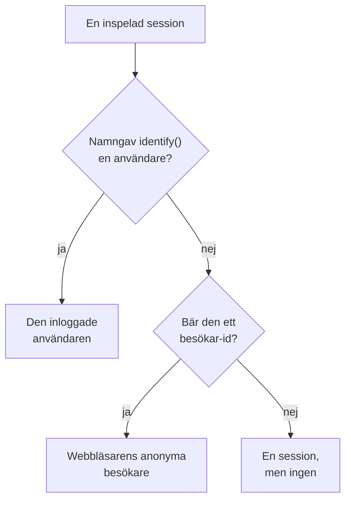

# Produktanalys

Produktanalys räknar de människor som använder en RUM-applikation och hur deras sessioner går: aktiva, nya, återkommande, inloggade och inaktiva användare, och sessioner per enhet, webbläsare, land och sida. Den räknar de sessioner som [Sessionsuppspelning](/docs/telemetry/session-replay) spelar in, så den behöver inget eget snippet, och den sparar sina siffror i 13 månader, långt efter att inspelningarna har gått ut.

:::cards
- [Hur personer räknas](#hur-personer-räknas): En inloggad användare en gång, en anonym webbläsare en gång.
- [Användare](#användare): Aktiva, nya, återkommande, inloggade, alla och inaktiva användare.
- [Sessioner](#sessioner): Hur många, hur länge, och per enhet, webbläsare, land och sida.
- [Integritet och lagring](#integritet-och-lagring): 13 månader, inga namn sparade, raderas på begäran.
:::

## Hur personer räknas

En applikations sidomeny har ett avsnitt **Produktanalys** med två sidor, **Användare** och **Sessioner**. Båda räknar de sessioner som Sessionsuppspelning spelar in, så de börjar när applikationens inspelare gör det, och en session som uppspelningspolicyn inte spelar in räknas inte. Varje session räknas för en person, eller för ingen:

- **En inloggad användare räknas en gång**, i varje webbläsare och på varje enhet hen använder: hen känns igen på envägshashen av den referens som din sida gav `identify()` (se [Identifiera dina användare](/docs/telemetry/session-replay#identifiera-dina-användare)).
- **En anonym webbläsare räknas en gång**, via sitt [anonyma besökar-id](/docs/telemetry/session-replay#anonyma-besökare). Två webbläsare är två besökare, och de sessioner en webbläsare hade innan någon loggade in i den förblir dess besökares.
- **En session från en äldre inspelare**, som inte skickade något besökar-id, räknas som en session men inte som en person.

Dagar räknas i din egen tidszon.

## Användare

**Användare** räknar personerna i det intervall du väljer:

| Ruta | Vad den räknar |
| --- | --- |
| **Aktiva användare** | Alla som kom under intervallet: varje inloggad användare en gång och varje anonym webbläsare en gång. |
| **Nya användare** | Aktiva användare vars första besök var under intervallet. |
| **Återkommande användare** | Aktiva användare som hade kommit innan intervallet började. |
| **Inloggade användare** | Aktiva användare som din app loggade in med `identify()`, och deras andel av alla aktiva användare. |
| **Totalt antal användare** | Alla som applikationen har sett under de senaste 13 månaderna. |
| **Inaktiva användare** | Personer som kom tidigare men inte under de senaste 30 dagarna, eller de 7, 14, 60 eller 90 dagar du väljer. |

De tre första visar också hur de har ändrats jämfört med perioden före. Under rutorna ritar **Aktiva användare** för varje dag de personer som kom den dagen, de som kom under de 7 dagarna fram till den och de som kom under de 30 dagarna fram till den, och **Nya och återkommande användare** delar varje dags personer i två.

**Personer** listar alla som rutorna räknar, en rad per person, de senast sedda först, och dess filter visar en rutas personer, de anonyma besökarna eller alla. Öppna en person för att se första och senaste besöket och var och en av personens sessioner från de senaste 13 månaderna, med **Titta** på varje session vars inspelning fortfarande sparas.

## Sessioner

**Sessioner** räknar de sessioner som började under intervallet: **Sessioner**, **Inloggade sessioner**, **Median sessionslängd**, **Sidor per session**, **Sessioner med fel** och **Frustrerade sessioner**. Under rutorna:

- **Sessioner per enhet** ritar varje dags sessioner från datorer, telefoner och surfplattor. En mobilapps session på en skärm vars kortare sida är 600 punkter eller mer räknas som en surfplattas.
- **Sessionslängd** delar in de avslutade sessionerna efter hur länge de varade, från under 10 sekunder till över 30 minuter. En session som fortfarande spelas in har ingen längd än.
- **Uppdelning** rangordnar användare och sessioner efter enhetstyp, webbläsare, operativsystem, land, appversion, startsida eller sida, flest användare först.

## Integritet och lagring

- **13 månader.** En månads siffror tas bort den första dagen i den 13:e månaden efter, så de senaste 12 hela månaderna finns alltid kvar, oavsett inspelningarnas egen lagringstid (7 dagar som standard).
- **Inga namn sparade.** Siffrorna sparar en inloggad användares envägsnyckel och en webbläsares besökar-id, aldrig referensen, egenskaperna eller en IP-adress. En rad namnger en inloggad användare bara så länge någon av hens inspelningar fortfarande sparas, och bara för en roll som får läsa identitet; annars står det **Inloggad användare** eller **Anonym besökare** och början av id:t.
- **Raderas på begäran.** En raderingsbegäran tar också bort de matchande siffrorna här (se [Radera sessioner](/docs/telemetry/session-replay#radera-sessioner)).

## Vem kan se det

Att läsa de två sidorna kräver detsamma som att läsa sessionslistan: `ReadRumSessionReplay` (_List Session Replays_) eller `ReadRumSessionReplayPayload` (_Watch Session Replays_), som projektägare och administratörer har. Att se vem en inloggad användare är, och att söka efter personer på namn, kräver den identitetsbehörighet som [Vem kan titta på en inspelning](/docs/telemetry/session-replay#vem-kan-titta-på-en-inspelning) beskriver.

## Nästa steg

:::cards
- [Sessionsuppspelning](/docs/telemetry/session-replay): Spela in de sessioner som de här sidorna räknar, och titta på dem.
- [Hantera applikationer](/docs/rum/applications): Namn, etiketter, ägare och lagring.
- [RUM – Översikt](/docs/rum/index): Vad en RUM-applikation visar mer.
:::
