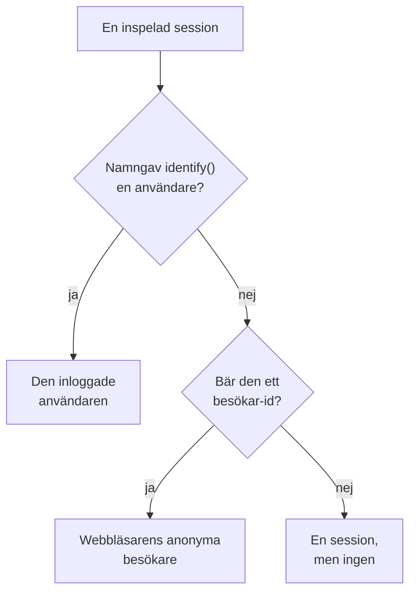

# Produktanalys

Produktanalys räknar de människor som använder en RUM-applikation, hur deras sessioner går och vad de gör: aktiva, nya, återkommande, inloggade och inaktiva användare, sessioner per enhet, webbläsare, land och sida, och de händelser din app skickar, som trender, trattar och kvarhållning. Den räknar de sessioner som [Sessionsuppspelning](/docs/telemetry/session-replay) spelar in och de händelser dess inspelare skickar, så den behöver inget eget snippet, och den sparar sina siffror i 13 månader, långt efter att inspelningarna har gått ut.

:::cards
- [Användare](#användare): Aktiva, nya, återkommande, inloggade, alla och inaktiva användare.
- [Sessioner](#sessioner): Hur många, hur länge, och per enhet, webbläsare, land och sida.
- [Skicka händelser och mätvärden](#skicka-händelser-och-mätvärden): Vad människor gör, och de siffror din sida mäter.
- [Händelser](#händelser): Hur ofta något hände, vem som gjorde det och var.
- [Trattar](#trattar): Vem som gick vidare, steg för steg, och hur lång tid det tog.
- [Kvarhållning av användare](#kvarhållning-av-användare): Vem som kom tillbaka, kohort för kohort.
:::

## Hur personer räknas

En applikations sidomeny har ett avsnitt **Produktanalys**: **Användare**, **Sessioner**, **Händelser**, **Trattar**, **Kvarhållning av användare**, **Användarflöden** och **Analysinställningar**. **Användare** och **Sessioner** räknar de sessioner som Sessionsuppspelning spelar in, så de börjar när applikationens inspelare gör det, och en session som uppspelningspolicyn inte spelar in räknas inte. Varje session räknas för en person, eller för ingen:



- **En inloggad användare räknas en gång**, i varje webbläsare och på varje enhet hen använder: hen känns igen på envägshashen av den referens som din sida gav `identify()` (se [Identifiera dina användare](/docs/telemetry/session-replay#identifiera-dina-användare)).
- **En anonym webbläsare räknas en gång**, via sitt [anonyma besökar-id](/docs/telemetry/session-replay#anonyma-besökare). Två webbläsare är två besökare, och de sessioner en webbläsare hade innan någon loggade in i den förblir dess besökares.
- **En session från en äldre inspelare**, som inte skickade något besökar-id, räknas som en session men inte som en person.

**Händelser**, **Trattar** och **Kvarhållning av användare** räknar personer på samma sätt, utifrån de händelser som inspelaren skickar från varje session, inspelad eller inte (se [Skicka händelser och mätvärden](#skicka-händelser-och-mätvärden)).

Dagar räknas i din egen tidszon.

## Användare

**Användare** räknar personerna i det intervall du väljer:

| Ruta | Vad den räknar |
| --- | --- |
| **Aktiva användare** | Alla som kom under intervallet: varje inloggad användare en gång och varje anonym webbläsare en gång. |
| **Nya användare** | Aktiva användare vars första besök var under intervallet. |
| **Återkommande användare** | Aktiva användare som hade kommit innan intervallet började. |
| **Inloggade användare** | Aktiva användare som din app loggade in med `identify()`, och deras andel av alla aktiva användare. |
| **Totalt antal användare** | Alla som applikationen har sett under de senaste 13 månaderna. |
| **Inaktiva användare** | Personer som kom tidigare men inte under de senaste 30 dagarna, eller de 7, 14, 60 eller 90 dagar du väljer. |

De tre första visar också hur de har ändrats jämfört med perioden före. Under rutorna ritar **Aktiva användare** för varje dag de personer som kom den dagen, de som kom under de 7 dagarna fram till den och de som kom under de 30 dagarna fram till den, och **Nya och återkommande användare** delar varje dags personer i två.

**Personer** listar alla som rutorna räknar, en rad per person, de senast sedda först, och dess filter visar en rutas personer, de anonyma besökarna eller alla. Öppna en person för att se första och senaste besöket och var och en av personens sessioner från de senaste 13 månaderna, med **Titta** på varje session vars inspelning fortfarande sparas.

## Sessioner

**Sessioner** räknar de sessioner som började under intervallet: **Sessioner**, **Inloggade sessioner**, **Median sessionslängd**, **Sidor per session**, **Sessioner med fel** och **Frustrerade sessioner**. Under rutorna:

- **Sessioner per enhet** ritar varje dags sessioner från datorer, telefoner och surfplattor. En mobilapps session på en skärm vars kortare sida är 600 punkter eller mer räknas som en surfplattas.
- **Sessionslängd** delar in de avslutade sessionerna efter hur länge de varade, från under 10 sekunder till över 30 minuter. En session som fortfarande spelas in har ingen längd än.
- **Uppdelning** rangordnar användare och sessioner efter enhetstyp, webbläsare, operativsystem, land, appversion, startsida eller sida, flest användare först.

## Skicka händelser och mätvärden

Händelser skickas så länge **Skicka produktanalyshändelser** är på, på applikationens sida **Analysinställningar**. Den är på från början för en ny applikation, och av för en applikation som skapades innan den fanns, så slå på den där. Sessionsuppspelning måste också vara på för applikationen, eftersom det är dess inspelare som skickar händelserna; React Native-inspelaren skickar inga ännu.

Varje session som webbläsarinspelaren körs i skickar själv sin start och varje sida den visar, en ensidesapps ruttbyten inräknade, oavsett om uppspelningens urval och policy spelar in sessionen eller inte. Dina egna händelser och siffror kommer från din sidas kod:

```js
OneUptimeReplay.track("Signed up", { plan: "pro" });
OneUptimeReplay.metric("cart.value", 42.5, { currency: "EUR" });
```

| Anrop | Vad det skickar |
| --- | --- |
| `track(name, properties?)` | En händelse som **Händelser**, **Trattar** och **Kvarhållning av användare** räknar, och en markör på uppspelningens tidslinje när sessionen spelas in. `name` ≤ 64 tecken; ≤ 20 egenskaper med sträng-, tal- eller booleska värden, nyckel ≤ 40 tecken, värde ≤ 200 tecken. |
| `metric(name, value, attributes?)` | Ett tal som din sida har mätt, som en punkt i ett av applikationens mätvärden (se [Instrumentpaneler och aviseringar](#instrumentpaneler-och-aviseringar)). `name` ≤ 100 tecken av bokstäver, siffror, `_`, `.`, `-` och `/`, som börjar med en bokstav och inte med `oneuptime.`; `value` ett ändligt tal; `attributes` som egenskaperna för `track()`. |

Innan inspelaren har laddats lägger du samma anrop i `window.OneUptimeReplayQueue` som `["track", name, properties]` och `["metric", name, value, attributes]` (se [JavaScript-API](/docs/telemetry/session-replay#javascript-api)).

- **Varje session, inspelad eller inte.** Uppspelningens urval och uppladdningspolicyn avgör vilka sessioner som spelas in, inte vilka som räknas. Inget skickas under Do Not Track eller Global Privacy Control, och inget sparas från ett ursprung som applikationen inte tillåter. När policyn kräver samtycke väntar händelserna på `grantConsent()`, högst 500 av dem, och `revokeConsent()` kastar dem.
- **Maskerade som inspelningen.** Under _Mask all text_ maskeras värdena för egenskaper och attribut innan de lämnar sidan. En sida skickas som sin sökväg, utan frågesträng och fragment.
- **I små omgångar**, var 5:e sekund och när fliken döljs. En händelse som når OneUptime mer än 3 dagar efter att den hände kastas, och ett projekt får skicka 60 000 händelser och mätpunkter per minut, alla dess applikationer tillsammans; därutöver väntar inspelaren och skickar dem igen.

`metric()` skickar inget medan händelserna är av, och `getDiagnostics().productAnalytics` säger om de är på (se [`getDiagnostics()`](/docs/telemetry/session-replay#getdiagnostics)).

### Användaregenskaper

För att dela upp och segmentera händelser efter vem som utförde dem anger du nycklar för egenskaper från `identify()` under **Användaregenskaper för analys** på **Analysinställningar**, till exempel `["plan", "role"]`, högst 20, jämförda exakt som de är skrivna. Varje händelse bär då de egenskaperna för den inloggade användaren, så som din sida gav dem till `identify()`. De andra egenskaperna lämnar aldrig sidan, och inga gör det medan **Registrera slutanvändarens identitet** är av. Ange inte egenskaper som innehåller personuppgifter, till exempel en e-postadress.

## Händelser

**Händelser** visar en händelse åt gången: appens vanligaste händelse tills du väljer en annan, eller den mest visade sidan så länge appen inte skickar någon. Väljaren listar också **Session startad** och varje visad sida, och **Alla händelser** nedanför listar varje händelse i intervallet med hur många gånger den hände och hur många personer som utförde den; välj en för att se den ovanför.

- Rutorna räknar händelsens **Händelser**, med hur många varje person utförde i genomsnitt, dess **Användare** och dess **Sessioner**.
- **Händelser och användare** ritar för varje dag hur många gånger händelsen hände, och hur många personer som utförde den den dagen.
- **Uppdelning** rangordnar händelsen efter enhetstyp, webbläsare, operativsystem, land, appversion, sida, händelseegenskap eller användaregenskap, med varje värdes händelser, användare och andel. Välj ett värde för att bara visa det.

**Segment** begränsar sidan till de händelser vars fält har de värden du väljer: **Lägg till filter**, sedan ett fält och ett värde, jämförda exakt. Ett segment har högst 5 filter, och en händelse måste matcha alla. Sidans adress behåller händelsen, intervallet, segmentet och uppdelningen, så en länk öppnar samma vy.

## Trattar

**Trattar** följer personer genom 2 till 6 steg i ordning, vart och ett en händelse som **Händelser** listar dem. Av de personer som utförde första steget under intervallet räknar den hur många som sedan utförde det andra, sedan det tredje, alla inom den tid du väljer från deras första steg: **Inom 1 timme**, **Inom 1 dag**, **Inom 7 dagar**, **Inom 14 dagar** eller **Inom 30 dagar**. **Lägg till steg** lägger till ett.

Under **Konvertering** finns andelen personer som utförde varje steg och, för varje steg, hur många personer som nådde det, hur stor andel av första stegets personer det är, hur många som föll bort sedan steget före och mediantiden de tog från det. Den som försökte mer än en gång räknas en gång, efter det försök som kom längst.

Segmentet för en tratt, och för en kvarhållningstabell, använder de fält som varje händelse bär och användaregenskaper, inte en händelses egna egenskaper, eftersom dess steg är olika händelser.

## Kvarhållning av användare

**Kvarhållning av användare** grupperar personer efter den dag, vecka eller månad i intervallet då de först utförde en händelse, **Personer som utförde**, och visar hur stor andel av varje grupp som utförde en annan, **Och kom tillbaka för att utföra**, under den perioden och varje period efter. Båda är **Session startad** tills du väljer andra.

**Kohorter** anger perioden: **Per dag**, **Per vecka** eller **Per månad**. När intervallet rymmer fler perioder än en tabell visar, 32 dagar, 26 veckor eller 13 månader, gör sidan kohorterna längre och säger det.

Varje rad är en kohort och hur många personer den har, och varje cell andelen av dem som kom tillbaka under den perioden, mörkare ju fler som gjorde det. En period som inte har börjat än lämnas tom.

**Alla kohorter**, ovanför dem, räknar kohorterna som en: under varje period de personer som kom tillbaka, av personerna i de kohorter som har nått den, så en kohort på 200 personer väger fyra gånger så mycket som en på 50. Den visas så snart två kohorter rymmer någon.

## Sparade trattar och kvarhållningstabeller

**Sparade trattar**, på sidan **Trattar**, och **Sparade kvarhållningstabeller**, på **Kvarhållning av användare**, listar det ditt team har sparat för applikationen, för att öppna det igen eller visa det på en instrumentpanel. En sparad tratt behåller sina steg, sin tid att slutföra dem och sitt segment, och en sparad kvarhållningstabell sina två händelser, sin period och sitt segment. Ingen av dem behåller tidsintervallet: sidan behåller sitt eget, och en instrumentpanel läser sitt eget.

- **+ Spara tratt** eller **+ Spara kvarhållningstabell** sparar det sidan visar, under ett namn. En applikation behåller högst 100 av varje.
- Välj en för att öppna den. Sidans adress namnger den, så en länk öppnar den för alla som får se den. När du ändrar det den visar säger namnet det, och **Uppdatera** sparar ändringen.
- **Redigera** byter namn på en, och **Ta bort** tar bort den för alla. **Rensa vy** stänger den som är öppen och behåller det sidan visar.
- En länk till en som har tagits bort, eller som du inte får se, säger det, och sidan öppnas utan den.

## Instrumentpaneler och aviseringar

Varje händelse räknas också, minut för minut, som ett av applikationens mätvärden, och varje anrop till `metric()` är en punkt i ett eget mätvärde, under det namn anropet anger. Rita dem på applikationens sida **Mätvärden**, lägg till dem på en instrumentpanel eller avisera på dem med en metrikövervakning; **Öppna Mätvärden** under **Alla händelser** öppnar sidan.

| Mätvärde | Vad det räknar | Per |
| --- | --- | --- |
| `oneuptime.rum.product.events` | Dina `track()`-händelser, per minut | `event.name` |
| `oneuptime.rum.product.sessions` | Sessioner som startade, per minut | `device.type` |
| `oneuptime.rum.product.page.views` | Visade sidor, per minut | `device.type` |

De här tre debiteras inte, och `metric()` avvisar ett namn som börjar med `oneuptime.`, så inget som din sida skickar kan utge sig för att vara dem. Dina `metric()`-punkter sparas och debiteras som applikationens andra mätvärden.

En sparad tratt eller kvarhållningstabell kan också visas på en instrumentpanel: widgetarna **Tratt** och **Kvarhållning av användare**, i widgetkatalogens grupp **Produktanalys**, visar en i instrumentpanelens tidsintervall, och **Öppna i Trattar** eller **Öppna i Kvarhållning av användare** öppnar den på dess sida (se [Instrumentpanels-widgetar](/docs/dashboards/widgets#produktanalys)).

## Integritet och lagring

- **13 månader.** En månads siffror tas bort den första dagen i den 13:e månaden efter, så de senaste 12 hela månaderna finns alltid kvar, oavsett inspelningarnas egen lagringstid (7 dagar som standard). Händelser sparas på samma sätt.
- **Inga namn sparade.** Siffrorna sparar en inloggad användares envägsnyckel och en webbläsares besökar-id, aldrig referensen eller en IP-adress, och av egenskaperna bara de användaregenskaper du anger. En rad namnger en inloggad användare bara så länge någon av hens inspelningar fortfarande sparas, och bara för en roll som får läsa identitet; annars står det **Inloggad användare** eller **Anonym besökare** och början av id:t.
- **Raderas på begäran.** En raderingsbegäran tar också bort de matchande siffrorna och händelserna här (se [Radera sessioner](/docs/telemetry/session-replay#radera-sessioner)).

## Vem kan se det

Att läsa de här sidorna kräver detsamma som att läsa sessionslistan: `ReadRumSessionReplay` (_List Session Replays_) eller `ReadRumSessionReplayPayload` (_Watch Session Replays_), som projektägare och administratörer har. Att se vem en inloggad användare är, och att söka efter personer på namn, kräver den identitetsbehörighet som [Vem kan titta på en inspelning](/docs/telemetry/session-replay#vem-kan-titta-på-en-inspelning) beskriver.

Att spara, byta namn på och ta bort sparade trattar och kvarhållningstabeller kräver samma behörigheter som att läsa de här sidorna, och en widget på en instrumentpanel visar en bara för en läsare som har dem.

Att slå på eller av händelserna kräver `EditRumApplication` (_Edit RUM Application_) eller rollen som projektägare, administratör eller medlem. Att ange användaregenskaper kräver `EditRumApplication` eller rollen som ägare eller administratör, eftersom det avgör vad som sparas om inloggade personer.

## Nästa steg

:::cards
- [Sessionsuppspelning](/docs/telemetry/session-replay): Spela in de sessioner som de här sidorna räknar, och titta på dem.
- [Hantera applikationer](/docs/rum/applications): Namn, etiketter, ägare och lagring.
- [RUM – Översikt](/docs/rum/index): Vad en RUM-applikation visar mer.
:::
