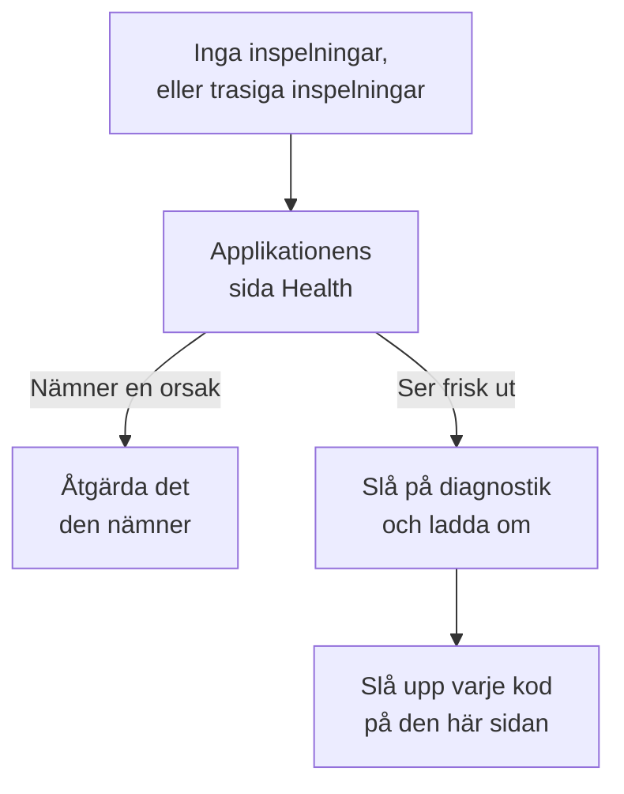

# Felsökning av sessionsuppspelning

När inga inspelningar kommer in, eller de kommer in trasiga, hittar den här sidan orsaken. Sessionsuppspelning spelar som standard in varje session och laddar upp den medan den pågår, så en frisk sida skickar en chunk ungefär var 15:e sekund medan användaren gör något. En inaktiv flik ger inga händelser och skickar ingenting, och efter fem minuter utan inmatning pausar inspelaren helt (`recording-paused-idle`), så rör musen eller klicka innan du bedömer en installation utifrån fliken Nätverk. Om du fortfarande inte ser någon förfrågan till OneUptime är någon av orsakerna nedan förklaringen.

:::cards
- [Slå på diagnostik](#slå-på-diagnostik): Låt inspelaren förklara varje beslut i konsolen.
- [Koder](#koder): Varje rad som inspelaren skriver ut, och vad du gör åt den.
- [En brandvägg framför OneUptime avvisar chunkarna](#en-brandvägg-framför-oneuptime-avvisar-chunkarna): Regler att kontrollera och undantag att lägga till.
- [Bilder, ikoner eller stilar saknas i uppspelningen](#bilder-ikoner-eller-stilar-saknas-i-uppspelningen): Inspelningar som spelas upp, men inte som din användare såg dem.
:::



Den enda inställningen där tystnad är normalt är uppladdning vid _On error or frustration_ (`OnErrorOrFrustration`): inspelaren håller då en ringbuffert i minnet och laddar bara upp när något går fel, vilket ser exakt ut som en trasig installation tills en utlösare slår till. Kontrollera vilken du använder innan du letar efter något annat: raden `config-accepted` längre ned skriver ut det.

Börja på serversidan om du kan. Applikationens sida **Hälsa**, i avsnittet **Sessionsuppspelning** i dess sidomeny, nämner orsaken när ingenting kommer in: inspelaren laddades aldrig, laddades men laddade inte upp något och varför, uppladdningar avvisas och av vilket skäl, eller budgeten är förbrukad. Se [Inspelningsstatus](/docs/telemetry/session-replay#inspelningsstatus). Det som följer är webbläsarsidan: slå på diagnostik, ladda om en gång och läs konsolen.

Kommer inspelningar in, men spelas upp med trasiga bilder, saknade ikoner eller områden utan stil? Det är en uppspelningsfråga, som besvaras i [Bilder, ikoner eller stilar saknas i uppspelningen](#bilder-ikoner-eller-stilar-saknas-i-uppspelningen).

## Slå på diagnostik

Välj den brytare du har till hands. De gör alla samma sak.

:::tabs
@tab I webbläsaren
I webbläsaren där det går fel. Kräver ingen ny driftsättning, fungerar i produktion och överlever omladdningar:

```js
localStorage.setItem("oneuptime.sessionReplay.debug", "true");
// then reload the page
```

Stäng av det igen med:

```js
localStorage.removeItem("oneuptime.sessionReplay.debug");
```
@tab Med en länk
För någon som inte är teknisk, eller en sida där du inte kan öppna en konsol, lägger du till `oneuptime_debug=1` i URL:en. Det fungerar också i fragmentet, som överlever en server som tar bort frågeparametrar den inte känner till:

```text
https://your-app.example.com/checkout?oneuptime_debug=1
https://your-app.example.com/checkout#oneuptime_debug=1
```
@tab På skripttaggen
För en stagingmiljö där du vill ha det påslaget för alla:

```html
<script
  src="https://oneuptime.com/telemetry/session-replay/v1/recorder.js"
  data-oneuptime-token="YOUR_TELEMETRY_INGESTION_KEY"
  data-oneuptime-app-identifier="YOUR_RUM_APP_IDENTIFIER"
  data-oneuptime-debug="true"
  crossorigin="anonymous"
  async
></script>
```
@tab I init-globalen
Om du konfigurerar inspelaren med init-globalen:

```js
window.__ONEUPTIME_SESSION_REPLAY__ = {
  host: "https://oneuptime.com",
  token: "YOUR_TELEMETRY_INGESTION_KEY",
  appIdentifier: "YOUR_RUM_APP_IDENTIFIER",
  debug: true,
};
```
@tab På driftsättningen
På OneUptime-driftsättningen, den enda brytaren som inte kräver någon vid webbläsaren där det går fel. Sätt `SESSION_REPLAY_DEBUG=true` och starta om. Varje inspelare som den här instansen levererar loggar då på varje sida där den körs, så slå på det, samla in en omladdning och stäng av det igen. Det ändrar ingen policy: varken sampling, maskering eller samtycke. Se [Anteckningar om egen drift](/docs/telemetry/session-replay#anteckningar-om-egen-drift) för driftsättningens övriga inställningar.
@tab Under körning
När inspelaren har laddats:

```js
OneUptimeReplay.setDebug(true);
```
:::

Utdata ser ut så här:

```text
[OneUptime Session Replay] loader-start: Loader running.
[OneUptime Session Replay] init-options-read: Init options read. {host: "https://oneuptime.com", appIdentifier: "checkout-web", …}
[OneUptime Session Replay] config-fetch-start: Requesting the policy. {url: "https://oneuptime.com/telemetry/session-replay/v1/config", …}
[OneUptime Session Replay] config-accepted: Policy accepted. {captureTrigger: "Always", samplePercentage: 100, …}
[OneUptime Session Replay] recording: Recording and uploading …
```

## Få tidslinjen utan att slå på något först

Inspelaren behåller sina senaste 250 beslut, oavsett om diagnostik är påslagen eller inte. Om problemet redan har hänt behöver du inte återskapa det med loggning påslagen — be om det här i stället:

```js
copy(JSON.stringify(OneUptimeReplay.getDiagnostics(), null, 2));
```

Det returnerar inspelarens version, sessions-ID:t, dess `state` (`recording`, `uploading`, `not-sampled`, `stopped`…), varför den stoppade om den gjorde det, `bootstrapDecision`, varje grinds svar i `decisions` (samplad eller inte, samtyckesstatus, om uppladdningar är tillåtna och vad som blockerar dem, serverns senaste direktiv), inspelarens `capabilities` och hela listan över poster — inklusive dem från laddaren, som körs innan inspelarens artefakt finns och där de flesta tillbakadraganden avgörs. Den innehåller genom sin konstruktion inget sidinnehåll; se [Vad diagnostiken aldrig innehåller](#vad-diagnostiken-aldrig-innehåller). Fälten beskrivs i [`getDiagnostics()`](/docs/telemetry/session-replay#getdiagnostics).

**Om du får `OneUptimeReplay is not defined`** laddades inspelarens artefakt aldrig — vilket i sig är svaret för en stor del av koderna nedan, och just när du behöver tidslinjen som mest. Posterna finns fortfarande kvar, på en global som laddaren skriver till innan artefakten finns:

```js
copy(JSON.stringify(window.__ONEUPTIME_SESSION_REPLAY_DEBUG__.records, null, 2));
```

Klistra in någon av dem i ditt supportärende — eller i **Ask the browser** på applikationens sida **Hälsa**, som förklarar varje kod i den. Ofta räcker det i sig.

## När tystnad är normalt: den felstyrda policyn

Det här avsnittet gäller bara om `config-accepted` skrev ut `captureTrigger: "OnErrorOrFrustration"`. Med standardpolicyn `Always` skickar inspelaren medan den spelar in, och tystnad på en sida som användaren interagerar med betyder att något verkligen är fel — läs i så fall vidare efter det här avsnittet.

Om konsolen säger det här:

```text
[OneUptime Session Replay] recording: Recording into memory. Nothing uploads until a trigger fires - call OneUptimeReplay.captureSession() to force one.
```

…då fungerar inspelaren. Med en felstyrd policy gör en frisk sida exakt en förfrågan till OneUptime per sidladdning (hämtningen av konfigurationen) och skickar inget annat förrän ett fel, en 5xx, en frustrationssignal eller en överskriden prestandabudget inträffar.

För att testa hela vägen från början till slut tvingar du fram en uppladdning:

```js
OneUptimeReplay.captureSession("installation test");
```

Du bör direkt se en `POST /telemetry/session-replay/v1/chunk` på fliken Nätverk och en rad `chunk-accepted` i konsolen. Gör du det är installationen korrekt, och uppspelningen visas i instrumentpanelen inom ungefär en minut, med din orsak markerad på dess tidslinje.

En `202` med `chunk-accepted` är det du letar efter. En `204` loggar i stället `chunk-not-recorded`: förfrågan var korrekt och servern bestämde sig för att inte lagra den — budgeten överskriden, inte samplad eller applikationen inaktiverad. Det är ett svar från policyn, inte ett installationsfel, och raden `server-directive` bredvid säger vilket.

För att spela in varje session igen sätter du **När en inspelning ska laddas upp** till _Always_ och **Samplingsprocent** över 0 på applikationens sida **Replay Policy**. Det är fabriksstandarden.

## Koder

Varje rad bär en stabil `code`. Slå upp din här.

### Uppstart

| code | vad det betyder |
| --- | --- |
| `loader-start` | Inspelarens skript kördes. Om du inte ser det här medan diagnostik är påslagen kördes själva skriptet aldrig — kontrollera `<script>`-förfrågan på fliken Nätverk och `script-src` i din CSP. |
| `init-options-read` | Alternativ hittades. Kontrollera `host` och `appIdentifier` i detaljen: `appIdentifier` måste matcha RUM-applikationen exakt, och `host` måste vara ditt OneUptime-ursprung, inte din egen apps. |
| `init-options-incomplete` | Ett obligatoriskt alternativ saknas. Detaljen säger vilket av `hasHost` / `hasToken` / `hasAppIdentifier` som är false. Om `hasHost` är false har skripttaggen ingen `src` att härleda värden från — lägg till `data-oneuptime-host`. |
| `privacy-signal` | Webbläsaren skickar Do Not Track eller Global Privacy Control och det respekteras — av sidan (ingenting på skripttaggen säger något annat) eller av serverns policy. Ingenting spelas in; med `stage: "before-config-fetch"` görs inte heller någon konfigurationsförfrågan. Inte ett fel. Sätt `data-oneuptime-respect-do-not-track="false"` bara om din rättsliga grund verkligen inte beror på signalen. |
| `init-options-missing` | Det finns inget att läsa på sidan: varken en `script[data-oneuptime-token]`-tagg eller `window.__ONEUPTIME_SESSION_REPLAY__`. Markörattributet är felstavat, kodsnutten har hamnat i ett annat dokument eller så har en tagghanterare tagit bort den. |
| `loader-threw` | Ett fel i själva inspelaren, inte i din konfiguration. Rapportera det med utdata från diagnostiken. |

### Policy

| code | vad det betyder |
| --- | --- |
| `config-fetch-start` | Ska till att begära policyn. `url` i detaljen är den exakta URL:en — kontrollera att den svarar från en webbläsare. |
| `config-fetch-rejected` | Slutpunkten svarade med något annat än 2xx. Se [Statusar för hämtning av konfigurationen](#statusar-för-hämtning-av-konfigurationen) nedan. |
| `config-fetch-failed` | Förfrågan slutfördes aldrig: `connect-src` i CSP:n, en annonsblockerare, DNS, TLS, ingen anslutning eller en tidsgräns på 5 sekunder. Webbläsaren loggar vanligtvis en egen rad bredvid den här. |
| `config-body-unparseable` | Slutpunkten svarade 2xx med en body som inte alls är JSON. Skiljer sig från `config-fetch-failed`: förfrågan *slutfördes*, så något på vägen — en proxy, en captive portal, en mellansida för SSO — svarade i stället för OneUptime. |
| `config-unparseable` | Bodyn *var* giltig JSON, men inte ett objekt — `null`, en sträng, en array. En omskrivande proxy, eller en server som svarar på en annan sökväg. |
| `config-disabled` | Servern säger att uppspelning är avstängd här. `disabledReason` i detaljen är svaret: se [disabledReason](#disabledreason) nedan. |
| `config-recorder-version-invalid` | Policyn nämnde inte exakt `latest` med gemener, så ingen artefakt-URL kunde byggas. En omskrivande proxy eller ett manipulerat svar — en driftsättning utan bygge rapporterar i stället `config-disabled` med `recorder-not-built`. |
| `config-accepted` | Policyn accepterades. Detaljen är hela policyn — `captureTrigger`, `samplePercentage`, `consentMode`, `maskingMode`. |
| `config-field-defaulted` | Servern skickade inget värde för ett fält i policyn (nämnt i detaljen), så den här inspelaren använde produktens standard. Informativt: vanligtvis en server som är äldre än inspelaren. Om instrumentpanelen visar ett annat värde för det fältet bör du uppdatera OneUptime. |
| `config-value-unrecognised` | Servern skickade ett värde som det här bygget av inspelaren inte känner till, så den föll tillbaka på det säkraste — som kanske inte är det som din instrumentpanel visar. Vanligtvis en sida som fortfarande kör en inspelare från en tidigare driftsättning. |
| `directive-stop` | Servern sa åt den här inspelaren att dra sig tillbaka. Kontrollera applikationens inspelningsstatus efter en budget, en hastighetsgräns eller en kill switch. |

#### Statusar för hämtning av konfigurationen

| status | åtgärd |
| --- | --- |
| `401` | Intagningstoken är fel, återkallad, har gått ut eller kommer från ett annat projekt. Skapa en under **Projektinställningar → Telemetri och APM → Intagningsnycklar** och bekräfta den med `GET /session-replay/v1/validate` — skicka nyckeln som inspelaren gör och lägg till huvudet `x-oneuptime-app-identifier`, så bär svaret även `isSessionReplayEnabled` för den applikationen, `sessionReplayDisabledDetail` som nämner den avstängda brytaren när den inte är påslagen, `isIngestEnabledOnThisInstance` och `keyType`. |
| `400` | `data-oneuptime-app-identifier` saknas. |
| `403` | Sidans ursprung finns inte i intagningsnyckelns **Tillåtna ursprung**. Lägg till det, eller använd en nyckel vars lista över tillåtna ursprung täcker den här sidan. |
| `404` | Sökvägen hittades inte på OneUptime-ursprunget. Nästan alltid en felaktig `data-oneuptime-host` — eller en omvänd proxy framför OneUptime som inte vidarebefordrar `/telemetry/*`. |
| `5xx` | Ett fel på serversidan; kontrollera loggarna för OneUptime-appen. |

#### disabledReason

| värde | vad du gör |
| --- | --- |
| `not-enabled-for-application` | Sessionsuppspelning är avstängd för den här RUM-applikationen, identifieraren matchar ingen, eller så får projektet inte använda uppspelning. `disabledDetail` säger vilket: `application-not-enabled` (den här applikationens brytare), `project-not-allowed` (brytaren för hela projektet, under **Övervakning av verkliga användare → Inställningar → Sessionsuppspelning**), `application-unknown` (ingen applikation har den här `appIdentifier` — kontrollera stavningen på applikationens sida **Replay Policy**) eller `project-killed` (en kill switch från operatören på den här driftsättningen). |
| `budget-exhausted` | Projektets dagliga bytebudget eller applikationens månadsbudget är redan förbrukad, så inspelarna uppmanas att inte spela in i stället för att ladda upp chunkar som skulle avvisas. `disabledDetail` är `project-daily-budget-exhausted` eller `app-monthly-budget-exhausted`, och `budgetResetsAt` säger när den frigörs. Höj budgeten på sidan **Replay Policy**, eller vänta på återställningen. |
| `recorder-not-built` | **Driftsättningen har ingen inspelarartefakt.** Ingenting på kundens sida kan åtgärda det. Bygget som producerar `packages/App/FeatureSet/BrowserRecorder/public/dist/manifest.json` kördes inte, eller så nådde resultatet aldrig den körande avbildningen. Bygg och driftsätt OneUptime-appen igen. Det är det typiska svaret på en egen installation där uppspelning aldrig har fungerat. |
| `disabled-by-default` | `SESSION_REPLAY_ENABLED_BY_DEFAULT=false` på den här driftsättningen. Sätt den till `true` — och sätt först `SESSION_REPLAY_MAX_BYTES_PER_PROJECT_PER_DAY` om du kör själv, eftersom uppspelning är den tyngsta tabell du har. |
| `ingest-disabled` | `SESSION_REPLAY_INGEST_ENABLED=false` på den här driftsättningen. |
| `policy-unavailable` | Servern kunde inte avgöra policyn — vanligtvis Redis eller Postgres. Misslyckas stängt med avsikt. Kontrollera loggarna för OneUptime-appen. |
| `not-reported` | Servern är äldre än det här fältet. Använd i stället panelen **Test your installation** i instrumentpanelen, på sidan **Replay Policy**. |

### Artefakten

| code | vad det betyder |
| --- | --- |
| `artifact-requested` | Det senaste inspelarpaketet injiceras. `url` är den exakta. |
| `artifact-load-failed` | Det laddades inte. I ordning efter sannolikhet: en `script-src` i CSP:n som inte tillåter ditt OneUptime-ursprung, en SRI-avvikelse (en proxy som skriver om paketet) eller en 404 eftersom den här driftsättningen inte byggde inspelaren. |
| `artifact-url-invalid` | Policyn nämnde inte exakt `latest` med gemener, så ingen URL byggdes. Ett manipulerat eller proxyändrat konfigurationssvar. |
| `artifact-api-missing` | Paketet laddades men publicerade inte `window.OneUptimeReplay` — ett annat skript på sidan skrev över det. |
| `bootstrap` | Inspelarens artefakt startar. |
| `bootstrap-already-started` | Två kopior av kodsnutten på samma sida. Ta bort den ena. |
| `bootstrap-already-running` | `bootstrap()` anropades igen medan en inspelare redan kördes. Ofarligt; vanligtvis en dubblerad integration. |
| `bootstrap-cancelled` | En `revokeConsent()` eller `stop()` i kön `window.OneUptimeReplayQueue` kördes innan inspelaren startade, så den här sessionen spelas inte in. Korrekt om din banner redan hade avvisats. |
| `prerender-wait` | Webbläsaren förrenderade den här sidan, så som Chrome gör med en sida som den väntar sig ska öppnas härnäst, och ingen har öppnat den än. Inspelaren startar när besökaren öppnar sidan, så en sida som aldrig öppnas spelar inte in något; anrop som din sida gör under tiden tillämpas då. |
| `start-stopped` | `start()` fick ingen användbar policy på sökvägen för det fristående paketet. Den exakta orsaken står i `config-*`-raden precis ovanför. |
| `rrweb-did-not-start` | DOM-inspelaren vägrade starta. Rapportera det. |
| `rrweb-error` | DOM-inspelaren fick ett internt fel på den här sidan (felets namn står i detaljen; det loggas en gång). Inspelningen kan hoppa eller frysa runt den punkten, och efter tre sådana fel bär sessionen ett återgivningsmeddelande som säger det. Rapportera det med sidans ramverk och felets namn. |

### Inspelning och uppladdning

| code | vad det betyder |
| --- | --- |
| `not-sampled` | Den här sessionen förlorade samplingslotteriet, så ingenting spelas in alls. Sampling är deterministisk utifrån sessions-ID:t, så en omladdning hjälper inte den här sessionen. Höj samplingsprocenten. |
| `recording` | Spelar in. Läs detaljen: `uploading: true` är det normala tillståndet med standardutlösaren `Always`. `uploading: false` med `captureTrigger: "OnErrorOrFrustration"` är det andra friska tillståndet, utan förfrågningar. |
| `same-origin-propagation` | Loggas en gång när inspelaren startar: om den lägger till spårningskontext (`traceparent`, och en `tracestate` som bär sessions-ID:t) i förfrågningar till sidans eget ursprung. `enabled: true` med `reason: "on"` är standard. `reason: "policy-off"` betyder att **Spårvidarebefordran från samma ursprung** är avstängd på applikationens sida **Replay Policy**; `reason: "opaque-origin"` betyder att sidan inte har något eget ursprung (en sandlådad iframe, `about:blank`, `srcdoc` eller `file:`), så ingenting räknas som samma ursprung. Även påslagna följer huvudena bara med förfrågningar som görs medan sessionen laddar upp, och aldrig med en `POST` till en sökväg som slutar på `/v1/traces`, `/v1/logs` eller `/v1/metrics` (sidans egna OpenTelemetry-exporter). Loggas en gång till, med `reason: "agent-stand-down"` och ett fält `agent` (`DD_RUM`, `NREUM` eller `elasticApm`), första gången i en sidladdning som inspelaren överlåter `traceparent` för en förfrågan till samma ursprung till den agenten eftersom den är konfigurerad att spåra förfrågan (Datadog RUM bara i en session som den följer); förfrågan får fortfarande `tracestate`-medlemmen, och kopplas bara om agenten faktiskt skickar en `traceparent`, vilket Datadog bara gör i en följd Datadog-session som är samplad för spår. New Relic (`NREUM`) skickar sin egen `tracestate` i stället för medlemmen, så dess förfrågningar kopplas bara via spår-ID (se [flikarna Logs och Traces är tomma](#spelarens-flikar-logs-och-traces-är-tomma)). Se [Korrelera med resten av din telemetri](/docs/telemetry/session-replay#korrelera-med-resten-av-din-telemetri). |
| `same-origin-propagation-tripped` | En förfrågan som inspelaren hade lagt till spårningskontext i misslyckades på nätverksnivå, vanligtvis en förfrågan till samma ursprung som omdirigerades till ett annat ursprung som inte tillåter `traceparent` och `tracestate`. Inspelaren slutade lägga till dem under resten av den här sidladdningen. `retried: true` betyder att det var en `fetch` `GET` eller `HEAD` utan body och att den skickades en gång till exakt som din sida gjorde den; `false` betyder att den inte kunde försökas igen och misslyckades: ingenting annat än en `fetch` `GET` eller `HEAD` utan body (ingen XHR, ingen annan metod, ingen förfrågan med body) försöks igen. Din egen sidas avbrott och tidsgränser utlöser det inte, och inte heller ett fel medan webbläsaren anger att den är offline; nästa sidladdning börjar om. Se [Nedladdningar eller omdirigeringar misslyckas efter att sessionsuppspelning har slagits på](#nedladdningar-eller-omdirigeringar-misslyckas-efter-att-sessionsuppspelning-har-slagits-på). |
| `trigger` | Något värt att behålla hände. `reason` är en av `error`, `frustration`, `performance`, `sampled` eller `manual`. |
| `upload-started` | Buffertens pre-roll töms. Chunk-POST:arna börjar här. |
| `upload-blocked-consent` | En utlösare slog till och ingenting laddades upp eftersom samtycke aldrig gavs. Med samtyckesläget `RequireExplicit` måste din sida anropa `OneUptimeReplay.grantConsent()` när din banner accepteras. |
| `chunk-discarded-consent` | Samma orsak, ett lager längre ned: en färdig chunk kastades. |
| `chunk-accepted` | En chunk kom fram och lagrades. Installationen fungerar. |
| `chunk-not-recorded` | Servern accepterade förfrågan och valde avsiktligt att inte spela in den — budgeten överskriden, inte samplad, applikationen inaktiverad eller gränsen för chunkar per session. Raden `server-directive` bredvid bär orsaken. Installationen är korrekt; policyn eller budgeten är inte vad du förväntar dig. |
| `chunk-post-failed` | POST:en nådde aldrig servern, innan den här sidan hade laddat upp något framgångsrikt. `connect-src` i CSP:n, en annonsblockerare eller CORS på intagningsursprunget — eller en sida som tappade anslutningen före sin första uppladdning. Räknas mot säkringen. |
| `chunk-held-offline` | Offlineläge: enheten har ingen anslutning (webbläsaren anger att den är offline, eller en förfrågan nådde aldrig en server som hade svarat tidigare). Inspelningen fortsätter och chunken väntar; `queueDepth` är hur många som väntar och `retryInMs` när nästa försök sker. Räknas inte som ett fel, och ingenting går förlorat. |
| `back-online` | Den första förfrågan efter ett avbrott nådde servern. Chunkarna i kön laddas upp, från äldst till nyast. |
| `browser-offline` | Webbläsaren skickade sin händelse `offline`. Inspelningen fortsätter; inspelaren öppnar sitt offlinelager så att chunkarna från en flik som stängs nu bevaras. |
| `browser-online` | Webbläsaren skickade sin händelse `online`, och `queuedChunks` laddas upp nu i stället för av timern för nya försök. |
| `offline-queue-full` | Avbrottet varade längre än uppladdningskön rymmer (240 chunkar eller 4 MB): de äldsta `dropped` chunkarna kastades för att behålla de nyaste. Sessionen visar en lucka där de var. |
| `offline-flush-stored` | Sidan doldes eller stängdes medan den var offline, så dess sista chunkar skrevs till webbläsarens IndexedDB i stället för att skickas. `storeOpen: false` betyder att lagret inte hade öppnats färdigt och att en flik som stängs fortfarande kan förlora dem. Appens nästa sida laddar upp dem. |
| `final-flush-deferred` | Den avslutande förfrågan kunde inte bära alla chunkar, och resten (`kept`) skrevs till IndexedDB för nästa sida i stället för att kastas. |
| `offline-chunks-restored` | Den här sidan hittade `chunks` som en tidigare sida spelade in offline och inte kunde skicka, och laddar upp dem före sina egna. |
| `offline-chunk-claimed-elsewhere` | En annan flik i samma app hade redan laddat upp en chunk som den här fliken hade lagrat, så den här fliken hoppade över den. Ingenting saknas. |
| `chunk-post-server-error` | Servern svarade 5xx. Inspelaren försöker igen; `consecutiveFailures` jämfört med `maxFlushFailures` i detaljen visar hur nära den är att ge upp. |
| `chunk-retry-scheduled` | Ett fel som kan försökas igen (nätverk, 5xx eller en begränsning från servern) lade chunken i kön för nya försök; `inMs` i detaljen är pausen före nästa försök, och `queueDepth` hur många chunkar som väntar. Ingenting har gått förlorat ännu. |
| `chunk-retry` | Pausen är över och chunkarna i kön skickas igen. |
| `chunk-abandoned` | En chunk misslyckades för många gånger och kastades; uppladdningen fortsätter med nästa. Sessionen visar en lucka där den var. Titta på den tidigare `chunk-post-*`-raden för orsaken. |
| `final-chunk-carried-queue` | Sidan doldes eller stängdes medan det fortfarande fanns chunkar i kön för nya försök, och de följde med som extra ramar i sidans enda förfrågan vid döljning: `frames` är hur många förfrågan bar, `bytes` dess totala storlek. Ingenting gick förlorat — det som inte fick plats rapporteras av `final-flush-partial`. |
| `final-flush-truncated` | När sidan försvann fanns det mer i bufferten än en keepalive-förfrågan kan bära, så de äldsta händelserna i den avslutande chunken kastades för att få den att passa; `droppedEvents` säger hur många. Slutet av sessionen — den del du vanligtvis letar efter — är det som överlever. |
| `final-flush-partial` | Den avslutande förfrågan kunde inte bära alla chunkar den fick: `sent` ramar skickades och `dropped` gjorde det inte. Den förseglande chunken väljs först, så det som går förlorat är äldre chunkar i kön, och sessionen visar en lucka där de var. |
| `chunk-too-large` | En chunk var fortfarande över gränsen per förfrågan efter komprimering — en odelbar ögonblicksbild av en hel sida från ett mycket stort DOM. Bara dess angivna storlek skickas, servern svarar 422, och sessionen bär ett återgivningsmeddelande i stället för den ögonblicksbilden i stället för att misslyckas. |
| `envelope-trimmed` | Chunkens huvud-JSON var över serverns kuvertgräns på 8 KB, så valfria fält togs bort i den här ordningen tills den passade: spår-ID:n, rutter, egenskaper, taggar, återgivningsmeddelanden (`shed` listar vad som försvann). Inspelningen påverkas inte; sessionen kan sakna vissa korrelations- eller taggdata. Vanligtvis 20 taggar och 20 egenskaper med maximal längd i samma session. |
| `final-chunk-too-large` | En chunk som skickades när sidan försvann var över de 56 KB som inspelaren tillåter sig vid tömning när sidan döljs — avsiktligt under webbläsarens sammanlagda keepalive-kvot på 64 KB. Med `sealed: true` var det den sista chunken: dess händelser kastades, så inspelningen slutar några sekunder tidigare, och en tom sista chunk skickas i stället, så att sessionen ändå slutar med fliken och chunksekvensen inte har några luckor. Med `sealed: false` var det ingen sista chunk: den kastades helt, ingenting förseglades, och sessionen förblir öppen med en lucka där chunken var. I båda fallen är det chunkens händelser som går förlorade; en chunk i kön som inte fick plats i samma förfrågan rapporteras separat av `final-flush-partial`. |
| `upload-blocked-transport` | En utlösare slog till när uppladdningen redan var avstängd för den här sidan. Raden `transport-disabled` ovanför säger varför. |
| `chunk-rejected-terminal` | Uppladdningen har stoppat för gott. `status: 401` är en felaktig token; `status: 403` är ett ursprung som inte finns på applikationens eller nyckelns lista över tillåtna ursprung; `status: 404` är en felaktig värd. Åtgärda och ladda om — inspelaren försöker inte igen på egen hand. Läs `answeredBy` först: `"not-oneuptime"` betyder att avvisningen inte alls kom från OneUptime — en brandvägg för webbapplikationer, ett CDN eller en proxy framför svarade, eller så är värden inte OneUptime. Se [En brandvägg framför OneUptime avvisar chunkarna](#en-brandvägg-framför-oneuptime-avvisar-chunkarna). |
| `chunk-refused` | En chunk avvisades (för stor, eller oläslig) och inspelningen fortsatte utan den. |
| `chunk-refused-terminal` | Uppladdningen stoppade eftersom servern kommer att avvisa varje chunk från den här inspelaren: antingen är `error` i detaljen ett som servern alltid svarar likadant på (`unsupported-wire-version` — en inspelare som servern inte längre accepterar; `app-identifier-mismatch` eller `missing-app-identifier` — chunken nämner en annan applikation än den som policyn hämtades för; `malformed-body` / `malformed-envelope` / `missing-envelope` — en proxy som skriver om förfrågan), eller så avvisades varje nylig chunk som felformad. Uppdatera OneUptime så att den publicerade inspelaren matchar servern, och rapportera det med diagnostiken om det kvarstår. |
| `chunk-throttled` | Hastighetsbegränsad. Uppladdningar pausar och återupptas av sig själva. |
| `transport-disabled` | Säkringen löste ut efter upprepade fel. `reason` säger vilket. |
| `server-directive` | Servern ändrade vad inspelaren ska göra mitt i sessionen. `reason` kommer från ett slutet ordförråd — se [Statusar för chunk-POST](#statusar-för-chunk-post) nedan. |
| `recorder-stopped-by-server` | Servern sa åt inspelaren att stoppa. Vanligtvis den dagliga bytebudgeten. |
| `recorder-throttled-by-server` | Servern bad inspelaren att sakta ner. Uppladdningar återupptas av sig själva; det finns inget att göra. |
| `recorder-stopped-transport` | Uppladdningen misslyckades permanent, så inspelningen stoppades och bufferten frigjordes. `reason` är samma som `transport-disabled` rapporterade. |
| `recorder-stopped` | Inspelningen avslutades, med sessionens totaler: `droppedEvents`, `droppedChunks`, `flushFailures`. Alla tre bör vara 0 i en frisk session. |
| `session-ended-idle` | Ingenting hände på sidan under 30 minuter, så sessionen avslutades — med datumet för den senaste aktiviteten, inte för när inspelaren märkte det (`idleForMs` säger hur länge sedan det var). Ingenting mer laddas upp, och förfrågningar till ditt eget ursprung bär inget sessions-ID, förrän användaren kommer tillbaka; en öppen flik utan någon framför startar inte en ny session varje halvtimme. |
| `recording-paused-idle` | Ingen tryckte på en tangent, klickade, rörde musen, scrollade eller rörde vid sidan under 5 minuter, så inspelningen pausades (`idleForMs` säger hur länge det hade gått). Ingenting fångas eller laddas upp, och förfrågningar till ditt eget ursprung bär inget sessions-ID, förrän nästa inmatning återupptar samma session — se [Inaktiv tid](/docs/telemetry/session-replay#inaktiv-tid). Normalt på varje flik som lämnas ifred. |
| `recording-resumed` | Användaren kom tillbaka medan inspelningen var pausad, så den återupptogs i samma session på en ny ögonblicksbild (`pausedForMs` säger hur länge den var pausad). Spelaren hoppar över sträckan däremellan. |
| `session-rotated` | En ny session började (användaren kom tillbaka efter 30 minuters inaktivitet, sessionen nådde 4 timmar, `identify()` nämnde en annan användare än sessionens — `rotationReason: "identity-change"` — eller en annan flik från samma besökare startade en först — `rotationReason: "adopted"`). Inspelningen fortsätter med ett nytt ID, lyssnare på `onSessionChange` får besked, och från och med då bär förfrågningar till ditt eget ursprung det nya ID:t. |
| `command-queue-not-an-array` | `window.OneUptimeReplayQueue` är ingen array, så alla kommandon i kön ignorerades. Den måste vara en array av `[command, ...arguments]`-poster. |
| `command-queue-unknown-command` | Namnet på ett kommando i kön kändes inte igen — kontrollera stavningen mot [JavaScript-API:t](/docs/telemetry/session-replay#javascript-api). |
| `command-queue-command-failed` | Ett kommando i kön kastade ett fel när det tillämpades — `command` och felets `name` står i detaljen. Resten av kön kördes ändå. Vanligtvis ett argument med fel form (en sträng där ett objekt med egenskaper förväntas). |

#### Statusar för chunk-POST

Vad intagningsslutpunkten svarar på en chunks `POST`, som du skulle se det på fliken Nätverk. Bara andra 4xx än 429 betyder att installationen är fel.

| status | vad det betyder |
| --- | --- |
| `202` | Accepterad och köad för lagring. Om den också bär `directive: "stop"` med orsaken `session-chunk-cap` har chunkarna i den här förfrågan som låg under gränsen per session kommit fram, och ingenting efter dem kommer någonsin att komma — en flik som har stått öppen länge och når slutet av vad en session kan rymma, inte ett fel. |
| `204` | Mottagen och avsiktligt inte lagrad. En 204 har ingen body, så direktivet färdas i huvuden: `x-oneuptime-replay-directive` är `stop` när inspelaren ska dra sig tillbaka (uppspelning avstängd, inte samplad, budget överskriden, vid gränsen) eller `continue` när bara den här förfrågan avvisades, och `x-oneuptime-replay-reason` bär orsaken. `consent-required` är den som kommer tillbaka med `continue`: samtyckesläget är _Require explicit_ och sidan har ännu inte anropat `grantConsent()`, så inspelaren fortsätter att spela in och försöker igen. Ordförrådet för orsaker är `ingest-disabled`, `instance-not-offering-replay`, `policy-unavailable`, `not-enabled`, `origin-not-allowed`, `session-chunk-cap`, `not-sampled`, `rate-limited`, `rate-counter-unavailable`, `budget-exhausted`, `budget-counter-unavailable`, `app-monthly-budget-exhausted` och `consent-required`, och sidan **Hälsa** räknar dem efter namn. |
| `400` | Ramen kunde inte hanteras, och det kunde inte heller nästa från samma bygge, så bodyn bär `directive: "stop"` och en stabil `error`-kod: `empty-body`, `missing-envelope`, `envelope-too-large`, `malformed-envelope`, `malformed-body`, `unsupported-wire-version`, `truncated-payload`, `too-many-frames`, `app-identifier-mismatch`, `missing-app-identifier` eller `chunk-index-malformed` (ett `chunkIndex` som saknas, är negativt, ett bråktal eller orimligt). Sex av dem — `unsupported-wire-version`, `app-identifier-mismatch`, `missing-app-identifier`, `malformed-body`, `malformed-envelope`, `missing-envelope` — stoppar uppladdningen omedelbart (`chunk-refused-terminal`); varje annan 400 förlåts en gång och stoppar uppladdningen efter tre i rad. Nästan alltid en proxy som skriver om förfrågan, eller en inspelare och en server i olika versioner. |
| `401` | Intagningsnyckeln är fel, återkallad, har gått ut eller kommer från ett annat projekt. |
| `403` | Sidans ursprung finns inte på intagningsnyckelns eller applikationens lista över tillåtna ursprung. Slutgiltigt — inspelaren försöker inte igen. En 403 vars body är en HTML-sida, eller tom, kom inte från OneUptime: en brandvägg för webbapplikationer avvisade förfrågan — se [En brandvägg framför OneUptime avvisar chunkarna](#en-brandvägg-framför-oneuptime-avvisar-chunkarna). |
| `413` | Bodyn var över gränsen per förfrågan. Inspelaren delar chunkar långt under den, så det är en proxy som har packat upp en komprimerad body igen. Den chunken kastas; sessionen fortsätter. |
| `422` | `snapshot-too-large`: en ram angav en nyttolast över gränsen — en odelbar ögonblicksbild av en hel sida som inte får plats. Per chunk, inte slutgiltigt: sessionen överlever med ett återgivningsmeddelande om att den ögonblicksbilden saknas, och uppspelningen fortsätter vid nästa. Gör DOM:et lättare, eller räkna med en lucka vid den sidladdningen. |
| `429` | Hastighetsbegränsad. `Retry-After` säger hur länge; uppladdningar pausar och återupptas av sig själva. |
| `503` | Chunklagret gick inte att nå. Inspelaren försöker igen. |

### Anrop som din sida gjorde

De här registrerar vad din egen kod bad inspelaren om. De finns till för att bekräfta att en samtyckesbanner eller en manuell inspelning verkligen nådde inspelaren, och när.

| code | vad det betyder |
| --- | --- |
| `api-capture-session` | `captureSession()` anropades. `hasReason` säger om den bar en orsak för tidslinjen. |
| `api-grant-consent` | `grantConsent()` anropades. |
| `api-revoke-consent` | `revokeConsent()` anropades. Allt i bufferten kastades och uppladdningen stoppades; inspelaren fortsätter att köras bara i minnet, så en senare `grantConsent()` fortsätter med en ny session. |
| `api-stop` | `stop()` anropades. Den sista chunken laddades upp och sessionen förseglades; ingenting spelas in under resten av sidans livstid. |
| `api-no-recorder` | Ett av anropen ovan kördes utan någon aktiv inspelare — vanligtvis för att det kördes innan inspelarens artefakt hade laddats. Lägg i stället `[command, ...arguments]`-poster i `window.OneUptimeReplayQueue`, så tillämpas de så snart den kommer. |

## Ingen förfrågan på fliken Nätverk

Gå igenom den här listan; den är sorterad efter hur ofta varje orsak är svaret.

1. **Filtrera på `session-replay`, inte på applikationens identifierare.** Konfigurationsförfrågan är en `GET`, och det är den enda förfrågan som en frisk session utan utlösare gör.
2. **Finns det en `GET .../session-replay/v1/config`?**
   - **Nej, och ingen `loader-start` i konsolen heller** → skriptet kördes aldrig. Kontrollera att `<script>`-elementet finns i DOM:et, att dess förfrågan lyckades och `script-src` i din CSP.
   - **Nej, men `privacy-signal` står i konsolen** → Do Not Track eller GPC. Fungerar som avsett.
   - **Ja, inte 2xx** → se [Statusar för hämtning av konfigurationen](#statusar-för-hämtning-av-konfigurationen).
3. **Ingen chunk-`POST`?** Interagera med sidan först — en inaktiv flik har inget att skicka. Läs sedan raden `recording`. Med standardutlösaren `Always` bör `uploading` vara `true` och chunkar bör gå iväg ungefär var 15:e sekund av aktivitet; `uploading: false` med `OnErrorOrFrustration` är normalt — anropa `OneUptimeReplay.captureSession()` för att tvinga fram en och bekräfta att vägen fungerar.
4. **Fortfarande ingenting efter `captureSession()`?** Leta efter `upload-blocked-consent` (anropa `grantConsent()`), `not-sampled` eller `transport-disabled`.

## En brandvägg framför OneUptime avvisar chunkarna

Om inspelaren når OneUptime genom din egen edge — en brandvägg för webbapplikationer som Azure Front Door eller Application Gateway, Cloudflare, eller en ModSecurity- eller Coraza-proxy — inspekterar den brandväggen varje chunk innan OneUptime ser den. När den avvisar en ser du:

- chunk-`POST`:ar som svarar `403` (ibland `400` eller `406`) med en HTML-sida eller en tom body i stället för OneUptimes JSON;
- `chunk-rejected-terminal` i konsolen med `answeredBy: "not-oneuptime"`, och uppladdningen stoppad under resten av sidan;
- i brandväggens logg ett regel-ID som `920420` (_Request content type is not allowed by policy_), `921110` (_HTTP Request Smuggling Attack_) och sedan `949110` (_Inbound Anomaly Score Exceeded_).

Den snabbaste kontrollen är vart förfrågningarna går. Om inspelarens värd är din egen domän (till exempel `https://app.example.com/telemetry/...`, vidarebefordrad till OneUptime) ligger din brandvägg på vägen. Att ladda inspelaren direkt från din OneUptime-värd tar bort brandväggen från vägen helt.

### Vad inspelaren skickar

Skriv varje undantag exakt för det här, och inget bredare:

| Vad | Hur det ser ut |
| --- | --- |
| Förfrågningar | `GET /telemetry/session-replay/v1/config`, `POST /telemetry/session-replay/v1/chunk` och webbläsarens CORS-preflight `OPTIONS` för var och en. Samma sökvägar utan prefixet `/telemetry` är också aktiva. |
| `Content-Type` | `application/octet-stream`. Inspelare som byggdes före den här ändringen skickade `application/vnd.oneuptime.session-replay.v1`, som regel 920420 avvisar. |
| Huvuden | `x-oneuptime-token` och `x-oneuptime-app-identifier` på båda förfrågningarna; `x-oneuptime-user-ref` på konfigurationsförfrågan när din sida har identifierat en användare. Ingen `Content-Encoding`. |
| Body | Varken JSON, formulär eller XML: en eller flera ramar av `<envelope JSON>` följda av inspelningen, vanligtvis komprimerad med gzip. En brandvägg läser den som ogenomskinliga byte. |

Utöver det lägger inspelaren till huvudena `traceparent` och `tracestate` i din sidas förfrågningar till dess eget ursprung (se [Korrelera med resten av din telemetri](/docs/telemetry/session-replay#korrelera-med-resten-av-din-telemetri)). De går till din backend, inte till OneUptime, så de spelar bara roll här om brandväggen framför din egen webbplats avvisar eller tar bort okända huvuden.

### OWASP Core Rule Set 3.3 och Azure DRS 2.x

Det finns inget att konfigurera. `application/octet-stream` finns på regeluppsättningens standardlista över tillåtna innehållstyper, så 920420 släpper igenom den, och en body av den typen delas aldrig upp i argument, så injektionsreglerna ser aldrig sid-URL:erna eller attributvärdena i den. Den enda regel som läser den råa bodyn, 921110, letar efter text som är formad som en HTTP-förfrågningsrad: ett metodnamn som `get`, blanksteg och sedan en radbrytning eller `HTTP/1.1`. Inspelaren skriver varje chunk så att det mönstret inte kan uppstå — `%`, `&` och `http/` går ut som JSON-escape, vilket inte lämnar något som brandväggens URL- och entitetsavkodning kan göra till en radbrytning, och varje rams egen radbrytning har ett blanksteg framför. OneUptime läser chunken exakt som tidigare.

Azure Front Doors DRS 2.1 och 2.2 bygger på CRS 3.3.2 och 3.3.4, så de täcks också av det här.

Om en sida fortfarande kör en inspelare från före den här ändringen — en flik som har varit öppen länge, eller ett bygge av en mobilapp som inte har uppdaterats — bär dess chunkar den gamla innehållstypen och avvisas tills den laddas om eller uppdateras. För att täcka den perioden på Azure Front Door lägger du till en anpassad regel som matchar `RequestUri` som innehåller `/session-replay/v1/chunk` och förfrågningshuvudet `Content-Type` lika med `application/vnd.oneuptime.session-replay.v1`, med åtgärden _Allow_. Ta bort den när de klienterna är borta.

### OWASP Core Rule Set 4

CRS 4 tog bort `application/octet-stream` från sin standardlista över tillåtna typer, så 920420 avvisar chunkarna tills du tillåter den typen — bara för chunksökvägen, inte för hela webbplatsen:

```apache
# REQUEST-900-EXCLUSION-RULES-BEFORE-CRS.conf
SecRule REQUEST_FILENAME "@endsWith /session-replay/v1/chunk" \
    "id:1000100,phase:1,pass,nolog,ctl:ruleRemoveById=920420"
```

Chunkens body behöver inget mer: samma kodning håller 921110 tyst även under CRS 4.

### Dina OpenTelemetry-förfrågningar blockeras också

OTLP/HTTP-exportören i OpenTelemetry-SDK:t för webbläsare skickar `application/json`, som en brandvägg tolkar — och då är varje span-attribut ett argument för injektionsreglerna. En `http.url` på ett span med en frågesträng räcker för att utlösa en; en rad i brandväggens logg som nämner `JsonValue:resourceSpans.scopeSpans.spans.attributes.value.stringValue` är det här fallet. OneUptime kan inte ändra vad det SDK:t skickar, så lösningen finns i brandväggen: undanta värdena i OTLP-nyttolasten från inspektion bara på OTLP-sökvägarna (`/otlp/v1/traces`, `/otlp/v1/logs`, `/otlp/v1/metrics`). På Azure Front Door kopplar du en separat WAF-policy till den rutt som betjänar de sökvägarna, och lägger där till undantag för hanterade regler med matchningsvariabeln _Request body JSON arg names_, operatorn _Starts with_ och väljarna `resourceSpans`, `resourceLogs` och `resourceMetrics`, avgränsade till de regler eller regelgrupper som din logg visar utlöses.

## Sessionslistan säger «N chunks missing», eller spelaren ritar luckor

En inspelning laddas upp som en numrerad sekvens av chunkar per flik. Avslutaren rapporterar varje index som aldrig kom fram som en saknad chunk, listan visar sessionen som **Delvis** med de saknade sekunderna, och spelaren ritar en märkt lucka där sekvensen hoppar, och hoppar över den — med avsikt, eftersom alternativet vore att spela upp mutationer över ett hål och visa ett DOM som användaren aldrig såg.

Så siffran säger alltid sanningen. Vad den betyder beror på var hålet finns:

- **Ett hål allra sist** är det vanliga, ofarliga fallet: webbläsaren stängdes eller gick till en annan sida mitt i en tömning. Leta efter `final-flush-partial` eller `final-chunk-carried-queue` i konsolen. En `final-chunk-too-large` med `sealed: true` förlorar de sista sekunderna utan att lämna en lucka i chunksekvensen.
- **Ett hål i mitten** är en chunk som servern avvisade eller aldrig tog emot. `chunk-refused`, `chunk-abandoned`, `chunk-post-failed`, `chunk-not-recorded` och `final-chunk-too-large` med `sealed: false` i konsolen nämner var sin orsak, och raden `server-directive` bredvid bär serverns orsak.
- **Samma lucka på samma ställe i varje session, på en sida med ett stort DOM**, var ett fel i gamla inspelare, åtgärdat i den inspelare som den här versionen av OneUptime publicerar. De byggena delade en rrweb-ögonblicksbild av en hel sida som var större än tömningströskeln på 256 KB i bitar märkta `snapshotPart`, som ingenting på mottagarsidan någonsin satte ihop igen, så ögonblicksbilden — och varje chunkindex den tog upp — kastades vid varje sidladdning, och ingenting på kundens sida kunde undvika det. Den nuvarande inspelaren delar aldrig en ögonblicksbild. Servern räknar det den avvisar, så en gammal inspelare syns på sidan **Hälsa** som kastade chunkar med orsaken `snapshot-fragment-unsupported`. Ladda om den berörda sidan för att få `latest` utan webbläsarens cache; inspelningar som redan är gjorda förblir som de är.

Luckor är inte samma sak som inaktiva sträckor: en inaktiv sträcka är inspelning där ingenting hände, ritad i grått på tidslinjen och möjlig att hoppa över; en lucka är inspelning som aldrig kom fram, ritad i bärnsten.

## Spelaren säger Buffering, eller ett segment kunde inte laddas

Spelaren hämtar inspelningen i segment om 15 sekunder när uppspelningshuvudet närmar sig dem. _Buffering_ betyder att nästa segment inte har kommit än; efter åtta sekunder erbjuder den **Försök igen**. Ett segment som misslyckas för gott visar ett fel med **Försök igen** och **Copy diagnostic** — det senare bär sessions-ID:t, fliken, segmentet och generationen, vilket är vad supporten behöver. En session vars inspelning har gått ut visar en förklaring i stället för scenen, medan flikarna Logs, Traces och Errors fortsätter att fungera på din telemetri.

## Bilder, ikoner eller stilar saknas i uppspelningen

En inspelning behåller adressen till varje bild, och till varje formatmall som inspelaren inte kunde läsa, i stället för själva filen, och spelaren laddar dem från de adresserna i din webbläsare medan du tittar; se [Bilder, stilar och typsnitt under uppspelning](/docs/telemetry/session-replay#bilder-stilar-och-typsnitt-under-uppspelning). När en inte laddas ser uppspelningen annorlunda ut än det din användare såg:

- ikoner för trasiga bilder, ibland med bildens alternativtext bredvid, som «web» eller «close»;
- en logotyp eller en produktbild som saknas;
- områden som har förlorat sina stilar: oformaterad text, staplade layouter, kontroller med webbläsarens standardutseende;
- en banner eller en dialogruta som din webbplats normalt döljer och som dyker upp, eftersom regeln som döljer den finns i en formatmall som inte laddades. Fältet _You're offline. This is a read only version of the page._ i en Power Pages-portal är en sådan: det finns på varje sida i portalen, dolt av en formatmall från `content.powerapps.com`. Det är ett element i själva portalen, inte OneUptimes [offlineläge](/docs/telemetry/session-replay#offlineläge), och säger ingenting om din användares anslutning;
- text i ett annat typsnitt, vilket kan flytta radbrytningar;
- ikontypsnitt som ritas som tomma rutor, eller som de ord de står för.

### Kontrollera det här först

1. **Läs inspelningsanteckningarna under spelaren.** När bilder eller formatmallar inte kunde laddas i din webbläsare säger den första anteckningen det — till exempel _2 images didn't load in this replay_ — och nämner webbplatserna de kom från. Den täcker varje flik som spelaren har spelat upp sedan du öppnade sessionen. **Sessionsdetaljer** (`I`) → **Fidelity** → **Missing assets** listar varje adress, upp till de första 200. Webbtypsnitt, CSS-bakgrundsbilder och bilder som din sida skapade i webbläsaren (`blob:`-adresser) finns inte i den listan; leta efter dem i DevTools (nedan).
2. **Kontrollera maskeringsläget.** En session som spelades in med _Mask all text_ laddar varken sina bilder eller sina webbtypsnitt, avsiktligt (en bild som sidan hade som `data:`-URL ingår i inspelningen och visas fortfarande), och dess inspelningsanteckningar säger _Images and web fonts are not loaded_. Detsamma gäller en session vars maskeringsläge inte rapporterades, eller inte är ett som instrumentpanelen känner igen. Formatmallar laddas ändå i båda fallen. **Sessionsdetaljer** → **Integritet** visar det läge som sessionen rapporterar, vilket är läget för dess senaste sidladdning.
3. **Kontrollera om det också misslyckades för din användare.** Öppna händelsepanelens flik **Fel** vid den tidpunkten: en rad _Resource failed to load_ för samma fil betyder att den också var trasig på din användares skärm, och att uppspelningen visar det troget.

### Hitta orsaken i DevTools

Öppna webbläsarens utvecklarverktyg på instrumentpanelens flik (F12, eller Cmd+Option+I på en Mac), välj **Network**, ladda om sidan och spela upp fram till där något saknas. Filtrera på värden som inspelningsanteckningen nämner, eller efter typ (**Img**, **CSS**, **Font**), och läs statusen för filen som misslyckades; **Console** säger med ord varför webbläsaren avvisade den. Texterna nedan är de som Chrome och Edge visar; Firefox och Safari formulerar dem annorlunda.

| Vad du ser | Varför filen inte laddades | Vad du ändrar |
| --- | --- | --- |
| `401` eller `403` | Filen kräver din användares inloggning, eller så avvisar dess server den: en lista över tillåtna IP-adresser, en brandväggsregel eller ett hotlinkskydd som kräver en `Referer` från din egen webbplats. En utgången signerad länk svarar också ofta `403`. | Leverera statiska filer som logotyper, ikoner och formatmallar utan inloggning, och låt hotlinkskyddet acceptera förfrågningar utan `Referer` och förfrågningar vars `Referer` är ditt OneUptime-ursprung: förfrågningar från CSS, som bakgrundsbilder och typsnitt, skickar det i Chrome och Edge. En fil som bara en inloggad användare kan hämta kan inte visas i en uppspelning. |
| `404` eller `410` | Filen finns inte längre: en driftsättning ändrade dess hashade namn, eller så raderades den. Uppspelningen begär filen som den är nu, inte som den var när din användare såg den. | Håll filerna från dina tidigare driftsättningar tillgängliga så länge du behåller inspelningarna. En fil som inte längre finns går inte att få tillbaka. |
| _CORS error_, och i konsolen _No 'Access-Control-Allow-Origin' header is present on the requested resource_ | Ett webbtypsnitt, eller en bild som din sida laddar med `crossorigin`. Webbläsaren använder dem bara på en annan webbplats med serverns tillåtelse, och uppspelningen körs på OneUptime-ursprunget. | Skicka `Access-Control-Allow-Origin: *`, eller ditt OneUptime-ursprung, med de filerna. |
| `ERR_BLOCKED_BY_RESPONSE.NotSameOrigin` eller `ERR_BLOCKED_BY_RESPONSE.NotSameSite` i konsolen, och `(blocked:CORP not "same-origin")` eller `(blocked:CORP not "same-site")` i panelen Network | Servern skickar `Cross-Origin-Resource-Policy: same-origin` eller `same-site`, vilket nekar filen till alla andra webbplatser. | Skicka `Cross-Origin-Resource-Policy: cross-origin` på statiska filer, eller skicka inte det huvudet. |
| `(blocked:mixed-content)`, och ett konsolfel som slutar med _This request has been blocked; the content must be served over HTTPS_ | En formatmall, ett typsnitt, en `srcset`-kandidat eller en bild inuti `<picture>` via `http://` på en `https`-instrumentpanel. Andra `http://`-bilder (en vanlig ``, en videoaffisch, en CSS-bakgrund) uppgraderas i stället till `https://` med en varning _Mixed Content_ och misslyckas där värden inte har `https`. | Leverera filerna via `https`. |
| `(blocked:csp)`, och en konsolrad som säger att filen _violates the following Content Security Policy directive_ | Raden nämner det direktiv som avvisade den. `img-src data: blob:` eller `font-src data:` är uppspelningens egen policy för en session som spelas upp utan sina bilder och webbtypsnitt (_Mask all text_, eller ett maskeringsläge som inte rapporterades eller inte känns igen), och `object-src 'none'` eller `media-src 'none'` är dess policy för inbäddningar, video och ljud i varje inspelning: båda är avsiktliga. Varje annat direktiv kommer från en `Content-Security-Policy` på själva OneUptime-instrumentpanelen, som också gäller inuti uppspelningen; på en egen installation lägger vanligtvis en omvänd proxy till den. | Ingenting, för uppspelningens egen policy. För instrumentpanelens tillåter du `https:`, eller de värdar som dina sidor använder, i dess `img-src`, `style-src` och `font-src`. |
| Ett nätverksfel som `ERR_NAME_NOT_RESOLVED` eller `ERR_CONNECTION_TIMED_OUT` | Din webbläsare kan inte nå värden: ett intranätnamn, en värd som bara nås via VPN, en lista över tillåtna IP-adresser som du inte finns med på. | Titta på uppspelningen från ett nätverk som kan nå den. |
| `ERR_BLOCKED_BY_CLIENT` i konsolen, och `(blocked:other)` i panelen Network | Ett tillägg i din webbläsare, som en annons- eller spårningsblockerare, avvisade filen. Din användare kan ha sett den; inspelningsanteckningen nämner också den här orsaken. | Tillåt webbplatsen i det tillägget, eller titta på uppspelningen i en webbläsarprofil utan det. Det finns inget att ändra på din webbplats. |
| `(blocked:origin)` på sprite-filen, som är av typen **Other** så att filtret **Img** döljer den, och i konsolen _Unsafe attempt to load URL … Domains, protocols and ports must match._ | Ikonen ritas från en SVG-spritefil (`<use href="/icons.svg#close">`). Webbläsare låter bara `<use>` peka på en fil på sidans eget ursprung, och uppspelningen körs på OneUptimes, så de här visas aldrig, inte ens från din egen domän. | Bädda in spriten i sidan (`<use href="#close">`), eller rita ikonen med `` eller en inbäddad `<svg>`. |
| `(blocked:other)` på en `blob:`-adress, och i konsolen _Not allowed to load local resource: blob:…_ | En bild som din sida skapade i webbläsaren med `URL.createObjectURL`: en förhandsvisning av en uppladdning, eller en bild som den hämtade med en token. En `blob:`-adress betyder bara något inuti fliken som skapade den, så de här laddas aldrig i en uppspelning, och inspelningsanteckningarna listar dem inte. | Ingenting: en uppspelning kan inte visa dem. |

### Power Pages-portaler

- Offlinefältets formatmall och dess ikoner `web.png` och `close.png` kommer från `content.powerapps.com`, som levererar dem till alla webbplatser, så spelaren laddar dem och fältet förblir dolt, som det var för din användare. Om det ändå visas nämner inspelningsanteckningarna den formatmall från `content.powerapps.com` som inte laddades i din webbläsare. Kontrollera att ditt nätverk, eller en policy på en egen instrumentpanel, låter dig nå den värden; en `404` betyder att den versionen av filen inte längre levereras.
- Ikontypsnitt som portalen levererar från sin egen domän, som Glyphicons (`/fonts/glyphicons-halflings-regular.woff2`), laddas bara när portalen tillåter ditt OneUptime-ursprung via CORS. Lägg till det (till exempel `https://oneuptime.com`) i webbplatsinställningen `HTTP/Access-Control-Allow-Origin` i appen Portal Management, eller under **Security** → **Advanced settings** → **CORS** i designstudion för Power Pages.
- Sidor, webbfiler och bilder som kräver inloggning i portalen — bakom sid- eller tabellbehörigheter, eller på en privat webbplats — förblir trasiga i uppspelningen, eftersom din webbläsare inte har din användares portalsession.

Portalinspelningar som gjordes innan OneUptime laddade de här filerna under uppspelning, de som visade offlinefältet vid varje uppspelning, spelas nu också upp med det dolt, så länge den formatmall som de nämner fortfarande levereras: det finns inget att ändra i en inspelning.

## RUM-appen säger «Frånkopplad»

Statusetiketten och **Senast sedd** på applikationens sida rapporterar när telemetri senast kom in för den applikationen. Sessionsuppspelning räknas: både en inspelare som hämtar sin policy och en accepterad chunk uppdaterar dem, så en applikation som bara är instrumenterad med uppspelningskodsnutten förblir Ansluten. I tidigare versioner gjorde bara RUM-telemetri från OpenTelemetry det, så en applikation med bara uppspelning visade «Frånkopplad» med ett Senast sedd från flera dagar tidigare medan dess inspelare fungerade fint.

Så «Ansluten» betyder att *något* rapporterar — inte att allt gör det. Sidvisningar, felfrekvens, p95-varaktighet och klienter kommer från OpenTelemetry-SDK:t för webbläsare, som installeras separat; när de står på noll medan inspelningar kommer in säger applikationens sida Översikt det rakt ut.

## RUM-telemetri är separat

Sessionsuppspelning och RUM-spår är två oberoende pipelines med två oberoende sätt att misslyckas. En fungerande inspelare innebär inte att RUM-telemetri kommer in, och en fungerande RUM-applikation är ingen förutsättning för att inspelaren ska laddas.

Om dina OTLP-förfrågningar saknas på fliken Nätverk är det din sidas OpenTelemetry-SDK för webbläsare, inte den här inspelaren — se [RUM-felsökning](/docs/rum/troubleshooting), som täcker orsakerna på SDK-sidan i ordning.

## Spelarens flikar Logs och Traces är tomma

De flikarna visar din backends telemetri som är kopplad till inspelningen, utan kod från din sida: de spans som vid intag märktes med sessions-ID:t, utifrån den `tracestate` som inspelaren lägger till i din sidas förfrågningar till dess eget ursprung, och loggarna och undantagen från samma spår, sammanfogade via spår-ID. Se [Korrelera med resten av din telemetri](/docs/telemetry/session-replay#korrelera-med-resten-av-din-telemetri). När de förblir tomma går du igenom den här listan:

1. **Lade inspelaren till huvudena?** Med diagnostik påslagen bör `same-origin-propagation` säga `enabled: true`. `reason: "policy-off"` betyder att **Spårvidarebefordran från samma ursprung** är avstängd för applikationen; `"opaque-origin"` betyder att sidan inte har något eget ursprung. En rad `same-origin-propagation-tripped` betyder att en förfrågan misslyckades och att inspelaren slutade lägga till dem under resten av sidladdningen (se [nedan](#nedladdningar-eller-omdirigeringar-misslyckas-efter-att-sessionsuppspelning-har-slagits-på)). I DevTools bär en `fetch` till samma ursprung som görs medan sessionen laddar upp `tracestate: oneuptime=sid:…`. Ingenting läggs till före samtycke under _Require explicit_ eller före en utlösare under _On error or frustration_.
2. **`tracestate` men ingen `traceparent`?** En förfrågan till samma ursprung som visar `tracestate: oneuptime=…` i DevTools men ingen `traceparent` betyder att en annan spårningsagent på sidan fick inspelaren att dra sig tillbaka och sedan inte själv lade till en `traceparent`. Din backend kastar en `tracestate` som kommer utan ett sådant huvud, så ingenting kopplas. Med diagnostik påslagen letar du efter `same-origin-propagation` med `reason: "agent-stand-down"`: dess `agent` nämner Datadog RUM (`DD_RUM`) eller Elastic APM (`elasticApm`). Med Datadog är det vanligtvis en session som Datadog inte samplar för spår: med en `traceSampleRate` under 100 och standardvärdet `traceContextInjection: "sampled"` skickar den ingen `traceparent` i sina andra sessioner. Sätt `traceSampleRate: 100` för att koppla varje session som den följer; `traceContextInjection: "all"` skickar en `traceparent` även i de sessionerna, men markerad som inte samplad, så din backends standardsampler `ParentBased` kastar ändå deras spår. Med Elastic APM kontrollerar du att dess `disableInstrumentations` inte innehåller `fetch` eller `xmlhttprequest`. Annars konfigurerar du den agenten att vidarebefordra en W3C-`traceparent` till ditt eget ursprung. Med OpenTelemetry-SDK:t för webbläsare kontrollerar du att URL:en inte finns i dess instrumenterings `ignoreUrls`. New Relic (`NREUM`) visar ett annat symtom, som tas upp i steg 5.
3. **Ligger ditt API på ett annat ursprung?** Dess förfrågningar får ingenting om inte ursprunget finns i **Ursprung för spårvidarebefordran**, och då bara en `traceparent`, som matchas via spår-ID. Om förfrågans rad på fliken Nätverk inte heller har någon länk till ett spår finns ursprunget inte i listan, och din sida sätter inte `traceparent` själv.
4. **För din backend W3C-spårningskontexten vidare?** Dess OpenTelemetry-propagatorer måste innehålla `tracecontext` (Go-SDK:t vidarebefordrar ingenting förrän `otel.SetTextMapPropagator(propagation.TraceContext{})`), och ingen proxy eller CDN framför den får ta bort `traceparent` och `tracestate`. Ett backend-spår vars ID matchar Nätverk-radens spår-ID, men vars spans saknas på fliken, pekar hit.
5. **Bar förfrågan redan en `tracestate`?** Datadog RUM, Elastic RUM och vissa OpenTelemetry-konfigurationer skickar sin egen. Inspelaren skriver inte i en annan leverantörs huvud, så de spans märks inte och kopplas bara via spår-ID. New Relic med distribuerad spårning påslagen (`agent-stand-down` nämner `NREUM`) skickar sin egen `tracestate` med varje `traceparent` som den lägger till, i stället för medlemmen: DevTools visar en `traceparent` och en `tracestate` utan någon `oneuptime=`-post. Dess `XMLHttpRequest`-anrop och dess `fetch`-anrop med ett `Request`-objekt kopplas via spår-ID; en `fetch` som anropas med en URL kopplas inte alls när New Relic laddas först, eftersom New Relic skickar en kopia av förfrågans alternativ som inspelaren aldrig ser. Ingen inställning i New Relic ger tillbaka medlemmen; bara att stänga av dess distribuerade spårning gör det, och då skapar inspelaren `traceparent` själv.
6. **Spår men tomma loggar?** Loggar sammanfogas via spår-ID, så din backend måste skriva dem inuti förfrågans span, med en OpenTelemetry-logger som registrerar det aktiva spårets ID.
7. **Kastade samplingen det?** Ett spår som din backend kastar når aldrig OneUptime; se [Sampling av spår som startas i webbläsaren](/docs/telemetry/session-replay#sampling-av-spår-som-startas-i-webbläsaren).

En låst flik som nämner en behörighet betyder att din roll inte kan läsa Logs eller Traces. React Native-inspelningar kopplar ingenting på egen hand: SDK:t instrumenterar inte nätverket, så lägg till `session.id` själv från `onSessionChange()`.

## Nedladdningar eller omdirigeringar misslyckas efter att sessionsuppspelning har slagits på

En förfrågan till ditt eget ursprung som servern omdirigerar till ett annat ursprung (en nedladdning som skickas till en försignerad URL hos S3, GCS eller Azure Blob, en avatar som levereras från ett CDN) tar med sig huvudena `traceparent` och `tracestate` som inspelaren lade till. Webbläsaren måste då be det andra ursprunget om lov med en CORS-preflight, och om det ursprunget inte tillåter de huvudena misslyckas förfrågan med ett CORS-fel i konsolen.

Inspelaren löser ut en säkring vid det första felet av det här slaget. Den loggar `same-origin-propagation-tripped`, slutar lägga till huvuden under resten av sidladdningen och försöker en `fetch` `GET` eller `HEAD` utan body igen en gång, exakt som din sida gjorde den (`retried: true` i detaljen), så att din sida får resultatet av det nya försöket. Ingenting annat än en `fetch` `GET` eller `HEAD` utan body (ingen `XMLHttpRequest`, ingen annan metod, ingen förfrågan med body) försöks igen, så den förfrågan fortsätter att misslyckas, och nästa sidladdning lägger till huvudena igen. För att åtgärda det permanent kan du antingen:

- tillåta `traceparent` och `tracestate` i det andra ursprungets CORS-konfiguration (på S3 bucketens CORS-`AllowedHeaders`), eller
- stänga av **Spårvidarebefordran från samma ursprung** på applikationens sida **Replay Policy** och ta bort ditt eget ursprung från **Ursprung för spårvidarebefordran** om du har lagt det där, annars fortsätter dess förfrågningar att få en `traceparent`. Backend-telemetri kopplas då bara för ursprungen i **Ursprung för spårvidarebefordran** och för förfrågningar som din sida spårar själv.

Se [Omdirigeringar till ett annat ursprung](/docs/telemetry/session-replay#omdirigeringar-till-ett-annat-ursprung).

## Varje session i listan säger Anonymous eller Visitor

Inspelaren vet inte vem din användare är om inte din sida berättar det. Anropa `OneUptimeReplay.identify(userRef, traits)` så snart du vet det, eller lägg det i kön `window.OneUptimeReplayQueue` innan skriptet laddas — se [Identifiera dina användare](/docs/telemetry/session-replay#identifiera-dina-användare). Fram till dess grupperar listan en webbläsares sessioner under _Visitor a1b2c3_, det slumpmässiga [besöks-ID](/docs/telemetry/session-replay#anonyma-besökare) som inspelaren skapar för varje webbläsare, som följer en webbläsare och aldrig en person mellan enheter; sidan **Replay Users** och spelarens meny med andra sessioner fungerar med det, sökningen `user:` gör det inte.

Fem saker som raderna berättar:

- **_Visitor_ på varje rad** — inspelaren är aktuell och din sida anropar inte `identify()`, eller anropar den först efter att sessionen har avslutats. `hasTraits` i `getDiagnostics()` är `true` så snart en `identify()` med egenskaper har nått inspelaren.
- **_Anonymous_ i stället för _Visitor_** — de sessionerna kom från en inspelare som byggdes innan besöks-ID:n fanns. Kontrollera om `visitor-id` finns i `getDiagnostics().capabilities`; om inte, ladda om sidan för att få den aktuella `latest`-inspelaren.
- **Ett nytt _Visitor_-ID vid varje sidladdning från samma webbläsare** — inspelaren kunde inte skriva till `localStorage` (privat surfning, blockerade webbplatsdata), så den skapade ett nytt ID vid varje laddning. Inspelningen fungerar fortfarande; bara grupperingen mellan besök går förlorad.
- **_Visitor_ trots att din sida anropar `identify()`** — kontrollera att **Registrera slutanvändarens identitet** är påslagen för applikationen. Är den avstängd lämnar referensen aldrig webbläsaren, avsiktligt, och sessionen förblir en besökares. En rad som säger _Hidden_ är något annat: sidan identifierade någon och din roll får inte läsa vem.
- **Vissa av en inloggad användares sessioner säger _Visitor_ och andra nämner användaren** — en session får användarens namn så snart någon av dess sidor anropar `identify()`, och därefter bär varje sida och flik i den sessionen användaren, även sidor som aldrig själva anropar den (se [Identifiera dina användare](/docs/telemetry/session-replay#identifiera-dina-användare)). En _Visitor_-rad är en session där ingen sida identifierade någon: vanligtvis en inloggningssida som lämnades öppen, ett besök som slutade innan användaren loggade in, eller en ny session — efter 30 minuters inaktivitet eller gränsen på 4 timmar — på en sida som inte själv hade anropat `identify()`. Att anropa `identify()` vid varje sidladdning där din app känner användaren, inte bara direkt efter inloggning, täcker det sista fallet. En användare som loggar ut och en annan som loggar in i samma webbläsare får var sin session: `identify()` med en annan referens avslutar den aktuella sessionen och startar en ny.

## Vad diagnostiken aldrig innehåller

Diagnostiken bär inget sidinnehåll, och det är framtvingat i stället för utlovat:

- Varje posts detalj är på typnivå begränsad till strängar, tal, booleska värden och null. En DOM-nod, en Response eller något annat objekt som skickas från otypad JavaScript ersätts med `<object omitted>` innan posten skapas, inte bara innan den skrivs ut.
- Strängvärden kortas.
- URL:er som visas i poster är antingen OneUptimes egna slutpunkter eller URL:er som redan har rensats från frågesträngar och fragment av samma rensare som själva inspelningen använder.

Så utdata från `getDiagnostics()` kan säkert klistras in i ett supportärende. Det som inte är en bra idé är att låta diagnostik vara påslagen för varje besökare på en produktionswebbplats — inte av integritetsskäl, utan för att det är brus i dina slutanvändares konsoler.

## Fortfarande fast?

Samla in det här innan du ber om hjälp:

- Utdata från `OneUptimeReplay.getDiagnostics()`.
- Statusen för förfrågan `session-replay/v1/config`.
- Vad applikationens sida **Hälsa** och panelen **Test your installation** på **Replay Policy** säger. De svarar från serversidan, som är den halva som en webbläsare inte kan se.
- För saknade bilder, ikoner eller stilar: adressen till en fil som inte laddades (**Missing assets** listar dem) och raden som webbläsarkonsolen skrev ut för den.

Skriv sedan till support@oneuptime.com eller öppna ett ärende på [GitHub](https://github.com/OneUptime/oneuptime).

## Nästa steg

:::cards
- [Sessionsuppspelning](/docs/telemetry/session-replay): Installationen, policyn och varje inställning som den här sidan nämner.
- [RUM-felsökning](/docs/rum/troubleshooting): När det är OpenTelemetry-telemetrin som saknas och inte inspelningarna.
- [Webbläsarkonfiguration](/docs/rum/browser-setup): Intagningsnycklar, tillåtna ursprung och Content Security Policy.
:::
