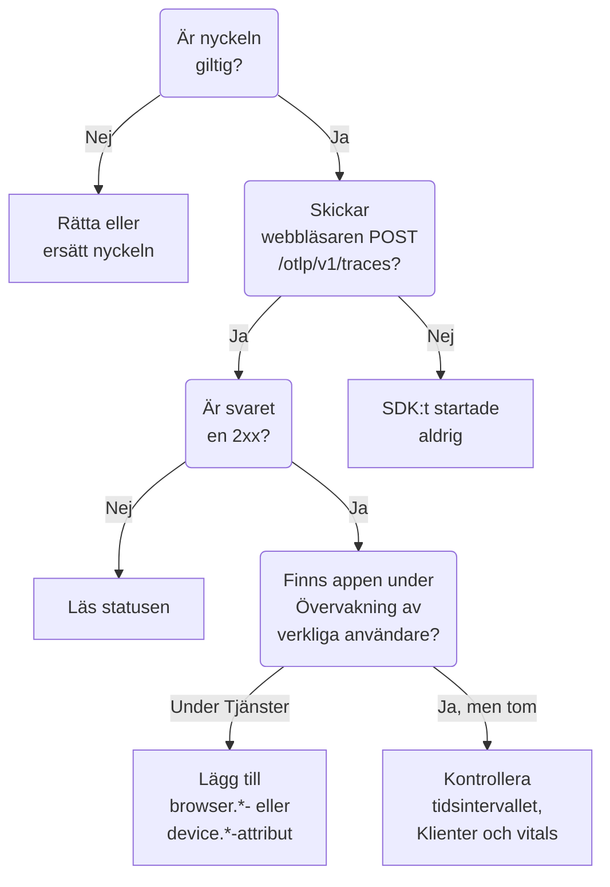

# RUM-felsökning

När en RUM-applikation saknas, är tom eller visar **Frånkopplad** går du igenom den här sidan i ordning. Varje kontroll utesluter en del av vägen mellan din app och OneUptime, i den ordning som de här problemen brukar uppstå.

:::cards
- [Kontrollera nyckeln](#kontrollera-nyckeln): Den snabbaste kontrollen, och allt annat beror på den.
- [Kontrollera vad som lämnar webbläsaren](#kontrollera-vad-som-lämnar-webbläsaren): Exportförfrågan i webbläsarens utvecklarverktyg.
- [Kontrollera var telemetrin hamnar](#kontrollera-var-telemetrin-hamnar): En RUM-applikation eller en backend-tjänst.
- [Problem med sessionsuppspelning](#problem-med-sessionsuppspelning): En separat pipeline, med en egen sida.
:::

## Var RUM-telemetri stannar

Telemetri passerar tre kontroller på väg till en RUM-applikation. Hitta den första som misslyckas:



## Kontrollera nyckeln

Kontrollera nyckeln först. Det är den snabbaste kontrollen, och inget av det som följer fungerar utan en nyckel som OneUptime accepterar:

```bash
curl -i https://oneuptime.com/otlp/v1/validate \
  -H "x-oneuptime-token: YOUR_TELEMETRY_INGESTION_TOKEN"
```

| Svar | Vad det betyder |
| --- | --- |
| `200` med `"valid": true` | OneUptime accepterar nyckeln. Svaret anger också dess `keyType` och dess `projectId`. Gå vidare till nästa kontroll. |
| `401` med `"valid": false` | Nyckeln saknas, är okänd, återkallad, inaktiverad eller har gått ut, och `message` säger vilket. Skapa en aktiv nyckel under **Projektinställningar → Telemetri och APM → Intagningsnycklar**. |

En webbapp behöver en **Webbläsare**-nyckel, och en mobilapp en **Server**-nyckel: se [Webbläsarkonfiguration](/docs/rum/browser-setup) och [Mobilkonfiguration](/docs/rum/mobile-setup). Exportslutpunkterna avvisar också en felaktig nyckel med `401`, som OTLP-specifikationen kräver, så ett väluppfostrat SDK loggar avvisningen i stället för att försöka igen. Den raden är lätt att missa i webbläsarkonsolen, och den här kontrollen svarar direkt.

## Kontrollera vad som lämnar webbläsaren

Öppna webbläsarens utvecklarverktyg på appens sida, välj fliken Nätverk och filtrera på `otlp`. Du letar efter `POST /otlp/v1/traces` som besvaras med en `2xx`-status.

### Ingen förfrågan

SDK:t startade aldrig. Det är nästan alltid en av de här orsakerna:

- `telemetry.ts` är inte den första importen i din app, eller så har din bundler tagit bort den. Instrumenteringarna ändrar `fetch` och `XMLHttpRequest`, så en förfrågan som görs före den ändringen spåras inte, och en fil som bundlern har tagit bort kör ingenting.
- Batchprocessorn har inte exporterat ännu. `BatchSpanProcessor` väntar några sekunder för att fylla en batch, så vänta, eller gå till en annan sida, innan du drar slutsatsen att ingenting skickas.
- En miljövariabel vid byggtiden har blivit kvar som `undefined`, och exportörens URL är trasig. Logga URL:en en gång vid start.

### Webbläsaren blockerar förfrågan

- **Ett Content Security Policy-fel i konsolen.** Sidans policy tillåter ännu inte OneUptime. Lägg till det i ditt befintliga `connect-src`-direktiv, eller använd din egen värd om du kör OneUptime själv:

  ```text
  connect-src 'self' https://oneuptime.com;
  ```

- **Ett CORS-fel.** OTLP-slutpunkterna accepterar förfrågningar från alla ursprung och tillåter huvudet `x-oneuptime-token`, så ett verkligt CORS-fel betyder nästan alltid att förfrågan aldrig nådde OneUptime: leta efter en företagsproxy, en annonsblockerare eller ett stavfel i värden. Kontrollera förfrågans URL på fliken Nätverk.

### Förfrågan får en felstatus

**`401`.** Nyckeln är okänd, återkallad eller har gått ut. Kör [nyckelkontrollen](#kontrollera-nyckeln) och använd sedan en aktiv nyckel.

**`404`.** URL:en är fel. Spårexportören behöver den fullständiga sökvägen, `/otlp/v1/traces`. Ett vanligt misstag är att ge basadressen (`https://oneuptime.com/otlp`) till en exportör som förväntar sig den fullständiga URL:en, eller den fullständiga URL:en till en som lägger till sökvägen själv och hamnar på `/otlp/v1/traces/v1/traces`.

**`413`.** Batchen var större än en proxy tillåter. OneUptimes egen ingress accepterar upp till 4 MB på `/otlp`, men en proxy som du placerar framför OneUptime kan vara striktare — ingress-nginx sätter till exempel `proxy-body-size` till 1 MB som standard — så om du har en, höj också dess gräns för `/otlp`. Oavsett vilket gör en mindre `maxExportBatchSize` på `BatchSpanProcessor` varje export mindre:

```ts
new BatchSpanProcessor(exporter, { maxExportBatchSize: 100 });
```

En webbläsare skickar sällan så stora batcher, om inte spans bär stora attribut, som en hel stackspårning eller en svarstext. Att korta dem är den bättre lösningen.

**`422`.** OneUptime avvisade nyckeln här, och meddelandet säger varför. `Origin https://app.example.com is not allowed for this browser ingestion key.` betyder att sidans exakta ursprung, med schema och eventuell port, saknas i nyckelns **Tillåtna ursprung**. `This telemetry ingestion key has been disabled.` betyder att någon har inaktiverat nyckeln.

**`429`.** Nyckelns **Requests Per Minute Limit** är förbrukad: `Too many telemetry requests for this ingestion key. Please retry later.` En Browser-nyckel tillåter 6000 förfrågningar per minut för alla dina besökare tillsammans, om du inte sätter en egen gräns på nyckeln.

**`403` med en HTML-sida, eller en tom text.** OneUptime besvarar varje avvisning i JSON, så den här kom från något framför, vanligtvis en brandvägg för webbapplikationer på din egen domän, om du leder OneUptime genom den. Brandväggen tolkar OTLP/JSON och jämför varje span-attribut med sina injektionsregler, så en URL med en frågesträng på ett span räcker för att den ska blockera, och brandväggens logg nämner regeln. Undanta OTLP-nyttolasten från inspektion bara på OTLP-sökvägarna: [Dina OpenTelemetry-förfrågningar blockeras också](/docs/rum/session-replay-troubleshooting#dina-opentelemetry-förfrågningar-blockeras-också) visar hur, och täcker uppspelningsinspelaren bakom samma brandvägg.

## Kontrollera var telemetrin hamnar

Förfrågan fungerar, men appen dyker upp under **Produkter → Tjänster** i stället för under **Produkter → Resurser → Övervakning av verkliga användare**. Det är det vanligaste ärendet, och orsaken är nästan alltid en resurs utan klientattribut. OneUptime arkiverar bara en batch som RUM när dess resurs bär något av de här:

| Typ | Attribut |
| --- | --- |
| Webbläsare | `browser.platform`, `browser.language` eller en icke-tom `browser.brands` |
| Mobil | `device.id` eller `device.model.identifier`, eller `device.manufacturer` på en resurs utan värdidentitet (`host.name`, `host.id` eller `k8s.node.name`) |

Ett `service.name` ensamt skapar en backend-tjänst. OpenTelemetry-SDK:t för webbläsare lägger inte till några `browser.*`-attribut om du inte lägger till webbläsarens resursdetektor eller sätter dem själv: se [Webbläsarkonfiguration](/docs/rum/browser-setup).

För att se vad du faktiskt skickar öppnar du OTLP-förfrågan på fliken Nätverk och tittar på nyttolasten: `resourceSpans[0].resource.attributes` är listan som avgör. Om det inte finns något `browser.*`-attribut lägger SDK:t inte till det, vad dokumentationen än säger.

Lägg till attributen, så skapar nästa batch RUM-applikationen. Tjänsten som skapades först blir inte en RUM-applikation, eftersom de är separata poster, så radera den under **Produkter → Tjänster** när RUM-telemetrin kommer in.

> [!NOTE]
> En resurs vars enda klientattribut är `device.manufacturer`, och som också har en värdidentitet, tolkas som en maskin och inte som en telefon, eftersom en värds inventering rapporterar sin tillverkare med samma attribut. Lägg till `device.id` eller `device.model.identifier`, så arkiveras batchen som mobil-RUM vad den än bär i övrigt.

## Applikationen är tom

Applikationen finns, men dess sidor visar ingenting.

- **Kontrollera tidsintervallet.** Översikten visar den senaste timmen som standard, så en testbatch från i morse hamnar utanför.
- **Vänta några minuter.** Intag går via en kö, och **Senast sedd** uppdateras med några minuters mellanrum i stället för vid varje batch.
- **Kontrollera projektet.** En nyckel skriver till sitt eget projekt, så telemetri som skickas med ett annat projekts nyckel finns där och inte här.

## Sidan Klienter är tom

Sidan **Klienter** listar `browser.platform` på webben och `device.model.identifier` på mobil. Två skäl till att den förblir tom även när allt annat fungerar:

- **Safari och Firefox.** `browserDetector` läser UA Client Hints-API:t, som bara Chromium-webbläsare har. På de andra sätter den `browser.language`, vilket räcker för att arkivera telemetrin som RUM, men inte `browser.platform`. Sätt `browser.platform` själv för att få med de klienterna.
- **Ett mobil-SDK som bara sätter `device.manufacturer`.** Det arkiverar telemetrin som mobil-RUM, men sidan **Klienter** behöver `device.model.identifier`.

## Core Web Vitals visar «No web vitals reported yet»

Kortet fylls bara med de mätvärden som din app skickar, så spår ensamma fyller det aldrig. Kontrollera att du exporterar mätvärden, att deras namn är bland dem som OneUptime läser och att de visas på applikationens sida **Mätvärden**. [Kortet säger «No web vitals reported yet»](/docs/rum/web-vitals#felsökning) går igenom varje kontroll, inklusive värden som går förlorade när en besökare stänger fliken före nästa export.

## Statusen säger Frånkopplad medan folk använder appen

En applikation går över till **Frånkopplad** efter 15 minuter utan telemetri. Om folk använder appen:

- **En sampler kanske kastar allt.** Kontrollera att du inte har satt en sampler som alltid är av, eller ett mycket lågt förhållande.
- **Appen skickar kanske bara telemetri vid vissa interaktioner**, och ingen använde dem under den tiden.
- **Nyckeln kan ha återkallats eller inaktiverats** efter driftsättningen: kör [nyckelkontrollen](#kontrollera-nyckeln) igen.

En intern app eller en app med lite trafik utan besökare på natten är verkligen frånkopplad. Det är inget fel.

## Problem med sessionsuppspelning

Sessionsuppspelning är en separat pipeline med egna problem: inspelarens skript, listor över tillåtna ursprung, samtycke, Content Security Policy och maskering. [Felsökning av sessionsuppspelning](/docs/rum/session-replay-troubleshooting) täcker dem. Börja där, och börja med att slå på inspelarens diagnostik, eftersom de flesta av dess fel är tysta med avsikt:

```js
localStorage.setItem("oneuptime.sessionReplay.debug", "true");
// then reload the page
```

Applikationens sida **Hälsa**, i avsnittet **Sessionsuppspelning**, och panelen **Test your installation** på **Replay Policy** kontrollerar nyckeln, listorna över tillåtna ursprung och policyn från serversidan och säger varför ingenting kommer in. Webbläsarkonsolen ger dig den halva som servern inte kan se.

Med standardpolicyn skickar en inspelare en chunk ungefär var 15:e sekund medan användaren interagerar med sidan. En inaktiv flik har inget att skicka, så klicka eller rör musen först; om det sedan inte finns någon chunk-förfrågan är något fel. Om appen bara laddar upp _On error or frustration_ är tystnad väntad tills något går fel. Anropa `OneUptimeReplay.captureSession()` för att tvinga fram en uppladdning och testa vägen ändå.

De två pipelinerna är oberoende. Du behöver ingen fungerande RUM-applikation för att inspelaren ska laddas, och en fungerande inspelare betyder inte att RUM-telemetri kommer in: var och en kan misslyckas på egen hand.

## Fortfarande fast?

Samla in det här innan du ber om hjälp. Det sparar en runda fram och tillbaka:

- Listan `resource.attributes` från nyttolasten i en verklig OTLP-förfrågan.
- HTTP-statusen för den förfrågan.
- Det exakta `service.name` du skickar, och om projektet har en applikation eller en tjänst med det namnet.
- Om `/otlp/v1/validate` svarar `200` för nyckeln i det driftsatta bygget.

Skriv sedan till support@oneuptime.com eller öppna ett ärende på [GitHub](https://github.com/OneUptime/oneuptime).

## Nästa steg

:::cards
- [Webbläsarkonfiguration](/docs/rum/browser-setup): Konfigurationen som de här kontrollerna utgår från, steg för steg.
- [Mobilkonfiguration](/docs/rum/mobile-setup): Nyckeln och attributen som en mobilapp behöver.
- [Hantera applikationer](/docs/rum/applications): Namn, etiketter, lagring och status.
- [Felsökning av sessionsuppspelning](/docs/rum/session-replay-troubleshooting): Varje kod från inspelaren, och vad du gör åt den.
:::
