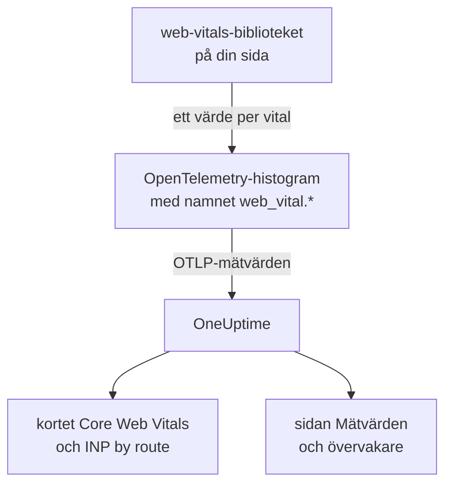
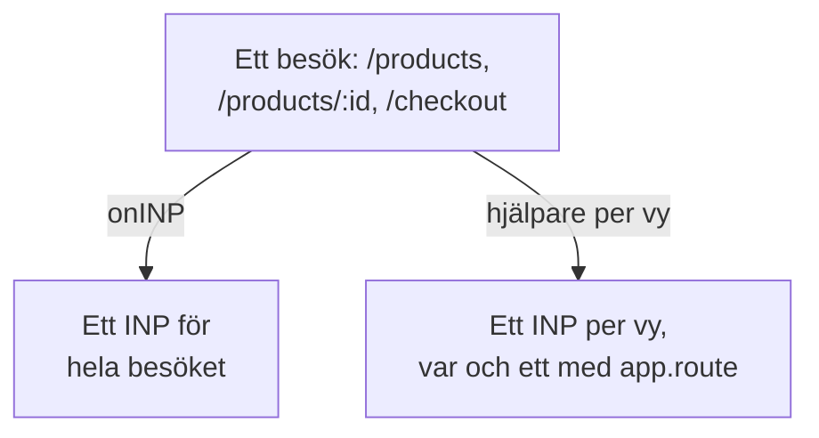

# Core Web Vitals

Kortet **Core Web Vitals** i en RUM-applikations översikt visar LCP, INP, CLS, FCP och TTFB, vart och ett bedömt mot Googles gränser. OneUptime mäter inget av dem själv: Kortet fylls bara från mätvärden som din webbläsarinstrumentering rapporterar, och den här sidan visar hur du skickar dem.

:::cards
- [Skicka dem](#skicka-dem-från-din-app): Vidarebefordra värdena från web-vitals-biblioteket som OpenTelemetry-mätvärden.
- [Namn som OneUptime läser](#mätvärdesnamn-som-oneuptime-känner-igen): Mätvärdesnamnen som varje vital kan komma in under.
- [Ensidesappar](#ensidesappar): INP för varje vy, inte ett värde per sidladdning.
- [Larma på en vital](#larma-på-en-vital): Färdiga övervakare för dåliga vitals.
:::

## Så fungerar det

Biblioteket [`web-vitals`](https://github.com/GoogleChrome/web-vitals) mäter varje vital på sidan; det är samma bibliotek som Chromes egna verktyg använder. Din kod registrerar varje värde i ett OpenTelemetry-histogram, och webbläsarens mätvärdespipeline exporterar det till OneUptime.



OpenTelemetry har ännu ingen slutlig namnkonvention för web vitals, så OneUptime letar efter varje vital under flera namn och använder det första som har data. Använd namnen `web_vital.*` för ny instrumentering.

## Innan du börjar

- En webbapp som är konfigurerad som i [Webbläsarkonfiguration](/docs/rum/browser-setup), med dess mätvärdespipeline: Det är `MeterProvider` från [Lägg till loggar och mätvärden](/docs/rum/browser-setup#lägg-till-loggar-och-mätvärden) som exporterar de här värdena.

## Skicka dem från din app

:::steps
### Installera biblioteket

```bash
npm install web-vitals
```

### Registrera varje vital i ett histogram

Skapa `src/web-vitals.ts`. Varje vital är ett histogram, så att sidan **Mätvärden** senare kan räkna ut percentiler, med bucketgränser på Googles gränser för bra och dåligt.

```ts title="src/web-vitals.ts"
// Import after ./telemetry
import { metrics } from "@opentelemetry/api";
import { onCLS, onFCP, onINP, onLCP, onTTFB, type Metric } from "web-vitals";

const meter = metrics.getMeter("web-vitals");

// Histograms, so the Metrics tab can compute percentiles later. The bucket
// edges sit on each vital's good / poor limits: a percentile is read from
// the buckets, and the defaults are far too coarse for these ranges.
const buckets = (...edges: number[]) => ({ advice: { explicitBucketBoundaries: edges } });

const lcp = meter.createHistogram("web_vital.lcp", { unit: "ms", ...buckets(0, 1000, 1500, 2000, 2500, 3000, 3500, 4000, 5000, 7500, 10000) });
const inp = meter.createHistogram("web_vital.inp", { unit: "ms", ...buckets(0, 50, 100, 150, 200, 250, 300, 400, 500, 750, 1000, 2000) });
const fcp = meter.createHistogram("web_vital.fcp", { unit: "ms", ...buckets(0, 600, 1200, 1800, 2400, 3000, 4000, 6000, 10000) });
const ttfb = meter.createHistogram("web_vital.ttfb", { unit: "ms", ...buckets(0, 200, 400, 600, 800, 1200, 1800, 2500, 4000) });
const cls = meter.createHistogram("web_vital.cls", { unit: "1", ...buckets(0, 0.025, 0.05, 0.1, 0.15, 0.2, 0.25, 0.4, 0.6, 1) });

function record(
  histogram: { record: (v: number, a?: Record<string, string>) => void },
) {
  return (metric: Metric): void => {
    histogram.record(metric.value, {
      // Keep attributes low-cardinality. Never put a full URL or a user id here.
      "web_vital.rating": metric.rating,
    });
  };
}

onLCP(record(lcp));
onINP(record(inp));
onCLS(record(cls));
onFCP(record(fcp));
onTTFB(record(ttfb));
```

### Importera den efter din telemetrikonfiguration

```ts
import "./telemetry";
import "./web-vitals";
```

### Kontrollera sidan Mätvärden

Ladda några sidor och sök sedan efter `web_vital.lcp` på applikationens sida **Mätvärden**. När mätvärdena finns där fylls kortet **Core Web Vitals** för det tidsintervall du väljer.
:::

## Skicka de sista värdena innan sidan stängs

`onINP` och `onCLS` rapporterar när sidan döljs, inte under besöket. Med exportintervallet på 30 sekunder från [Webbläsarkonfiguration](/docs/rum/browser-setup) kan en besökare som stänger fliken direkt efter det sista värdet hinna lämna innan det exporteras. Om fullständighet spelar roll kortar du `exportIntervalMillis`, eller behåller den `MeterProvider` du byggde i `telemetry.ts` och tömmer den när sidan döljs:

```ts
// In telemetry.ts, export the provider you created:
export const meterProvider = new MeterProvider({ /* ... */ });

// Anywhere after setup:
import { meterProvider } from "./telemetry";

document.addEventListener("visibilitychange", () => {
  if (document.visibilityState === "hidden") {
    void meterProvider.forceFlush();
  }
});
```

## Mätvärdesnamn som OneUptime känner igen

OneUptime provar namnen i den här ordningen, och det första som har data i det valda intervallet vinner.

| Vital | Mätvärdesnamn, vilket som helst | Enhet |
| --- | --- | --- |
| LCP: Largest Contentful Paint | `web_vital.lcp`, `browser.largest_contentful_paint`, `largest_contentful_paint`, `web.vitals.lcp` | ms |
| INP: Interaction to Next Paint | `web_vital.inp`, `browser.interaction_to_next_paint`, `interaction_to_next_paint`, `web.vitals.inp` | ms |
| CLS: Cumulative Layout Shift | `web_vital.cls`, `browser.cumulative_layout_shift`, `cumulative_layout_shift`, `web.vitals.cls` | poäng |
| FCP: First Contentful Paint | `web_vital.fcp`, `browser.first_contentful_paint`, `first_contentful_paint`, `web.vitals.fcp` | ms |
| TTFB: Time to First Byte | `web_vital.ttfb`, `browser.time_to_first_byte`, `time_to_first_byte`, `web.vitals.ttfb` | ms |

De andra namnen finns för att en app som redan skickar enligt en community-konvention ska dyka upp utan ändringar.

## Bedömningsgränser

Kortet bedömer varje värde med Googles publicerade gränser för Core Web Vitals:

| Vital | **Good** | **Needs work** | **Poor** |
| --- | --- | --- | --- |
| LCP | under 2500 ms | 2500 till 4000 ms | 4000 ms eller mer |
| INP | under 200 ms | 200 till 500 ms | 500 ms eller mer |
| CLS | under 0,1 | 0,1 till 0,25 | 0,25 eller mer |
| FCP | under 1800 ms | 1800 till 3000 ms | 3000 ms eller mer |
| TTFB | under 800 ms | 800 till 1800 ms | 1800 ms eller mer |

Kortet visar **medelvärdet** över det valda intervallet, inte den 75:e percentil som Googles fältverktyg rapporterar. Det är avsiktligt: OneUptime läser ett histograms percentiler från dess buckets, så en percentil är bara så exakt som dess buckets, medan medelvärdet kommer från histogrammets exakta summa och antal. Med OpenTelemetrys standardbuckets (`0, 5, 10, 25, 50, …`) hamnar varje CLS-värde i den första bucketen, och en 75:e percentil skulle visa 2,5 för en sida som knappt rör sig.

> [!TIP]
> Läs kortet som en trend. För den 75:e percentilen registrerar du med bucketgränserna ovan och visar sedan mätvärdet på sidan **Mätvärden** med aggregeringen **P75**. En mätvärdesövervakare erbjuder samma val.

## Ensidesappar

`onINP` mäter INP så som webbläsaren definierar det: **ett värde per sidladdning**. En ensidesapp laddas en gång och byter sedan route med `history.pushState`, så ett besök på `/products`, `/products/42` och `/checkout` ger ett enda INP för hela besöket. Alla vyers interaktioner tävlar om det enda talet, och ett route-attribut på det anger den sida som visades när det rapporterades, inte den sida som var långsam.



För att se INP per vy mäter du det per vy: Varje routebyte avslutar den aktuella vyn och startar en ny, och varje vy rapporterar sitt eget INP. Hjälparen nedan gör det med webbläsarens Event Timing API, samma data som `onINP` använder, och tar hand om den del som är lätt att få fel: Klicket som **orsakade** en navigering levereras först efter att routen redan har bytts, men hör till sidan där det klickades.

```ts title="src/inp-per-route.ts"
// INP for each view of a single-page app.
type Report = (inpMs: number, route: string) => void;

interface View {
  route: string;
  path: string; // the URL path it was opened for
  start: number; // performance.now() when the view began
  latencies: Map<number, number>; // interactionId -> its slowest entry
}

// Long enough for the click that navigated to be delivered: its entry
// arrives after the next paint, i.e. after the route has changed.
const SETTLE_MS = 1000;

let views: Array<View> = [];
let report: Report = () => {};

// The path, plus the hash when a hash router keeps the route there.
const currentPath = (): string =>
  location.pathname + (location.hash.startsWith("#/") ? location.hash : "");

function close(view: View): void {
  if (!views.includes(view)) return; // already reported
  views = views.filter((v) => v !== view);

  const sorted = [...view.latencies.values()].sort((a, b) => b - a);
  if (sorted.length === 0) return; // nobody interacted: no INP, not 0

  // web-vitals' p98: skip one outlier for every 50 interactions.
  report(sorted[Math.min(sorted.length - 1, Math.floor(sorted.length / 50))]!, view.route);
}

function record(entries: PerformanceEntryList): void {
  for (const entry of entries as Array<PerformanceEventTiming & { interactionId?: number }>) {
    if (!entry.interactionId) continue; // hovers, scrolls: not interactions

    // The view the interaction STARTED in, so the click that navigated
    // counts towards the page it was clicked on.
    const view = [...views].reverse().find((v) => entry.startTime >= v.start);
    if (!view) continue;

    const slowest = view.latencies.get(entry.interactionId) ?? 0;
    view.latencies.set(entry.interactionId, Math.max(slowest, entry.duration));
  }
}

export function observeInpPerRoute(route: string, onReport: Report): void {
  if (typeof PerformanceObserver === "undefined" || !PerformanceObserver.supportedEntryTypes?.includes("event")) return;

  report = onReport;
  views = [{ route, path: currentPath(), start: 0, latencies: new Map() }];

  const observer = new PerformanceObserver((list) => record(list.getEntries()));
  observer.observe({ type: "event", durationThreshold: 40, buffered: true } as PerformanceObserverInit);

  // The tab may never come back: report every view now, then keep
  // measuring the current route as a fresh view.
  document.addEventListener("visibilitychange", () => {
    if (document.visibilityState !== "hidden") return;
    record(observer.takeRecords());
    const current = views[views.length - 1]?.route ?? route;
    [...views].forEach(close);
    views = [{ route: current, path: currentPath(), start: performance.now(), latencies: new Map() }];
  });
}

// Call after every navigation, with the route PATTERN ("/products/:id").
// Safe to call when nothing changed (a router's initial navigation, a
// query-string update): the view only ends when the path does.
export function startView(route: string): void {
  const closing = views[views.length - 1];
  if (!closing || closing.path === currentPath()) return;

  views.push({ route, path: currentPath(), start: performance.now(), latencies: new Map() });
  setTimeout(() => close(closing), SETTLE_MS);
}
```

Båda funktionerna tar routens **mönster**, aldrig URL:en: `/products/42` och `/products/7` måste vara en enda route, annars blir varje produkt en egen serie. Använd routerns mönster där den har ett; annars slår du ihop id:na själv:

```ts
// "/products/42" -> "/products/:id", also for UUIDs.
export const toRoutePattern = (path: string): string =>
  path.replace(/\/(\d+|[0-9a-f]{8}-[0-9a-f-]{27})(?=\/|$)/gi, "/:id");
```

Registrera det som hjälparen rapporterar i samma histogram `web_vital.inp`, med routen som `app.route`, och **ta bort `onINP`** från snippetet ovan: Med båda skulle varje interaktion räknas två gånger.

```ts
// src/web-vitals.ts, in place of onINP(record(inp))
import { observeInpPerRoute } from "./inp-per-route";

observeInpPerRoute(toRoutePattern(location.pathname), (inpMs, route) => {
  inp.record(inpMs, {
    "app.route": route,
    "web_vital.rating": inpMs <= 200 ? "good" : inpMs <= 500 ? "needs-improvement" : "poor",
  });
});
```

Anropa sedan `startView` där din router meddelar en avslutad navigering. Den ignorerar ett anrop när URL-sökvägen inte har ändrats, så en router som också rapporterar den första laddningen, eller en ändring av frågesträngen, delar inte vyn:

:::tabs
@tab Vue Router
```ts
router.afterEach((to) => startView(to.matched[to.matched.length - 1]?.path ?? toRoutePattern(to.path)));
```
@tab React Router
```tsx
// In a component that stays mounted inside the router
const { pathname } = useLocation();
useEffect(() => startView(toRoutePattern(pathname)), [pathname]);
```
:::

Det här får du:

- **INP by route** i översikten, långsammast först, utifrån `app.route`; OneUptime läser också OpenTelemetrys `url.template`.
- Ett routefilter för larm: Filtrera en mätvärdesövervakare på `web_vital.inp` efter `app.route` för att bevaka ett enskilt flöde, som `/checkout`, för sig.
- Appens samlade INP på kortet **Core Web Vitals** fortsätter att fungera: Det är samma mätvärde, nu med ett värde per vy i stället för ett per sidladdning.

Chromium-webbläsare rapporterar de interaktions-id:n som detta behöver. Safari rapporterar inga, och det är också därför `onINP` inte rapporterar något där. Chromes experimentella Soft Navigations API siktar på att göra detta inbyggt, men det är inte allmänt tillgängligt; den här hjälparen fungerar redan i dag.

> [!NOTE]
> Inspelaren i [Sessionsuppspelning](/docs/telemetry/session-replay) mäter redan INP per vy, utan kod: Varje inspelning visar en INP-rad för varje route som användaren interagerade på, med det långsamma elementet och hur tiden fördelades mellan inmatningsfördröjning, bearbetning och presentation.

## Håll kardinaliteten under kontroll

Mätvärdesattribut multipliceras. `web_vital.rating` har tre möjliga värden, vilket är okej, och ett attribut för route eller sidtyp är oftast värt det:

```ts
histogram.record(metric.value, {
  "web_vital.rating": metric.rating,
  "app.route": routePattern, // "/product/:id" — the PATTERN, not "/product/8842"
});
```

Att registrera den konkreta URL:en i stället för routemönstret skapar en tidsserie per produktsida, vilket gör sidan **Mätvärden** långsam och lagringsräkningen stor. Detsamma gäller användar-id:n, sessions-id:n och skärmstorlekar.

## Larma på en vital

Applikationens sida **Rekommendationer** erbjuder en färdig övervakare för varje vital. Var och en läser femminutersmedelvärdet av sitt mätvärde och utlöses när det når Googles gräns för dåligt:

| Rekommendation | Mätvärde | Utlöses vid | Allvarlighetsgrad |
| --- | --- | --- | --- |
| **Poor Largest Contentful Paint** | `web_vital.lcp` | 4000 ms | **Kritisk** |
| **Poor Interaction to Next Paint** | `web_vital.inp` | 500 ms | **Kritisk** |
| **Poor Cumulative Layout Shift** | `web_vital.cls` | 0,25 | **Kritisk** |
| **Slow First Contentful Paint** | `web_vital.fcp` | 3000 ms | **Warning** |
| **Slow Time to First Byte** | `web_vital.ttfb` | 1800 ms | **Warning** |

De här övervakarna läser bara namnen `web_vital.*`. Om din app skickar en vital under ett annat namn ändrar du mätvärdet i den skapade övervakaren. För att larma på en enda route lägger du till ett filter `app.route` på övervakaren. Du kan också bygga en egen övervakare på vilket som helst av de här mätvärdena: se [Metrikövervakning](/docs/monitor/metrics-monitor).

## Felsökning

:::details Kortet säger ”No web vitals reported yet”
Kortet fylls bara från mätvärden som din app skickar. Kontrollera i ordning:

1. Att du alls har en mätvärdespipeline: Spår ensamma fyller aldrig det här kortet.
2. Att mätvärdesnamnen hör till dem som OneUptime läser: se [Mätvärdesnamn som OneUptime känner igen](#mätvärdesnamn-som-oneuptime-känner-igen).
3. Att mätvärdena finns på applikationens sida **Mätvärden**. Gör de det fungerar exporten, och problemet är namnet eller tidsintervallet.
4. Att INP och CLS rapporteras när sidan döljs, så ett kort besök kan ta slut före nästa export: se [Skicka de sista värdena innan sidan stängs](#skicka-de-sista-värdena-innan-sidan-stängs).

Om inget av detta hjälper kontrollerar [RUM-felsökning](/docs/rum/troubleshooting) hela pipelinen.
:::

:::details INP rapporteras, men inte per route
Kortet **INP by route** behöver attributet `app.route`, eller `url.template`, på `web_vital.inp`. Registrera routemönstret med varje värde som i [Ensidesappar](#ensidesappar).
:::

:::details Värdena skiljer sig från Googles rapport
Kortet visar medelvärdet över det intervall du valde, och Google rapporterar den 75:e percentilen av sina egna besökare. Visa **P75** på sidan **Mätvärden** för att jämföra lika med lika.
:::

## Nästa steg

:::cards
- [Webbläsarkonfiguration](/docs/rum/browser-setup): Pipelinen för spår, loggar och mätvärden som de här vitals färdas på.
- [Metrikövervakning](/docs/monitor/metrics-monitor): Larma på vilken vital som helst, för hela appen eller en enda route.
- [Sessionsuppspelning](/docs/telemetry/session-replay): Se INP per vy i inspelningar, utan kod.
- [RUM-felsökning](/docs/rum/troubleshooting): Varje kontroll, i den ordning problem brukar uppstå.
:::
