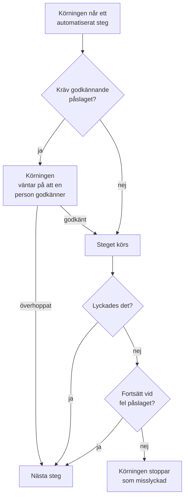

# Skriva ett runbook

Du skriver ett runbook som en ordnad lista med steg på dess sida **Steg**. Den här sidan visar hur du skapar ett runbook, hur du konfigurerar var och en av de sju stegtyperna och hur fel och godkännanden ändrar en körnings förlopp.

:::cards
- [Skapa ett runbook](#skapa-ett-runbook): Från ett tomt runbook till sparade steg.
- [Stegtyper](#stegtyper): Manual, JavaScript, HTTP request, Bash, SSH, kubectl och AI.
- [Felhantering och godkännanden](#felhantering-och-godkännanden): Vad som händer när ett steg misslyckas eller väntar på godkännande.
- [Ett genomgånget exempel](#ett-genomgånget-exempel): En databas-failover i fem steg.
:::

## Innan du börjar

- **En roll som skriver runbooks.** Project Owner, Project Admin och Runbook Admin skapar runbooks och sparar deras steg. Med detaljerade behörigheter behöver du **Create Runbook** och **Edit Runbook**. Se [Behörigheter](/docs/runbooks/configuration#behörigheter).
- **En Runner, för Bash-, SSH- och kubectl-steg.** De här stegen körs på en [Runner](/docs/runbooks/agents) i din egen infrastruktur, aldrig på OneUptime Worker. Installera en först. Ett steg som inte väljer någon Runner körs på [projektets standard-Runner](/docs/runbooks/agents#projektets-standard-runner), om du har angett en; annars körs ett JavaScript-steg på en [global Runner](/docs/runbooks/agents#globala-runners).
- **En hemlig variabel, för SSH- och kubectl-steg.** Den nyckel, det lösenord eller den kubeconfig som ett steg loggar in med är en hemlig [runbook-variabel](/docs/runbooks/variables). Project Owner och Project Admin skapar variabler, och Runbook Admin väljer dem i de steg den skriver. Ett kubectl-steg kan i stället använda Runnerns egen åtkomst.
- **En LLM-leverantör, för AI-steg.** Se [LLM-leverantörer](/docs/ai/llm-provider).

## Skapa ett runbook

:::steps
### Öppna Runbooks

Öppna **Produkter → Runbooks**. Runbooks finns i gruppen **Instrumentpaneler och automatisering**.

### Skapa runbooket

Klicka på **Skapa Runbook**, ange ett **Namn** och eventuellt en **Beskrivning** av vad runbooket är till för. Under **Fler fält** finns brytaren **Aktiverad**, som är påslagen som standard, och **Etiketter**. Det nya runbooket öppnas på sin sida **Steg**.

### Lägg till steg

Under **Kom igång med din runbook** väljer du typen för det första steget; under det sista steget erbjuder **Lägg till ett steg till** samma sju typer. Varje steg öppnas med sin **Titel** och det som dess typ behöver; resten, till exempel dess **Beskrivning** och tidsgränser, är hopfällt under **Fler fält**. När runbooket har ett steg lägger **Lägg till steg** högst upp på kortet till ett Manual-steg.

### Ordna stegen

Steg körs **i ordning**. Du ändrar ordningen genom att dra ett steg i handtaget till vänster i dess rubrik; med tangentbordet sätter du fokus på handtaget, trycker på blanksteg, flyttar steget med piltangenterna och trycker på blanksteg igen.

### Spara stegen

Klicka på **Spara steg**. Tills du gör det visar redigeraren **Osparade ändringar**. När de är sparade ser du **Sparad**, och runbooket är redo att [köras](/docs/runbooks/running).
:::

## Hur ett steg är uppbyggt

Varje steg har de här fälten. Ett automatiserat steg visar sin **Titel** och inställningarna för sin typ och fäller ihop resten under **Fler fält**, som visar vad av det som är satt:

| Fält | Syfte |
| --- | --- |
| **Titel** | En kort etikett som visas i steglistan och vid varje körning. |
| **Beskrivning** | Valfri kontext för den som hanterar incidenten, i Markdown, under **Fler fält**. På ett Manual-steg är det de **Instruktioner** personen läser och följer, visade under titeln. |
| **Fortsätt vid fel** | Bara automatiserade steg. När den är påslagen stoppar ett steg som misslyckas inte körningen: nästa steg körs ändå. |
| **Kräv godkännande** | Bara automatiserade steg. När den är påslagen stannar körningen före det här steget tills någon godkänner det, och först då körs det. Brytaren heter **Kräv godkännande innan det här steget körs**, och stegets rubrik visar **Kräver godkännande**. |
| Typspecifika inställningar | Skriptet, URL:en, Runnern, en hemlig variabel eller prompten. Se [Stegtyper](#stegtyper). |

## Stegtyper

| Typ | Körs på | Kräver |
| --- | --- | --- |
| [Manual](#manual) | En person | Ingenting |
| [JavaScript](#javascript) | En Runner | En Runner |
| [HTTP request](#http-request) | OneUptime Worker | Ingenting |
| [Bash](#bash) | En Runner | En Runner |
| [SSH](#ssh) | En Runner | En Runner och en hemlig variabel att logga in med |
| [kubectl](#kubectl) | En Runner | En Runner och en kubeconfig-variabel eller Runnerns egen åtkomst |
| [AI](#ai) | OneUptime Worker | En LLM-leverantör |

I varje automatiserat steg nedan innehåller stegets **Fler fält** först dess **Runner**, för ett steg som körs på en, sedan **Kräv godkännande** och **Fortsätt vid fel**, sedan stegets egna inställningar - ett HTTP-anrops headers, ett SSH-stegs port och nyckelns lösenfras, ett AI-stegs leverantör och kontextbrytare - och sist **Beskrivning** och tidsgränserna. Hopfällt nämner det stegets Runner, så att du ser var ett steg körs utan att öppna det.

### Manual

En checklistepunkt för en person: stegets **Instruktioner** säger vad som ska göras eller kontrolleras. Körningen pausar när den når ett Manual-steg och stannar i `WaitingForManualStep` (**Väntar på dig**) tills någon klickar på **Markera som klar** eller **Hoppa över**. En körning som väntar på en person löper aldrig ut. Ett Manual-steg har ingen godkännandebrytare: det stoppar redan körningen för en person.

Använd det för det som bara en människa kan kontrollera eller göra: "Bekräfta i lastbalanserarens instrumentpanel att trafiken har flyttats till den sekundära regionen."

### JavaScript

Ett stycke JavaScript som körs i en `isolated-vm`-sandlåda på en [runbook-agent](/docs/runbooks/agents), inte på OneUptime Worker: på en av dina egna, eller på en [global Runner](/docs/runbooks/agents#globala-runners) när steget inte väljer någon.

| Fält | Vad det gör | Standard |
| --- | --- | --- |
| **Runner** | Under **Fler fält**. Den Runner som kör steget: **Global Runner** eller en av dina egna. Bara den Runner du väljer får ta jobbet; vilken global Runner som helst får ta ett steg på **Global Runner**. | [Projektets standard-Runner](/docs/runbooks/agents#projektets-standard-runner), om du har angett en; annars **Global Runner**, när det finns en |
| **Skript** | Den JavaScript-kod som ska köras. Returnera ett värde med `return` för att registrera det; varje rad från `console.log` registreras också. Ett kastat fel får steget att misslyckas. | — |
| **Tidsgräns för körning** | Hur länge Runnern låter koden köra innan den river sandlådan. En global Runner låter den köra i högst 5 minuter. | 30 sekunder |
| **Tidsgräns för övertagande** | Hur länge Workern väntar på att Runnern tar jobbet. | 2 minuter |

```javascript
const start = Date.now();
// ... your logic ...
console.log("replica lag checked");
return { durationMs: Date.now() - start };
```

Sandlådan har 128 MB minne och ingen åtkomst till filsystemet eller processer. Den kan göra HTTP-begäranden med `axios`, men bara till publika adresser: en begäran till ett privat nätverk, till Runnerns egen värd eller till en metadataslutpunkt i molnet avvisas. Använd ett [Bash](#bash)-steg med `curl` för att nå en tjänst i ditt nätverk.

### HTTP request

Ett utgående HTTP-anrop som görs av OneUptime Worker. Ingen Runner behövs.

| Fält | Vad det gör | Standard |
| --- | --- | --- |
| **Metod** | `GET`, `POST`, `PUT`, `PATCH`, `DELETE` eller `HEAD`. | `GET` |
| **URL** | Slutpunkten som ska anropas. | Tom |
| **Rubriker (JSON)** | Under **Fler fält**. Ett JSON-objekt, till exempel `{ "Authorization": "Bearer ..." }`. Headers som inte är giltig JSON får steget att misslyckas. | Inga |
| **Brödtext** | Visas för `POST`, `PUT`, `PATCH` och `DELETE`. Skickas som JSON när den kan tolkas som JSON, annars som text. | Ingen |
| **Tidsgräns för begäran** | Hur länge det väntas på slutpunktens svar innan steget misslyckas. | 30 sekunder |

Steget lyckas vid ett `2xx`- eller `3xx`-svar och misslyckas vid allt annat, med `HTTP <status>` som fel. Omdirigeringar följs inte. Svarets status, headers och body registreras, upp till 50 KB.

> [!NOTE]
> Workern anropar aldrig loopback- eller link-local-adresser, till exempel en metadataslutpunkt i molnet. På OneUptime Cloud anropar den bara publika adresser. En självhostad OneUptime når även privata nätverk, om inte `DATA_SOURCE_BLOCK_PRIVATE_ADDRESSES` är `true`. Använd ett [Bash](#bash)-steg med `curl` för att anropa en tjänst i ditt nätverk från OneUptime Cloud.

Användbart för: att öppna en PagerDuty-incident, posta till en Slack-webhook, anropa din molnleverantörs API eller ditt eget publika API.

> [!TIP]
> Håll tokens utanför steget. Spara dem som hemliga [runbook-variabler](/docs/runbooks/variables) och skriv `{{global.variables.NAME}}` där värdet ska stå, i URL:en, headers eller body. OneUptime skickar begäran själv, så det fyller även i hemligheter, och svaret som steget registrerar visar `[REDACTED]` i deras ställe. I JSON-headers eller en JSON-body hamnar ett värde inuti sin sträng, så ett citattecken eller en radbrytning i det förstör inte JSON:en.

### Bash

Ett bash-skript som körs med `bash -c <script>` på en [runbook-agent](/docs/runbooks/agents) i din egen infrastruktur. Bash körs aldrig på OneUptime Worker.

| Fält | Vad det gör | Standard |
| --- | --- | --- |
| **Runner** | Under **Fler fält**. Den Runner som kör steget. Bara den Runnern får ta jobbet. Globala Runners kör bara JavaScript-steg. | Projektets standard-Runner, om du har angett en |
| **Bash-skript** | Skriptet. Output (stdout och stderr) registreras upp till 50 KB, och en slutkod som inte är noll får steget att misslyckas. | — |
| **Tidsgräns för körning** | Hur länge Runnern låter skriptet köra innan den dödar det med `SIGKILL`. Höj den för steg som av goda skäl tar minuter. | 30 sekunder |
| **Tidsgräns för övertagande** | Hur länge Workern väntar på att Runnern tar jobbet. | 2 minuter |

Skriptet körs i Runnerns container med de verktyg som dess image levereras med, som `curl`, `wget` och `ssh`-klienten, och med nätverksåtkomsten från den värd det körs på. Till exempel för att kontrollera en tjänst som bara ditt nätverk kan nå:

```bash
set -euo pipefail
HTTP_CODE=$(curl -s -o /tmp/resp.txt -w "%{http_code}" "http://payments.internal:8080/health")
echo "HTTP $HTTP_CODE"
cat /tmp/resp.txt
if [[ "$HTTP_CODE" != "200" ]]; then
  echo "Health check failed"
  exit 1
fi
```

Om den valda Runnern är offline när körningen når det här steget väntar steget upp till **claim timeout** (2 minuter som standard) och misslyckas sedan på grund av tidsgräns. Lägg till en agent under **Runbooks → Runbook-agenter** innan du räknar med ett Bash-steg.

> [!TIP]
> Håll lösenord och tokens utanför skriptet. Spara dem som hemliga [runbook-variabler](/docs/runbooks/variables) och skriv `{{global.variables.NAME}}` där värdet ska stå: Runnern får skriptet med värdet ifyllt, och stegets utdata visar `[REDACTED]` i dess ställe.

### SSH

Logga in på en maskin över SSH och kör ett bash-skript där. Runnern öppnar anslutningen, så maskinen behöver bara kunna nås från Runnern, och den nyckel eller det lösenord som steget loggar in med är en hemlig [runbook-variabel](/docs/runbooks/variables) som aldrig skrivs i steget.

| Fält | Vad det gör |
| --- | --- |
| **Runner** | Under **Fler fält**. Den Runner som öppnar anslutningen. Den måste kunna nå maskinen över nätverket. Ett steg som inte väljer någon körs på projektets standard-Runner. |
| **SSH till** | Användaren och maskinen, som du skulle skriva dem efter `ssh`: `deploy@10.0.4.21`. |
| **Logga in med** | Den hemliga variabel som innehåller den privata nyckeln eller lösenordet; värdet visar vilket det är. Bara hemliga variabler erbjuds, och steget säger till när dess Runner inte får använda den valda. |
| **Bash-skript** | Körs med `bash` på maskinen som den användare steget loggar in som. Utdata fångas upp till 50 KB, och en slutkod som inte är noll gör att steget misslyckas. |
| **Port** | Under **Fler fält**. 22 när den lämnas tom. |
| **Nyckelns lösenfras** | Under **Fler fält**. Den hemliga variabel som innehåller lösenfrasen för en nyckel som har en. |
| **Tidsgräns för körning** | Täcker anslutning, inloggning och körning av skriptet tillsammans, så att ett skript som hänger sig inte kan hålla steget öppet. Standard 30 sekunder. |
| **Tidsgräns för övertagande** | Hur länge Workern väntar på att Runnern tar jobbet. Standard 2 minuter. |

Till exempel för att starta om en tjänst och visa att den kom tillbaka:

```bash
sudo systemctl restart nginx
systemctl status nginx --no-pager
```

### kubectl

Kör kubectl-kommandon mot ett kluster. Skriptet körs med bash på Runnern, som levereras med `kubectl`, med `KUBECONFIG` pekande på klustret: alla kubectl-kommandon fungerar, och det gör all bash runt dem också.

| Fält | Vad det gör |
| --- | --- |
| **Runner** | Under **Fler fält**. Den Runner som kör kubectl. Den måste kunna nå klustrets API-server. Ett steg som inte väljer någon körs på projektets standard-Runner. |
| **Kubeconfig** | Den hemliga variabel som innehåller klustrets kubeconfig, eller **Runnerns egen åtkomst**: Runnerns egen kubeconfig, eller dess tjänstkonto när den körs i klustret. Runnern skriver en kubeconfig till en fil som bara den kan läsa, och tar bort den när skriptet slutar. |
| **Skript** | kubectl-kommandona. Utdata fångas upp till 50 KB, och en slutkod som inte är noll gör att steget misslyckas. |
| **Tidsgräns för körning** | Hur länge Runnern låter skriptet köras innan den stoppar det med `SIGKILL`. Standard 30 sekunder. |
| **Tidsgräns för övertagande** | Hur länge Workern väntar på att Runnern tar jobbet. Standard 2 minuter. |

Till exempel för att starta om en deployment och vänta tills dess nya poddar är redo:

```bash
kubectl rollout restart deployment/checkout-api --namespace checkout
kubectl rollout status deployment/checkout-api --namespace checkout --timeout=120s
```

**Exempel – klicka för att infoga**, under varje skript, fyller i vanliga skript som dessa. Ge kubeconfigens användare bara det som dina skript gör: en Role i de namespaces där de verkar, med de verb de använder. Om API-servern nekar ett kommando står kubectls eget meddelande i stegets utdata, så ett behörighetsfel talar om vilken role binding du ska utöka.

### AI

Be AI att analysera, sammanfatta eller besluta något mitt i körningen. Svaret blir stegets output på körningen. AI-steg körs på OneUptime Worker; ingen Runner behövs.

| Fält | Vad det gör |
| --- | --- |
| **Prompt** | Vad AI:n ska göra. Till exempel: "Gå igenom outputen från de föregående stegen och säg om det är säkert att fortsätta med åtgärden." |
| **LLM-leverantör** | Valfritt. **Projektstandard** använder projektets standardleverantör. Lås en leverantör när steget behöver en viss modell, till exempel en självhostad modell för data som inte får lämna ditt nätverk. Se [LLM-leverantörer](/docs/ai/llm-provider). |
| **Ta med kontext från föregående steg** | När den är påslagen ser AI:n allt om de steg som kördes före det här: titel, typ, status, output och felmeddelanden. Den får upp till 4 000 tecken av varje stegs output. |
| **Ta med utlösarkontext** | När den är påslagen ser AI:n vad som startade körningen: den kopplade incidenten, larmet eller den schemalagda underhållshändelsen (beskrivning, allvarlighetsgrad, aktuellt tillstånd, berörda monitorer, grundorsak, tillståndstidslinje och publika anteckningar), eller vem som körde runbooket manuellt. |

För att hålla en människa i loopen slår du på **Kräv godkännande** på steget efter ett AI-steg: AI:n analyserar, en person läser svaret, och det åtgärdande steget körs först när personen godkänner det.

**Vad AI:n aldrig ser.** Svaret från ett AI-steg sparas som stegoutput på körningen, och körningar kan läsas av alla med läsbehörighet för runbooks, en bredare publik än incidentens. Därför utelämnar utlösarkontexten **privata interna anteckningar** och **kanalmeddelanden från Slack och Microsoft Teams**. Outputen från tidigare steg genomsöks efter hemligheter (tokens, nycklar, autentiseringsuppgifter), som maskeras innan den skickas till modellen. Inbäddade bilder och långa kodade data, till exempel en skärmbild som klistrats in i en incidents beskrivning, utelämnas också, med en kort notering i stället.

AI-steg mäts och faktureras som alla andra AI-funktioner. Steget misslyckas med ett meddelande som säger varför när det saknar prompt, när AI-funktioner är avstängda för projektet, när ingen LLM-leverantör är tillgänglig eller när den låsta leverantören inte längre är tillgänglig för projektet. Slå på **Fortsätt vid fel** om resten av runbooket ändå ska köras.

## Felhantering och godkännanden



Som standard stoppar ett steg som misslyckas körningen och markerar den som `Failed`, med stegets fel som orsak. Med **Fortsätt vid fel** påslaget registreras felet och nästa steg körs, vilket passar runbooks av typen "prova de här tre sakerna och meddela sedan".

**Kräv godkännande** gäller innan ett steg körs, vad som än hände före det: körningen väntar tills någon klickar på **Godkänn och kör**, och steget körs, eller på **Hoppa över**, och det körs aldrig. Slå på det för steget som ändrar något - omstarten, failovern, nedskalningen - så att en person först ser vad stegen före det hittade. Godkännandet hör till steget, så flyttar du steget följer det med.

:::note
Via API:t och Terraform är brytaren ett stegs fält `requireApprovalBeforeRunning`. Ett stegs fält `requireApproval`, som runbooks skrev innan godkännanden flyttade till steget de skyddar, fungerar fortfarande och betyder det det betydde: ett godkännande efter det steget. OneUptime läser det som ett godkännande före nästa steg eller, efter det sista steget, som ett Manual-steg i slutet med titeln **Approve the result**.
:::

## Spara och redigera

Ändringar av stegen träder i kraft när du klickar på **Spara steg**. Varje körning arbetar utifrån den ögonblicksbild som togs när den startade, så pågående körningar behåller de steg de startade med, och redigering skriver aldrig om historiken för tidigare körningar.

## Ett genomgånget exempel

Ett runbook för "DB primary unreachable":

| # | Typ | Vad det gör |
| --- | --- | --- |
| 1 | JavaScript | Hämta den aktuella primära värden från din konfigurationstjänst och logga den. |
| 2 | Manual | "Bekräfta att replikeringsfördröjningen på den sekundära är under 5 sekunder." |
| 3 | HTTP request | `POST` till din failover-orkestrerares API. |
| 4 | Manual | "Kontrollera att skrivningar nu går till den nya primära." |
| 5 | HTTP request | `POST` ett klartecken till en Slack-webhook. |

Den som hanterar incidenten ser steg 1 köras, bockar av steg 2, ser steg 3 köras, bockar av steg 4, och körningen avslutas med steg 5. Varje stegs output registreras för postmortem.

## Nästa steg

:::cards
- [Köra ett runbook](/docs/runbooks/running): Starta en körning och slutför, godkänn eller hoppa över dess steg.
- [Runbook-regler](/docs/runbooks/rules): Starta det här runbooket automatiskt vid matchande incidenter.
- [Runbook-agenter](/docs/runbooks/agents): Installera den Runner som dina skriptsteg behöver.
- [Runbook-variabler](/docs/runbooks/variables): Håll värdar, nycklar, lösenord och kubeconfigs utanför dina steg.
:::
