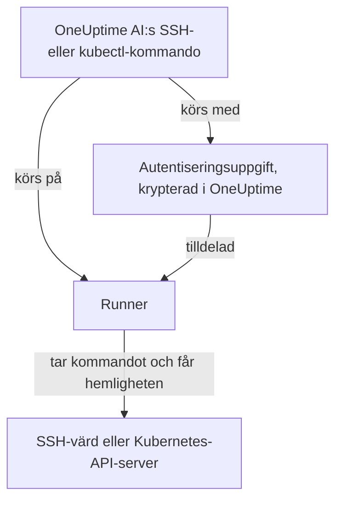

# AI-åtkomst

AI-åtkomst är hur OneUptime AI:s egna kommandon når något som **inte** är en Runners egen värd — en server över SSH, eller API-servern i ett Kubernetes-kluster som inte kör Kubernetes-agentens chart. Varje åtkomst är en autentiseringsuppgift: den åtkomsten som ett hanterat objekt, krypterat i vila, tilldelat vissa Runners och valt av OneUptime AI i stället för att skrivas in i ett kommando. Runbook-steg använder dem inte: ett SSH- eller kubectl-steg loggar in med en hemlig [runbook-variabel](/docs/runbooks/variables). En Runner som är äldre än den här versionen är undantaget: den kör ett Kubernetes-steg som flyttats från en åtgärd med den autentiseringsuppgift som steget nämnde, tills stegets skript eller kubeconfig ändras.

Hantera dem under **Runbooks → Runbook-agenter → AI-åtkomst**.

:::cards
- [Skapa en autentiseringsuppgift](#skapa-en-autentiseringsuppgift): Dess åtkomst och de Runners som får använda den.
- [Minsta behörighet på andra sidan](#minsta-behörighet-på-andra-sidan): Begränsa vad nyckeln eller token kan göra.
- [Runners som kör OneUptime AI:s kommandon](#runners-som-kör-oneuptime-ais-kommandon): Vem som får ge en sådan Runner en SSH-autentiseringsuppgift.
:::

## Så används en autentiseringsuppgift

OneUptime AI kör ett SSH-kommando med en av de SSH-autentiseringsuppgifter som är tilldelade den Runner det körs på, och ett kubectl-kommando för ett kluster som inte kör Kubernetes-agentens chart med den Kubernetes-autentiseringsuppgift som är bunden till klustret, som [AI SRE](/docs/ai/ai-sre) visar. När Runnern tar kommandot kontrollerar OneUptime att autentiseringsuppgiften är tilldelad den, dekrypterar hemligheten och lämnar ut den bara i svaret på det anspråket. Hemligheten lagras aldrig på jobbet och kan aldrig läsas via API:t.

## Innan du börjar

- **En roll som hanterar autentiseringsuppgifter.** Project Owner och Project Admin, eller alla med behörigheten **Create Runbook Credential**. Rollen Runbook Admin omfattar den inte. Att tilldela en SSH-autentiseringsuppgift till en Runner som kör OneUptime AI:s kommandon kräver också **Read Runbook Credential**; se [Runners som kör OneUptime AI:s kommandon](#runners-som-kör-oneuptime-ais-kommandon).
- **En plan som omfattar dem.** På OneUptime Cloud kräver runbook-autentiseringsuppgifter planen **Growth** eller högre.
- **En [Runner](/docs/runbooks/agents)** som kan nå värden eller klustrets API-server över nätverket.

## Skapa en autentiseringsuppgift

:::steps
### Öppna AI-åtkomst

Öppna **Runbooks → Runbook-agenter → AI-åtkomst** och klicka på **Skapa Credential**.

### Namnge den och välj dess typ

I steget **Credential** anger du ett **Namn**, till exempel `prod-cluster`, en valfri **Beskrivning** och **Typ**: **SSH** eller **Kubernetes**. Typen kan inte ändras senare; skapa en ny autentiseringsuppgift i stället.

### Ange åtkomsten

:::tabs
@tab SSH
Under **SSH-värd** anger du **Värdnamn**, **Port** (22 om fältet är tomt) och **Användarnamn**. Under **SSH-autentisering** väljer du under **Logga in med**: en **Privat nyckel**, det bättre valet när du kan välja, och klistrar sedan in **Private Key (PEM)** med dess **Private Key Passphrase** om den har en; eller ett **Lösenord** för en värd utan nyckelåtkomst, och anger sedan **Lösenord**.
@tab Kubernetes
Under **Kubernetes** anger du **API Server URL**, till exempel `https://10.0.0.1:6443`, **Service Account Token** och **CA Certificate (PEM)** så att Runnern kan verifiera API-servern. Lämna bara CA:n tom om API-servern presenterar ett certifikat som Runnern redan litar på.
:::

### Tilldela den till Runners

I steget **Runbook-agenter** väljer du de Runners som får använda autentiseringsuppgiften och klickar sedan på **Skapa Credential**. En autentiseringsuppgift som inte är tilldelad någon Runner kan inte användas av något kommando.

### Låt OneUptime AI använda den

OneUptime AI kör sina SSH-kommandon på den Runner som en regel för automatisk åtgärd väljer för dem, med en av de SSH-autentiseringsuppgifter som är tilldelade den. En Kubernetes-autentiseringsuppgift används så snart den är bunden till ett kluster tillsammans med en av sina Runners: se [AI SRE](/docs/ai/ai-sre).
:::

## Vad som sparas

| Typ | Fält |
| --- | --- |
| SSH | Värdnamn, port (22 som standard), användarnamn och antingen en privat PEM-nyckel (med valfri lösenfras) eller ett lösenord. |
| Kubernetes | API-serverns URL, en serviceaccount-token och klustrets CA-certifikat. |

## Hemliga värden kan bara skrivas

Privata nycklar, lösenfraser, lösenord och serviceaccount-tokens är krypterade i vila, och API:et **returnerar dem aldrig**: varken till instrumentpanelen, till ett arbetsflöde eller till en export. Tabellen kan visa dig vad en autentiseringsuppgift *är* utan att någonsin visa vad den innehåller.

Det finns därför ingen "visa" för ett hemligt värde, bara "ersätt": att ange ett värde igen är sättet att byta det. Om du har tappat bort originalet utfärdar du en ny nyckel på målsystemet och uppdaterar autentiseringsuppgiften.

## Tilldela en autentiseringsuppgift till Runners

En autentiseringsuppgift kan bara användas av de Runners du tilldelar den. Ett kommando som nämner en autentiseringsuppgift som dess Runner inte är tilldelad **misslyckas i stället för att köras** — en Runner som tyst inte gör något ser precis ut som en som fungerade.

Tilldelningen är åtkomstgränsen, så håll den snäv: en Runner som bara någonsin startar om ett kluster behöver inte SSH-nyckeln till dina databasvärdar.

### Runners som kör OneUptime AI:s kommandon

En Runner kör OneUptime AI:s kommandon så snart den har valts för dem: som Runner för en regel för automatisk åtgärd, eller för ett Kubernetes-klusters AI-åtkomst. På en sådan Runner väljer OneUptime AI bland de SSH-autentiseringsuppgifter som är tilldelade Runnern för de kommandon den kör där. Därför når en SSH-autentiseringsuppgift bara en sådan Runner genom en person som får läsa runbook-autentiseringsuppgifter (**Read Runbook Credential**, eller en Project Owner eller Project Admin), oavsett vad som sparas först:

- **Tilldela autentiseringsuppgiften.** Att skapa en SSH-autentiseringsuppgift med en sådan Runner, eller lägga till en sådan Runner i en, kräver den behörigheten. Utan den avvisas sparandet och Runnern nämns: tilldela autentiseringsuppgiften till Runners som inte kör AI-åtgärdskommandon, eller be någon med behörigheten att tilldela den.
- **Välja Runnern.** Att välja en Runner som har SSH-autentiseringsuppgifter för OneUptime AI:s kommandon - som en regels Runner eller för ett kluster - kräver samma behörighet första gången den väljs.

Att ta bort Runners från en autentiseringsuppgift, spara en autentiseringsuppgift med de Runners den redan har och Kubernetes-autentiseringsuppgifter kräver inget mer: OneUptime AI:s kubectl-kommandon körs med den autentiseringsuppgift som är bunden till deras kluster. Tilldelningar av autentiseringsuppgifter och val av en Runner som görs av någon utan den behörigheten sparas en i taget i ett projekt, så att de två inte kan klara sina kontroller tillsammans; ett sparande som kommer medan ett annat sparas väntar på det, och tar det för lång tid avvisas det med *Try again in a moment*. Spara igen. Att spara en Runner, till exempel när du ändrar dess beskrivning, väntar aldrig.

Ett arbetsflödes steg agerar som Project Admin men lånar inte en Project Admins läsning av runbook-autentiseringsuppgifter: ett steg har den bara om den person som senast sparade arbetsflödets steg har den. Se [Vad arbetsflödessteg får göra](/docs/workflows/configuration#vad-arbetsflödessteg-får-göra).

## Minsta behörighet på andra sidan

OneUptime kan inte begränsa vad din autentiseringsuppgift får göra på målsystemet: det är målsystemets uppgift, och det är värt att göra:

- **SSH** — föredra en nyckel framför ett lösenord, ge användaren bara de kommandon den behöver (ett tvingat kommando eller ett begränsat skal där det är praktiskt) och återanvänd inte en administratörs personliga nyckel.
- **Kubernetes** — bind tjänstkontot till en Role som bara tillåter det du låter OneUptime AI göra, i de namespaces där det får agera. Ett tjänstkonto som bara får läsa låter OneUptime AI undersöka och nekar varje åtgärd.

## Vem kan se dem

Att skapa, redigera och ta bort autentiseringsuppgifter kräver behörigheterna för runbook-autentiseringsuppgifter (eller Project Owner/Admin). Att läsa en autentiseringsuppgift visar bara dess icke-hemliga fält.

Observera att en Runners **agentnyckel** motsvarar de autentiseringsuppgifter som är tilldelade den Runnern: allt som har nyckeln kan ta arbete som den Runnern och få autentiseringsuppgifter. Därför kan agentnycklar bara läsas av Project Owners, Project Admins och Runbook Admins: behandla dem som du skulle behandla själva autentiseringsuppgifterna.

## Nästa steg

:::cards
- [Runbook-variabler](/docs/runbooks/variables): De hemligheter som SSH- och kubectl-steg loggar in med.
- [Runbook-agenter](/docs/runbooks/agents): Installera den Runner som en autentiseringsuppgift tilldelas.
- [Runbook-konfiguration & säkerhet](/docs/runbooks/configuration): Behörigheter och härdning för hela runbook-stacken.
:::
