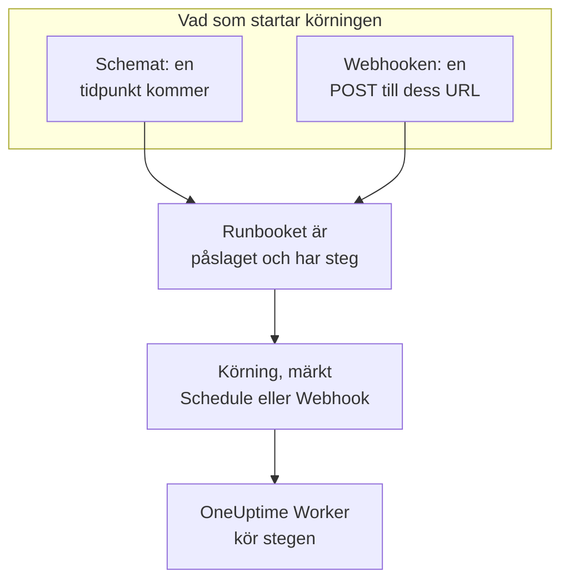

# Runbook-utlösare

Ett runbook kan starta av sig själv: enligt ett schema, eller när ett annat verktyg anropar dess webhook-URL. Använd ett schema för rutinarbete, som en nattlig städning eller en veckovis kontroll av certifikat, och webhooken för att starta ett runbook från ett larmsystem, en CI-pipeline eller ett skript. Båda konfigureras på runbookets sida **Utlösare**.

:::cards
- [Kör enligt ett schema](#kör-enligt-ett-schema): Med några minuters mellanrum, varje dag, vissa veckodagar eller med ett cron-uttryck.
- [Anropa webhooken](#anropa-webhooken): Starta en körning med en POST-förfrågan till runbookets URL.
- [Värden som ett webhook-anrop skickar](#värden-som-ett-webhook-anrop-skickar): Hur stegen läser den JSON som en anropare skickar.
- [Felsökning](#felsökning): Ett schema som inte körs, ett anrop som avvisas.
:::

## Så startar en utlösare en körning



En utlösare startar en körning så som **Kör nu** gör: körningen går igenom runbookets nuvarande steg och är inte kopplad till någon incident, något larm eller någon planerad underhållshändelse. Varje körning registrerar vad som startade den. Runbookets **Körningar** och **Runbooks → Körningar** visar det under **Utlöst av**, med när en schemalagd körning skulle ske eller adressen som anropade webhooken, och båda listorna kan filtreras på det.

## Innan du börjar

- Ett runbook med minst ett steg, vars reglage **Kör det här runbooket** är påslaget på sidan **Inställningar**.
- Behörighet att redigera runbooket och att köra den. Se [Vem får konfigurera utlösare](#vem-får-konfigurera-utlösare).

## Kör enligt ett schema

:::steps
### Öppna runbookets sida Utlösare
Öppna runbooket från **Runbooks** och klicka på **Inställningar → Utlösare** i dess sidomeny. **Inställningar** är hopfälld från början: klicka på den för att visa **Utlösare**.

### Konfigurera schemat
Klicka på **Konfigurera schema**. Under **När den körs** väljer du ett alternativ under **Upprepa** och det som det behöver. Dialogrutan säger schemat i en mening, som "Körs varje vardag kl. 09:00", och listar dess nästa körningar medan du ändrar det.

### Kontrollera tidszonen
**Tidszon** börjar med din egen. Schemats tider läses på den här zonens klocka.

### Spara det
Klicka på **Spara schema**. Schemat slås på, och kortet visar det i en mening med dess **Nästa körningar**.
:::

| **Upprepa** | Vad du väljer | Till exempel |
| --- | --- | --- |
| **Med några minuters mellanrum** | **Var**: 1, 2, 3, 4, 5, 6, 10, 12, 15, 20 eller 30 minuter | Var 15:e minut |
| **Med några timmars mellanrum** | **Var**: 1, 2, 3, 4, 6, 8 eller 12 timmar, och **Minuter efter hel timme** | Var 2:a timme kl. :30 |
| **Varje dag** | **Klockslag** | Varje dag kl. 09:00 |
| **Vissa veckodagar** | **Dessa dagar**, med **Vardagar** och **Varje dag** som genvägar, och **Klockslag** | Varje vardag kl. 09:00 |
| **Anpassat (cron-uttryck)** | **Cron-uttryck** | `0 2 1 * *`: kl. 02:00 den 1:a varje månad |

Ett cron-uttryck har fem fält: minut, timme, dag i månaden, månad och veckodag. Runbooks körs högst en gång per minut, så det finns inget sekundfält. Dialogrutan förklarar ett uttryck som den inte kan läsa, eller ett som aldrig körs, som `0 0 31 2 *`, och sparar ingenting förrän det kan köras.

Kortet visar sedan schemat, dess nästa tre körningar enligt zonens klocka, vad det gör när en körning fortfarande pågår eller en tidpunkt missades, och **Senaste schemalagda körning** med **Visa körning**. **Redigera schema** öppnar samma dialogruta, och reglaget **Kör enligt det här schemat** pausar schemat utan att förlora det.

### Om en körning fortfarande pågår

En körning pågår fortfarande så länge den står i kö, körs eller väntar på att någon slutför eller godkänner ett steg, oavsett hur den startade. Schemats inställning **Om en körning fortfarande pågår**, hopfälld under **Fler fält** i dialogrutan, avgör vad en tidpunkt som kommer då gör:

| Inställning | Vad som händer |
| --- | --- |
| **Hoppa över den tidpunkten** (standard) | Ingenting startar. Schemat väntar på sin nästa tidpunkt. |
| **Kör när den är klar** | En körning väntar och startar när den pågående körningen är klar. Fler tidpunkter som kommer under tiden startar ingenting. |

### Om OneUptime missade en tidpunkt

Om OneUptime låg nere eller uppgraderades vid en schemalagd tidpunkt är tidpunkten missad så snart den är mer än 5 minuter sen. **Om OneUptime missade en tidpunkt** avgör vad som händer när OneUptime är tillbaka:

| Inställning | Vad som händer |
| --- | --- |
| **Kör en gång när OneUptime är tillbaka** (standard) | En körning startar, oavsett hur många tidpunkter som missades, märkt "Kördes en gång för att ta igen tidpunkter som OneUptime missade". |
| **Hoppa över de missade tidpunkterna** | Ingenting startar förrän nästa tidpunkt. |

Tidpunkter som passerar medan schemat eller runbooket är avstängt är inte missade: slår du på något av dem igen fortsätter det från nästa tidpunkt.

### Tidszoner och sommartid

Tiderna läses hela året på zonens klocka. Ett schema för kl. 09:00 i Europe/London körs kl. 09:00 London-tid både på vintern och på sommaren. Natten då klockorna ställs fram körs en tidpunkt som inte finns den natten en timme senare på klockan. När klockorna ställs tillbaka och en timme kommer två gånger körs ett schema som körs varje timme i båda, och alla andra scheman en gång, i den första.

## Anropa webhooken

:::steps
### Slå på webhooken
Slå på **Kör när den här URL:en anropas** på runbookets sida **Utlösare**. Runbooket får en egen URL.

### Kopiera URL:en
**Webhook-URL** är maskerad: klicka på **Visa** för att se den, eller på **Kopiera URL** för att kopiera hela. **Prova** har ett `curl`-kommando att utgå från.

### Anropa den från ditt verktyg
Skicka en `POST`-förfrågan till URL:en, med ett JSON-objekt som innehåll, eller utan innehåll:

```bash
curl -X POST "https://oneuptime.com/runbook/webhook/RUNBOOK_ID/SECRET_KEY" \
  -H "Content-Type: application/json" \
  -d '{"host": "web-1", "reason": "Disk almost full"}'
```

### Kontrollera körningen
Svaret namnger den körning det startade: `{"runbookExecutionId": "...", "status": "Scheduled"}`. Körningen finns under runbookets **Körningar**, där **Utlöst av** säger **Webhook**, och dess sida visar under **Indata** vad anropet skickade.
:::

**Skicka testförfrågan** skickar en `POST` med ett innehåll som du skriver till URL:en, som ett annat verktyg skulle göra, och länkar till körningen den startade. Det är en riktig körning av runbooket.

### Vad ett anrop får för svar

| Svar | När |
| --- | --- |
| `200` | Körningen startades. Innehållet namnger den. |
| `400` | Innehållet är inte ett JSON-objekt, är kapslat mer än 32 nivåer djupt eller innehåller ett NUL-tecken, eller så har runbooket inga steg. |
| `403` | Webhooken eller runbooket är avstängt. |
| `404` | Ingen runbook-webhook svarar på den här URL:en: runbookets ID eller nyckeln är fel, eller så har URL:en återställts. |
| `405` | Förfrågan är en `GET`. En `GET` startar aldrig en körning, så en länkförhandsvisning i en chattapp kan inte köra den av misstag. |
| `413` | Innehållet är större än 64 KB. |
| `429` | Webhooken startade 30 körningar den senaste minuten, 10 av dess körningar pågår fortfarande, eller en adress gjorde fler än 120 anrop till runbook-webhooks på en minut, eller adresserna i ett IPv6-/64 fler än 1200 tillsammans. Headern `Retry-After` säger när du kan försöka igen, där det går. |
| `503` | OneUptime kan inte räkna anrop just nu. Försök igen om en minut. |

Ett avvisat anrop startar ingenting, och dess innehåll säger varför i en mening, som "This runbook is turned off, so it was not started. Turn it on with Run this runbook, under the runbook's Settings."

### Håll URL:en hemlig

URL:en innehåller runbookets hemliga nyckel: alla som har den kan starta runbooket. Nyckeln består av 43 slumpmässiga tecken, jämförs i konstant tid, och en felaktig nyckel får samma svar som om det inte fanns något sådant runbook.

Om URL:en läcker klickar du på **Återställ URL**. Runbooket får en ny URL och den gamla slutar fungera direkt, så ge den nya till varje verktyg som anropar den. Om du stänger av webhooken och slår på den igen behålls samma URL.

## Värden som ett webhook-anrop skickar

Innehållets värden på översta nivån blir körningens indata. De når stegen som data, aldrig som text inklistrad i ett skript eller ett kommando:

| Stegtyp | Hur det läser indata |
| --- | --- |
| Bash och kubectl | Miljövariabler: en `ONEUPTIME_INPUT_<NAME>` för varje värde på översta nivån, `ONEUPTIME_INPUTS` med hela objektet som JSON och `ONEUPTIME_TRIGGER` med det som startade körningen, som `Webhook` eller `Schedule`. |
| JavaScript | `args.inputs`, objektet som det skickades, och `args.trigger`. |
| AI | I sin prompt, märkt som data utifrån OneUptime, när **Ta med utlösarkontext** är påslaget. |
| HTTP request och SSH | Inte alls. Deras URL, skript och mål är det som står i runbooket, och ingenting som en anropare skickar ändrar dem. |

En variabels namn är värdets namn med versaler, där varje tecken som inte är en bokstav eller en siffra skrivs som `_`: `host-name` blir `ONEUPTIME_INPUT_HOST_NAME`. Text skickas som den är, tal och `true` eller `false` som de är skrivna, och objekt och listor som JSON. Ett steg får högst 100 sådana variabler, och ett namn på fler än 100 tecken blir ingen; varje värde finns ändå i `ONEUPTIME_INPUTS`. Varje namn börjar med `ONEUPTIME_`, så en anropare kan inte sätta `PATH` eller någon annan variabel som Runnern läser.

En anropare bestämmer de här värdena, så kontrollera dem innan du agerar på dem:

```bash
set -euo pipefail
case "$ONEUPTIME_INPUT_HOST" in
  web-1|web-2|web-3) ;;
  *) echo "Unknown host: $ONEUPTIME_INPUT_HOST"; exit 1 ;;
esac
curl -fsS -X POST "http://$ONEUPTIME_INPUT_HOST.internal:8080/restart"
```

```javascript
const host = args.inputs.host;
if (!["web-1", "web-2", "web-3"].includes(host)) {
  throw new Error(`Unknown host: ${host}`);
}
console.log(`Started by ${args.trigger} for ${host}`);
return { host };
```

## Vem får konfigurera utlösare

Ett schema eller en webhook startar körningar utan att någon är där, så att konfigurera en kräver behörighet att redigera runbooket och att köra den: Project Owner, Project Admin eller Runbook Admin, eller **Edit Runbook** tillsammans med Project Member, Runbook Member eller **Create Runbook Execution**. De etiketter som en roll är begränsad till räknas, som för **Kör nu**. Att se eller återställa webhook-URL:en kräver detsamma.

Att stänga av ett schema eller en webhook startar ingenting, så det kräver bara behörighet att redigera runbooket. Den som får redigera runbooket men inte köra den ser sidan **Utlösare** med **Konfigurera schema** låst, och får veta vem som kan se webhook-URL:en.

## Felsökning

:::details Ingenting körs enligt schemat
Runbooket är avstängt eller har inga steg: kortet säger vilket. Slå på **Kör det här runbooket** på runbookets sida **Inställningar**, eller lägg till steg på dess sida **Steg**. Om kortet säger att schemat är pausat slår du på **Kör enligt det här schemat**.
:::

:::details En schemalagd tidpunkt startade ingenting
En körning pågick fortfarande och schemat hoppar över sådana tidpunkter, eller så missade OneUptime tidpunkten och schemat hoppar över missade tidpunkter. Se [Om en körning fortfarande pågår](#om-en-körning-fortfarande-pågår) och [Om OneUptime missade en tidpunkt](#om-oneuptime-missade-en-tidpunkt).
:::

:::details Att spara ett schema misslyckas med "You do not have permission to set up this runbook's schedule or webhook."
Att konfigurera en utlösare kräver behörighet att köra runbooket och att redigera den. Be om Runbook Admin, eller om Runbook Member eller **Create Runbook Execution** utöver **Edit Runbook**.
:::

:::details Ett anrop får svaret "No runbook webhook answers at this URL."
URL:en har återställts eller kopierats fel. Kopiera den igen från runbookets sida **Utlösare**.
:::

:::details Ett anrop får svaret "This runbook's webhook is turned off, so the runbook was not started."
Slå på **Kör när den här URL:en anropas** på runbookets sida **Utlösare**. URL:en är densamma som tidigare.
:::

## Nästa steg

:::cards
- [Köra ett runbook](/docs/runbooks/running): Vad en körning visar och hur du för den framåt.
- [Skriva ett runbook](/docs/runbooks/authoring): Skriv stegen som en utlösare kör.
- [Runbook-konfiguration & säkerhet](/docs/runbooks/configuration): Gränser, behörigheter och härdning.
:::
