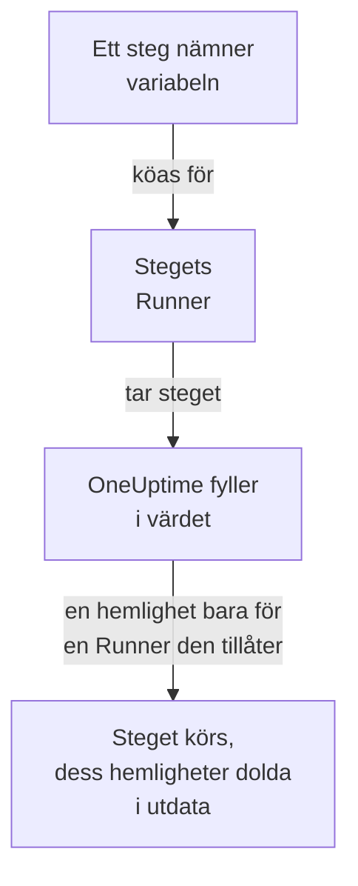

# Runbook-variabler

En runbook-variabel är ett värde som dina steg använder via namnet i stället för att innehålla det själva: en värd, ett namespace eller en URL, eller en hemlighet som en SSH-nyckel, ett lösenord, en kubeconfig eller en API-token. Ändra värdet en gång, så använder varje steg som nämner det det nya nästa gång det körs. En hemlighet är krypterad, visas aldrig igen och döljs i det som stegen skriver ut.

:::cards
- [Skapa en variabel](#skapa-en-variabel): Ett vanligt värde, eller en hemlighet och de Runners som får använda den.
- [Använd en variabel i ett steg](#använd-en-variabel-i-ett-steg): I ett skript eller en HTTP-begäran, eller som ett SSH-stegs inloggning och ett kubectl-stegs kubeconfig.
- [Vem får en hemlighet](#vem-får-en-hemlighet): Dina Runners, globala Runners när du låter dem, och OneUptime för ett HTTP-begäransteg.
:::

## Så når en variabel ett steg



Ett steg innehåller variabelns namn, aldrig dess värde. När stegets Runner tar det fyller OneUptime i värdet - i skriptet, i ett SSH-stegs maskin och inloggning eller i ett kubectl-stegs kubeconfig - och lämnar det bara till den Runnern. Ett steg som nämner en variabel som det inte får ha misslyckas med orsaken, i stället för att köras med namnet där värdet borde stå.

Bash-, JavaScript-, SSH-, kubectl- och HTTP-begäransteg använder variabler. AI-steg fyller inte i dem. Ett HTTP-begäransteg skickar OneUptime själv, utan Runner, så steget får varje variabel det nämner, även hemligheter, och döljer dem i svaret det registrerar.

## Globala variabler och runbook-variabler

| | Globala variabler | En runbooks egna variabler |
| --- | --- | --- |
| Hanteras under | **Runbooks → Inställningar → Globala variabler** | Runbookens **Inställningar → Variabler** |
| Används av | Varje runbook i projektet | Bara den runbookens steg |
| Skrivs i ett steg som | `{{global.variables.NAME}}` | `{{local.variables.NAME}}` |

Ett namn används en gång, oavsett stora och små bokstäver, bland projektets globala variabler, och en gång bland en runbooks egna. En runbooks variabel får dela namn med en global: var och en skrivs på sitt eget sätt.

## Innan du börjar

- **En roll som hanterar variabler.** Project Owner och Project Admin, eller behörigheten **Create Runbook Variable**. Runbook Admin läser variabler för att välja dem i de steg den skriver, men ändrar dem inte.
- **En plan som innehåller dem.** På OneUptime Cloud kräver runbook-variabler planen **Growth** eller högre.

## Skapa en variabel

:::steps
### Öppna variablerna

Öppna **Runbooks → Inställningar → Globala variabler**, eller en runbooks **Inställningar → Variabler**, och klicka på **Skapa Variabel**.

### Namnge den och ange dess värde

Ange ett **Namn** i steget **Variabel**: bokstäver, siffror, bindestreck och understreck, upp till 100 tecken, till exempel `PROD_DB_SSH_KEY`. **Hemlighet** är påslagen från början: klistra in nyckeln, lösenordet, token eller kubeconfig i **Värde för hemlighet** och klicka på **Nästa**. För ett värde som vem som helst får läsa, som en värd, slår du av **Hemlighet**, anger det i **Värde** och klickar på **Skapa Variabel**. En valfri **Beskrivning** väntar under **Fler fält**.

### Välj vem som får använda en hemlighet

Välj dina Runners under **Dina Runners som får använda den** i steget **Vem får använda den**. På en server med [globala Runners](/docs/runbooks/agents#globala-runners) låter **Globala Runners får använda den** även det här projektets steg som körs på en global Runner använda hemligheten: den är påslagen från början så länge projektet använder globala Runners. En hemlighet behöver det ena eller det andra. Klicka på **Skapa Variabel**.
:::

Om en variabel är en hemlighet kan inte ändras senare. Ta i stället bort den och skapa den igen med samma namn: steg nämner variabler via namnet, så de fortsätter att fungera. Ett klusters Runner i klustret, den som Kubernetes-agentens chart installerar, får aldrig en hemlighet.

## Hemliga värden kan bara skrivas

En hemlighets värde är krypterat i vila och API:t **returnerar det aldrig**: varken till instrumentpanelen, till ett arbetsflöde eller till en export. Listan visar **Hemlighet** där en vanlig variabel visar sitt värde, och dess kolumn **Runbook-agenter** visar vilka Runners som får varje hemlighet. För att ändra den klickar du på **Ersätt värde** på dess rad: det nya värdet krypteras, det gamla är borta för gott och stegen får det nya nästa gång de körs.

När ett steg skriver ut en hemlighet som det har fått ersätter Runnern den med `[REDACTED]` innan utdata lämnar dess värd, och OneUptime gör det igen innan utdata lagras. En rad i en privat nyckel, eller token i en kubeconfig, döljs också. En hemlighet som är kortare än 4 tecken letas inte efter.

## Använd en variabel i ett steg

:::tabs
@tab I ett skript
Skriv referensen där värdet ska stå, i ett Bash-, JavaScript-, SSH- eller kubectl-skript:

```bash
curl -s -X POST \
  -H "Authorization: Bearer {{global.variables.CDN_API_TOKEN}}" \
  "https://api.cdn.example.com/v1/purge"
```
@tab I en HTTP-begäran
Skriv referensen i URL:en, headers eller body i ett [HTTP-begäransteg](/docs/runbooks/authoring#http-request):

```json
{ "Authorization": "Bearer {{global.variables.API_TOKEN}}" }
```
@tab SSH-inloggning
Ett [SSH-steg](/docs/runbooks/authoring#ssh) väljer under **Logga in med** den hemliga variabel som innehåller dess privata nyckel eller lösenord, och under **Fler fält → Nyckelns lösenfras** nyckelns lösenfras. Värdet visar om det är en nyckel eller ett lösenord.
@tab Kubeconfig
Ett [kubectl-steg](/docs/runbooks/authoring#kubectl) väljer under **Kubeconfig** den hemliga variabel som innehåller klustrets kubeconfig, eller **Runnerns egen åtkomst** för att använda Runnerns.
:::

På en runbooks sida **Steg** listar varje skript och varje HTTP-begäran under **Variabler – klicka för att kopiera** de variabler som deras steg kan använda, och redigeraren säger till när ett steg nämner en variabel som inte finns, eller en hemlighet som dess Runner inte får använda.

## Vem får en hemlighet

| Vem som kör steget | En vanlig variabel | En hemlighet |
| --- | --- | --- |
| En av dina Runners | Alltid | När hemligheten listar den under **Dina Runners som får använda den** |
| En global Runner | Alltid | När **Globala Runners får använda den** är påslagen, för ett steg i hemlighetens eget projekt |
| OneUptime själv, för ett HTTP-begäransteg | Alltid | Alltid |

Ett steg som nämner en hemlighet som dess Runner inte får använda misslyckas, med hemlighetens namn och vad som ska ändras, och ingenting lämnas ut.

## Runbook-hemligheter och autentiseringsuppgifter blev variabler

Runbook-variabler tog platsen för runbook-hemligheter och för de autentiseringsuppgifter som SSH- och Kubernetes-steg nämnde. När OneUptime uppgraderades flyttades det som varje projekt hade en gång, så att varje runbook körs som förut:

- varje runbook-hemlighet blev en hemlig global variabel med samma namn, samma värde, samma Runners och samma brytare för globala Runners;
- `{{runbookSecrets.NAME}}` i ett skript skrevs om till `{{global.variables.NAME}}`, och den gamla stavningen läser fortfarande den globala variabeln `NAME`;
- varje autentiseringsuppgift som ett steg nämnde blev hemliga globala variabler med samma Runners, namngivna efter den: `<name>-ssh-key` (och `<name>-ssh-key-passphrase`, för en nyckel som hade en), `<name>-ssh-password` eller `<name>-kubeconfig`;
- varje SSH-steg som nämnde en autentiseringsuppgift loggar in på sin maskin med dem och kör sitt kommando som sitt skript, och varje Kubernetes-steg blev ett kubectl-steg som kör den `kubectl patch` som dess åtgärd gjorde, utan att behöva mer åtkomst än steget hade.

En Runner som är äldre än den här versionen (14.0.79) kan inte köra ett kubectl-skript: den får ett kubectl-steg att misslyckas och säger att Runnern behöver uppdateras. Varje Kubernetes-steg som flyttades så behöll först sin autentiseringsuppgift och sin åtgärd bredvid sitt skript, för en sådan Runner; de försvann med runbook-autentiseringsuppgifterna, så varje kubectl-steg behöver en Runner från 14.0.79 eller senare.

Runbook-autentiseringsuppgifter har sedan tagits bort, och ett steg som fortfarande nämnde en flyttades först på samma sätt. Ett steg som nämner en autentiseringsuppgift körs inte längre, och dess sida med steg erbjuder **Gör om till ett skriptsteg**; en sparning via API:t eller Terraform som ger ett steg en avvisas. Se [Runbook-autentiseringsuppgifter är borttagna](/docs/installation/upgrading#runbook-autentiseringsuppgifter-är-borttagna).

## Nästa steg

:::cards
- [Skriv en runbook](/docs/runbooks/authoring): Skriv de SSH- och kubectl-steg som använder en variabel.
- [Runbook-agenter](/docs/runbooks/agents): Installera den Runner som en hemlighet lämnas till.
- [Runbook-konfiguration och säkerhet](/docs/runbooks/configuration): Behörigheter och härdning för hela runbook-stacken.
:::
