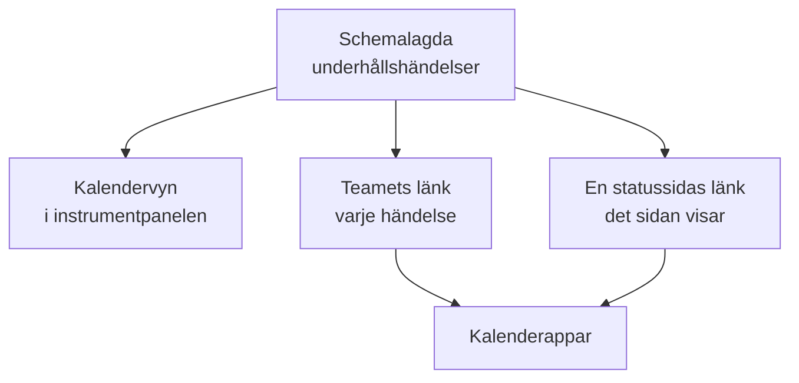

# Underhållskalender

Underhållskalendern visar ditt schemalagda underhåll efter datum: som en kalender i instrumentpanelen, i ditt teams egna kalenderappar via en hemlig länk och i kalendrarna hos de människor som följer dina statussidor. Den här sidan förklarar kalendervyn, teamets kalenderlänk, en statussidas kalender och vad varje kalenderhändelse innehåller.

:::cards
- [Kalendervyn](#kalendervyn): Varje händelse på en månad, en vecka eller en dag, i färgen för dess tillstånd.
- [Teamets kalenderlänk](#teamets-kalenderlänk): Varje händelse i projektet i Google Kalender, Outlook eller Apple Kalender.
- [En statussidas kalender](#en-statussidas-kalender): Det en statussida visar, i besökarnas kalendrar.
- [Vad en kalenderhändelse innehåller](#vad-en-kalenderhändelse-innehåller): Titeln, tidsfönstret, tillståndet och en länk tillbaka.
:::



## Kalendervyn

Öppna **Schemalagt underhåll → Alla händelser**. Längst till höger i filterfältet växlar **Lista** och **Kalender** mellan tabellen med händelser och en kalender med dem. Webbläsaren kommer ihåg valet, så sidan öppnas med kalendern nästa gång.

- Kalendern öppnas på den här månaden, med dagens datum markerat. **Månad**, **Vecka** och **Dag** ändrar hur mycket den visar; bläddra med pilarna och gå tillbaka med **Idag**. Tiderna visas i din egen tidszon.
- Varje händelse är ett block i färgen för dess tillstånd, och tillståndens färger namnges under kalendern. Klicka på en händelse för att öppna den.
- Filtren ovanför kalendern fungerar som i listan: välj ett tillstånd, en etikett eller en ägare för att bara se de händelserna.
- En dag som ännu inte har kommit visar ett **+** när du pekar på dess vecka. Det öppnar **Skapa schemalagt underhållsevenemang** med **Börjar den** på den dagen, vid den timme formuläret skulle välja i dag. Du ser det bara om du får skapa händelser.
- En vy visar upp till 500 händelser. En fullare månad säger till: begränsa den med filtren eller titta på en vecka.

## Teamets kalenderlänk

**Prenumerera på kalender**, under kalendern eller i listans **⋯**-meny, öppnar projektets kalenderlänk: en hemlig iCalendar-länk (`.ics`) som lägger in varje schemalagd underhållshändelse i projektet i Google Kalender, Outlook, Apple Kalender eller vilken app som helst som prenumererar på en kalender via en URL.

:::steps
### Publicera länken

Klicka på **Publicera länk**. Ett projekt har en länk för hela teamet, så det behövs bara en gång.

### Lägg till den i din kalenderapp

**Google Kalender** öppnar Google Kalender, som frågar om kalendern ska läggas till. **Apple Kalender / Outlook** öppnar länken i kalenderappen på din dator eller telefon. **Kopiera länk** kopierar den för vilken annan app som helst.

### Kontrollera att det fungerar

Panelen **Status** visar när en kalenderapp senast läste länken, och vilken. En ny länk visar **Väntar på första synkroniseringen** tills en app läser den.
:::

Länken ser ut så här:

```text
https://<your host>/api/scheduled-maintenance-calendar/project/<token>/maintenance.ics
```

> [!WARNING]
> Alla som har länken ser varje schemalagd underhållshändelse i projektet utan att logga in. Behandla den som ett lösenord och skapa den på nytt om den delas av misstag.

### Vem som kan se länken

Länken visar varje händelse i projektet, så dialogen visar den bara för personer som kan läsa varje händelse. Den vars roll begränsar dem till vissa händelser, efter etikett eller till de händelser de äger, får i stället veta varför.

| Åtgärd | Vem som kan göra det |
| --- | --- |
| Kopiera länken | Alla som kan läsa varje schemalagd underhållshändelse i projektet |
| **Publicera länk** | Alla som också kan skapa schemalagda underhållshändelser |
| **Skapa länken på nytt**, **Inaktivera länk** | Alla som också kan redigera schemalagda underhållshändelser |

### Hantera länken

**Skapa länken på nytt** och **Inaktivera länk** finns i menyn **⋯** högst upp i dialogen.

| Åtgärd | Vad som händer |
| --- | --- |
| **Skapa länken på nytt** | Skapar en ny länk. I 30 dagar levererar den gamla en tom kalender, så att apparna som har den rensar sin kopia; därefter hittas den inte. Prenumerera igen med den nya länken. |
| **Inaktivera länk** | Behåller länken, men den levererar en tom kalender tills **Aktivera länk**. |

Kalendern innehåller varje händelse från 90 dagar bakåt till ett år framåt, upp till 1 000 händelser.

## En statussidas kalender

De som följer en statussida kan lägga in dess schemalagda underhåll i sin egen kalender. På statussidans sida med schemalagda händelser erbjuder **Prenumerera på kalender** Google Kalender, kalenderappen på deras enhet eller länken att kopiera. Länken är sidans adress följd av `/maintenance.ics`, till exempel `https://status.example.com/maintenance.ics`.

- **Vad den innehåller.** Exakt det sidan visar: händelserna i sidans historikfönster, varje händelse som ännu inte har börjat och varje som pågår, så länge **Synlig på statussidan** är påslaget. Det varje händelse påverkar namnges som sidan namnger sina resurser, aldrig med dina monitorers egna namn.
- **En privat sida.** En kalenderapp kan inte logga in, så en privat sida erbjuder ingen **Prenumerera på kalender**, och dess länk levererar en tom kalender som säger att sidan är privat.
- **En händelse.** **Lägg till i kalender** på en händelses sida lägger bara till den händelsen: Google Kalender öppnas med den ifylld, eller så laddas den ned som en fil som enhetens kalenderapp öppnar. Det fungerar också på en privat sida för en besökare som har loggat in, och erbjuds inte när händelsen är över.

## Vad en kalenderhändelse innehåller

Varje kalender, teamets och en statussidas, skriver en händelse på samma sätt.

| Del | Vad den innehåller |
| --- | --- |
| Titel | Händelsens titel |
| Start och slut | Dess planerade tidsfönster i UTC; kalenderappen visar det i din egen tidszon |
| Beskrivning | Dess beskrivning som ren text, dess tillstånd, vad den påverkar och en länk till händelsen; teamets länk namnger också dess statussidor |
| Status | Inställd när händelsen ställdes in: slutförd utan att någonsin ha pågått |
| Ledig eller upptagen | Ledig, så att ett underhållsfönster aldrig blockerar din tillgänglighet |
| Kategorier | Dess etiketter; en statussidas kalender visar dem bara när sidan visar etiketter |

En händelse som redigeras i OneUptime uppdateras på plats i varje kalender som har den, och en som tas bort eller tas bort från en statussida försvinner ur kalendern vid nästa uppdatering.

## Hur ofta kalendrar uppdateras

Kalenderappar läser en prenumererad länk enligt sitt eget schema. Google Kalender gör det med några timmars mellanrum, ibland bara en gång om dagen; Apple Kalender och Outlook oftast varje timme. OneUptime sparar en kalender i högst fem minuter, så väntan du ser är kalenderappens. Stegen för varje app finns på [Kalenderflöden](/docs/on-call/calendar-feeds#prenumerera-i-din-kalenderapp), som fungerar på samma sätt för jourpass.

## Felsökning

:::details Kalenderappen visar inte längre nya händelser
Länken har skapats på nytt eller inaktiverats: öppna **Prenumerera på kalender** för att se dess status. En länk som har skapats på nytt måste prenumereras på igen med den nya länken; en inaktiverad länk kommer tillbaka med **Aktivera länk**.
:::

:::details Google Kalender kan inte lägga till länken
Google Kalender läser länken från Googles servrar, så OneUptime-servern måste kunna nås från internet. Se [Kalenderflöden](/docs/on-call/calendar-feeds#felsökning) för en server i egen drift.
:::

:::details En händelse saknas i en statussidas kalender
Sidans kalender innehåller det sidan visar. Kontrollera att händelsen nämner sidan, att **Synlig på statussidan** är påslaget i dess **Inställningar** och att den började inom sidans historikfönster.
:::

## Nästa steg

:::cards
- [Skapa underhållshändelser](/docs/scheduled-maintenance/creating-events): Formuläret, fält för fält, och vad som händer sedan.
- [Prenumeranter och meddelanden](/docs/status-pages/subscribers#schemalagda-underhållshändelser): Vad en statussidas prenumeranter får veta om underhåll.
- [Kalenderflöden](/docs/on-call/calendar-feeds): Samma sorts länk för jourpass.
:::
