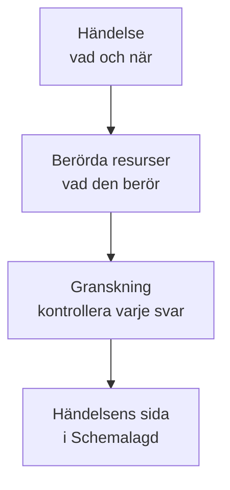

# Skapa underhållshändelser

Schemalägg underhåll i två korta steg: säg vad som händer och när, och sedan vad det påverkar och vem som ska få höra om det. Bara titeln måste skrivas in; allt annat börjar med ett rimligt standardvärde. Den här sidan går igenom formuläret, vad som händer i samma stund som du skapar en händelse, hur du ändrar den senare och hur du skapar händelser från kod.

:::cards
- [Skapa en händelse](#skapa-en-händelse): Två steg och en granskning.
- [Vad som händer när du skapar den](#vad-som-händer-när-du-skapar-den): Numret, reglerna, ägarna och de första meddelandena.
- [Ändra en händelse senare](#ändra-en-händelse-senare): Fönstret, resurserna, statussidorna och anteckningarna.
- [Skapa händelser från kod](#skapa-händelser-från-kod): API:et, Terraform, arbetsflöden och chatt.
:::

## Så fungerar det

Formuläret ställer två frågor, en per steg, och visar sedan allt i en granskning innan det skapar händelsen. Händelsen börjar i ditt schemalagda tillstånd, och dess sida öppnas.



## Innan du börjar

- **Din roll.** För att skapa en händelse krävs **Projektägare**, **Projektadministratör**, **Projektmedlem**, **Underhållsadministratör** eller **Underhållsmedlem**, eller en anpassad roll med **Create Scheduled Maintenance**.
- **Dina statussidor.** För att informera kunderna behöver du en statussida som visar schemalagda underhållshändelser. Se [Statussidor – Översikt](/docs/status-pages/index).

## Skapa en händelse

:::steps
### Öppna formuläret

Gå till **Schemalagt underhåll → Alla händelser** och klicka på **Skapa schemalagt underhållsevenemang**. Formuläret öppnas på sitt första steg, **Händelse**.

### Säg vad som händer och när

Skriv en **Titel**, och lägg till en **Beskrivning** om det hjälper: den är Markdown, och den visas på dina statussidor. **Börjar den** är redan nästa hela timme enligt din klocka, och **Slutar den** en timme senare; ändra dem bara när de är fel. Flyttar du **Börjar den** flyttas **Slutar den** med, så att fönstret behåller sin längd. **Ägare** och **Etiketter** väntar under **Fler fält**, hopfällda.

### Välj vad det påverkar

Klicka på **Nästa** för att komma till **Berörda resurser**. Välj de **Monitorer** som arbetet berör. Så snart du väljer en visas **Ändra övervakningsstatus till** under dem: den status monitorerna går över till när händelsen börjar. Välj sedan eventuella **Andra påverkade resurser**, till exempel värdar, kluster, databaser, nätverksplatser eller tjänster.

### Välj vem som får höra om det

Välj statussidorna under **Visa händelse på dessa statussidor**. **Aviseringar till prenumeranter**, hopfällt, säger på en rad vem som får veta och när; öppna det för att ändra **När händelsen schemaläggs**, **När händelsen börjar**, **När händelsen slutar** eller **Påminnelser före händelsen**.

### Skapa den

Klicka på **Nästa** för att se granskningen, kontrollera den och klicka sedan på **Skapa schemalagt underhållsevenemang**. Händelsens egen sida öppnas.
:::

Ingenting skickas förrän du väljer en statussida: en händelse som inte visas på någon statussida meddelar ingen prenumerant.

## Formulärets fält

| Fält                                 | Steg               | Börjar som                      | Vad det gör                                                                      |
| ------------------------------------ | ------------------ | ------------------------------- | -------------------------------------------------------------------------------- |
| **Titel**                            | **Händelse**       | Tom, och obligatorisk           | Namnger händelsen överallt, även på dina statussidor.                            |
| **Beskrivning**                      | **Händelse**       | Tom                             | Förklarar arbetet för dina kunder, i Markdown.                                   |
| **Börjar den**                       | **Händelse**       | Nästa hela timme                | När händelsen börjar av sig själv.                                               |
| **Slutar den**                       | **Händelse**       | En timme efter **Börjar den**   | När händelsen slutar av sig själv. Den måste komma efter **Börjar den**.         |
| **Ägare**                            | **Händelse**       | Ingen                           | Personer och team som äger händelsen och får veta om den.                        |
| **Etiketter**                        | **Händelse**       | Inga                            | Etiketter som regler och filter kan matcha på.                                   |
| **Monitorer**                        | **Berörda resurser** | Inga                          | De monitorer som inte kontrolleras medan händelsen pågår.                        |
| **Ändra övervakningsstatus till**    | **Berörda resurser** | Ingen ändring                 | Den status monitorerna visar under händelsen. Efterfrågas så snart en monitor är vald. |
| **Andra påverkade resurser**         | **Berörda resurser** | Inga                          | Värdar, kluster, databaser, nätverksplatser, tjänster och mer.                   |
| **Visa händelse på dessa statussidor** | **Berörda resurser** | Inga                        | De statussidor som visar händelsen och meddelar sina prenumeranter.              |
| **Aviseringar till prenumeranter**   | **Berörda resurser** | Alla tre tillfällen på, inga påminnelser | När prenumeranterna på de sidorna får veta.                     |

Två saker fyller i formuläret åt dig medan du arbetar:

- **Länkade resurser.** När du väljer en monitor läggs de värdar, kluster, tjänster och andra resurser den är länkad till under **Andra påverkade resurser**, och en rad under fältet nämner dem. Ta bort dem du inte vill ha. Molnresurser läggs inte till: en underhållshändelse innehåller inga.
- **Föreslagna statussidor.** Under **Visa händelse på dessa statussidor** föreslås de sidor som visar dina monitorer: klicka på en sidas namn för att lägga till den, eller på **Lägg till alla**. Ingenting väljs åt dig. Se [Schemalagda underhållshändelser](/docs/status-pages/subscribers#schemalagda-underhållshändelser).

## Börja från en resurs eller en mall

På fliken **Schemalagt underhåll** för en värd, ett Kubernetes-, Proxmox-, Ceph- eller Docker Swarm-kluster, en Docker- eller Podman-värd, en vCenter, en lagringsenhet, en IoT-flotta, en databas, en tjänst eller en nätverksplats öppnar **Skapa schemalagt underhållsevenemang** samma formulär med den resursen redan vald under **Andra påverkade resurser**, och fliken listar de händelser som påverkar den. Fliken för ett inventarieobjekt väljer den värd, tjänst eller det Kubernetes-kluster som objektet pekar på.

**Skapa från mall**, bredvid knappen för att skapa, ber dig att **Välj mall för schemalagt underhåll** och öppnar sedan formuläret ifyllt från mallen. Se [Mallar och återkommande händelser](/docs/scheduled-maintenance/templates).

## Vad som händer när du skapar den

I samma stund som du klickar på **Skapa schemalagt underhållsevenemang** går OneUptime igenom de här stegen, i den här ordningen:

1. **Den får ett nummer och ett tillstånd.** Numret kommer från en räknare per projekt och visas med ditt prefix (`SM-42`). Händelsen börjar i ditt schemalagda tillstånd, oavsett vilket tillstånd en begäran nämner.
2. **Dina chattverktyg får höra om den.** Slack- och Microsoft Teams-reglerna under **Arbetsyta** publicerar den i sina kanaler, och en regel kan skapa en kanal för händelsen. Dess flöde registrerar att den skapades.
3. **Dess tillståndstidslinje börjar.** Den första raden i dess **Tillståndstidslinje** är ditt schemalagda tillstånd.
4. **Ägare och etiketter läggs till**: de du valde, och sedan de från matchande ägar- och etikettregler.
5. **Runbook-regler startar** de runbooks som matchar händelsen.
6. **Påminnelser schemaläggs**, när en påminnelseregel matchar, för dess ägare.

Inom en minut får prenumeranterna på dess statussidor veta att den är schemalagd, om du inte har stängt av **När händelsen schemaläggs**. Arbetsflödesutlösaren **On Create Scheduled Maintenance Event** startar alla arbetsflöden som bygger på den, och dess ägare får höra om den om de har slagit på den aviseringen: se [Aviseringsinställningar](/docs/notifications/notification-settings).

## Ändra en händelse senare

Allt i formuläret kan ändras på händelsens egna sidor, utom de tre prenumeranttillfällena, som bestäms en gång, när händelsen skapas.

| För att ändra                               | Gå till                                                                        |
| ------------------------------------------- | ------------------------------------------------------------------------------ |
| Titeln, fönstret eller etiketterna          | **Redigera** på kortet **Maintenance Details** i dess **Översikt**, steget **Händelse** |
| Statussidorna eller påminnelserna           | Samma **Redigera**, steget **Statussidor**                                      |
| Monitorerna, deras status eller andra resurser | **Redigera** på kortet **Berörda resurser**                                 |
| Beskrivningen                               | **Beskrivning** i dess sidomeny                                                |
| Ägarna                                      | **Ägare** i dess sidomeny                                                      |

**Ändra övervakningsstatus till** kan ändras tills händelsen börjar. Därefter visar kortet den skrivskyddad, eftersom monitorerna redan har den statusen. En redigering lägger till en post i **Schemalagd Underhåll Flöde** som nämner vad den ändrade; att spara utan ändringar lägger inte till någon.

## Skriv anteckningar medan arbetet pågår

- **Offentliga anteckningar** är uppdateringar till dina kunder: de visas på händelsens statussidor, och var och en kan meddela deras prenumeranter med **Notify status page subscribers**.
- **Privata anteckningar** är bara för ditt team.

Skriv en på händelsens sida **Offentliga anteckningar** eller **Privata anteckningar**, eller från menyn **Åtgärder** i **Schemalagd Underhåll Flöde** med **Add Public Note** eller **Lägg till privat anteckning**. Samma meny kör en runbook med **Execute Runbook**. En anteckningsmall fyller i text som ditt team ofta skriver: se [Underhållsregler och inställningar](/docs/scheduled-maintenance/settings#anteckningsmallar).

## Skapa händelser från kod

Händelsemodellen har ett standard-API, så `POST /api/scheduled-maintenance` skapar en händelse. Autentisera dig med en API-nyckel från **Projektinställningar → Avancerad → API-nycklar**, skickad i huvudet `apikey`; nyckeln anger projektet.

```bash
curl -X POST https://oneuptime.com/api/scheduled-maintenance \
  -H "apikey: $ONEUPTIME_API_KEY" \
  -H "Content-Type: application/json" \
  -d '{
    "data": {
      "title": "Database upgrade",
      "description": "Writes pause for a few minutes while the primary restarts.",
      "startsAt": "2030-06-01T02:00:00Z",
      "endsAt": "2030-06-01T04:00:00Z"
    }
  }'
```

| Fält                                                  | Anteckningar                                                                              |
| ----------------------------------------------------- | ----------------------------------------------------------------------------------------- |
| `title`, `startsAt`, `endsAt`                          | Obligatoriska, som i formuläret.                                                          |
| `monitors`, `statusPages`, `labels`                   | Händelsens monitorer, statussidor och etiketter, alla från API-nyckelns projekt.         |
| `changeMonitorStatusToId`                             | Den övervakningsstatus dess monitorer går över till när den börjar.                       |
| `currentScheduledMaintenanceStateId`                  | Ignoreras: varje händelse börjar i ditt schemalagda tillstånd.                            |
| `shouldStatusPageSubscribersBeNotifiedOnEventCreated` | Reglaget **När händelsen schemaläggs**. De två andra tillfällena har egna fält.           |

Samma händelse som kod är Terraform-resursen `oneuptime_scheduled_maintenance_event`: se [Exempel](/docs/terraform/examples#schemalagt-underhåll). Ett arbetsflöde skapar en med sitt steg **Create One Scheduled Maintenance Event**, och `/oneuptime maintenance` öppnar formuläret i Slack: se [Slack](/docs/workspace-connections/slack#skapa-incidenter-och-underhåll-från-slack).

## Felsökning

:::details Slutar den säger att den måste komma efter Börjar den
Fönstret måste vara i ordning: händelsen slutar efter att den har börjat. Flytta **Börjar den** först, eftersom **Slutar den** följer med, och ställ sedan in **Slutar den**.
:::

:::details Ändra övervakningsstatus till saknas i formuläret
Den efterfrågas bara när händelsen har en monitor. Välj en under **Monitorer**, så visas den direkt under dem.
:::

:::details Ändra övervakningsstatus till kan inte ändras längre
Händelsen har börjat, och dess monitorer har redan den statusen. Statusen gäller från det ögonblick händelsen börjar tills den slutar.
:::

## Nästa steg

:::cards
- [Underhållsstatusar](/docs/scheduled-maintenance/states): Vad som startar och avslutar en händelse, och hur du flyttar den manuellt.
- [Mallar och återkommande händelser](/docs/scheduled-maintenance/templates): Spara formulärets svar till nästa gång.
- [Prenumeranter och meddelanden](/docs/status-pages/subscribers#schemalagda-underhållshändelser): Exakt vem som får veta, och när.
- [Underhållsregler och inställningar](/docs/scheduled-maintenance/settings): Lägg till ägare, etiketter och påminnelser automatiskt.
:::
