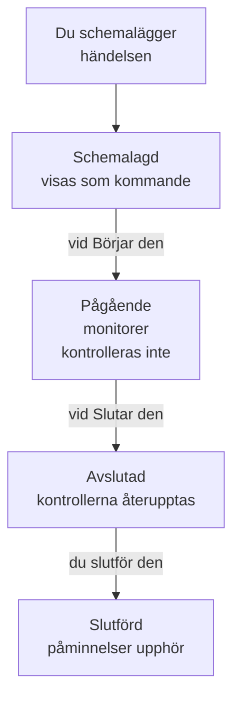

# Schemalagt underhåll – Översikt

En schemalagd underhållshändelse berättar för alla om planerat arbete innan det sker: en databasuppgradering, en nätverksändring, en flytt till nya servrar. OneUptime startar och avslutar händelsen i tid, slutar kontrollera de monitorer den påverkar medan arbetet pågår och visar den på dina statussidor, så att planerat driftstopp aldrig ser ut som ett avbrott. Den här sidan förklarar hur en händelse förlöper, var allt finns i instrumentpanelen och vad en händelse ändrar i resten av OneUptime.

:::cards
- [Hur en händelse förlöper](#hur-en-händelse-förlöper): Från schemalagd till slutförd, mestadels av sig själv.
- [Var händelser kommer ifrån](#var-händelser-kommer-ifrån): Formuläret, mallar, ett schema, formulär, chatt och kod.
- [Vad en händelse påverkar](#vad-en-händelse-påverkar): Monitorer, statussidor, prenumeranter och larm.
- [En händelses egna sidor](#en-händelses-egna-sidor): Översikten, tidslinjen, anteckningarna och inställningarna.
:::

## Hur en händelse förlöper

Varje händelse har ett planerat tidsfönster, sitt **Börjar den** och **Slutar den**, och går nedåt i din lista över underhållstillstånd. Ett jobb som körs varje minut flyttar den vidare i båda ändarna av fönstret, så du schemalägger arbetet en gång och OneUptime sköter resten.

En ny händelse börjar i **Schemalagd**. Vid sitt **Börjar den** går den över till **Pågående**: OneUptime slutar kontrollera dess monitorer och visar dem, om du har valt en status för dem, i den statusen. Vid sitt **Slutar den** går den över till **Avslutad**: kontrollerna återupptas och varje monitor går tillbaka till "i drift". **Slutförd** är det sista steget, och ingenting tar det av sig självt: en person, en chattknapp eller API:et markerar arbetet som godkänt, vilket också stoppar påminnelserna till ägarna.

Du kan starta eller avsluta en händelse tidigt, eller lägga till egna tillstånd mellan dessa fyra. Se [Underhållsstatusar](/docs/scheduled-maintenance/states).

## Underhåll och meddelanden

Båda berättar något för besökarna på dina statussidor. Använd en underhållshändelse för arbete med en start och ett slut, och ett meddelande för allt annat de bör läsa.

|                              | Schemalagt underhåll                                                    | Meddelande                                     |
| ---------------------------- | ----------------------------------------------------------------------- | ---------------------------------------------- |
| **Vad det är**               | Planerat arbete, med ett tidsfönster                                    | Ett meddelande till besökarna på dina statussidor |
| **Dess monitorer**           | Kontrolleras inte medan den pågår, och visas i den status du väljer     | Oförändrade                                    |
| **Hur den går vidare**       | Genom dina underhållstillstånd, i tid                                   | Den visas från sin starttid till sin sluttid, om den har en |
| **När prenumeranterna får veta** | När den schemaläggs, börjar och slutar, och före start om du vill   | En gång, när den börjar visas                  |
| **Nummer i ett nytt projekt** | `SM-42`                                                                | Inga                                           |

Meddelanden beskrivs på [Prenumeranter och meddelanden](/docs/status-pages/subscribers#meddelanden).

## Var händelser kommer ifrån

- **Formuläret.** Klicka på **Skapa schemalagt underhållsevenemang** i listan över händelser, eller på fliken **Schemalagt underhåll** för en värd, ett kluster, en tjänst, en nätverksplats eller en annan resurs, som väljer den resursen åt dig. Se [Skapa underhållshändelser](/docs/scheduled-maintenance/creating-events).
- **En mall.** **Skapa från mall** fyller i formuläret från en mall du har sparat för arbete du gör ofta. Se [Mallar och återkommande händelser](/docs/scheduled-maintenance/templates).
- **Ett schema.** En återkommande mall skapar en ny händelse enligt ett schema, till exempel varje vecka eller varje månad, utan att någon öppnar formuläret.
- **Ett formulär.** Ett formulär vars inlämningar skapar underhållshändelser gör en ändringsbegäran till en händelse. Se [Vad en inlämning skapar](/docs/forms/on-submit#så-blir-en-inlämning-en-schemalagd-underhållshändelse).
- **Chatt.** `/oneuptime maintenance` i Slack, eller `maintenance` skrivet till OneUptime-boten i Microsoft Teams, öppnar formuläret i ditt chattverktyg. Se [Slack](/docs/workspace-connections/slack#skapa-incidenter-och-underhåll-från-slack).
- **Kod.** API:et på `/api/scheduled-maintenance`, Terraform-resursen `oneuptime_scheduled_maintenance_event` och steget **Create One Scheduled Maintenance Event** i ett arbetsflöde.

## Var underhåll finns i instrumentpanelen

Öppna **Schemalagt underhåll** från menyn **Produkter** i det övre fältet. Listan över händelser finns på `/dashboard/{projectId}/scheduled-maintenance-events`, och dess sidomeny rymmer allt om underhåll:

| Avsnitt       | Vad du gör där                                                                                                             |
| ------------- | -------------------------------------------------------------------------------------------------------------------------- |
| **Översikt**  | **Alla händelser** och **Pågående händelser**, vars märke räknar de händelser som pågår just nu.                            |
| **Kalender** | **Underhållskalender**: varje händelse på en månad, en vecka eller en dag, bredvid de kalendrar utanför projektet som du lägger till. |
| **Arbetsyta** | **Slack** och **Microsoft Teams**, beroende på vad projektet har anslutit, eller **Anslut Slack eller Teams** när det inte har något av dem. |
| **Regler**    | **Ägarregler**, **Runbook-regler**, **Etikettregler**, **Reminder Rules**.                                                  |
| **Inställningar** | **Händelsestatus**, **Händelsemallar**, **Anteckningsmallar**, **Anpassade fält**, **Mätningar**, **Kalenderinställningar**, **Numrering**.      |

**Översikt** och **Kalender** är öppna; **Arbetsyta**, **Regler**, **Inställningar** och **Utvecklare** börjar hopfällda, och ett avsnitt öppnas av sig självt när du är på en av dess sidor. **Utvecklare** rymmer **Terraform**, **API** och **AI-assistenter**, för att styra underhåll från kod. Allt om underhåll finns här, inte i **Projektinställningar**.

Listan visar **Nummer för schemalagt underhåll**, **Titel**, **Nuvarande tillstånd**, **Berörda resurser**, **Visas på statussida**, **Börjar den**, **Varaktighet**, **Slutar den**, **Etiketter** och **Ägare**. Markera händelser för att hantera flera samtidigt: **Markera som {{state}}**, **Ändra tillstånd**, **Tilldela mig**, **Lägg till ägare**, **Ta bort ägare**, **Lägg till etiketter**, **Ta bort etiketter** eller **Ta bort**. Menyn **⋯** i slutet av varje händelses rad gör samma sak för just den händelsen: stegen **Markera som {{state}}** så länge händelsen kan ta dem, **Ändra tillstånd**, **Tilldela mig** tills du äger den, och **Lägg till ägare**.

**Underhållskalender** i avsnittet **Kalender** visar samma händelser på en månad, en vecka eller en dag och kan visa kalendrar utanför projektet bredvid. Se [Underhållskalender](/docs/scheduled-maintenance/calendar).

## Vad en händelse påverkar

Medan en händelse pågår behandlar OneUptime avbrottet den planerar som väntat:

- **Dess monitorer kontrolleras inte.** Varje monitor under **Monitorer** slutar kontrolleras, och var och ens sidor visar **Denna övervakning är inaktiverad**. Om du har valt en **Ändra övervakningsstatus till** visar monitorerna den statusen, även på dina statussidor. När händelsen slutar eller tas bort återupptas kontrollerna och varje monitor går tillbaka till "i drift", om inte en annan pågående händelse fortfarande håller den.
- **Dess andra resurser förblir tysta.** En telemetrimonitor som bevakar många värdar, kluster, databaser eller tjänster, med en serie var, skapar ingen incident och inget larm för en serie vars resurs händelsen täcker, medan de andra serierna fortsätter att larma.
- **Nätverksplatser och SLO:er håller igen.** En nätverksplats som händelsen täcker slutar räkna sitt planerade avbrott mot platserna ovanför den, och en SLO:s regler för förbrukningstakt utlöser ingenting så länge någon av dess monitorer är under underhåll. Se [Nätverksplatser](/docs/monitor/network-sites#schemalagt-underhåll-för-nätverksplatser) och [Larm och incidenter för förbrukningstakt](/docs/slo/burn-rate-alerts#planerat-underhåll).
- **Dina statussidor visar den.** Händelsen visas på de statussidor du har valt, först som kommande, sedan som pågående och sedan som över, så länge **Synlig på statussidan** är påslagen i dess **Inställningar**, och från dess **Publicera den** om du har valt ett. När den har startat visar upptidshistoriken på de sidorna för varje resurs som dess monitorer finns på den på varje dag som dess fönster berör, och de resurserna visar "Under underhåll" medan den pågår; monitorns upptidshistorik i instrumentpanelen visar den på samma sätt. Se [Upptidsprocent och historikdiagram](/docs/status-pages/resources-and-groups#upptidsprocent-och-historikdiagram).
- **Prenumeranterna får höra om den.** Som standard får prenumeranterna på de sidorna veta när den schemaläggs, när den börjar och när den slutar, och en påminnelse före start om du ställer in påminnelser. Se [Schemalagda underhållshändelser](/docs/status-pages/subscribers#schemalagda-underhållshändelser).
- **Ditt team får höra om den.** Dess ägare får veta det som deras [aviseringsinställningar](/docs/notifications/notification-settings) säger, och Slack- och Microsoft Teams-reglerna under **Arbetsyta** publicerar den i dina kanaler.

## En händelses egna sidor

Öppna en händelse från listan för att se dess sidor. Dess sidomeny rymmer:

| Avsnitt i sidomenyn | Sidor                                                                                       |
| ----------------- | --------------------------------------------------------------------------------------------- |
| **Översikt** | **Översikt**, **Tillståndstidslinje**, **Beskrivning**, **Runbooks** |
| **Team** | **Ägare** |
| **Aviseringar**        | **Aviseringsloggar** och **AI-loggar**: varje meddelande som skickats om händelsen, och vad AI har gjort för den |
| **Anteckningar**  | **Privata anteckningar** och **Offentliga anteckningar**                                       |
| **Utvecklare**    | **Terraform**, **API** och **AI-assistenter**: händelsen styrd från kod                        |
| **Avancerad**     | **Anpassade fält**, **Inställningar**, **Granskningsloggar**, **Ta bort händelse**             |

**Översikt**, **Team** och **Anteckningar** är öppna; de andra avsnitten förblir hopfällda tills du klickar på dem.

- **Översikt** — sidhuvudet visar händelsens nummer, titel och tillstånd, hur länge det är kvar tills den börjar eller hur länge den har pågått, vem som äger den, vilka statussidor den visas på och vem som skapade den, och knapparna som flyttar den vidare. Under det visar **Börjar**, **Slutar** och **Varaktighet** det planerade fönstret i din tidszon. **Schemalagd Underhåll Flöde** registrerar allt som har hänt med händelsen, bredvid korten **Maintenance Details** och **Berörda resurser**, och korten **Mätningar** och **Anpassade fält** när ditt projekt har några.
- **Tillståndstidslinje** — varje tillstånd händelsen har varit i, när och hur länge. Se [Underhållsstatusar](/docs/scheduled-maintenance/states#tillståndstidslinjen).
- **Offentliga anteckningar** — uppdateringar till dina statussidor och deras prenumeranter. **Privata anteckningar** är bara för ditt team.
- **Inställningar** — **Synlig på statussidan**, som visar eller döljer händelsen på dess statussidor, och **Skicka påminnelser**, som påminner dess ägare om den tills den är slutförd. Varje reglage sparas i samma stund som du slår om det.

## Felsökning

:::details En händelse började inte vid sitt Börjar den
Jobbet som startar händelser körs varje minut, så ge det en minut. Om sidhuvudet visar **Start försenad** har händelsen missat sin start med mer än två minuter: starta den med knappen i sidhuvudet, som gör allt jobbet gör, och öppna dess **Tillståndstidslinje** för att se var den stod.
:::

:::details En monitor kontrollerades fortfarande under underhållet
Bara de monitorer som händelsen nämner under **Monitorer** slutar kontrolleras, och bara medan händelsen pågår. En monitor för en värd eller en tjänst som händelsen nämner under **Andra påverkade resurser** kontrolleras fortfarande. Redigera händelsens kort **Berörda resurser** för att lägga till monitorn.
:::

:::details Händelsen visas inte på min statussida
Kontrollera att händelsen nämner sidan under **Visa händelse på dessa statussidor** och att **Synlig på statussidan** är påslagen i händelsens **Inställningar**. Visar dess sidhuvud **Inte på statussidor än**, visas den från dess **Publicera den**: se [Publicera den senare](/docs/scheduled-maintenance/creating-events#publicera-den-senare). Kontrollera sedan själva statussidan: den måste visa schemalagda underhållshändelser, och en händelse som började längre tillbaka än sidans historikfönster, 14 dagar om du inte har ändrat det, visas inte längre.
:::

## Nästa steg

:::cards
- [Skapa underhållshändelser](/docs/scheduled-maintenance/creating-events): Formuläret, fält för fält, och vad som händer sedan.
- [Underhållsstatusar](/docs/scheduled-maintenance/states): Vad som startar och avslutar en händelse, och egna tillstånd.
- [Mallar och återkommande händelser](/docs/scheduled-maintenance/templates): Återanvänd en händelse, eller schemalägg den varje vecka.
- [Underhållsregler och inställningar](/docs/scheduled-maintenance/settings): Ägare, etiketter, runbooks och påminnelser, automatiskt.
:::
