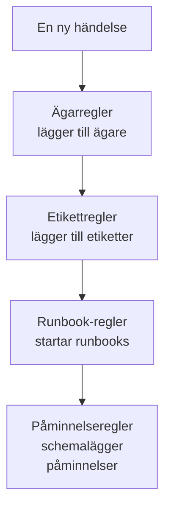

# Underhållsregler och inställningar

Konfigurationen av underhåll finns i **Schemalagt underhåll**, inte i **Projektinställningar**: reglerna som verkar på varje ny händelse och inställningarna som formar varje händelse i projektet. Den här sidan är referensen för var och en av dem, och för vem som får ändra dem.

:::cards
- [Reglerna som en ny händelse passerar](#reglerna-som-en-ny-händelse-passerar): I ordning, och vad var och en gör.
- [Påminnelseregler](#påminnelseregler): Påminn ägarna tills en händelse är slutförd.
- [Inställningar](#inställningar): Anteckningsmallar, anpassade fält, mätningar och numrering.
- [Vem som kan ändra dem](#vem-som-kan-ändra-dem): Underhållsrollerna och abonnemangen.
:::

## Var underhållsinställningarna finns

Öppna **Schemalagt underhåll** från menyn **Produkter** i det övre fältet. Avsnitten **Regler** och **Inställningar** i dess sidomeny börjar hopfällda, så fäll ut dem först. Varje sida här gäller hela projektet, på en adress som börjar med `/dashboard/{projectId}/scheduled-maintenance-events/settings/`.

| Regelsida          | Vad den gör                                                         |
| ------------------ | ------------------------------------------------------------------- |
| **Ägarregler**     | Lägger till ägare på matchande händelser.                           |
| **Runbook-regler** | Startar runbooks för matchande händelser.                           |
| **Etikettregler**  | Lägger till etiketter på matchande händelser.                       |
| **Reminder Rules** | Påminner ägarna med ett intervall tills en händelse är slutförd.    |

Avsnittet **Inställningar** rymmer **Händelsestatus**, som beskrivs på [Underhållsstatusar](/docs/scheduled-maintenance/states), **Händelsemallar**, som beskrivs på [Mallar och återkommande händelser](/docs/scheduled-maintenance/templates), och sedan **Anteckningsmallar**, **Anpassade fält**, **Mätningar**, **Kalenderinställningar** och **Numrering**. **Kalenderinställningar** beskrivs på [Underhållskalender](/docs/scheduled-maintenance/calendar#externa-kalendrar), resten nedan.

Avsnittet **Arbetsyta** rymmer Slack- och Microsoft Teams-reglerna som publicerar händelser i kanaler. Se [Slack](/docs/workspace-connections/slack#aviseringsregler) och [Microsoft Teams](/docs/workspace-connections/microsoft-teams#aviseringsregler).

## Reglerna som en ny händelse passerar

Reglerna skiljer sig åt i hur flera träffar avgörs:

- **Ägarregler**, **Etikettregler** och **Runbook-regler** verkar alla när de matchar. Ägare och etiketter som flera regler lägger till läggs till en gång.
- **Reminder Rules** kontrolleras uppifrån och ned i sin lista, och den första träffen vinner. Dra en regel för att ändra dess plats; en ny regel hamnar sist.

En ny regel börjar aktiverad; stäng av **Aktiverad** i dess redigeringsformulär för att pausa den, och listan visar en grön **Aktiverad** eller en röd **Inaktiverad** för varje regel. Ägar-, etikett- och runbook-regler verkar på händelser som skapas efter att du har sparat dem. För att tillämpa en ägar- eller etikettregel på de händelser du redan har använder du **Kör nu**: se [Köra regler på befintliga resurser](/docs/configuration/run-rules-now).

## Ägar- och etikettregler

**Ägarregler** lägger till ägaranvändare och ägarteam på nya händelser som matchar, och **Etikettregler** lägger till etiketter. Att skapa en tar två steg: **Matcha**, villkoren, och sedan **Ägare** eller **Etiketter**, det som regeln lägger till.

| Villkor                                                         | Matchar                                                                    |
| --------------------------------------------------------------- | -------------------------------------------------------------------------- |
| **Monitorer**, **Händelseetiketter**, **Övervakningsetiketter** | Händelser med någon av de monitorer eller etiketter du väljer.             |
| **Händelsetitel**, **Händelsebeskrivning**, **Övervakningsnamn**, **Övervakningsbeskrivning** | Ett mönster, som ett reguljärt uttryck, utan hänsyn till skiftläge. |

En regel matchar bara när varje villkor du fyller i stämmer; ett villkor som lämnas tomt hoppas över.

- **En regel kan ärva.** Hopfällda under **Ärv ägare** eller **Ärv etiketter** för sex reglage vidare ägarna eller etiketterna från händelsens monitorer, värdar, Kubernetes-kluster, Docker-värdar, Podman-värdar och tjänster.
- **En ny regel måste lägga till något**: välj minst en ägare eller etikett, eller slå på ett reglage.
- **Avisera ägare**, under **Fler fält** på en ägarregel, avgör om de personer som läggs till får veta det.

[Etikett- och ägarregler](/docs/configuration/label-and-owner-rules) går igenom formuläret steg för steg, för alla slags resurser.

## Runbook-regler

**Runbook-regler** startar en runbook när en ny händelse matchar, till exempel en checklista före varje databasuppgradering. De matchar på samma saker som ägar- och etikettregler; händelser har ingen allvarlighetsgrad, så runbook-regler för underhåll erbjuder ingen. Körningen kopplas till händelsen, på dess sida **Runbooks**. Se [Runbook-regler](/docs/runbooks/rules).

## Påminnelseregler

**Schemalagt underhåll → Regler → Reminder Rules** påminner en händelses ägare tills arbetet är godkänt. Varje händelse får den första regel som matchar den, uppifrån och ned i listan.

:::steps
### Välj vilka händelser det ska påminnas om

Klicka på **Skapa Scheduled Maintenance Reminder Rule**. Under **Matcha** låter du **Alla schemalagda underhållshändelser** vara valt för att påminna om varje händelse, eller väljer **Endast schemalagda underhållshändelser som uppfyller villkoren** och sedan de **Etiketter** den gäller för.

### Ställ in intervallet

Under **Påminnelser** ställer du in **Påminnelseintervall (minuter)**, hur ofta ägarna påminns, och väljer under **Påminn ägare** när. Dess **Namn** följer båda, till exempel "Påminn var 30 minuter medan den pågår", tills du skriver ett eget, och en **Beskrivning** väntar under **Fler fält**. Skapa sedan regeln.
:::

| Svar | När ägarna påminns |
| --- | --- |
| **Medan den pågår** | Från att händelsen börjar tills den slutar. En ny regel börjar med det här svaret. |
| **Innan den börjar** | Från att händelsen schemaläggs tills den börjar. |
| **Innan den börjar och medan den pågår** | Från att händelsen schemaläggs tills den slutar. |

En regel som sparats via API:et eller Terraform och som väntar tills händelsen börjar och slutar när den börjar skickar aldrig någon påminnelse: listan markerar den med **Påminner aldrig**, och dess formulär ber dig välja ett svar.

Ägarna får varje påminnelse som **Maintenance reminder**, som är påslagen via e-post för varje ny medlem. Att spara, ändra eller ta bort en påminnelseregel matchar varje händelse som inte är slutförd på nytt. För att stoppa påminnelserna för en händelse stänger du av **Skicka påminnelser** på dess sida **Inställningar**; reglaget sparas i samma stund som du slår om det.

De här påminnelserna är för ditt team. De påminnelser som dina statussideprenumeranter får innan en händelse börjar ställs in på själva händelsen, under **Påminnelser före händelsen**.

## Inställningar

### Anteckningsmallar

**Schemalagt underhåll → Inställningar → Anteckningsmallar** rymmer färdigskriven text för uppdateringar om underhåll. Kortet **Mallar för offentliga eller privata anteckningar för schemalagda underhållshändelser** listar dem; **Skapa Schemalagd Underhåll Anteckning Mall** frågar efter ett **Mallnamn**, en **Mallbeskrivning** och **Anteckning**. En mall erbjuds när någon skriver en offentlig eller privat anteckning på en händelse, och när de ändrar dess tillstånd, och dess text kan redigeras innan den publiceras. Till skillnad från anteckningsmallar för incidenter fyller anteckningsmallar för underhåll inte i några variabler.

### Anpassade fält

**Schemalagt underhåll → Inställningar → Anpassade fält** lägger till dina egna fält på varje händelse, till exempel ett ändringsärende eller en kundnivå. Fyll i dem på en händelses sida **Anpassade fält**, eller via API:et som `customFields`. Ett fält kan kopiera sitt värde från ett anpassat fält på en monitor i stället för att skrivas in: se [Fält som kopieras från en monitor](/docs/incidents/settings#fält-som-kopieras-från-en-monitor), som fungerar på samma sätt för händelser.

### Mätningar

**Schemalagt underhåll → Inställningar → Mätningar** tar tid på hur länge saker tar på varje händelse. Välj **Startfördröjning**, från den planerade starten tills händelsen börjar, **Överdrag**, från det planerade slutet tills den slutar, eller **Underhållets varaktighet**, från att den börjar tills den slutar; eller två egna tidpunkter med **Något annat**. Varje mätning visas på händelsens sida och ritas som `oneuptime.scheduled-maintenance.measurement.<key>`. Se [Mätningar](/docs/incidents/settings#mätningar), som fungerar på samma sätt för händelser.

### Numrering

**Schemalagt underhåll → Inställningar → Numrering** anger texten framför händelsenummer: `SM-` i ett nytt projekt, eller `#` utan prefix. **Uppdatera** frågar efter **Nummerprefix för schemalagt underhåll** och visar numret i en förhandsvisning medan du skriver. Bara händelser som skapas efteråt får det nya prefixet; befintliga behåller sina nummer. Reglerna för ett prefix finns på [Nummerprefix](/docs/incidents/settings#nummerprefix).

Kortet **Nästa nummer** under det anger numret som nästa händelse får, för att fortsätta ett annat verktygs nummer: **Uppdatera** öppnar **Nästa nummer för schemalagt underhåll**, som måste vara högre än det högsta hittills. Se [Nästa nummer](/docs/incidents/settings#nästa-nummer).

> [!NOTE]
> På OneUptime Cloud kräver anpassade fält abonnemanget **Growth** eller högre, och detsamma gäller att lägga till och ändra underhållstillstånd och mallar.

## Arbetsflöden

Varje underhållsmodell har arbetsflödesutlösare och åtgärder som är namngivna efter den: **On Create Scheduled Maintenance Event**, **On Update Scheduled Maintenance Event**, **On Create or Update Scheduled Maintenance Event** och **On Delete Scheduled Maintenance Event**, samma sak för **Scheduled Maintenance State Timeline** och de andra, och åtgärder som **Create One Scheduled Maintenance Event** och **Update One Scheduled Maintenance Event**. Definitioner av anpassade fält och mätvärden är undantagen: de har inga arbetsflödessteg. Se [Översikt över arbetsflöden](/docs/workflows/index).

## Vem som kan ändra dem

| Roll                              | Vad den kan göra                                                                                     |
| --------------------------------- | ---------------------------------------------------------------------------------------------------- |
| **Underhållstittare**  | Läser händelser, och ändrar ingenting.                                                               |
| **Underhållsmedlem**  | Skapar, ändrar och tar bort händelser med deras anteckningar, tillståndstidslinjer och ägare, och båda slagen av mallar. |
| **Underhållsadministratör**   | Allt en medlem gör, och skapar, ändrar och tar dessutom bort underhållstillstånd.                    |

Regler, anpassade fält och mätningar kräver **Projektägare** eller **Projektadministratör**, eller en anpassad roll med den sidans egen behörighet, till exempel **Create Scheduled Maintenance Owner Rule**. Runbook-regler godtar även **Runbook-administratör**. **Projektmedlem** arbetar med händelser och mallar, som **Underhållsmedlem**. Se [Användare, team och behörigheter](/docs/permissions/index).

## Felsökning

:::details En ägarregel lade inte till någon på en ny händelse
Öppna regeln och kontrollera dess villkor: varje villkor du har fyllt i måste stämma. Ett titelmönster är ett reguljärt uttryck, så `db upgrade` matchar inte "DB-Upgrade"; skriv `db.upgrade`. En regel verkar också bara på händelser som skapats efter att den sparades: använd **Kör nu** för dem du redan har.
:::

:::details Ägarna fick ingen påminnelse
Kontrollera att en påminnelseregel matchar händelsens etiketter, att händelsens **Skicka påminnelser** är påslagen och att **Maintenance reminder** är påslagen i ägarnas aviseringsinställningar. En regel med **Medan den pågår** skickar ingenting innan händelsen börjar.
:::

## Nästa steg

:::cards
- [Underhållsstatusar](/docs/scheduled-maintenance/states): Sidan Händelsestatus, och vad varje tillstånd gör.
- [Mallar och återkommande händelser](/docs/scheduled-maintenance/templates): Sidan Händelsemallar, på djupet.
- [Etikett- och ägarregler](/docs/configuration/label-and-owner-rules): Regelformuläret, steg för steg.
- [Aviseringsinställningar](/docs/notifications/notification-settings): Hur varje ägare väljer vad som når fram till dem.
:::
