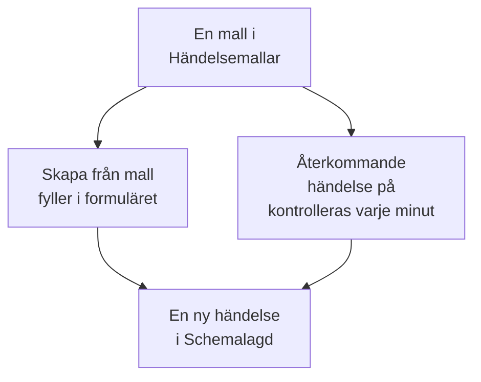

# Mallar och återkommande händelser

En mall för schemalagt underhåll sparar en händelse som du ofta planerar: dess titel och beskrivning, de monitorer den pausar, de statussidor den visas på och vem som får veta. Använd en för att fylla i formuläret med ett klick, eller gör den återkommande, så att OneUptime schemalägger händelsen åt dig varje vecka, varje månad eller med vilket intervall du vill.

:::cards
- [Skapa en mall](#skapa-en-mall): Formulärets steg, med ett namn först och ett schema sist.
- [Använd en mall](#använd-en-mall): Fyll i en ny händelse från den.
- [Återkommande händelser](#återkommande-händelser): Låt OneUptime schemalägga händelsen av sig själv.
- [Ändra eller stoppa en mall](#ändra-eller-stoppa-en-mall): Redigera den, pausa dess schema eller ta bort den.
:::

## Så fungerar det

En mall är en utgångspunkt. En händelse som har skapats från den är en kopia med egna värden: ändrar du mallen senare ändras bara de händelser som skapas efter det.

## Innan du börjar

- **Ditt abonnemang.** På OneUptime Cloud kräver mallar abonnemanget **Growth** eller högre.
- **Din roll.** För att skapa en mall krävs **Projektägare**, **Projektadministratör**, **Projektmedlem**, **Underhållsadministratör** eller **Underhållsmedlem**, eller en anpassad roll som får skapa mallar för schemalagt underhåll.

## Skapa en mall

:::steps
### Öppna mallarna

Gå till **Schemalagt underhåll → Inställningar → Händelsemallar**. **Inställningar** börjar hopfällt i sidomenyn: fäll ut det först. Klicka på **Skapa Schemalagd Underhåll Mall**.

### Namnge mallen

Under **Mallinformation** ger du den ett **Mallnamn** och en **Mallbeskrivning**, så att ditt team vet när den ska användas. Båda är obligatoriska.

### Beskriv händelsen

Under **Händelse** fyller du i den **Titel** och den **Beskrivning** som varje händelse från den börjar med. **Ägare** och **Etiketter** väntar under **Fler fält**.

### Välj vad den påverkar

Under **Berörda resurser** väljer du **Monitorer**, **Ändra övervakningsstatus till** för dem, eventuella **Andra påverkade resurser**, statussidorna under **Visa händelse på dessa statussidor** och **Aviseringar till prenumeranter**.

### Bestäm om den återkommer

Under **Återkommande** låter du **Återkommande händelse** vara avstängd för en mall som du använder manuellt, eller slår på den och fyller i dess schema. Klicka på **Nästa** för att gå igenom granskningen och skapa sedan mallen.
:::

En mall frågar efter **Ändra övervakningsstatus till** även när den inte nämner några monitorer: statusen gäller också de monitorer du lägger till när du schemalägger en händelse från den. Under **Andra påverkade resurser** tar en mall värdar, Kubernetes-kluster, Docker-värdar, Podman-värdar och tjänster.

## Vad en mall fyller i

| Del av händelsen                                  | Skapa från mall                      | En återkommande händelse        |
| ------------------------------------------------- | ------------------------------------ | ------------------------------- |
| **Titel** och **Beskrivning**                     | Ifyllda, och du kan ändra dem        | Kopierade                       |
| **Monitorer** och **Ändra övervakningsstatus till** | Ifyllda                            | Kopierade                       |
| **Andra påverkade resurser**                      | Ifyllda                              | Kopierade                       |
| Statussidorna och **Aviseringar till prenumeranter** | Ifyllda                           | Kopierade                       |
| **Ägare** och **Etiketter**                       | Ifyllda                              | Kopierade                       |
| **Börjar den** och **Slutar den**                 | Nästa hela timme, i en timme         | Beräknade utifrån schemat       |

## Använd en mall

:::steps
### Välj mallen

På **Schemalagt underhåll → Alla händelser** klickar du på **Skapa från mall** och väljer en mall under **Välj mall för schemalagt underhåll**.

### Kontrollera formuläret

Klicka på **Skapa från mall**. Formuläret öppnas med mallens svar redan ifyllda. Ställ in fönstret och ändra det som den här händelsen behöver.

### Skapa händelsen

Gå igenom stegen med **Nästa** och klicka sedan på **Skapa schemalagt underhållsevenemang** i granskningen.
:::

När projektet ännu inte har någon mall säger **Skapa från mall** det och länkar till **Händelsemallar**.

## Återkommande händelser

En återkommande mall skapar händelsen enligt ett schema. Du anger när den första händelsen skapas, när den börjar och när den slutar; varje senare händelse behåller samma avstånd, ett intervall senare.

| Fält                                                     | Vad det betyder                                                                                    |
| -------------------------------------------------------- | -------------------------------------------------------------------------------------------------- |
| **Återkommande händelse**                                | Slår på schemat.                                                                                   |
| **Första händelsen schemalagd**                          | När OneUptime skapar den första händelsen, och alltså när dess prenumeranter får veta att den är schemalagd. |
| **Första händelsen börjar**                              | När den första händelsen börjar.                                                                   |
| **Första händelsen slutar**                              | När den första händelsen slutar.                                                                   |
| **Hur ofta vill du att den här händelsen ska upprepas?** | Ett tal och en enhet: timmar, dagar, veckor, månader eller år.                                     |

Till exempel ett veckofönster där den första händelsen skapas en måndag för lördagen därefter:

| Händelse     | Skapad             | Börjar             | Slutar             |
| ------------ | ------------------ | ------------------ | ------------------ |
| Den första   | `2030-06-03 09:00` | `2030-06-08 02:00` | `2030-06-08 04:00` |
| Den andra    | `2030-06-10 09:00` | `2030-06-15 02:00` | `2030-06-15 04:00` |

Sätt **Första händelsen schemalagd** så långt före starten som du vill att dina kunder ska få höra om arbetet. Alla tre tiderna måste ligga i framtiden när du skapar mallen, händelsen måste skapas innan den börjar och slutar, och den måste börja innan den slutar; formuläret säger vilken regel en tid bryter mot.

Ett jobb kontrollerar de återkommande mallarna varje minut. När en malls nästa tid kommer flyttar det den tiden ett intervall framåt och skapar händelsen. Malllistan visar den tiden i sin kolumn **Återkommande händelse**, och **Nej** för en mall som inte återkommer. En händelse som har skapats från schemat är som vilken annan som helst: dess regler körs, dess ägare läggs till och dess prenumeranter får veta att den är schemalagd.

## Ändra eller stoppa en mall

Öppna en mall från listan för att se dess sida:

- **Malldetaljer för schemalagt underhåll** visar vad nya händelser börjar med. Dess **Redigera** går igenom **Mallinformation**, **Händelse**, **Statussidor** och **Återkommande**.
- **Berörda resurser** rymmer dess **Monitorer**, deras **Ändra övervakningsstatus till** och dess **Andra påverkade resurser**, med en egen **Redigera**.
- **Ägare** listar de personer och team som äger varje händelse som schemaläggs från den.

Ändringar gäller de händelser som skapas efter att du har sparat dem; händelser som redan har skapats behåller sina egna värden. För att stoppa ett schema stänger du av **Återkommande händelse** under **Redigera**, eller tar bort mallen. En mall som är avstängd behåller sitt schema: slår du på den igen fortsätter den vid schemats nästa tid och hoppar över tiderna då den var avstängd. Tar du bort en mall finns de händelser den har skapat kvar.

## Felsökning

:::details När en återkommande mall skapas står det att en tid ska ligga i framtiden
Alla tre första tiderna måste ligga efter nu när du skapar den. Flytta fram dem: schemat fortsätter sedan från den första händelsen.
:::

:::details En återkommande mall skapade ingen händelse
Kontrollera att **Återkommande händelse** fortfarande är på, och titta på tiden i listans kolumn **Återkommande händelse**: händelsen skapas då, inte vid sin start. Jobbet körs varje minut, så ge det en minut.
:::

:::details En händelse från en mall saknar en resurs som jag valde
En mall tar värdar, Kubernetes-kluster, Docker-värdar, Podman-värdar och tjänster under **Andra påverkade resurser**. Lägg till andra slags resurser på själva händelsen, med **Redigera** på dess kort **Berörda resurser**.
:::

## Nästa steg

:::cards
- [Skapa underhållshändelser](/docs/scheduled-maintenance/creating-events): Formuläret som en mall fyller i.
- [Underhållsstatusar](/docs/scheduled-maintenance/states): Hur varje händelse går vidare när den har skapats.
- [Underhållsregler och inställningar](/docs/scheduled-maintenance/settings): Ge varje ny händelse ägare och etiketter automatiskt.
- [Schemalagt underhåll – Översikt](/docs/scheduled-maintenance/index): Var mallar passar in i resten av underhållet.
:::
