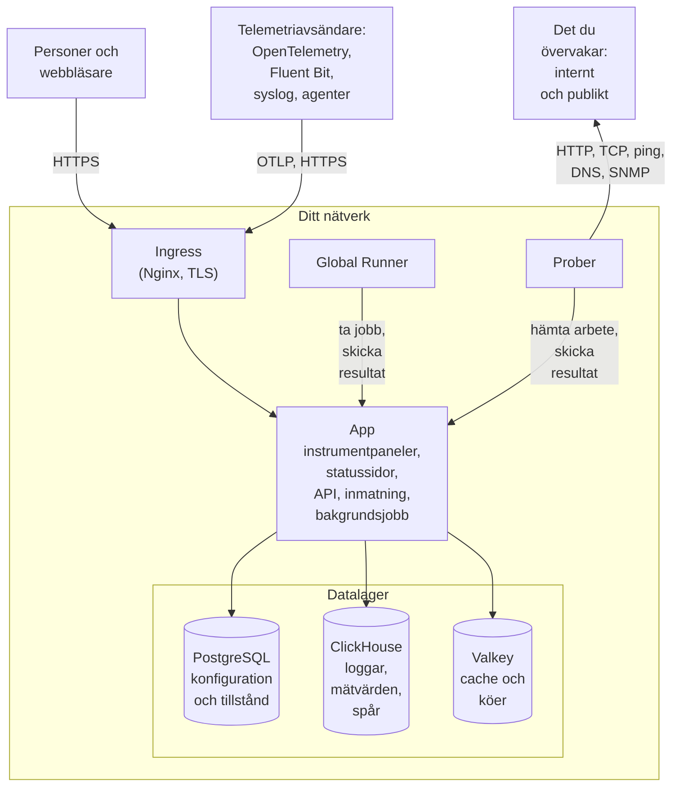

# Arkitektur

En egeninstallerad OneUptime består av en handfull containrar: en ingress som varje begäran kommer in genom, en app-image som gör jobbet, prober som kör dina övervakares kontroller och tre datalager. Den här sidan visar hur de hänger ihop, vad var och en gör och vilka anslutningar som korsar ditt nätverk.

## Det här visar bilden

- Personer når OneUptime genom **ingressen**, som avslutar TLS och skickar varje begäran vidare till appen: Dashboard, statussidorna, API:et och varje inmatningsslutpunkt som telemetri skickas till.
- **Appen** läser och skriver sitt tillstånd i PostgreSQL, sparar telemetri i ClickHouse och använder Valkey (den BSD-licensierade forken av Redis 7.2) som cache och för de köer som dess bakgrundsjobb arbetar sig igenom.
- **Prober** kan köras i ditt kluster (rekommenderas) och/eller någon annanstans i ditt nätverk. De kan övervaka:
  - Interna/privata tjänster bakom din brandvägg.
  - Externa/publika resurser på internet.
- Probresultat skickas till appen, köas i Valkey och bearbetas av bakgrundsjobben in i dina datalager. En prob någon annanstans i ditt nätverk når appen genom ingressen, på din OneUptime-URL.
- Telemetri (mätvärden, spår, loggar och mer) tas emot av samma app och lagras i ClickHouse.

> [!NOTE]
> Om du använder en extern PostgreSQL, Valkey (eller Redis) eller ClickHouse i stället för de medföljande ansluter appen i stället till dina externa slutpunkter. Det logiska flödet förblir detsamma.

## Komponenterna

| Komponent | Docker Compose-tjänst | Helm-chart | Vad den gör |
| --- | --- | --- | --- |
| Ingress | `ingress` | `nginx` | Avslutar TLS, betjänar ditt värdnamn och dina statussidors domäner och skickar varje begäran vidare till appen. |
| App | `app` | `app` | Dashboard, statussidorna, API- och inmatningsslutpunkterna och, om du inte delar upp dem, bakgrundsjobben. |
| Worker | En del av `app` | `worker` (av som standard) | Bakgrundsjobben i egna poddar, så att tung köbearbetning aldrig konkurrerar med API-begäranden. |
| Telemetry writer | En del av `app` | `telemetryWriter` (av som standard) | En nivå med fast storlek som gör varje ClickHouse-insättning, så att insättningarna håller sig begränsade hur långt workers än skalar. |
| Prob | `probe-1` | `probes` | Kör övervakarkontroller och skickar tillbaka resultaten. Varje medföljande prob är en global prob som alla projekt kan använda. |
| Global Runner | `global-runner` | `globalRunner` | En [global Runner](/docs/runbooks/agents#globala-runners): den kör JavaScript-stegen i alla projekt som inte väljer en egen Runner, vart och ett i en sandlåda som bara når internet, och OneUptime AI:s kodkorrigeringar i varje kodrepository som inte väljer någon. Den har sin egen nyckel och inget annat från servern. Bash-, SSH- och kubectl-steg körs på [Runners](/docs/runbooks/agents) som du installerar där de ska köras. |
| PostgreSQL | `postgres` | `postgresql`, eller `postgresOperator.cnpg` | Projekt, övervakare, incidenter, användare och alla andra inställningar och tillstånd. |
| ClickHouse | `clickhouse` | `clickhouse`, eller `clickhouseOperator.altinity` | Loggar, mätvärden, spår, undantag, profiler och övervakarloggar. |
| Valkey | `valkey` | `valkey` | Cachen, jobbköerna och kortlivat tillstånd som väntande push-kvitton. |

Alla appens roller är samma image: Docker Compose kör dem i en enda `app`-container, och Helm-chartet kan köra worker och telemetry writer som egna deployments. Hur du dimensionerar varje nivå står i [Dimensionering och kapacitetsplanering](/docs/installation/sizing).

## Anslutningar ut från ditt nätverk

Tre anslutningar görs om du inte ändrar en inställning:

- En gång om dagen frågar appen GitHubs API (`api.github.com`) om en nyare version har kommit. Du stänger av det med `updateCheck.disabled: true` i Helm-chartet, eller med `DISABLE_UPDATE_CHECK=true` i `config.env` med Docker Compose.
- Registrerar sig någon med ”Meddela mig om säkerhetsuppdateringar och nya versioner” markerad, som den är från början, skickas personens namn och e-post, eventuellt företag och telefonnummer samt din installations adress och version till `oneuptime.com`. Avmarkera den i ett nätverk utan internetåtkomst.
- På Kubernetes faller prober tillbaka på de publika resolvrarna `8.8.8.8` och `1.1.1.1` efter klustrets egen DNS. Sätt `dnsConfig.nameservers` till `[]` för att hålla alla uppslag på din egen DNS.

Allt annat ansluter bara utåt när du slår på det, och var och en har en sida som anger exakt vilka adresser som ska tillåtas:

| Utgående anslutning | Används till | Läs mer |
| --- | --- | --- |
| E-post (SMTP, eller SendGrids API) | Aviseringar och inbjudningar | [SMTP](/docs/emails/smtp) |
| Twilio | SMS och telefonsamtal | [Twilio-integration](/docs/self-hosted/twilio-integration) |
| OneUptimes push-relä, eller Expo | Mobila push-aviseringar | [Push-aviseringar](/docs/self-hosted/push-notifications) |
| Slack och Microsoft Teams | Aviseringar och åtgärder i arbetsytan | [Slack-integration](/docs/self-hosted/slack-integration) |
| En LLM-leverantör, som OpenAI, Anthropic, Microsoft Foundry eller en modell du kör själv | OneUptime AI | [LLM-leverantörer](/docs/ai/llm-provider) |
| `oneuptime.com` | Aktivera en Enterprise-licens online | [Enterprise Edition](/docs/self-hosted/enterprise) |

Anslutningar åt andra hållet – SendGrid som levererar inkommande e-post, Slack och Microsoft Teams som anropar tillbaka – kräver att ingressen går att nå från internet. Vilka privata adresser appen och proberna får nå bestämmer du: se [Åtkomst till privat nätverk](/docs/self-hosted/private-network-access).

OneUptimes logotyp finns inuti varje e-postmeddelande som OneUptime skickar, så den visas även i ett nätverk utan internetåtkomst, och när ett meddelande öppnas efterfrågas ingenting från någon annan värd. Bilder som du laddar upp själv, som din egen logotyp eller en statussidas, visas från din OneUptime-URL, som de som läser meddelandena måste kunna nå.

## Nästa steg

:::cards
- [Docker Compose](/docs/installation/docker-compose): Installera alla komponenter på en maskin.
- [Dimensionering och kapacitetsplanering](/docs/installation/sizing): Hur mycket CPU, minne och disk varje nivå behöver.
- [Egna prober](/docs/probe/custom-probe): Kör en prob i ett annat nätverk.
- [Enterprise Edition](/docs/self-hosted/enterprise): Vad Enterprise-images lägger till och hur licensiering fungerar.
:::
