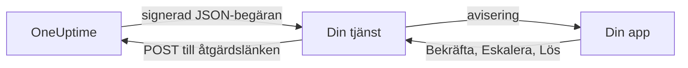

# Anpassade aviseringskanaler

En anpassad kanal skickar jourlarm till en tjänst som du driver: ditt företags egen app, ett personsökarsystem eller en gateway som kontrollerar vad som lämnar ditt nätverk. Du lägger till den en gång, för hela servern, och alla kan larmas via den utan att ställa in något. I Admin Dashboard heter de **Custom Channels**.

> [!NOTE]
> Anpassade kanaler ingår i [OneUptime Enterprise Edition](/docs/self-hosted/enterprise) och kräver en Enterprise-licens som omfattar dem. Community Edition har ingen sida **Custom Channels** och skickar ingenting till en kanal. Se [Utan licens](#utan-licens).

:::cards
- [Lägg till en kanal](#lägg-till-en-kanal): Ett namn, en URL och en signeringshemlighet.
- [Vad din tjänst tar emot](#vad-din-tjänst-tar-emot): En signerad JSON-begäran per person och larm.
- [Agera på ett larm](#agera-på-ett-larm): Bekräfta, eskalera eller lös från din egen app.
- [Leverans och nya försök](#leverans-och-nya-försök): Vad som händer när din tjänst är nere.
- [Andra aviseringar](#andra-aviseringar): Aviseringar till ägare, anteckningar och jourpass, för den som vill ha dem.
- [Utan licens](#utan-licens): Vad som stoppas och vad som behålls.
:::

## Så fungerar det



När en jourpolicy larmar någon och personens jourregel använder kanalen skickar OneUptime en begäran till kanalens URL. Den talar om vem larmet gäller (namn och e-postadress) och vad det handlar om, och innehåller länkar som din tjänst anropar när personen bekräftar, eskalerar eller löser det i din app.

## Lägg till en kanal

1. Öppna **Inställningar** i Admin Dashboard, sedan **Custom Channels**, och välj **Add**.
2. Fyll i steget **Channel**:
   - **Namn**: det som personer ser i sina aviseringsmetoder och jourregler, till exempel `CorpoApp`.
   - **Webhook URL**: dit OneUptime skickar varje larm. Den kan ligga i ditt privata nätverk.
   - **Signing Secret**: OneUptime skapar en åt dig. Kopiera den till din tjänst, som kontrollerar varje begäran med den. Du kan se den igen genom att redigera kanalen.
3. Spara i steget **Delivery** och välj sedan **Send test** för att skicka en [testbegäran](#testbegäranden) till din tjänst.

I steget **Delivery** är **Page everyone through this channel** påslaget. OneUptime lägger då till kanalen i allas jourregler i varje projekt, och i reglerna för alla som går med i ett projekt senare, och använder den för att nå en jourhavande som saknar regel för det som utlöstes. Stäng av det för att låta personer lägga till kanalen i sina regler själva.

Personer ser kanalen under **Användarinställningar**, sedan **Aviseringsmetoder**, sedan **Custom Channels**, med knappen **Send test**, och väljer den i sina jourregler som `Custom Channel: CorpoApp`. De ställer inte in något: din tjänst får veta vem varje larm gäller.

För att sluta skicka utan att ändra någons regler redigerar du kanalen och stänger av **På**. Larm som skulle ha gått till den registreras i jourloggen som inte skickade. Tar du bort en kanal tas alla jourregler som använder den bort.

## Vad din tjänst tar emot

Varje larm är en `POST`-begäran med en JSON-body:

| Huvud | Vad det innehåller |
| --- | --- |
| `Content-Type` | `application/json` |
| `X-OneUptime-Event` | Händelsen, till exempel `on-call.incident.created` |
| `X-OneUptime-Signature` | `sha256=` och den hexadecimala HMAC-SHA256 av den råa bodyn, skapad med kanalens signeringshemlighet |

```json title="An incident page"
{
  "version": 1,
  "event": "on-call.incident.created",
  "notificationId": "5f2c8a1e-6b1d-4c3a-9e7f-2a4b6c8d0e1f",
  "sentAt": "2026-10-27T03:14:15.000Z",
  "channel": { "id": "0b7e…", "name": "CorpoApp" },
  "title": "New Incident INC-42: API latency high",
  "message": "A new incident has been created: INC-42 (API latency high) in Agency A. Click to view details.",
  "project": { "id": "8d1f…", "name": "Agency A" },
  "team": { "id": "2c9a…", "name": "SRE" },
  "user": { "id": "4e6b…", "name": "Jane Tan", "email": "jane@example.com" },
  "recordType": "incident",
  "record": {
    "id": "9a3c…",
    "number": "INC-42",
    "title": "API latency high",
    "description": "p95 latency above 2 seconds for 5 minutes.",
    "severity": "Critical",
    "state": "Created",
    "url": "https://oneuptime.example.com/dashboard/8d1f…/incidents/9a3c…"
  },
  "onCallPolicy": { "id": "1d4e…", "name": "Primary" },
  "escalationRule": { "id": "7b2f…", "name": "Level 1" },
  "isPageAgain": false,
  "actions": {
    "acknowledge": "https://oneuptime.example.com/api/custom-notification-channel/page/5f2c…/acknowledge?token=…",
    "escalate": "https://oneuptime.example.com/api/custom-notification-channel/page/5f2c…/escalate?token=…",
    "resolve": "https://oneuptime.example.com/api/custom-notification-channel/page/5f2c…/resolve?token=…"
  }
}
```

| Fält | Vad det är |
| --- | --- |
| `version` | `1`. Den här versionen får bara nya fält tillagda. |
| `event` | `on-call.incident.created`, `on-call.alert.created`, `on-call.incidentEpisode.created`, `on-call.alertEpisode.created`, `notification` för [andra aviseringar](#andra-aviseringar), eller `test` |
| `notificationId` | En per person och larm. Använd den för att kasta en begäran som du redan har hanterat. |
| `title`, `message` | Färdiga att visa, så som en push-avisering skulle visa dem |
| `user` | Vem larmet gäller. Hitta personens konto i din app med `email` eller `id`. |
| `team` | Teamet som personen larmades via, eller `null` när personen larmades direkt |
| `recordType`, `record` | Vad larmet handlar om: en `incident`, `alert`, `incidentEpisode` eller `alertEpisode` |
| `onCallPolicy`, `escalationRule` | Policyn och nivån som larmade personen |
| `isPageAgain` | `true` när posten bekräftades för en stund sedan och fortfarande inte är löst |
| `actions` | Länkarna som din tjänst anropar för att [agera på larmet](#agera-på-ett-larm) |

Ett larm till flera personer är en begäran per person, var och en med personens egna länkar, så att OneUptime vet vem som svarade. Titeln, meddelandet och beskrivningen får tillsammans vara högst 16 384 tecken; en längre beskrivning kortas och slutar med ”… (truncated — see OneUptime for the full text)”.

### Kontrollera signaturen

Beräkna HMAC för begärans råa body innan du tolkar den, och jämför den med huvudet:

```javascript title="Node.js"
const crypto = require("crypto");

function isFromOneUptime(rawBody, signatureHeader, secret) {
  const expected =
    "sha256=" + crypto.createHmac("sha256", secret).update(rawBody).digest("hex");
  const received = String(signatureHeader || "");

  return (
    received.length === expected.length &&
    crypto.timingSafeEqual(Buffer.from(received), Buffer.from(expected))
  );
}
```

## Agera på ett larm

När personen trycker på en knapp i din app skickar din tjänst en `POST`-begäran till motsvarande länk i `actions`. Ingen API-nyckel behövs: varje länk bär en token för just det larmet, giltig i 7 dagar, och åtgärden registreras som utförd av den person som larmades.

| Åtgärd | Vad den gör |
| --- | --- |
| `acknowledge` | Bekräftar personens larm, och därmed incidenten, larmet eller episoden |
| `escalate` | Personen kan inte ta det: larmar nu nästa nivå i jourpolicyn och slutar larma personen |
| `resolve` | Löser incidenten, larmet eller episoden, om personens egna behörigheter tillåter det |

```bash title="Acknowledge a page"
curl -X POST "https://oneuptime.example.com/api/custom-notification-channel/page/5f2c…/acknowledge?token=…"
```

Svaret talar om vad som hände, med ord som din app kan visa som de är:

```json title="The answer"
{
  "action": "acknowledge",
  "result": "acknowledged",
  "message": "Acknowledged."
}
```

`result` är något av `acknowledged`, `alreadyAcknowledged`, `escalated`, `notEscalated`, `resolved` och `alreadyResolved`. En utgången eller felaktig länk avvisas med en 4xx-status och ett meddelande.

## Andra aviseringar

Larm är inte de enda aviseringar som personer får: OneUptime talar också om när en incident som de äger byter tillstånd, när en anteckning publiceras, när deras jourpass börjar, med mera. Var och en väljer vart var och en av dem ska gå under **Användarinställningar > Aviseringsinställningar**, som har en kolumn **Custom Channels** så länge en kanal är påslagen. Den är avstängd för alla tills de slår på den själva.

En avisering går till varje påslagen kanal, som en begäran per kanal, med `event` satt till `notification`:

```json title="A notification"
{
  "version": 1,
  "event": "notification",
  "notificationId": null,
  "sentAt": "2026-10-27T03:20:00.000Z",
  "channel": { "id": "0b7e…", "name": "CorpoApp" },
  "title": "Incident INC-42 acknowledged",
  "message": "Incident INC-42 (API latency high) was acknowledged in Agency A.",
  "project": { "id": "8d1f…", "name": "Agency A" },
  "team": null,
  "user": { "id": "4e6b…", "name": "Jane Tan", "email": "jane@example.com" },
  "recordType": null,
  "record": null,
  "onCallPolicy": null,
  "escalationRule": null,
  "isPageAgain": false,
  "actions": null,
  "notificationType": "Send incident state changed notification when I am the owner of the incident",
  "url": "https://oneuptime.example.com/dashboard/8d1f…/incidents/9a3c…"
}
```

`title` och `message` är det som personens push-avisering skulle säga. `notificationType` anger inställningen som aviseringen skickades för, och `url` länkar till det den gäller, eller är `null`. Det finns inget att agera på, så `actions` är `null`.

## Leverans och nya försök

En begäran räknas som levererad när din tjänst svarar med en 2xx-status inom 10 sekunder. En begäran som den inte svarade på, eller svarade på med 408, 429 eller en 5xx-status, skickas igen efter 1 sekund och efter ytterligare 4 sekunder: tre försök totalt. Vid alla andra 4xx-statusar skickas den inte igen.

Utfallet av varje försök finns i personens jourlogg, med kanalens namn och den status som din tjänst svarade med, aldrig URL:en. Ett larm som inte levereras stoppar inte jourpolicyn: om ingen bekräftar eskalerar den som vanligt. Behåll en e-post- eller sms-regel längre ner i dina regler om din tjänst är det enda sättet att nå personer.

## Testbegäranden

**Send test**, på sidan i Admin Dashboard eller bland en persons aviseringsmetoder, skickar en begäran med `event` satt till `test`, personen som tryckte som `user`, och `notificationId`, `record` och `actions` satta till `null`. Använd den för att prova din tjänst innan ett riktigt larm kommer.

## Utan licens

Anpassade kanaler fungerar under Enterprise Editions provperiod på 14 dagar och fristen på 30 dagar efter att en licens har löpt ut. Därefter, eller med en licens som inte omfattar dem:

- **Ingenting skickas till en anpassad kanal.** Ett larm som skulle ha gått till en registreras i personens jourlogg som inte skickat, och det gör även ett test.
- **Kanaler erbjuds inte längre.** De försvinner från personers aviseringsmetoder, jourregler och aviseringsinställningar, och beredskapen och reservlösningen slutar räkna med dem.
- **Sidan är skrivskyddad.** Du kan se och ta bort kanaler, men inte lägga till eller ändra dem, och ingen kan rikta en regel eller en aviseringsinställning mot en kanal.
- **Ingenting tas bort.** Kanalerna, och de jourregler och inställningar som använder dem, behålls.

Allt återupptas så snart en licens aktiveras, utan omstart. Personer som gick med i ett projekt medan anpassade kanaler var stoppade får ingen kanal som larmar alla i sina regler: de kan lägga till den själva.
