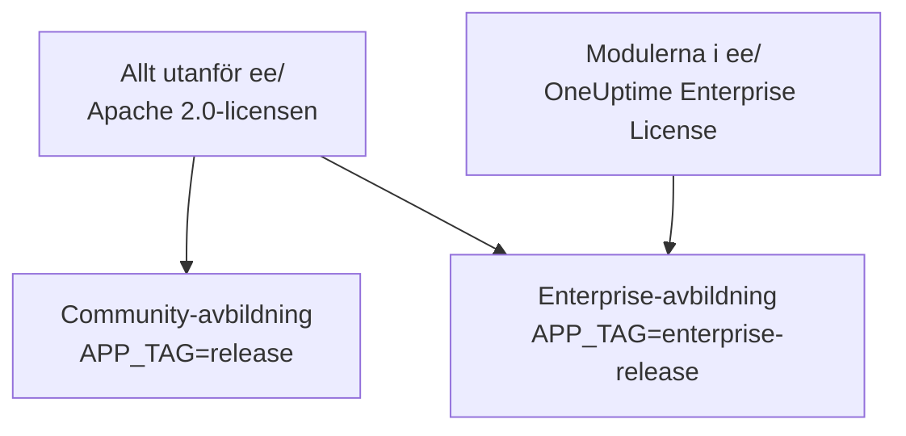
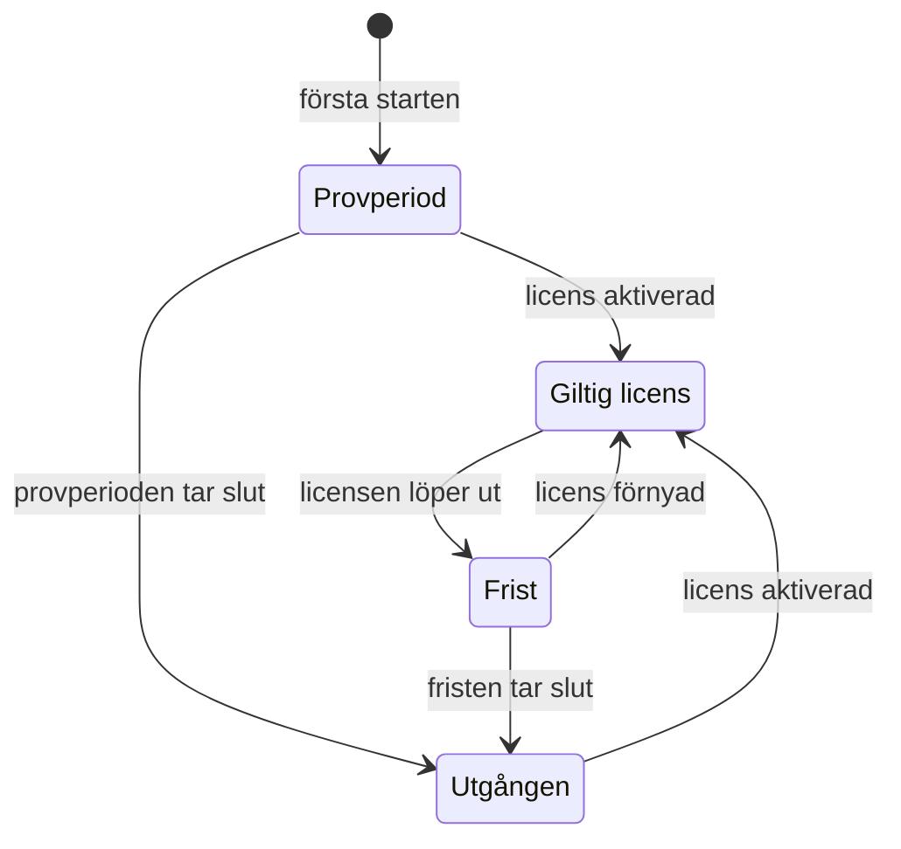

# Enterprise Edition

OneUptime byggs från ett enda repository och levereras i två utgåvor:

- **Community Edition**: hela plattformen för övervakning, incidenter och observerbarhet, inklusive enkel inloggning med SAML och OpenID Connect, öppen källkod under Apache 2.0-licensen och gratis att drifta själv i alla storlekar.
- **Enterprise Edition**: Community Edition plus enterprise-modulerna i repositoriets katalog [`ee/`](https://github.com/OneUptime/oneuptime/tree/master/ee). Modulerna lägger till SCIM-etablering samt funktioner för styrning och administration av instansen. De är licensierade under [OneUptime Enterprise License](https://github.com/OneUptime/oneuptime/blob/master/ee/LICENSE), och användning i produktion kräver en Enterprise-licens för ditt antal användare.

De två utgåvorna är separata containeravbildningar. Community-avbildningen innehåller ingen kod från `ee/`. OneUptime Cloud kör Enterprise Edition, och i molnet avgör din plan vilka av dessa funktioner du får.



> [!NOTE]
> **Enkel inloggning finns i alla utgåvor.** Inloggning med SAML och OIDC för projekt och statussidor, global SSO och "Require SSO for login" ingår i Community Edition, och inget licenstillstånd stänger av dem.

Den här sidan beskriver vad varje utgåva innehåller, hur du kör Enterprise Edition, hur licensieringen fungerar och vad som händer när du byter utgåva.

:::cards
- [Jämför utgåvorna](#vad-varje-utgåva-innehåller): Vad Enterprise Edition lägger till.
- [Kör Enterprise-avbildningen](#köra-enterprise-edition): En enda inställning, på Kubernetes eller Docker Compose.
- [Aktivera en licens](#licensiering): Online med en nyckel eller offline med en signerad token.
- [När en licens löper ut](#när-en-licens-löper-ut-eller-saknas): Vad som stoppas, vad som aldrig stoppas och hur det kommer tillbaka.
:::

## Vad varje utgåva innehåller

| Funktion | Community | Enterprise | OneUptime Cloud |
| --- | --- | --- | --- |
| Övervakning, larm, incidenter, jour, statussidor, loggar, mätvärden, spår, undantag, instrumentpaneler, arbetsflöden, AI-funktioner, API och Terraform | Ja | Ja | Alla planer |
| Inloggning med lösenord, tvåfaktorsautentisering, team, roller och API-nycklar | Ja | Ja | Alla planer |
| [SAML-SSO och OpenID Connect](/docs/identity/sso) för inloggning i projekt | Ja | Ja | Planen Scale och högre |
| SAML-SSO och OpenID Connect för inloggning på privata statussidor | Ja | Ja | Planen Scale och högre |
| [Global SSO och OIDC (för hela instansen)](/docs/identity/global-sso) | Ja | Ja | Inte tillämpligt |
| [SCIM-etablering](/docs/identity/scim) för projekt och statussidor | Nej | Ja | Planen Scale och högre |
| Inställningar för teamefterlevnad | Nej | Ja | Planen Scale och högre |
| Granskningsloggar | Nej | Ja | Planen Enterprise |
| Åsidosättningar av lagringstid: lagringstid per telemetrityp (loggar, spår, mätvärden, profiler, med regler per loggallvarlighet och spårstatus) samt lagringstid per tjänst och per resurs | Nej | Ja | Planen Scale och högre |
| Administrationens **Health**-instrumentpaneler: översikt över instansen, bakgrundsköer, instansloggar, PostgreSQL, Valkey, ClickHouse-kluster, diagnostikloggar och telemetriinmatning | Nej | Ja | Inte tillämpligt |
| Administrationens **Query Console** | Nej | Ja | Inte tillgängligt |
| Hälsolarm för PostgreSQL och Valkey (Redis) | Nej | Ja | Inte tillämpligt |
| Kapacitetsvy för ClickHouse, kapacitetslarm och automatisk rensning av disken | Ja | Ja | Inte tillämpligt |
| Migreringsstatus, supportpaket och globala prober i administratörspanelen | Ja | Ja | Inte tillämpligt |
| Hantering av Enterprise-licens, platser och instanser | Nej | Ja | Inte tillämpligt |

Enkel inloggning omfattar "Require SSO for login" för projekt, privata statussidor och hela instansen, i båda utgåvorna.

Alla utgåvor har projektets standardlagringstid för telemetri under **Projektinställningar > Telemetri och APM > Datalagring**. Åsidosättningar av lagringstid är det som Enterprise Edition lägger till ovanpå den.

På OneUptime Cloud kan en betald funktion alltid stängas av, på alla planer. En åsidosättning av lagringstid som en provperiod (eller ett byte till en lägre plan) lämnade inställd fortsätter att gälla för ny telemetri, så under planen Scale visar lagringssidorna den under uppgraderingskortet med knappen **Ta bort åsidosättning**. Borttagningen fungerar på alla planer; att ställa in en igen kräver planen Scale. Telemetri som redan har lagrats behåller den lagringstid den lagrades med. På samma sätt visar **Projektinställningar > Säkerhet > SSO** reglaget **Kräv SSO för inloggning** under sitt uppgraderingskort så länge projektet fortfarande kräver SSO, så att det går att stänga av.

Rader med "Inte tillämpligt" är funktioner för administration av instansen. På OneUptime Cloud driver OneUptime instansen åt dig.

## Köra Enterprise Edition

Båda utgåvorna använder samma konfiguration, samma databaser och samma data. Ett byte av utgåva ändrar avbildningen du kör och inget annat. Ingen migrering behövs i någon riktning.

:::tabs
@tab Kubernetes
Ange avbildningstypen i din `values.yaml`:

```yaml title="values.yaml"
image:
  type: enterprise-edition
```

Uppgradera sedan som vanligt:

```bash
helm upgrade my-oneuptime oneuptime/oneuptime -f values.yaml
```

Chartet hämtar då `enterprise-`-varianten av varje avbildningstagg, till exempel `oneuptime/app:enterprise-release`, eller `enterprise-<version>` när du låser `image.tag`. Ange `image.type: community-edition` (standardvärdet) för att köra Community Edition.
@tab Docker Compose
Ange `APP_TAG` i din `config.env`:

```bash title="config.env"
APP_TAG=enterprise-release
```

Använd `enterprise-<version>` för att låsa en version. Hämta sedan avbildningarna och starta om:

```bash
npm run update
```

För att gå tillbaka till Community Edition anger du `APP_TAG=release` **och** `IS_ENTERPRISE_EDITION=false`. Så länge `IS_ENTERPRISE_EDITION=true` är angiven ställer `npm run update` tillbaka `APP_TAG` till `enterprise-release`, och Community-avbildningen vägrar starta.
:::

### `IS_ENTERPRISE_EDITION` är inaktuell

Avbildningen du kör avgör utgåvan. `IS_ENTERPRISE_EDITION` slår inte längre på enterprise-funktioner och tas bort i en framtida version. Du kan lämna den oangiven.

Att ange `IS_ENTERPRISE_EDITION=true` på Community-avbildningen slår **inte** på enterprise-funktioner. Appen **vägrar i stället att starta**, så att en uppgradering som hamnar på Community-avbildningen aldrig i tysthet kan stoppa SCIM-etableringen (inklusive avetablering) och granskningsloggningen. Felet talar om vad du ska ange: `APP_TAG=enterprise-<version>` för att behålla Enterprise Edition, eller `IS_ENTERPRISE_EDITION=false` för att köra Community Edition. Med Helm kan det inte hända: chartet härleder variabeln från `image.type`.

`ONEUPTIME_EDITION=community` får Enterprise-avbildningen att köras som Community Edition. Det är användbart för att prova en nedgradering innan du gör den. Enterprise-avbildningen anger själv `ONEUPTIME_EDITION=enterprise`; åsidosätt den inte med något annat än `community`.

## Licensiering

Filen [`LICENSE`](https://github.com/OneUptime/oneuptime/blob/master/LICENSE) i repositoriets rot anger vilken licens som täcker vad: allt i katalogen `ee/` omfattas av [OneUptime Enterprise License](https://github.com/OneUptime/oneuptime/blob/master/ee/LICENSE), tredjepartskomponenter behåller de licenser som deras ägare tillhandahåller dem under, och allt annat omfattas av Apache 2.0-licensen.

En ny installation av Enterprise Edition körs som en **provperiod på 14 dagar**, räknat från första gången installationen startar Enterprise Edition. Provperioden är till för utvärdering: användning av Enterprise Edition i produktion kräver ett abonnemang under OneUptime Enterprise License. Aktivera en licens innan provperioden tar slut: därefter stoppas SCIM, granskningsloggning och åsidosättningar av lagringstid, och enterprise-konfigurationen blir skrivskyddad (se [När en licens löper ut eller saknas](#när-en-licens-löper-ut-eller-saknas)). Kontakta [sales@oneuptime.com](mailto:sales@oneuptime.com) för att få en licens.

Licensen hanteras från **utgåvemärket**, som huvudadministratörer ser i sidhuvudet i administratörspanelen och i sidfoten i Dashboarden. Det visar licensstatus, platsanvändning och, för huvudadministratörer, instans-ID:t.

### Onlineaktivering (licensnyckel)

:::steps
1. Logga in som huvudadministratör och öppna utgåvemärket.
2. Ange din licensnyckel och validera den.
:::

Installationen kontrollerar nyckeln hos OneUptime och lagrar licensen den får. Därefter håller den licensen aktuell med en daglig synkronisering. Använd **Refresh license** på utgåvemärket för att hämta ändringar, som extra platser eller en förnyelse, direkt.

Onlineaktivering kräver utgående HTTPS från OneUptime-servern till `https://oneuptime.com`. Om servern bara når internet via ett relä anger du `ENTERPRISE_LICENSE_SERVER_URL` till reläets `https://`-adress. Reläet måste vidarebefordra `/api/enterprise-license/` till oneuptime.com.

### Offlineaktivering (installationer utan nätverksåtkomst)

En installation utan väg till internet kan använda en **signerad licenstoken** i stället för en nyckel:

:::steps
1. Logga in som huvudadministratör, öppna utgåvemärket och anteckna **instans-ID:t**.
2. Be OneUptime ([sales@oneuptime.com](mailto:sales@oneuptime.com)) om en offlinelicenstoken för det instans-ID:t.
3. Klistra in token i utgåvemärkets tokenfält och aktivera den.
:::

Installationen verifierar själv token, mot OneUptimes signeringsnycklar som är inbyggda i din version. Den kontaktar aldrig OneUptime. En token som utfärdats för ett instans-ID nekas av alla andra installationer, och en token som utfärdats utan instans-ID (som den token en onlineaktiverad installation får) nekas också. För att förnya eller lägga till platser aktiverar du en ny token innan den nuvarande löper ut.

> [!IMPORTANT]
> **Offlineaktivering kräver en version som litar på OneUptimes signeringsnyckel för licenser.** Om din version ännu inte innehåller den nyckeln misslyckas aktiveringen med "this build does not trust the key that signed this token". Aktivera i så fall online, eller uppgradera till en version som innehåller nyckeln.

### Vad den dagliga licenssynkroniseringen skickar

En onlineaktiverad installation skickar en rapport till OneUptime om dagen. Den innehåller:

- licensnyckeln;
- instans-ID:t (en slumpmässig identifierare som installationen genererar) och värdnamnet som installationen är konfigurerad med (`HOST`);
- OneUptime-versionen som installationen kör;
- antalet användare på installationen;
- en **SHA-256-hash** av varje användares e-postadress med gemener. OneUptime använder hasharna för att räkna en person med konton på flera av dina installationer som en enda plats. Vanliga användares e-postadresser skickas aldrig i klartext;
- e-postadresserna till installationens **huvudadministratörer**, så att OneUptime kan kontakta dig om förnyelser och platsgränser.

Svaret innehåller licensen så som OneUptime känner till den den dagen: företagsnamn, utgångsdatum, platsgräns, det sammanlagda antalet användare över dina installationer och de installationer som är registrerade på licensen. Andra repliker av installationen plockar upp en ändring inom ungefär en minut.

När du aktiverar eller uppdaterar licensen skickar installationen bara licensnyckeln, instans-ID:t, värdnamnet och versionen.

Inget annat skickas. Inga övervakningsdata, ingen telemetri, inga loggar och ingen konfiguration lämnar installationen. Community Edition skickar inget av detta, och det gör inte heller en offlineaktiverad installation.

### När en licens löper ut eller saknas

Alla enterprise-funktioner fungerar under provperioden på 14 dagar och i 30 dagar efter att en licens har löpt ut (fristen). Utgåvemärket varnar innan någon av dem tar slut. Därefter **stoppas SCIM, granskningsloggning och åsidosättningar av lagringstid** tills en licens aktiveras, precis som på Community Edition, och enterprise-konfigurationen blir skrivskyddad. Enkel inloggning är inte en enterprise-funktion: inloggning med SAML och OIDC, global SSO och "Require SSO for login" fungerar likadant i alla licenstillstånd.



| Tillstånd | Vad som händer |
| --- | --- |
| **Giltig licens** | Alla enterprise-funktioner fungerar. Nya användare kan inte läggas till utöver det licensierade antalet platser. Befintliga användare tas aldrig bort. |
| **Provperiod eller frist** (de första 14 dagarna för en installation utan licens, eller 30 dagar efter att en licens har löpt ut), eller en installation med en licens vars utgång aldrig registrerades | Alla enterprise-funktioner fungerar, och utgåvemärket visar en varning. Under fristen efter en utgång gäller platsgränsen fortfarande. En installation med en licens utan registrerad utgång kör samma provperiod på 14 dagar som en installation utan licens, och platsgränsen upprätthålls inte, eftersom licensposten den har redan är ofullständig. |
| **Efter provperioden eller fristen** (utgången, saknad eller ogiltig licens, eller en licens som inte omfattar funktionen) | SCIM-etablering, granskningsloggning och åsidosättningar av lagringstid **stoppas** (se nedan). Enterprise-konfigurationen blir **skrivskyddad**: du kan visa och ta bort den, men inte skapa eller ändra den. En ändring fungerar alltid, så att du kan hantera en incident: att byta ut en SCIM-bearer-token. SCIM-inställningssidorna erbjuder den medan allt annat är skrivskyddat: **Återställ Bearer-token** på en SCIM-konfiguration, som visar den nya token en gång. Via API:t skickar du `bearerToken` ensam (minst 32 tecken). Granskningsloggning kan inte slås på eller utökas. Enterprise-instrumentpanelerna under Health och Query Console är låsta. Platsgränsen upprätthålls inte längre. |

Vad som stoppas när en licens löper ut:

- **SCIM-etableringen stoppas.** Din identitetsleverantörs SCIM-begäranden nekas, inklusive avetablering, och SCIM-teamlås hävs, så att team som hanteras av SCIM-pushgrupper kan redigeras för hand.
- **Granskningsloggningen slutar registrera.** Granskningsloggar som har registrerats hittills behålls.
- **Åsidosättningar av lagringstid slutar gälla.** Ny telemetri behålls enligt projektets standardlagringstid. Telemetri som redan har lagrats behåller den lagringstid den skrevs med. Du kan fortfarande rensa en åsidosättning via API:t, men inte ställa in en.

Vad som **inte** stoppas:

- **Enkel inloggning.** Inloggning med SAML och OIDC för projekt, privata statussidor, hela instansen (global SSO) och mobilapparna, liksom "Require SSO for login", ingår i alla utgåvor. En utgången licens ändrar inget av detta, och konfigurationen för enkel inloggning går fortfarande att redigera.
- **Grundövervakningen påverkas aldrig**: övervakare, larm, incidenter, jour, statussidor och telemetri fortsätter alla att fungera.
- **Huvudadministratörer kan alltid logga in med sitt lösenord.**
- **Inget tas bort.** SCIM-konfiguration, granskningsloggar och åsidosättningar av lagringstid förblir som de är.

**Allt fortsätter igen så snart en licens aktiveras**, utan omstart: SCIM-etablering, granskningsloggning och åsidosättningar av lagringstid kommer tillbaka med den konfiguration du har. OneUptime stänger bara av dem när det vet att licensen har löpt ut. Så länge det inte kan läsa licenstillståndet, till exempel en kort stund medan servern startar, förblir SCIM, granskningsloggning och åsidosättningar av lagringstid påslagna.

> [!WARNING]
> **Om din identitetsleverantör avetablerar användare via SCIM ska du aktivera en licens innan provperioden eller fristen tar slut.** Därefter avetablerar SCIM inte längre de personer du tar bort hos din identitetsleverantör: deras OneUptime-konton finns kvar, och om inte "Require SSO for login" gäller för dem kan vem som helst som fortfarande når en sådan kontos inkorg ange ett lösenord och logga in. Om du låter licensen löpa ut tar du själv bort de användarna i OneUptime.

## Byta från Enterprise till Community

Din konfiguration ligger kvar i databasen. Ett byte tillbaka till Enterprise-avbildningen återställer allt som det var, så länge installationen har en giltig licens eller fortfarande är i sin provperiod eller frist. Enkel inloggning ändras inte: inloggning med SAML och OIDC, global SSO och "Require SSO for login" fungerar likadant på båda avbildningarna. På Community-avbildningen:

- **SCIM stoppas.** Dess etableringsslutpunkter finns inte längre, så SCIM-anrop från IdP:n misslyckas. Det omfattar även SCIM-avetablering.
- **SCIM-teamlås hävs**, så att team som hanterades av SCIM-pushgrupper kan redigeras för hand. Vid start loggar servern vilka projekt som fick sina SCIM-teamlås hävda.
- **Granskningsloggningen stoppas.** Granskningsloggar som har registrerats hittills behålls, men sidorna för granskningsloggar visar en uppmaning att uppgradera.
- **Åsidosättningar av lagringstid slutar gälla.** Ny telemetri behålls enligt projektets standardlagringstid, och lagringskorten under **Projektinställningar > Telemetri och APM > Datalagring** och på inställningssidan för varje tjänst och varje resurs visar en uppmaning att uppgradera. Åsidosättningarna ligger kvar i databasen och gäller igen när du byter tillbaka.
- **Enterprise-inställningssidor visar en uppmaning att uppgradera.** Via API:t kan du fortfarande läsa och ta bort enterprise-konfiguration och återställa en SCIM-bearer-token, men inte skapa eller ändra något annat. Granskningsloggning kan inte slås på.
- **Enterprise-instrumentpanelerna under Health, Query Console och hälsolarmen för PostgreSQL och Valkey stoppas.** Kapacitetsövervakning och rensning för ClickHouse, migreringsstatus och supportpaketet fortsätter att fungera.

> [!CAUTION]
> **Innan du byter en installation vars identitetsleverantör avetablerar användare via SCIM till Community-avbildningen ska du gå igenom vem som har åtkomst.** Utan SCIM behåller de personer du tar bort hos din identitetsleverantör sina OneUptime-konton, och om inte "Require SSO for login" gäller för dem kan vem som helst som fortfarande når en sådan kontos inkorg ange ett lösenord och logga in. Ta bort de användarna först.

## Felsökning

:::details Appen vägrar starta efter en uppgradering
`IS_ENTERPRISE_EDITION=true` är angiven på Community-avbildningen. Ange `APP_TAG=enterprise-<version>` för att behålla Enterprise Edition, eller `IS_ENTERPRISE_EDITION=false` för att köra Community Edition, och kör sedan `npm run update` igen.
:::

:::details Offlineaktivering misslyckas med "this build does not trust the key that signed this token"
Din version byggdes innan den litade på OneUptimes signeringsnyckel för licenser. Aktivera online, eller uppgradera till en version som innehåller nyckeln.
:::

:::details Din identitetsleverantörs SCIM-begäranden nekas
På Enterprise-avbildningen har licensen löpt ut: aktivera en, så fortsätter etableringen utan omstart. På Community-avbildningen finns SCIM-slutpunkterna inte alls.
:::

## Nästa steg

:::cards
- [Uppgradering](/docs/installation/upgrading): Byt till en ny version, och mellan utgåvornas avbildningar.
- [SSO](/docs/identity/sso): Enkel inloggning, i alla utgåvor.
- [Global SSO](/docs/identity/global-sso): En identitetsleverantör för hela instansen.
- [SCIM](/docs/identity/scim): Etablera användare och team från din identitetsleverantör.
:::
