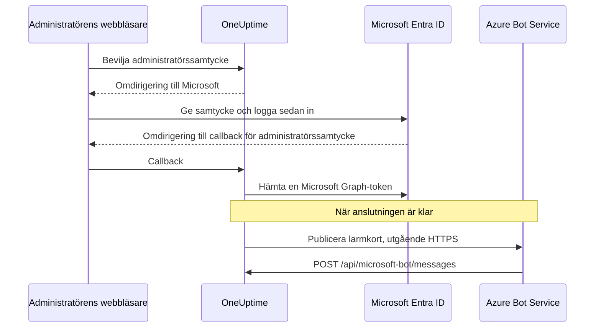
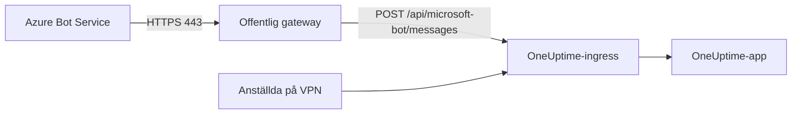

# Microsoft Teams-integration

Anslut din självhostade OneUptime till Microsoft Teams. Du registrerar en app i Microsoft Entra ID, skapar en Azure Bot för den, ger OneUptime appens inloggningsuppgifter och installerar det Teams-apppaket som din server genererar. Därefter publicerar OneUptime larm och incidenter i dina kanaler och chattar, och ditt team agerar på dem direkt i Teams.

Den här sidan är för den som driver OneUptime-servern. När Teams är anslutet ställs aviseringsregler in per projekt: se [Microsoft Teams](/docs/workspace-connections/microsoft-teams).

:::cards
- [Konfigurera integrationen](#konfigurera-integrationen): Nio steg, från Azure-portalen till ditt första team.
- [Miljövariabler](#miljövariabler): De tre värden som OneUptime behöver från appregistreringen.
- [Nätverksåtkomst](#nätverksåtkomst): Botslutpunkten som Microsoft måste kunna nå.
- [Felsökning](#felsökning): Slutpunkter som inte går att nå, saknade installationer och anslutningar som misslyckades.
:::

## Så fungerar det

OneUptime använder en Azure Bot för Teams-integrationen. Trafiken går åt båda hållen, och de två riktningarna är oberoende: OneUptime anropar Microsoft för att publicera meddelanden, och Azure Bot Service anropar din server när någon trycker på en knapp, skriver till boten eller lägger till den i en chatt.



En Incoming Webhook eller en URL för ett Teams-arbetsflöde ersätter inte den här botens meddelandeslutpunkt.

Videosamtal (ett Teams-möte för en incident) använder inte den här boten: de behöver en egen appregistrering, som beskrivs i [Videosamtal](/docs/workspace-connections/video-calls#one-click-connect-on-a-self-hosted-server).

## Innan du börjar

- En Azure-prenumeration för Azure Bot-resursen.
- Ett konto som kan skapa appregistreringar i Microsoft Entra ID, och en Microsoft 365-administratör som kan bevilja administratörssamtycke.
- Ett offentligt HTTPS-värdnamn för OneUptime som Azure Bot Service kan nå. Se [Nätverksåtkomst](#nätverksåtkomst).
- Åtkomst till serverkonfigurationen: `config.env` med Docker Compose, eller dina Helm-values på Kubernetes.
- För att ansluta ett projekt: rollen **Project Owner**, **Project Admin** eller **Project Member** i projektet.

## Konfigurera integrationen

:::steps
### Steg 1: Skapa Azure-appregistreringen

Öppna **App registrations** i [Azure-portalen](https://portal.azure.com) och välj **New registration**. Fyll i formuläret:

- **Name:** oneuptime
- **Supported account types:** Accounts in this organizational directory only (Single tenant)
- **Redirect URI:** Web - `https://your-oneuptime-domain.com/api/microsoft-teams/auth`

Välj **Register** och lägg sedan till en andra Web-omdirigerings-URI, `https://your-oneuptime-domain.com/api/microsoft-teams/admin-consent/callback`. Anteckna **Application (client) ID** och **Directory (tenant) ID**: du behöver båda senare.

> [!NOTE]
> **Varför en enda klientorganisation:** en självhostad OneUptime-installation betjänar en organisation, och dess bot är registrerad för den enda klientorganisation du anger i `MICROSOFT_TEAMS_APP_TENANT_ID` (steg 6). Att registrera appen för flera klientorganisationer utökar inte det och inför ett sätt att misslyckas: gäst- / B2B-användare vars egen Microsoft-klientorganisation skiljer sig från din når boten med sitt eget klientorganisations-ID, som OneUptime inte kan koppla till ditt projekt. Har du redan registrerat en app för flera klientorganisationer fortsätter den att fungera; se bara till att `MICROSOFT_TEAMS_APP_TENANT_ID` är din egen klientorganisation, och räkna med att gästkonton behöver ett konto i din klientorganisation för att använda boten.

### Steg 2: Konfigurera appens behörigheter

Öppna **API permissions** i din appregistrering, välj **Add a permission** och välj **Microsoft Graph**.

**Lägg till delegerade behörigheter** (när appen agerar för en inloggad användares räkning):

- **User.Read** - Krävs för att hämta den autentiserade användarens profiluppgifter (visningsnamn, e-post) under OAuth-flödet
- **Team.ReadBasic.All** - Krävs för att lista de team användaren är medlem i när användaren väljer vilket team som ska anslutas
- **Channel.ReadBasic.All** - Krävs för att läsa kanalinformation och lista teamens kanaler för leverans av aviseringar
- **ChannelMessage.Send** - Krävs för att skicka aviseringar om larm och incidenter till Teams-kanaler

**Lägg till programbehörigheter** (när appen agerar som sig själv, utan en inloggad användare):

- **Team.ReadBasic.All** - Krävs för att lista alla team i organisationen när administratörssamtycke har beviljats
- **Channel.ReadBasic.All** - Krävs för att kontrollera att kanaler finns och hämta deras detaljer
- **TeamsAppInstallation.ReadForTeam.All** - Krävs för diagnostik. Den låter OneUptime läsa vilket apppaket som faktiskt är installerat i ett team och jämföra det med den här installationens klient-ID, så att ett misslyckat utskick kan tala om *vilken* av de möjliga orsakerna det är. Utan den kan OneUptime inte skilja "inte installerad" från "installerad, men det är någon annans paket", och rapporterar bara vad Microsoft sa. Det är huvudskälet till att felsökning av den här integrationen tar dagar i stället för minuter. Bevilja den.
- **Chat.ReadBasic.WhereInstalled** - Valfri. Den låter OneUptime läsa namnet på varje chatt som OneUptime-appen finns i. Utan den ger varje chatt detta genom manifestbehörigheten **ChatSettings.Read.Chat** (nedan), som en chatt som lades till med ett äldre manifest har först när appen har uppdaterats i den.

`ChannelMessage.Send` är bara en delegerad behörighet; det finns ingen variant som programbehörighet i [referensen för Microsoft Graph-behörigheter](https://learn.microsoft.com/en-us/graph/permissions-reference#channelmessagesend). Behåll den i listan över delegerade behörigheter ovan.

Välj sedan **Grant admin consent** för din organisation.

Själva boten använder behörigheter för resursspecifikt medgivande (RSC) som definieras i Teams-appmanifestet. De beviljas när appen installeras eller uppdateras i ett team eller en chatt, inte i Entra ID:

- **ChannelMessage.Send.Group** - Låter boten skicka meddelanden till teamkanaler
- **ChannelMessage.Read.Group** - Låter boten läsa kanalmeddelanden för interaktiva kommandon
- **Channel.Create.Group** - Låter boten skapa kanaler vid behov
- **ChatMessage.Read.Chat** - Låter boten läsa meddelanden i chattar den har lagts till i (för interaktiva kommandon)
- **ChatMember.Read.Chat** - Låter boten läsa medlemmarna i chattar den har lagts till i (för att namnge chattar i OneUptime)
- **ChatSettings.Read.Chat** - Låter OneUptime läsa namnet på gruppchattar som appen har lagts till i. Teams skickar inte namnet på en gruppchatt till boten på ett tillförlitligt sätt, så utan den visas en namngiven gruppchatt med medlemmarnas namn
- **TeamsAppInstallation.Read.Group** - Låter OneUptime bekräfta att appen är installerad i ett team där den ska publicera

Om du laddade upp appmanifestet innan dessa behörigheter fanns laddar du ned det igen från **Projektinställningar > Arbetsyta > Microsoft Teams** och laddar upp det till Teams som en uppdatering av OneUptime-appen. Teams beviljar team- och chattbehörigheterna när appen installeras eller uppdateras i det teamet eller den chatten, så godkänn uppdateringen i varje team och varje chatt som redan har appen. För chattar, se [En gruppchatt visas med medlemmarnas namn](#en-gruppchatt-visas-med-medlemmarnas-namn).

### Steg 3: Skapa en klienthemlighet

Öppna **Certificates & secrets** i din appregistrering och välj **New client secret**. Lägg till en beskrivning, välj en giltighetstid (24 månader är ett rimligt val) och välj **Add**. Kopiera hemlighetens värde direkt: Azure visar det bara en gång.

> [!IMPORTANT]
> Kopiera hemlighetens **Value**, inte dess **Secret ID**. Värdet är den längre strängen.

### Steg 4: Skapa en Bot Service

Skapa en **Azure Bot**-resurs i Azure-portalen:

- **Bot handle:** oneuptime-bot
- **Subscription** och **Resource group:** dina egna
- **Pricing tier:** F0 (Free) räcker för test
- **Type of App:** Single Tenant, med den befintliga appregistreringen: dess **Application (client) ID** och **Directory (tenant) ID** från steg 1

Välj **Review + create** och sedan **Create**. När boten har distribuerats öppnar du dess sida **Configuration**, anger **Messaging endpoint** till `https://your-oneuptime-domain.com/api/microsoft-bot/messages` och sparar.

**Kontrollera slutpunkten innan du går vidare.** Azure Bot Service anropar den här URL:en från det offentliga internet, så testa den från en plats utanför ditt nätverk: inte inifrån klustret, och inte över ett VPN som ser värden när Azure inte gör det:

```bash
curl -sS -i https://your-oneuptime-domain.com/api/microsoft-bot/messages
```

Använd `-i` i stället för att bara titta på statuskoden: vid en 404 är **brödtexten det enda som talar om vem som genererade den**, och den skillnaden är hela diagnosen.

- **405** är korrekt och betyder att du är klar. Slutpunkten tar bara emot POST, så en GET får `405 Method Not Allowed`, med `Allow: POST` och en beskrivning av slutpunkten. Att nå den är precis det som testas.
- **En 404 med JSON-brödtexten `{"message":"Page not found - /api/microsoft-bot/messages"}`** kommer från OneUptime, så begäran *kom* fram. Antingen är den här installationen äldre än 405-svaret ovan (äldre versioner betjänade bara den här vägen för POST, så en GET hamnade i den allmänna "not found"-hanteraren), eller så skriver något framför OneUptime om sökvägen och tar bort prefixet `/api` innan appen ser den (en Kubernetes-ingress med `rewrite-target: /` är den vanliga boven).
- **En 404 med en HTML-felsida** från nginx, din ingress eller en lastbalanserare betyder motsatsen: begäran nådde aldrig OneUptime, och det som står framför dirigerar inte `/api` till appen.
- **Ett TLS-fel, en tidsgräns eller en nekad anslutning** betyder att Azure inte heller kommer fram. Se [felsökningen för meddelandeslutpunkten](#kortknappar-säger-unable-to-reach-app-och-chattar-dyker-aldrig-upp) längre ned.

### Steg 5: Lägg till Microsoft Teams-kanalen i boten

Öppna **Channels** i din Azure Bot-resurs och lägg till **Microsoft Teams**. Behåll standardinställningarna för meddelanden om du inte har särskilda behov, och spara. Utan den här kanalen etableras boten aldrig i Teams-konversationer.

### Steg 6: Konfigurera OneUptimes miljövariabler

Ge OneUptime appens inloggningsuppgifter:

:::tabs
@tab Docker Compose
```bash title="config.env"
MICROSOFT_TEAMS_APP_CLIENT_ID=YOUR_TEAMS_APP_CLIENT_ID
MICROSOFT_TEAMS_APP_CLIENT_SECRET=YOUR_TEAMS_APP_CLIENT_SECRET
MICROSOFT_TEAMS_APP_TENANT_ID=YOUR_MICROSOFT_TENANT_ID
```

Tillämpa ändringen med `npm run start`, som skapar om containrarna. `docker compose restart` läser inte om `config.env`.
@tab Kubernetes
```yaml title="values.yaml"
microsoftTeamsApp:
  clientId: YOUR_TEAMS_APP_CLIENT_ID
  clientSecret: YOUR_TEAMS_APP_CLIENT_SECRET
  tenantId: YOUR_MICROSOFT_TENANT_ID
```

Om du vill hålla värdena i en Kubernetes-Secret som du själv hanterar anger du i stället `microsoftTeamsApp.existingSecret`: dess `name` och nycklarna `clientIdKey`, `clientSecretKey` och `tenantIdKey`. Tillämpa ändringen med `helm upgrade`.
:::

När OneUptime är igång igen visar **Projektinställningar > Arbetsyta > Microsoft Teams** kortet **Bevilja administratörssamtycke** i stället för installationsguiden.

### Steg 7: Bevilja administratörssamtycke i OneUptime

Öppna **Projektinställningar > Arbetsyta > Microsoft Teams** och välj **Bevilja administratörssamtycke**. Logga in hos Microsoft som Microsoft 365-administratör och godkänn behörigheterna. Microsoft skickar tillbaka dig till samma sida, och kortet visar **Admin Consent Completed**: projektet är nu anslutet till din klientorganisation.

Välj sedan **Connect my account with Microsoft Teams** för att koppla ditt eget konto. Andra projektmedlemmar gör samma sak från **Användarinställningar > Arbetsyta > Microsoft Teams**.

### Steg 8: Ladda upp Teams-appmanifestet

Efter administratörssamtycket visar **Projektinställningar > Arbetsyta > Microsoft Teams** kortet **Action Required: Install This Deployment's App on Microsoft Teams**. Välj **Ladda ner app-manifest-zip**: paketet innehåller den här installationens bot-ID.

Öppna **Apps > Manage your apps** i Microsoft Teams, välj **Upload an app**, sedan **Upload a custom app**, och välj zip-filen du laddade ned.

> [!WARNING]
> Installera inte "OneUptime" från Microsoft Teams-butiken för en självhostad installation. Butiksappen pekar på OneUptime Clouds bot, så Teams godtar den och avvisar sedan varje meddelande som den här installationen skickar.

### Steg 9: Lägg till OneUptime i varje team (obligatoriskt)

När du laddar upp manifestet installeras appen för **dig**. Det ger **inte** boten åtkomst till kanalerna i något team. Microsoft tar bara emot meddelanden i ett team som appen har lagts till i, så du måste göra detta i varje team där du vill ha aviseringar:

1. Klicka på "..." bredvid **teamnamnet** i Microsoft Teams (inte kanalnamnet)
2. Välj **Manage team** > **Apps** > **More apps**
3. Sök efter **OneUptime** och klicka på **Add**

Anteckningar:

- Att installera OneUptime för dig själv, eller lägga till den i en chatt, är en **annan** installation. Ingen av dem låter den publicera i ett teams kanaler.
- **Privata kanaler** behöver appen installerad i själva kanalen: öppna kanalen > "..." > **Manage channel** > **Apps** > **Add an app**. En installation på teamnivå täcker inte privata kanaler.
- **Delade kanaler** kan inte ta emot aviseringar alls: Microsoft Teams stöder inte botar i delade kanaler. OneUptime döljer dem i kanalväljaren.
- Om **Manage team > Apps > More apps** är tom eller nedtonad blockerar din Teams-princip för appkonfiguration anpassade appar. Åtgärda det i Teams administrationscenter under **Teams apps > Manage apps** och **Setup policies**.
:::

## Miljövariabler

| Docker Compose (`config.env`) | Helm (`values.yaml`) | Värde |
| --- | --- | --- |
| `MICROSOFT_TEAMS_APP_CLIENT_ID` | `microsoftTeamsApp.clientId` | **Application (client) ID**. Det är också bot-ID:t i Teams-apppaketet, så det måste vara ett GUID. |
| `MICROSOFT_TEAMS_APP_CLIENT_SECRET` | `microsoftTeamsApp.clientSecret` | Klienthemlighetens **Value**, inte dess ID. |
| `MICROSOFT_TEAMS_APP_TENANT_ID` | `microsoftTeamsApp.tenantId` | **Directory (tenant) ID**. Boten autentiserar sig som en app för en enda klientorganisation i den här klientorganisationen. |
| `HOST` | `host` | Ditt offentliga värdnamn. Omdirigerings-URI:erna, meddelandeslutpunkten och Teams-apppaketet byggs utifrån det. |
| `HTTP_PROTOCOL` | `httpProtocol` | `https`. Azure Bot Service anropar bara HTTPS-slutpunkter. |

Alla tre värdena `MICROSOFT_TEAMS_APP_*` är obligatoriska:

- Utan klient-ID:t visar Microsoft Teams-sidan installationsguiden i stället för **Bevilja administratörssamtycke**.
- Utan klient-ID:t eller hemligheten slutar anslutningen med **"Microsoft Teams är inte konfigurerat på den här OneUptime-servern."**
- Utan klientorganisations-ID:t kan boten inte autentisera sig, så både publicering och botslutpunkten misslyckas.

## Nätverksåtkomst

Microsoft kräver en [offentligt nåbar HTTPS-slutpunkt för en självhostad bot](https://learn.microsoft.com/en-us/azure/bot-service/bot-service-resources-faq-security?view=azure-bot-service-4.0). En privat IP-adress, ett internt DNS-namn eller en anställds VPN-anslutning ger inte Azure Bot Service åtkomst till OneUptime.

| Riktning | Mål | Syfte |
| --- | --- | --- |
| Från OneUptime till Microsoft | HTTPS över TCP 443 till Microsoft Graph, Microsoft-identitet och Bot Framework-tjänsterna | Tokenutbyte, uppslag av team och kanaler samt leverans av aviseringar |
| Från Microsoft till OneUptime | `POST /api/microsoft-bot/messages` | Botmeddelanden, installationshändelser i konversationer och korthandlingar |
| Från användarens webbläsare till OneUptime | `/api/microsoft-teams/auth` och `/api/microsoft-teams/admin-consent/callback` | Omdirigeringar för inloggning och administratörssamtycke |

Appregistreringens omdirigeringar till `/api/microsoft-teams/auth` och `/api/microsoft-teams/admin-consent/callback` går tillbaka via användarens webbläsare. Den webbläsaren måste nå OneUptime, till exempel via företagsnätverket eller VPN:et. Botmeddelanden och korthandlingar kommer från Microsofts servrar och behöver en egen nåbar ingress. Utgående leverans av larm bekräftar inte i sig inkommande anslutning.

### Publicera botslutpunkten från en privat distribution



:::steps
1. Låt offentlig DNS för ditt OneUptime-värdnamn peka på en omvänd proxy eller en lastbalanserare som är exponerad mot internet. Tillåt inkommande TCP 443 och leverera ett offentligt betrott TLS-certifikat med hela kedjan.
2. Anslut gatewayen till OneUptimes privata ingress, direkt eller via ditt eget plats-till-plats-VPN / din egen privata länk, och tillåt ursprungets tjänsteport. En Kubernetes-`ClusterIP`-tjänst behöver en nåbar ingress eller en annan väg från gatewayen. Håll databaser och andra interna tjänster privata.
3. Publicera `/api/microsoft-bot/messages` via den gatewayen och ange Azure Botens **Messaging endpoint** från steg 4 till den fullständiga offentliga HTTPS-URL:en. Bevara metoden, prefixet `/api`, frågesträngen, brödtexten och huvudet `Authorization`. Bevara den offentliga `Host` och ange betrodda vidarebefordringshuvuden för den offentliga värden och HTTPS-schemat. Lägg inte till omdirigeringar, webbläsar-SSO, CAPTCHA eller proxyinloggning på den här vägen; OneUptimes Bot Framework-adapter måste ta emot och autentisera begäran.
4. Håll andra vägar privata vid behov. Med delad DNS kan anställda slå upp samma värdnamn till den privata ingressen via företagsnätverket eller VPN:et. Den ingressen måste också leverera HTTPS med ett certifikat som är giltigt för värdnamnet och tillåta webbläsaromdirigeringarna i tabellen ovan. Begränsa åtkomsten till ursprunget till gatewayen och behöriga interna klienter.
5. Ange `HOST=oneuptime.example.com` och `HTTP_PROTOCOL=https` i Docker Compose `config.env`, eller `host: oneuptime.example.com` och `httpProtocol: https` i Helm-values. Ersätt exemplet med din domän, tillämpa uppdateringen av distributionen och vänta tills appen har startat om. Dessa värden genererar URL:er; de etablerar inte DNS, TLS eller nätverksåtkomst. Om värdnamnet ändras uppdaterar du Azure Bot-slutpunkten och appregistreringens omdirigeringar och laddar ned och laddar upp Teams-manifestet igen.
:::

OneUptimes [inställningar för åtkomst till privata nätverk](/docs/self-hosted/private-network-access) styr utgående begäranden till interna tjänster. Att aktivera `ALLOW_PRIVATE_NETWORK_WEBHOOKS` gör inte botslutpunkten nåbar för Microsoft.

### Utgående åtkomst och IP-begränsningar

Tillåt DNS-uppslag och utgående HTTPS från OneUptime-appen. Använd `graph.microsoft.com`, `login.microsoftonline.com`, Bot Frameworks autentiserings- och kanalslutpunkter och den URL för anslutningstjänsten som anges för en konversation. Reservanslutningen i det kommersiella molnet är `https://smba.trafficmanager.net/teams/`; konversationers tjänst-URL:er kan vara andra. Följ [Microsofts brandväggsvägledning](https://learn.microsoft.com/en-us/azure/bot-service/bot-service-resources-faq-security?view=azure-bot-service-4.0) och granska blockerad trafik under testning; det här är inte en fullständig lista över värdnamn.

Microsoft stöder inte fasta IP-tillåtelselistor för inkommande Bot Framework-trafik, eftersom dess källadresser ändras. IP-intervallen för media från Teams-klienter beskriver inte var botwebhookar kommer ifrån. Håll Bot Framework-autentiseringen aktiverad i stället för att behandla en käll-IP som bevis på identitet.

### Testning och distributioner utan inkommande åtkomst

Använd steg 4 för att kontrollera offentlig DNS, TLS och routning från utanför ditt nätverk och ditt VPN. Anslut sedan Teams, skicka en testavisering, skriv till boten och tryck på en knapp på ett kort. Bekräfta åtgärden i OneUptime och jämför Microsofts leveransdiagnostik med gatewayens och appens loggar. En nåbar GET-väg eller en levererad avisering bekräftar inte ensam en autentiserad inkommande bot-POST.

För utveckling beskriver [Microsofts vägledning för att testa Teams-botar lokalt](https://learn.microsoft.com/en-us/microsoftteams/platform/bots/how-to/authentication/add-authentication#testing-the-bot-locally-in-teams) hur du exponerar en lokal tjänst med en tunnel. Vidarebefordra till en proxy som tillåter botslutpunkten och använd `/api/microsoft-bot/messages` i stället för Microsofts exempelsökväg `/api/messages`. Uppdatera det konfigurerade värdnamnet och Azure Bot-slutpunkten varje gång tunnelns offentliga URL ändras, stoppa tunneln efter testningen och använd en stabil ingress i produktion. En tunnel öppnar också för inkommande åtkomst.

> [!WARNING]
> Om en princip förbjuder inkommande anslutningar kan den fullständiga Teams-botintegrationen inte fungera: kommandon, korthandlingar och identifiering av konversationer bygger på att Microsoft når OneUptime. Azure Bot Private Endpoint löser inte det här kravet. Microsofts [instruktioner för nätverksisolering](https://learn.microsoft.com/en-us/azure/bot-service/dl-network-isolation-how-to?view=azure-bot-service-4.0) beskriver Direct Line-isolering och anger att det förstör konfigurationen av Teams-kanaler att inaktivera offentlig nätverksåtkomst. En helt frånkopplad installation kan inte använda Teams.

## Felsökning

Börja med de här kontrollerna:

- Appregistreringen har behörigheterna ovan, och administratörssamtycke har beviljats.
- Omdirigerings-URI:erna matchar exakt (ersätt `your-oneuptime-domain.com` med din riktiga domän).
- Miljövariablerna är angivna, och OneUptime har startats om efter att du angav dem.
- Botens meddelandeslutpunkt kan nås från internet, och boten har Microsoft Teams-kanalen.
- Det Teams-apppaket du laddade upp är det som laddades ned från den här installationen.

### Kortknappar säger "Unable to reach app" och chattar dyker aldrig upp

De här symtomen betyder oftast att **Azure Bot Service inte kan leverera autentiserade aktiviteter till din meddelandeslutpunkt**. Kontrollera routning, botautentisering och projektkonfiguration.

Det förvirrande är att larmkort fortfarande når Teams, vilket får integrationen att se nästan frisk ut. Det är den inte: de två riktningarna är oberoende, och bara den ena fungerar:

| Riktning | Hur den färdas | Måste Azure nå dig? |
| --- | --- | --- |
| OneUptime publicerar ett larmkort i en kanal | OneUptime anropar Microsoft och autentiserar sig med din klienthemlighet | **Nej** |
| Du trycker på en knapp på det kortet | Azure Bot Service skickar en POST till `/api/microsoft-bot/messages` | **Ja** |
| Du skriver `help` till boten | Azure Bot Service skickar en POST till `/api/microsoft-bot/messages` | **Ja** |
| En chatt registreras i **Microsoft Teams Chats** | Azure Bot Service skickar en botaktivitet med POST till `/api/microsoft-bot/messages` | **Ja** |

Ett larm som kommer fram bekräftar alltså det utgående utskicket; det bekräftar inte varje Graph-behörighet eller den inkommande botslutpunkten. Interaktiva funktioner kräver att inkommande botaktiviteter bearbetas korrekt.

OneUptime registrerar chattar utifrån botaktiviteter, till exempel installation av appen, att boten läggs till i konversationen eller ett meddelande till boten i den chatten. Alla kommer in via samma inkommande slutpunkt. En tom **Microsoft Teams Chats**-lista efter att du har lagt till appen och skrivit till den betyder att ingen chatt har registrerats för det projektet; kontrollera inkommande begäranden, autentiseringsfel och kopplingen mellan klientorganisation och projekt. Ett klick på **Refresh Chats** läser om de chattar som OneUptime har sparat och läser om namnet på varje sparad gruppchatt från Microsoft.

**Felsök i den här ordningen:**

1. **Leta efter POST, inte efter 404:orna.** Det är här de flesta undersökningar går fel:

   ```bash
   grep 'POST /api/microsoft-bot/messages' <your access log>
   ```

   Om det inte finns några POST-rader bekräftar du att rätt åtkomstlogg registrerar begäranden och kontrollerar sedan den slutpunkt som är konfigurerad i Azure och nätverksvägen. Om POST:ar kommer in granskar du deras svar och OneUptimes fel i autentisering eller projektkoppling. `GET`-rader som returnerar 404 är en separat kontroll; se anmärkningen nedan.

2. **Anropa slutpunkten från utanför ditt nätverk,** som i steg 4, med `curl -i` för att se brödtexten. En `405` bevisar att vägen är aktiv och nåbar från den plats där du körde kommandot. Ett TLS-fel, en tidsgräns eller en nekad anslutning är ditt svar.

3. **Kontrollera certifikatkedjan.** Azure kräver HTTPS med ett offentligt betrott certifikat som levereras med hela kedjan. Ett självsignerat certifikat, en intern CA eller ett saknat mellanliggande certifikat får TLS-handskakningen att misslyckas innan OneUptime ser begäran, så din åtkomstlogg förblir tom och det ser ut som om Azure aldrig försökte:

   ```bash
   openssl s_client -connect your-oneuptime-domain.com:443 -servername your-oneuptime-domain.com -verify_return_error </dev/null
   ```

4. **Kontrollera att värden går att slå upp offentligt.** Ett privat DNS-namn, en split-horizon-post eller en ingress som bara är intern når dig och ditt VPN men förblir osynlig för Azure. Slå upp den från ett nätverk utan åtkomst till ditt.

5. **Bekräfta slutpunkten i Azure Bot-resursen**: den måste matcha den här installationen exakt, inklusive schema och sökväg: `https://your-oneuptime-domain.com/api/microsoft-bot/messages`.

**En 404 på `GET /api/microsoft-bot/messages` är inte felet, och inte heller ett bevis på att Azure inte kunde nå dig.** Slutpunkten har alltid bara tagit emot POST, så i versioner före den här hamnade en GET från webbläsaren i OneUptimes allmänna "not found"-hanterare och kom tillbaka som `{"message":"Page not found - /api/microsoft-bot/messages"}`. Det ser ut som en saknad väg och har fått mer än en administratör att leta efter en regression som inte fanns; men titta på vad det faktiskt bevisar: OneUptime genererade svaret, så begäran nådde appen. Det är 58 byte, och därför står det i en åtkomstlogg som `"GET /api/microsoft-bot/messages HTTP/1.1" 404 58`.

Den här versionen svarar på en GET med `405 Method Not Allowed` och en beskrivning av sig själv, så skillnaden behöver inte längre förklaras. Om du fortfarande kör en äldre version bedömer du en 404 utifrån brödtexten: JSON från OneUptime betyder att begäran kom fram; en HTML-felsida från din proxy betyder att den inte gjorde det.

### En gruppchatt visas med medlemmarnas namn

Teams skickar inte namnet på en gruppchatt till boten på ett tillförlitligt sätt, så OneUptime läser det från Microsoft Graph. Det kräver manifestbehörigheten **ChatSettings.Read.Chat**, som varje chatt beviljar när OneUptime-appen installeras eller uppdateras i den. Chattar som appen lades till i med ett äldre manifest har den inte, och **Refresh Chats** flaggar dem. Åtgärda det på ett av de här två sätten:

1. Ladda ned manifestet igen från **Projektinställningar > Arbetsyta > Microsoft Teams**, ladda upp det till Teams som en uppdatering av OneUptime-appen, godkänn uppdateringen i var och en av de chattarna och klicka sedan på **Refresh Chats**.
   - Teams godtar bara uppladdningen som en uppdatering när dess version är högre än den installerade. Release-images anger den utifrån `APP_VERSION`. Ett bygge utan `APP_VERSION` använder ett fast reservvärde som bara ändras när OneUptime ändrar manifestet; om Teams säger att paketet inte är nyare höjer du manifestets `version` innan du laddar upp det.
   - Om din klientorganisation bara tillåter chattbehörigheter för förhandsgodkända appar lägger du först till **ChatSettings.Read.Chat** i OneUptimes princip för förhandsgodkännande (till exempel `Update-MgBetaTeamAppPreapproval -TeamsAppId <app id> -ResourceSpecificApplicationPermissionsAllowedForChats @('ChatMember.Read.Chat','ChatMessage.Read.Chat','ChatSettings.Read.Chat')`), annars kan den uppdaterade appen inte läggas till i chattar.
2. Eller bevilja appregistreringen programbehörigheten **Chat.ReadBasic.WhereInstalled** (steg 2) med administratörssamtycke och klicka sedan på **Refresh Chats**. Det täcker varje chatt som appen finns i på en gång, utan uppdatering chatt för chatt. OneUptime fortsätter att använda sin nuvarande Microsoft Graph-token tills den går ut, så en nyss beviljad behörighet kan ta upp till en timme att börja gälla.

En gruppchatt som saknar namn i Teams visas med medlemmarnas namn, och det är avsiktligt. En chatt som byter namn i Teams får det nya namnet nästa gång någon klickar på **Refresh Chats**.

### Kontrollera den här installationens botkonfiguration

```bash
curl -sS https://your-oneuptime-domain.com/api/microsoft-bot/test | jq
```

Det här rapporterar vad OneUptime kan se lokalt: om `MICROSOFT_TEAMS_APP_CLIENT_ID` och `MICROSOFT_TEAMS_APP_CLIENT_SECRET` är angivna, den meddelandeslutpunkt som den här installationen förväntar sig och, mest användbart, det **bot-ID** som ditt Teams-apppaket måste innehålla.

Det läser miljövariabler och inget annat. Det anropar inte Azure, så det kan inte tala om för dig om Azure Bot-resursen finns, om dess meddelandeslutpunkt pekar hit, om Teams-kanalen är aktiverad, om hemligheten fortfarande är giltig eller om Azure kan nå dig. Svaret säger det själv genom att lista vad det kontrollerade och vad det inte kontrollerade, så att det aldrig misstas för grönt ljus.

Den enda avgörande kontrollen det möjliggör: jämför det `botId` som det returnerar med bot-ID:t i den OneUptime-app som är installerad i Teams. Om de skiljer sig åt kan det paketet inte ta emot meddelanden från den här installationen; se steg 8.

### "The OneUptime app is not installed in the Microsoft Teams team ..."

OneUptime har kontrollerat det med Microsoft Graph, och appen saknas verkligen i det teamet (eller, för en privat kanal, i den kanalen). Slutför **steg 9** ovan. OneUptime kan lista varje kanal i din klientorganisation med Graphs programbehörigheter, men kan bara *publicera* i team som appen är medlem i.

### "Microsoft Teams refused the message ... because the OneUptime bot is not a member of that conversation"

Microsoft avvisade publiceringen (med egna ord `BotNotInConversationRoster`) och OneUptime kunde **inte** bekräfta att appen saknas, så utgå inte från det. Gå igenom orsakerna i ordningen nedan; de två första ser, sett från Teams, exakt ut som en korrekt konfiguration.

1. **Appen i teamet är ett annat paket.** Det räcker inte att se en ikon som heter "OneUptime" under **Manage team > Apps**: det som räknas är om det paketets bot-ID är `MICROSOFT_TEAMS_APP_CLIENT_ID` för *den här* installationen. Den offentliga OneUptime-appen i Teams-butiken pekar på OneUptime Clouds bot och godtar aldrig publiceringar från din självhostade installation. Bara manifestet som laddats ned från **Projektinställningar > Arbetsyta > Microsoft Teams** (steg 8) är gjort för din installation. Om du är osäker tar du bort appen från teamet, laddar upp ditt eget manifest igen och lägger till det.
2. **Azure Bot har ingen Microsoft Teams-kanal.** Slutför **steg 5**. Utan den etableras boten aldrig i Teams-konversationer, så den finns inte i någon kanals medlemslista, även om appen installeras utan problem och applistan ser rätt ut.
3. **Appen är installerad för dig, eller i en chatt, men inte i teamet.** Slutför **steg 9**.
4. **Kanalen är privat.** En installation på teamnivå täcker inte privata kanaler; se anteckningarna i steg 9.

Bevilja **TeamsAppInstallation.ReadForTeam.All** (steg 2) så att OneUptime talar om vilken av dessa det är i stället för att lista dem.

### Aviseringar fungerar i ett team men inte i ett annat

Installation sker per team. Att lägga till OneUptime i ett team gör ingenting för andra team, och det gör inte heller att ansluta integrationen: det ger *läsåtkomst* till Graph i hela klientorganisationen, och därför kan kanalväljaren visa dig kanaler från team där boten inte kan publicera. Slutför **steg 9** i varje team där du vill ha aviseringar.

### "Testregel" fungerar men riktiga aviseringar kommer aldrig fram

Kontrollera vilka mål regeln faktiskt har aktiverade. En regel testar bara det den är inställd för: med **Create Microsoft Teams Channel** aktiverat skapar testet en kanal och publicerar i den, vilket bevisar att boten kan publicera *i det team där den kanalen skapades*, och ingenting om något annat team. **Projektinställningar > Aviseringar > Aviseringsloggar** registrerar varje testutskick, inklusive Microsofts exakta fel när ett misslyckas.

### "Sorry, I couldn't find your project configuration"

Den Microsoft-klientorganisation som botaktiviteten kom från är inte den klientorganisation som är ansluten till något OneUptime-projekt. Kontrollera klientorganisations-ID:t i dina serverloggar:

```bash
grep "Project auth not found for tenant ID" <your app logs>
```

Jämför det med den klientorganisation som är sparad för projektet:

```sql
SELECT "projectId", "workspaceProjectId"
FROM "WorkspaceProjectAuthToken"
WHERE "workspaceType" = 'MicrosoftTeams';
```

Om de inte matchar är användaren som skriver till boten inloggad i en annan Microsoft-klientorganisation (ofta ett gäst- / B2B-konto vars egen klientorganisation inte är din). Be användaren att använda ett konto från den anslutna klientorganisationen, eller att @-nämna boten i en kanal i det anslutna teamet i stället för i en 1:1-chatt.

### "This Microsoft 365 organization is connected to more than one OneUptime project"

Två eller fler OneUptime-projekt har anslutit samma Microsoft-klientorganisation. Ett botmeddelande innehåller bara ett klientorganisations-ID, så OneUptime kan inte veta vilket projekt du menar och vägrar i stället för att gissa. Koppla från Microsoft Teams från alla projekt utom ett.

### "Microsoft Teams App Client ID must be a valid GUID"

**Ladda ner app-manifest-zip** vägrar bygga ett paket när `MICROSOFT_TEAMS_APP_CLIENT_ID` inte är ett GUID, eftersom Teams kräver ett för app- och bot-ID:t. Kopiera **Application (client) ID** igen från appregistreringens översiktssida, ange det och tillämpa konfigurationen.

### Anslutningen slutfördes inte

När Microsoft skickar tillbaka dig och anslutningen inte gjordes (när du beviljade administratörssamtycke eller loggade in med Microsoft) visar den Microsoft Teams-sida du började på (**Projektinställningar > Arbetsyta > Microsoft Teams**, eller dina egna **Användarinställningar > Arbetsyta > Microsoft Teams** om du anslöt ditt konto) **Microsoft Teams anslöts inte**, med en mening på ditt eget språk som säger varför. Resten av sidan läses in som vanligt, så du kan försöka igen direkt där. Den visar aldrig vad Microsoft självt svarade (till exempel en `AADSTS`-kod): det står i OneUptimes serverlogg tillsammans med orsaken.

| Sidan säger | Vad du gör |
| --- | --- |
| **"Den här anslutningslänken är ogiltig, har gått ut eller har redan använts. Börja om."** | Länken fungerar en gång, i 15 minuter, i den webbläsare som startade den. Börja om från Microsoft Teams-sidan och slutför inom 15 minuter i samma webbläsare. |
| **"Du har inte behörighet att ansluta det här projektet till Microsoft Teams."** | Att bevilja administratörssamtycke för projektet kräver **Project Owner**, **Project Admin** eller **Project Member**. Det kontrolleras igen när Microsoft skickar tillbaka dig. |
| **"Du är inte längre medlem i det här projektet."** | För att ansluta ditt eget Microsoft-konto måste du vara medlem i projektet när Microsoft skickar tillbaka dig. |
| **"Du loggade in i en annan Microsoft 365-organisation än den som den här anslutningen gäller."** | Logga in med ett konto från den Microsoft 365-organisation som beviljade administratörssamtycke, eller som projektet är anslutet till. |
| **"Din Microsoft 365-organisation har inga team ännu."** | Skapa ett team i Microsoft Teams och bevilja sedan administratörssamtycke igen. |
| **"Anslutningen avbröts, så inget ändrades."** | Inget samtycke beviljades hos Microsoft. Börja om och godkänn det. |
| **"Microsoft Teams är inte konfigurerat på den här OneUptime-servern."** | Ange klient-ID och hemlighet för Microsoft Teams-appen (se [steg 6](#steg-6-konfigurera-oneuptimes-miljövariabler)) och starta om OneUptime. |
| **"OneUptime kunde inte slutföra anslutningen. Försök igen."** | Microsoft svarade med ett fel, eller så misslyckades en begäran eller en skrivning under slutförandet. OneUptimes serverlogg säger vilken. Försök igen; om det fortsätter kontrollerar du loggen och appregistreringens inställningar. |

Vi vill förbättra den här integrationen, så feedback är välkommen på [hello@oneuptime.com](mailto:hello@oneuptime.com).

## Nästa steg

:::cards
- [Microsoft Teams](/docs/workspace-connections/microsoft-teams): Skapa aviseringsregler och sammanfattningar för projektet.
- [Slack-integration](/docs/self-hosted/slack-integration): Konfigurera också Slack-appen på din server.
- [Åtkomst till privat nätverk](/docs/self-hosted/private-network-access): Låt arbetsflöden och webhookar nå interna verktyg.
:::
