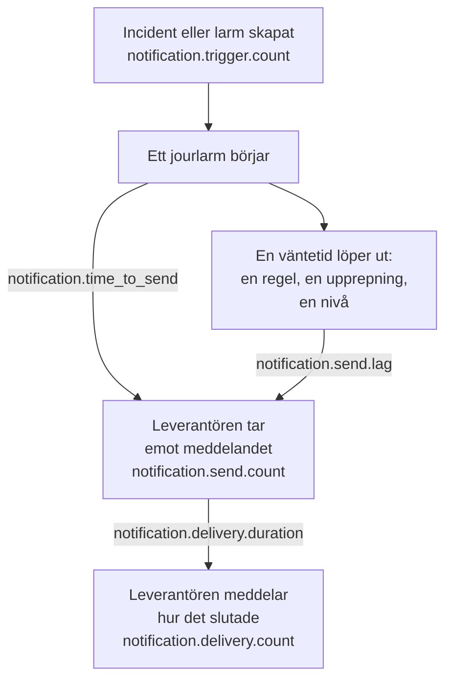

# Mått för aviseringsleverans

OneUptime registrerar hur det går för aviseringarna det skickar: hur många incidenter och larm som kräver dem, om varje meddelande nådde sin leverantör, hur lång tid ett jourlarm tog på sig att gå ut och om det nådde telefonen. Skicka OneUptimes egen telemetri till ett OneUptime-projekt, eller till valfri OpenTelemetry-backend, för att sätta leveransmål för de människor din installation betjänar och kontrollera att du håller dem.

:::cards
- [Slå på dem](#slå-på-dem): Två inställningar, och utan dem registreras ingenting.
- [Måtten](#måtten): Sju mått, från utlösaren till telefonen.
- [Så tidsmäts ett larm](#så-tidsmäts-ett-larm): Vad tid till sändning och sändningsfördröjning räknas från.
- [SLO:er att börja med](#sloer-att-börja-med): Fyra mål, fråga för fråga.
:::

## Så fungerar det



Varje meddelande räknas i `notification.send.count`, på varje kanal, inte bara jourlarm. De två tiderna, `notification.time_to_send` och `notification.send.lag`, gäller bara jourlarm.

## Slå på dem

Ingenting registreras förrän OneUptime har en OpenTelemetry-exportör: utan en kostar måtten ingenting och sparas ingenstans. Rikta den mot ett OneUptime-projekt, med en Server-[intagningsnyckel](/docs/telemetry/ingestion-keys) från det projektet, eller mot valfri backend som tar emot OTLP över HTTP.

:::tabs
@tab Kubernetes
```yaml
openTelemetryExporter:
  endpoint: https://oneuptime.example.com/otlp
  headers: x-oneuptime-token=YOUR_INGESTION_KEY
```
Distributionerna `app` och `worker` skickar dem: låt `app.disableTelemetryCollection` och `worker.disableTelemetryCollection` stå kvar på `false`, deras standard.
@tab Docker Compose
```bash
OPENTELEMETRY_EXPORTER_OTLP_ENDPOINT=https://oneuptime.example.com/otlp
OPENTELEMETRY_EXPORTER_OTLP_HEADERS=x-oneuptime-token=YOUR_INGESTION_KEY
DISABLE_TELEMETRY_FOR_APP=false
```
Ange dem i `config.env` och kör sedan `npm start`. `DISABLE_TELEMETRY_FOR_APP` är `true` som standard, och då skickas ingenting.
:::

OneUptime behöver både slutpunkten och huvudena: utan ett huvud skickar det ingenting. Skriv varje huvud som `name=value` och skilj flera åt med `;`. Ett värde får innehålla `=`. OneUptime lägger själv till `/v1/metrics` på slutpunkten, och samma inställningar skickar också dess egna spår och loggar. Varje mått dyker upp så snart OneUptime registrerar det första gången: `notification.send.count` med det första skickade meddelandet.

### Skicka deltor till ett OneUptime-projekt

OneUptime skickar räknare och histogram som OpenTelemetry gör som standard: varje punkt innehåller den löpande summan sedan den serverprocessen startade. Måttutforskaren summerar punkterna i varje steg i ett diagram, så den läser antal och percentiler för ett tidsintervall exakt bara från deltor, punkter som innehåller det som hänt sedan den förra. När måtten går till ett OneUptime-projekt, skicka deltor:

:::tabs
@tab Kubernetes
```yaml
extraEnv:
  - name: OTEL_EXPORTER_OTLP_METRICS_TEMPORALITY_PREFERENCE
    value: delta
```
En tjänsts egen lista ersätter den för hela chartet: om du anger `app.extraEnv` eller `worker.extraEnv`, lägg till den där också.
@tab Docker Compose
```yaml title="docker-compose.override.yml"
services:
  app:
    environment:
      OTEL_EXPORTER_OTLP_METRICS_TEMPORALITY_PREFERENCE: delta
```
Skapa den bredvid `docker-compose.yml`, eller lägg till detta i den du har, och kör sedan `npm start`.
:::

Det gäller varje mått som OneUptime skickar om sig självt. En backend som själv läser löpande summor, som Prometheus, behöver ingen ändring.

## Måtten

| Mått | Typ | Enhet | Vad det svarar på |
| --- | --- | --- | --- |
| `notification.trigger.count` | Räknare | `1` | Hur många poster som krävde aviseringar |
| `notification.send.count` | Räknare | `1` | Hur det gick för varje meddelande som lämnades till en leverantör |
| `notification.send.duration` | Histogram | `ms` | Hur lång tid leverantören tog på sig att ta emot det |
| `notification.time_to_send` | Histogram | `ms` | Hur länge efter sin utlösare ett larm nådde sin leverantör |
| `notification.send.lag` | Histogram | `ms` | Hur länge efter förfallotiden en senare skickad avisering nådde sin leverantör |
| `notification.delivery.count` | Räknare | `1` | Hur meddelandena som leverantörerna tog emot slutade |
| `notification.delivery.duration` | Histogram | `ms` | Hur länge efter att leverantören tog emot det ett meddelande slutade |

Varje attribut har ett av några få fasta värden, aldrig ett projekt, en person, ett telefonnummer eller en post. Det enda undantaget är en anpassad kanals ID och namn: en installation har en handfull, och att hålla isär dem är hela poängen.

### Poster som aviserar människor

`notification.trigger.count` räknar varje incident, larm, incidentepisod och larmepisod när den skapas.

| Attribut | Värden |
| --- | --- |
| `notification.trigger.type` | `incident`, `alert`, `incident_episode`, `alert_episode` |
| `notification.trigger.source` | `automatic` när OneUptime skapade den, från en monitor eller en regel; `manual` när en person eller API:et gjorde det |
| `monitor.type` | Typen av den monitor som skapade en incident eller ett larm, till exempel `Incoming Request`, `Logs` eller `Metrics`; utelämnas när ingen monitor gjorde det |

### Meddelanden som lämnas till en leverantör

`notification.send.count` räknar varje meddelande som lämnas till en leverantör, och `notification.send.duration` tidsmäter anropet till leverantören. Båda bär dessa attribut:

| Attribut | Värden |
| --- | --- |
| `notification.channel` | `email`, `sms`, `call`, `whatsapp`, `telegram`, `push`, `webhook`, `slack`, `microsoft_teams`, `mattermost`, `custom_channel` |
| `notification.provider` | `twilio`, `sms_and_call_gateway`, `smtp`, `sendgrid`, `amazon_ses`, `mailgun`, `postmark`, `resend`, `microsoft_graph`, `expo`, `push_relay`, `web_push`, `meta_whatsapp`, `telegram_bot_api`, `slack`, `microsoft_teams`, `mattermost`, `webhook`, `custom_channel`, eller `none` när ingenting lämnades till någon |
| `notification.provider.config` | `global` för installationens eget konto och egna inställningar; `project` för ett projekts eget Twilio-konto, SMTP-server, webhook eller arbetsytesanslutning, vars fel det är projektets sak att åtgärda |
| `notification.on_call_page` | `true` för en avisering från ett jourlarm, annars `false` |
| `outcome` | `success`, `failure` eller `not_sent`, som nedan |
| `notification.destination` | Slack, Microsoft Teams och Mattermost: `direct_message` till en person, `channel` för ett inlägg i en kanal eller en gruppchatt i Teams, `incoming_webhook` för en inkommande webhook, till exempel en statussidesprenumerants. Webhooks: `status_page_subscriber` för en statussidesprenumerants egen webhook. Utelämnas för en persons webhook och för alla andra kanaler |
| `notification.custom_channel.id`, `notification.custom_channel.name` | Endast anpassade kanaler: kanalens ID och dess namn, avkortat till 100 tecken |

- `success`: leverantören tog emot meddelandet.
- `failure`: leverantören avvisade det eller gick inte att nå, eller så misslyckades sändningen. En chattkanal som inte hittades är ett misslyckande utan varaktighet.
- `not_sent`: avsiktligt inte skickat. Projektet har stängt av kanalen, har för lite saldo eller är blockerat, push är avstängt på den här servern, eller en anpassad kanal är avstängd, borttagen eller inte täckt av licensen. En andel lyckade lämnar dessa utanför: det är inställningar som verkar, inte plattformen som fallerar.

Ett meddelande till en statussidesprenumerants egen webhook räknas en gång, oavsett hur många gånger det försöktes: `success` när slutpunkten svarade med en 2xx-status, och `failure` när den svarade med en annan status, inte gick att nå eller dess adress inte är tillåten.

### Vad som nådde telefonen

`notification.delivery.count` räknar hur varje meddelande som en leverantör tog emot slutade, så som leverantören rapporterar det senare, en gång per meddelande. `notification.delivery.duration` tidsmäter hur länge efter att leverantören tog emot det. Båda bär `notification.channel`, `notification.provider`, `notification.provider.config`, `notification.on_call_page` och `outcome`, den slutliga statusen:

| Kanal | Leverantör | `outcome` | Varaktighet |
| --- | --- | --- | --- |
| `sms` | `twilio` | `delivered`, `undelivered`, `failed` | Tills Twilio rapporterar statusen |
| `call` | `twilio` | `answered`, `not_answered`, `failed` | Tills samtalet besvarades, eller annars tog slut |
| `push` | `expo`, `push_relay` | `delivered`, `undelivered`, `failed` | Inte tidsmätt: ett kvitto säger om Apple eller Google tog emot pushen, inte när |
| `whatsapp` | `meta_whatsapp` | `delivered`, `failed` | Tills Meta rapporterar statusen |

Ett samtal som ringde ut, var upptaget eller avvisades är `not_answered`. En push till en app som inte längre finns är `undelivered`, och ett läst WhatsApp-meddelande räknas som levererat. `notification.provider.config` är `project` bara för SMS och samtal på ett projekts eget Twilio-konto.

Statusar kommer bara där leverantören kan rapportera dem:

- SMS och samtal: via Twilio, när Twilio kan nå din server på dess `HOST` (se [Twilio-integration](/docs/self-hosted/twilio-integration#3-konfigurera-nätverksåtkomst)). SMS- och samtalsgatewayen rapporterar inga.
- WhatsApp: när Metas webhook är inställd för din installation.
- Push: från Expos kvitton, som OneUptime läser ungefär 15 minuter efter pushen, även via push-reläet. Installationen som skickade pushen räknar den.
- E-post, Telegram, webhooks, chatt och anpassade kanaler rapporterar ingen slutlig status.

## Så tidsmäts ett larm

### Tid till sändning

`notification.time_to_send` löper från ett larms utlösare till att leverantören tar emot aviseringen. Den tidsmäter bara aviseringarna som förfaller när larmet startar: personerna i den första eskaleringsregeln, enligt deras jourregler som inte väntar på något, och varje nivå som larmet går vidare till direkt eftersom det inte nådde någon. Väntetider som jourkonfigurationen begär är inte plattformens fördröjning, så de lämnas utanför: de finns i [sändningsfördröjningen](#sändningsfördröjning). Bara aviseringar som leverantören tog emot tidsmäts; ett misslyckande syns i `notification.send.count`.

| Attribut | Värden |
| --- | --- |
| `notification.channel` | Som på `notification.send.count` |
| `notification.page.start` | Vad tiden räknas från, som nedan |
| `notification.trigger.type` | Posten som larmet gäller: `incident`, `alert`, `incident_episode`, `alert_episode` |
| `notification.custom_channel.id`, `notification.custom_channel.name` | Endast anpassade kanaler |

| `notification.page.start` | Tiden räknas från |
| --- | --- |
| `monitor_data_received` | När OneUptime tog emot de data som utlöste monitorn: en inkommande begäran, en serveragents rapport, ett inkommande e-postmeddelande, en probs kontroll, en SNMP-trap eller en avläsning av en nätverksenhet. Det inkluderar tiden som data väntade i kön på att utvärderas. |
| `record_created` | När incidenten, larmet eller episoden skapades: av en telemetrimonitor, en regel eller en person, och vid en kontroll av frånvaro, till exempel en heartbeat som slutade. |
| `page_started` | När ett larm startade senare: en person, ett arbetsflöde eller en regel som nu matchar startade det, eller det är ett direktlarm. För ett larm som dess jourregel eller OneUptime AI höll kvar, när uppehållet tog slut, eller när det startade om det var tidigare. För ett nytt larm, när tidsgränsen efter bekräftelse löpte ut. Så syns en worker som kom sent till något av dem i tiden. |

För en inkommande begäran löper tiden från den senaste begäran som slutpunkten tog emot, så den kan bli lite för kort.

### Sändningsfördröjning

`notification.send.lag` löper från det ögonblick då en senare skickad avisering förföll till att leverantören tar emot den. Två workers skickar dessa, en gång i minuten var, så en worker som ligger i fas visar upp till ungefär en minut, och en som har hamnat efter visar hur mycket.

| `notification.schedule` | Förfaller när |
| --- | --- |
| `rule_wait` | En persons jourregel som väntar, till exempel "ring mig efter 10 minuter": så länge efter att personen larmades. Aldrig innan workern senast gick igenom personens regler, så en regel som läggs till eller ändras senare förfaller från då. |
| `repeat` | En push som upprepas tills någon bekräftar: varje gång dess intervall löper ut. |
| `escalation` | En senare eskaleringsnivå: när nivån före den har avslutat sin väntetid, eller direkt när en person skickar vidare larmet. |
| `policy_repeat` | Policyn som börjar om från sin första nivå: när väntetiden på dess sista nivå har löpt ut. |

Den bär också `notification.channel`, `notification.trigger.type` och, för anpassade kanaler, `notification.custom_channel.id` och `notification.custom_channel.name`. En avisering som förfaller när dess larm startar finns aldrig i den, inte ens när en worker startade larmet sent, efter ett uppehåll eller som ett nytt larm: den finns i tid till sändning.

### Histogrammens buckets

Varje histogram har egna bucketgränser, i millisekunder, satta så att ett mål kan läsas av vid en gräns:

| Histogram | Bucketgränser, i millisekunder |
| --- | --- |
| `notification.send.duration` | `5, 10, 25, 50, 100, 250, 500, 1000, 2500, 5000, 10000, 30000, 60000, 120000` |
| `notification.time_to_send` | `250, 500, 1000, 2000, 5000, 10000, 15000, 30000, 60000, 120000, 300000, 600000, 1800000, 3600000` |
| `notification.send.lag` | `1000, 5000, 10000, 15000, 30000, 45000, 60000, 75000, 90000, 120000, 180000, 300000, 600000, 1800000, 3600000` |
| `notification.delivery.duration` | `500, 1000, 2000, 5000, 10000, 15000, 30000, 60000, 120000, 300000, 600000, 1800000, 3600000, 14400000, 86400000` |

En percentil beräknas från bucketarna och ritas som mitten av den bucket den hamnar i. Jämför den därför med en buckets gräns: en P95 för `notification.time_to_send` på eller under 30000 betyder att 95 % av larmen tog 30 sekunder eller mindre.

## SLO:er att börja med

Fyra mål som de flesta installationer kan lova, vart och ett byggt av en eller två frågor i måttutforskaren i projektet som tar emot måtten. De läser ett tidsintervall exakt när måtten kommer fram som deltor: se [Skicka deltor till ett OneUptime-projekt](#skicka-deltor-till-ett-oneuptime-projekt).

### Bygg ett i måttutforskaren

:::steps
1. Öppna projektets [Måttutforskare](/docs/telemetry/metrics-explorer) och klicka på målets första mått. Dess fråga är `a`.
2. Välj dess aggregering under **Aggregate by**. Öppna sedan **Filters & grouping** och lägg till vart och ett av dess villkor under **Filter by attributes**.
3. För en andra fråga klickar du på **Lägg till mätvärde** och ställer in `b` på samma sätt.
4. För en formel klickar du på **Lägg till formel** och skriver den i **Formel**.
5. För att få veta när målet missas klickar du på **Åtgärder → Skapa monitor från den här vyn** och larmar när värdet passerar målet: se [Metrikövervakning](/docs/monitor/metrics-monitor).
:::

För att följa ett mål över 30 dagar med en felbudget kopplar du den monitorn till en [SLO](/docs/slo/introduction): den räknar tiden då målet missades.

### Jour-SMS når Twilio

Högst 1 % av de jour-SMS som skickas via installationens eget Twilio-konto misslyckas, så 99 % tas emot.

| Fråga | Mått | Aggregering | Villkor |
| --- | --- | --- | --- |
| `a` | `notification.send.count` | **Summa** | `notification.channel = sms`, `notification.on_call_page = true`, `notification.provider.config = global`, `outcome != not_sent` |
| `b` | `notification.send.count` | **Summa** | Samma, med `outcome = failure` |

Formeln `$b / $a * 100` är andelen som misslyckades, och målet håller så länge den ligger på eller under 1. Ett steg utan misslyckanden ritar ingen punkt, eftersom `b` inte har någon. `outcome != not_sent` utesluter det som projektens egna inställningar höll tillbaka, och `global` projektens egna Twilio-konton. På en installation som skickar SMS via sin SMS- och samtalsgateway mäter samma frågor gatewayen. För en annan kanal ändrar du `sms`: `call`, `push` eller `email`.

### Larm går ut inom 30 sekunder

95 % av jourlarmen når sin leverantör inom 30 sekunder efter sin utlösare.

| Fråga | Mått | Aggregering | Villkor |
| --- | --- | --- | --- |
| `a` | `notification.time_to_send` | **P95** | `notification.page.start != page_started` |

Målet håller så länge `a` ligger på eller under 30000. Larm som startas senare tidsmäts från sin start eller sin förfallotid, inte från en utlösare, så de lämnas utanför. Gruppera efter `notification.page.start` för att se monitorernas kö (`monitor_data_received`) skild från resten, eller efter `notification.channel` för att hitta en långsam kanal.

### Senare skickade aviseringar går ut inom 90 sekunder

99 % av aviseringarna som skickas efter en väntetid når sin leverantör inom 90 sekunder efter förfallotiden.

| Fråga | Mått | Aggregering | Villkor |
| --- | --- | --- | --- |
| `a` | `notification.send.lag` | **P99** | — |

Målet håller så länge `a` ligger på eller under 90000. Gruppera efter `notification.schedule` för att se vilken worker som hamnade efter: `rule_wait` och `repeat` hör till den ena workern, `escalation` och `policy_repeat` till den andra.

### Jour-SMS når telefonen

Högst 5 % av de jour-SMS som Twilio tog emot för installationens eget konto levereras inte.

| Fråga | Mått | Aggregering | Villkor |
| --- | --- | --- | --- |
| `a` | `notification.delivery.count` | **Summa** | `notification.channel = sms`, `notification.on_call_page = true`, `notification.provider.config = global` |
| `b` | `notification.delivery.count` | **Summa** | Samma, med `outcome != delivered` |

Formeln `$b / $a * 100` är andelen som inte levererades. Operatörer och avstängda telefoner avgör en del av den, så sätt målet utifrån vad du ser under några veckor. För samtal använder du `call` och `outcome != answered`. Twilio måste kunna nå din server: se [Vad som nådde telefonen](#vad-som-nådde-telefonen).

## Felsökning

:::details Inga aviseringsmått kommer fram
Kontrollera att `OPENTELEMETRY_EXPORTER_OTLP_ENDPOINT` och `OPENTELEMETRY_EXPORTER_OTLP_HEADERS` båda är angivna, och i Docker Compose att `DISABLE_TELEMETRY_FOR_APP` är `false`, och starta sedan om OneUptime. När OneUptime startar loggar det en varning om det inte kan läsa ett huvud, eller om det inte skickar något. Ett mått dyker upp först när något har registrerats, så skicka en avisering först.
:::

:::details Ett antal bara växer, eller en percentil rör sig knappt
Måtten kommer fram som löpande summor. Skicka deltor: se [Skicka deltor till ett OneUptime-projekt](#skicka-deltor-till-ett-oneuptime-projekt).
:::

:::details Inga slutliga statusar kommer fram
Slutliga statusar kommer från leverantörerna, senare, och bara där de kan rapportera dem: se [Vad som nådde telefonen](#vad-som-nådde-telefonen). På en installation som Twilio inte kan nå räknas SMS och samtal som skickade, men aldrig som levererade.
:::

## Nästa steg

:::cards
- [Måttutforskare](/docs/telemetry/metrics-explorer): Rita, kombinera och jämför valfritt mått.
- [Metrikövervakning](/docs/monitor/metrics-monitor): Larma när ett mål missas.
- [Twilio-integration](/docs/self-hosted/twilio-integration): Låt Twilio rapportera vad som nådde telefonen.
- [Eskaleringsregler](/docs/on-call/escalation-rules): Väntetiderna som sändningsfördröjningen räknas från.
:::
