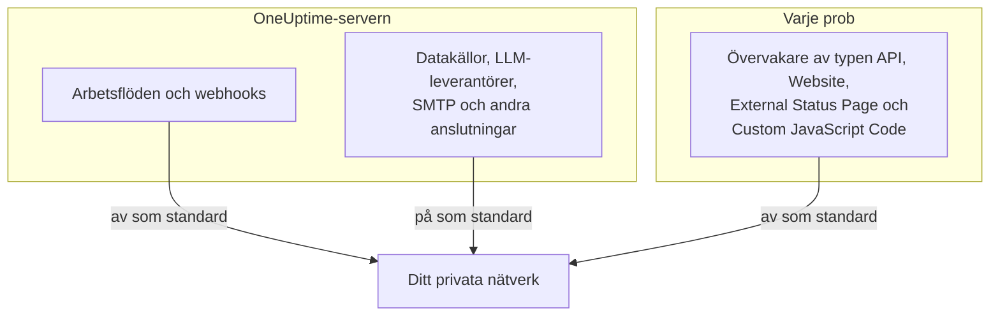

# Åtkomst till privat nätverk

OneUptime vägrar skicka vissa utgående begäranden till värdar som slås upp till ett privat område, ett loopback-område eller ett link-local-område. Om du har försökt peka ett arbetsflöde mot ett internt verktyg har du sett meddelandet:

> Webhook URL resolves to a private, loopback, or link-local address and is not allowed

Den standarden är rätt för den hostade produkten, där vem som helst kan registrera sig och målet för en webhook är indata som inte går att lita på. På en egeninstallerad instans står den i vägen för något helt vanligt: att skicka ett larm till en egeninstallerad Mattermost, Jira eller ett ärendehanteringssystem som bara finns i ditt eget nätverk.

Den här sidan förklarar hur du tillåter det, medvetet och snävt. Tre reglage avgör det, vart och ett för sin typ av anslutning, och de konfigureras på olika maskiner:

| Vad du vill nå internt | Var inställningen finns | Standard på en egeninstallation |
| --- | --- | --- |
| Arbetsflöden, projektwebhooks, användarwebhooks för jour | Miljön för **API-servern** | Privata adresser nekas |
| Datakällor, LLM-leverantörer, SMTP-servrar, OIDC-discovery och andra anslutningar | Miljön för **API-servern** | Privata adresser tillåts |
| **Övervakare** av typen API, Website, External Status Page och Custom JavaScript Code | **Probens** egen miljö | Privata adresser nekas |



Nätverksnära övervakartyper som Ping, Port, SSL-certifikat, DNS, DNSSEC, SNMP / Nätverksenhet, SQL-fråga, Databashälsa, Synthetic och Network Path använder sina egna transporter. Inställningen på den här sidan styr de HTTP-transporter som returnerar godtyckligt svarsinnehåll till ett projekt: övervakare av typen API, Website, External Status Page och Custom JavaScript Code.

:::cards
- [Webhooks och arbetsflöden](#webhooks-och-arbetsflöden): Låt en webhook posta in i ditt nätverk.
- [Andra utgående anslutningar](#andra-utgående-anslutningar): Datakällor, LLM-leverantörer och e-postservrar.
- [Prober och övervakare](#prober-och-övervakare): Låt en prob kontrollera privata webbplatser.
- [Kontrollera att det fungerar](#kontrollera-att-det-fungerar): Läs vilket reglage ett avslag nämner.
:::

## Vad som blockeras och vad som kan öppnas

Blockerade mål delas in i två nivåer.

| Nivå | Områden | Kan det tillåtas? |
| --- | --- | --- |
| **Privat** | RFC-1918 (`10.0.0.0/8`, `172.16.0.0/12`, `192.168.0.0/16`), CGNAT (`100.64.0.0/10`), IPv6 unique-local (`fc00::/7`) och site-local (`fec0::/10`) | Ja |
| **Förbjuden** | Loopback (`127.0.0.0/8`, `::1`), den ospecificerade adressen, link-local (`169.254.0.0/16`, `fe80::/10`), multicast, reserverad, broadcast samt namnen `localhost` och `metadata.google.internal` | Bara genom att ange exakt värd eller CIDR i tillåtelselistan för webhooks. Aldrig för övervakare. |

Slutpunkten för molnmetadata `169.254.169.254` ligger i den förbjudna nivån av en anledning. På en moln-VM lämnar den ut instansens IAM-inloggningsuppgifter till allt som kan göra en HTTP-begäran från maskinen, så ingen generell inställning kommer någonsin att öppna den.

IPv6-skrivsätt som bär ett IPv4-mål inuti sig – IPv4-mapped (`::ffff:10.0.0.5`), NAT64, 6to4, Teredo – klassificeras efter den IPv4-adress de når, så de kan inte användas för att smuggla en förbjuden adress förbi en tillåtelse för den privata nivån.

## Webhooks och arbetsflöden

Dessa mål omfattas, eftersom målet är en URL som en autentiserad medlem i ditt projekt har skrivit:

- **API**-komponenter i arbetsflöden (GET / POST / PUT / PATCH / DELETE)
- HTTP-begäranden från arbetsflödeskomponenten **Custom JavaScript**
- Projektets webhook-aviseringar (incidenter, larm, övervakare, jour, schemalagt underhåll, händelser på statussidor)
- **Användarwebhooks** för jour

**Inte** omfattade, och det kommer de aldrig att bli: **webhooks för prenumeranter på statussidor**. Vilken besökare som helst på en publik statussida kan registrera en, så att lätta på det målet skulle låta vem som helst på internet få din server att POSTa in i ditt privata nätverk. Det går inte att konfigurera.

Utgående anslutningar som inte är webhooks – externa datakällor, LLM-leverantörer, SMTP-servrar (ett projekts SMTP-inställningar och arbetsflödeskomponenten **Email**), SMTP-OAuth-tokenslutpunkter, OIDC-discovery och HTTP-steg i runbooks – styrs separat, av `DATA_SOURCE_BLOCK_PRIVATE_ADDRESSES`, och tillåter redan privata områden på egeninstallationer. Se [Andra utgående anslutningar](#andra-utgående-anslutningar).

### Konfigurera API-servern

Sätt en eller båda av dessa på API-servern och starta om den. De är av som standard, så en instans som inte sätter någon av dem beter sig exakt som tidigare.

| Variabel | Helm-värde | Vad den tillåter |
| --- | --- | --- |
| `ALLOW_PRIVATE_NETWORK_WEBHOOKS` | `webhooks.allowPrivateNetwork` | Hela den privata nivån, när den är satt till `true`. |
| `PRIVATE_NETWORK_WEBHOOK_ALLOWLIST` | `webhooks.privateNetworkAllowlist` | De värdar och CIDR som den anger, oavsett nivå. |

:::tabs
@tab Docker Compose
```bash title="config.env"
ALLOW_PRIVATE_NETWORK_WEBHOOKS=true
PRIVATE_NETWORK_WEBHOOK_ALLOWLIST=mattermost.internal,*.svc.cluster.local,10.20.0.0/16
```
@tab Kubernetes
```yaml title="values.yaml"
webhooks:
  allowPrivateNetwork: true
  privateNetworkAllowlist: "mattermost.internal,10.20.0.0/16"
```
:::

På Docker Compose har `config.env` en rad `ALLOW_PRIVATE_NETWORK_WEBHOOKS=false`: ändra den i stället för att lägga till en rad till, och kör sedan `npm run start`. På Kubernetes uppgraderar du releasen.

Poster i tillåtelselistan kan separeras med kommatecken, mellanslag eller radbrytningar, och var och en kan vara:

- ett värdnamn – `mattermost.internal`
- ett jokertecken – `*.svc.cluster.local` (matchar underdomäner, inte själva suffixet)
- en IPv4- eller IPv6-adress – `10.20.30.40`, `fd00::1`
- en CIDR – `10.20.0.0/16`, `fd12:3456::/32`

Ett schema, en port, en sökväg eller användarinformation i en post tas bort, så det fungerar att klistra in den webhook-URL du redan har.

Ett värdnamn som anges i tillåtelselistan betros **utan DNS-kontroll** – det är just poängen med att ange det, eftersom det förväntas slås upp till något som blockeringslistan skulle neka. En adresspost jämförs med den bokstavliga adressen i URL:en och med varje adress som DNS returnerar för den.

> [!CAUTION]
> **Lägg aldrig `169.254.169.254`, eller något område som innehåller den, i tillåtelselistan.** På en moln-VM ger det varje projektmedlem instansens IAM-inloggningsuppgifter.

## Andra utgående anslutningar

Ett andra skydd täcker utgående anslutningar vars mål en projektmedlem väljer men som inte är webhooks:

- externa datakällor (PostgreSQL-, MySQL-, SQL Server-, ClickHouse-, Elasticsearch- och REST API-anslutningar), anslutningar för säkerhetshändelser som Splunk samt threat intel-flöden
- LLM-leverantörer, inklusive en egeninstallerad Ollama eller vLLM
- SMTP-servrar – ett projekts SMTP-inställningar och arbetsflödeskomponenten **Email** – samt OAuth-token-URL:er för SMTP och arbetsflöden
- OIDC-discovery för enkel inloggning
- verifiering av egna domäner för statussidor och instrumentpaneler
- HTTP-steg i runbooks
- URL:en till Grafana OnCall-API:et som en import läser från (**Projektinställningar** > **Grundläggande** > **Importera från ett annat verktyg**)

Det här skyddet fungerar tvärtom mot webhook-inställningarna. På en egeninstallation **tillåter** det den privata nivån som standard, eftersom databasen, e-postservern eller modellservern som dessa ansluter till oftast finns i ditt eget nätverk. Den förbjudna nivån – loopback, link-local och slutpunkten för molnmetadata – nekas i alla fall, och det finns ingen tillåtelselista för den.

`DATA_SOURCE_BLOCK_PRIVATE_ADDRESSES` skärper det. Sätt den till `true` för att neka den privata nivån även för dessa anslutningar, till exempel när projekten på din instans tillhör personer som inte ska nå ditt interna nätverk:

:::tabs
@tab Docker Compose
```bash title="config.env"
DATA_SOURCE_BLOCK_PRIVATE_ADDRESSES=true
```
@tab Kubernetes
```yaml title="values.yaml"
outboundConnections:
  blockPrivateNetwork: true
```
:::

Den här inställningen gäller inte en global LLM-leverantör, som en administratör konfigurerar i stället för ett projekt (med variablerna `GLOBAL_LLM_PROVIDER_*`, Helm-chartets värde `vllm.globalProvider`, eller i Administratörspanel under **Inställningar** > **Globala LLM-leverantörer**): en sådan leverantör kan fortfarande nå privata adresser, även om loopback och link-local förblir nekade även för den.

Bara det exakta värdet `true` slår på den. På en instans med `BILLING_ENABLED=true` är den alltid på, oavsett vad du sätter. Den ändrar inte vilka mål webhook-inställningarna ovan eller probinställningen nedan tillåter; varje spärr konfigureras för sig. Däremot ändrar den hur avslag formuleras, även för webhooks och arbetsflödesbegäranden: när den är på rapporteras ett nekat värdnamn utan att det sägs vad det slogs upp till (se [Kontrollera att det fungerar](#kontrollera-att-det-fungerar)).

På Docker Compose har `config.env` en rad `DATA_SOURCE_BLOCK_PRIVATE_ADDRESSES=false` (lägg till den om din `config.env` är äldre). Ändra den raden till `true` i stället för att lägga till en rad till, och kör sedan `npm run start` så att containrarna återskapas med det nya värdet; `docker compose restart` läser inte om `config.env`. På Kubernetes sätter du den i din values-fil och uppgraderar releasen; chartet skickar den vidare till app- och worker-poddarna.

När den är på rapporteras ett nekat värdnamn utan att det sägs vad det slogs upp till, till exempel _"LLM provider host ollama.internal could not be reached."_ Ett namn som inte går att slå upp alls får samma meddelande, så att projektmedlemmar inte kan använda de här fälten för att ta reda på vilka interna namn som finns. En adress som skrivits som IP anges fortfarande tillsammans med orsaken, till exempel _"LLM provider host 10.0.4.12 is not allowed: private network address."_ Med `LOG_LEVEL=DEBUG` loggar appen den adress som varje nekat namn slogs upp till.

## Prober och övervakare

Fyra övervakartyper påverkas: **API**, **Webbplats**, **External Status Page** och **Custom JavaScript Code**. På en standardprob kan de nå publika HTTP(S)-mål, men nekar privat adressrymd. Övervakare av typen API, Website och External Status Page validerar och fäster DNS-resultat för varje anslutning och validerar om varje omdirigering; Custom JavaScript Code tillämpar samma adresspolicy i bryggan till sin sandlåda.

Reglaget läses av **probprocessen från dess egen miljö**, inte från API-serverns, och varje prob läser det: de som följer med Docker Compose, de som Helm-chartet driftsätter och varje [egen prob](/docs/probe/custom-probe) som du kör själv. Den som driftsätter en prob styr dess miljö och vet vilket nätverk proben kan se – en egen prob är oftast en annan maskin, ofta driven av en annan person, och den läser aldrig API-serverns konfiguration.

:::tabs
@tab Docker Compose
`config.env` har redan en rad `PROBE_ALLOW_PRIVATE_NETWORK_MONITORS=false`: ändra den raden till `true` i stället för att lägga till en rad till, för när en variabel förekommer två gånger vinner den senare raden. Kör sedan `npm run start`, som återskapar containrarna med det nya värdet; `docker compose restart` läser inte om `config.env`. Varje medföljande prob läser den enda raden, så den gäller för `probe-1` och, där din stack kör en prob till, för `probe-2`.

```bash title="config.env"
PROBE_ALLOW_PRIVATE_NETWORK_MONITORS=true
```
@tab Kubernetes
Sätt den per prob i din values-fil och uppgradera releasen. Varje post under `probes:` är en separat prob, så sätt den på varje prob som ska nå privata adresser:

```yaml title="values.yaml"
probes:
  one:
    allowPrivateNetworkMonitors: true
```
:::

På en egen prob sätter du `PROBE_ALLOW_PRIVATE_NETWORK_MONITORS=true` i den probens egen miljö och startar om den. Värdet måste vara exakt `true`; allt annat, som `TRUE` eller `1`, lämnar reglaget av, och proben säger det i en varning vid start, oavsett vad `LOG_LEVEL` är satt till.

De medföljande proberna är **globala prober**: de registrerar sig med instansens `REGISTER_PROBE_KEY`, och alla projekt på instansen kan välja dem. Att slå på reglaget för en medföljande prob låter därför övervakare från **alla projekt på instansen** nå privata adresser genom den. Det är oftast vad en installation för ett enda team vill. Där projekt inte ska dela den räckvidden – separata team eller kunder som du hostar – lämnar du det av på de medföljande proberna och driftsätter i stället en privat (egen) prob i varje nätverk, påslagen bara där.

Det finns ett undantag. En prob som registrerar sig med `REGISTER_PROBE_KEY` och har `BILLING_ENABLED=true` i sin egen miljö – en global prob i den hostade produkten med öppen registrering, där vem som helst kan registrera sig och alla projekt delar de globala proberna – förblir enbart publik även med reglaget på, och loggar vid start en varning om att den bortser från det. Proberna som följer med Docker Compose och Helm-chartet får instansens `BILLING_ENABLED` automatiskt; ge det till varje annan `REGISTER_PROBE_KEY`-prob som du kör för en sådan instans. En prob kan inte på något annat sätt veta att den är global, så en global prob som skapats i Administratörspanel och körs med `PROBE_ID` och `PROBE_KEY` följer reglaget som en privat: slå inte på det där om projekt inte ska dela den probens nätverk. En privat prob följer reglaget på vilken instans som helst.

Varje prob loggar vid start sin gällande policy för privata nätverk: om övervakning av privata nätverk är på eller av, och varför. Ett värde som det bortses från, och en global prob som reglaget öppnar för alla projekt, loggas som varningar på alla `LOG_LEVEL`. Den vanliga raden på eller av, och JSON-posten "Probe environment" som registrerar samma beslut under `privateNetworkMonitors`, loggas vid `LOG_LEVEL=INFO`, Helm-chartets standard; Docker Compose levereras med `LOG_LEVEL=ERROR`, så sätt `LOG_LEVEL=INFO` för att se dem där. Kontrollera den loggen först när en övervakare på en prob du nyss ändrat fortfarande nekas.

Att slå på det öppnar **inte** loopback, link-local eller slutpunkten för molnmetadata. De förblir nekade på alla prober, vilket betyder mest för prober som körs i ett nätverk som övervakarens författare inte äger.

> [!WARNING]
> Låt det vara av på prober som du driver åt andra personer.

## Kontrollera att det fungerar

Kör arbetsflödet eller övervakaren igen. Om det fortfarande nekas anger felmeddelandet vilken spärr som är stängd:

- _"...points to a private network address and is not allowed. Self-hosted instances can allow this by setting `ALLOW_PRIVATE_NETWORK_WEBHOOKS`..."_ – API-serverns inställning saknas.
- _"...private network address... Set PROBE_ALLOW_PRIVATE_NETWORK_MONITORS=true on the probe running this monitor to allow it."_ – en privat (egen) prob körde övervakaren, och dess reglage är av. Observera att det sätts på proben, inte på API-servern.
- _"...private network address... Set PROBE_ALLOW_PRIVATE_NETWORK_MONITORS=true on the probe running this monitor to allow it (probes.<name>.allowPrivateNetworkMonitors in the Helm chart). This is a global probe, so that allows it for every project on this instance; otherwise, select a private probe deployed on that network."_ – en medföljande (global) prob körde övervakaren, och dess reglage är av. Slå på det för den proben enligt beskrivningen ovan om alla projekt på instansen får nå det nätverket; välj annars en privat prob för övervakaren.
- _"...Global probes cannot monitor private network addresses. Deploy and select a private probe for this target."_ – en global prob med `BILLING_ENABLED=true` i sin miljö körde övervakaren. Automatiskt registrerade globala prober förblir enbart publika där, vad deras reglage än säger; driftsätt en privat prob inne i målets nätverk och välj den för övervakaren.
- _"Monitor target host ... could not be reached."_ – en övervakare av typen API, Website eller External Status Page vars mål är ett **värdnamn** rapporterar detta både när namnet slås upp till en nekad adress och när DNS misslyckas, så att en övervakare inte kan användas för att kartlägga vilka interna namn som finns. Feldetaljerna som visas tillsammans med det nämner `PROBE_ALLOW_PRIVATE_NETWORK_MONITORS` i båda fallen; de säger inte vilket fall det var. Om namnet pekar på en privat adress kontrollerar du probens policy för privata nätverk i dess startlogg; om den är av är lösningen densamma som för meddelandena ovan. Med `LOG_LEVEL=DEBUG` loggar proben också den exakta orsaken för varje nekat namn.
- _"Request URL could not be reached."_ – samma regel för en övervakare av typen **Custom JavaScript Code**: ett skript som begär ett **värdnamn** får detta både när namnet slås upp till en nekad adress och när DNS misslyckas. Med `LOG_LEVEL=DEBUG` loggar proben den exakta orsaken.
- _"Webhook URL could not be reached."_ eller, från ett arbetsflöde, _"Request URL could not be reached."_ – instansen körs med `DATA_SOURCE_BLOCK_PRIVATE_ADDRESSES=true` (eller `BILLING_ENABLED=true`), så ett nekat **värdnamn** förklaras inte: det slogs antingen upp till en nekad adress eller inte alls. Med `LOG_LEVEL=DEBUG` loggar appen eller workern vilket av de två, och adressen.
- _"...points to a private, loopback, or link-local address and is not allowed."_ – målet ligger i den förbjudna nivån. För en webhook anger du exakt värd eller CIDR i `PRIVATE_NETWORK_WEBHOOK_ALLOWLIST` om du verkligen behöver det. För en övervakare finns det inget undantag.
- _"...hostname could not be resolved via DNS."_ – containern kan inte slå upp namnet. Kontrollera att den delar ett nätverk med målet.

## Säkerhetsanteckningar

Att öppna för detta ändrar på riktigt vad din OneUptime-instans kan förmås att nå, så det är värt att göra det medvetet:

- **Föredra tillåtelselistan framför det generella reglaget.** Att ange `mattermost.internal` är en mycket mindre behörighet än att öppna varje RFC-1918-adress.
- **Den som kan skapa ett arbetsflöde eller en övervakare av typen API, Website, External Status Page eller Custom JavaScript Code kan nå allt du har tillåtit.** Behandla medlemskap i de projekten därefter.
- **Svarets innehåll kommer tillbaka.** En API-komponent i ett arbetsflöde returnerar status, huvuden och innehåll till arbetsflödets logg, så en tillåten värd går att läsa, inte bara skriva till.
- **Omdirigeringar följs aldrig** för webhook-begäranden, så en tillåten publik värd kan inte studsa servern vidare till en intern värd i ett andra hopp.
- **Avgränsa per prob i stället för för hela instansen där du kan.** En prob som driftsatts inne i ett nätverk är en snävare behörighet än att öppna API-serverns utgående trafik.

## Nästa steg

:::cards
- [Egna prober](/docs/probe/custom-probe): Kör en prob i det nätverk den ska kontrollera.
- [Konfiguration av arbetsflöden](/docs/workflows/configuration): Vad arbetsflödessteg kan nå och göra.
- [LLM-leverantörer](/docs/ai/llm-provider): Anslut OneUptime AI till en modell i ditt nätverk.
- [Arkitektur](/docs/self-hosted/architecture): Vilken del av en egeninstallation som gör vilken anslutning.
:::
