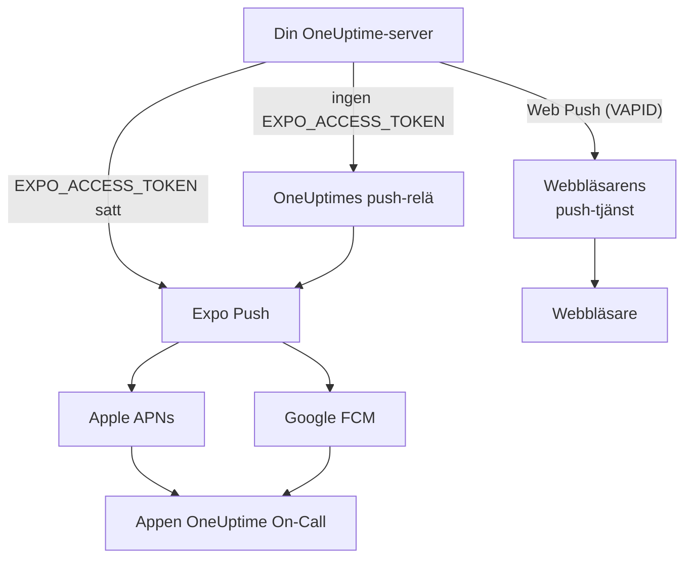
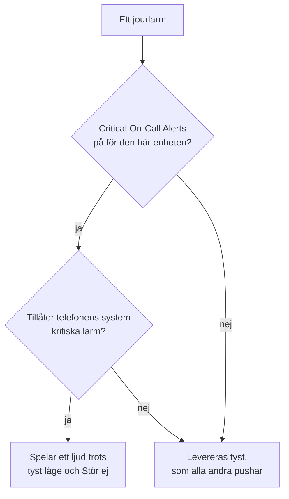

# Push-aviseringar

OneUptime larmar personer i telefonen via mobilappen **OneUptime On-Call**, och i webbläsaren via Web Push. Mobila pushar går via **Expo Push**: en egeninstallerad instans skickar dem som standard via OneUptimes push-relä, så den behöver utgående nätverksåtkomst till reläet och inga egna inloggningsuppgifter för Expo, Apple eller Google.

:::cards
- [Välj hur pushar skickas](#egeninstallerad-konfiguration): Push-reläet, eller din egen åtkomsttoken för Expo.
- [Öppna brandväggen](#nätverksåtkomst): De adresser som din server och dina personers enheter når.
- [Ring igenom tyst läge](#kritiska-jourlarm-åsidosätter-tyst-läge): Låt jourlarm höras på en telefon som är ljudlös.
- [Åtgärda pushar som aldrig kommer fram](#felsökning): Vad vart och ett av Expos fel betyder.
:::

## Så fungerar det



OneUptimes mobilapp registrerar en Expo Push-token hos backend. Backend skickar aviseringar via OneUptimes push-relä, eller direkt till Expo när `EXPO_ACCESS_TOKEN` är konfigurerad. Expo vidarebefordrar meddelandena till Apple APNs eller Google FCM för leverans till enheten.

Web Push-aviseringar använder fortfarande VAPID-nycklar och Web Push-protokollet.

## Egeninstallerad konfiguration

Med den officiella mobilappen och standardreläet behöver servern inga inloggningsuppgifter för Expo. För direkt leverans via Expo konfigurerar du `EXPO_ACCESS_TOKEN` med inloggningsuppgifter som passar din apps Expo-projekt. Web Push kräver `VAPID_PUBLIC_KEY`, `VAPID_PRIVATE_KEY` och `VAPID_SUBJECT`.

| Variabel | Helm-värde | Standard | Vad den gör |
| --- | --- | --- | --- |
| `PUSH_NOTIFICATION_RELAY_URL` | `pushNotification.relayUrl` | `https://oneuptime.com/api/notification/push-relay/send` | Vart mobila pushar går så länge `EXPO_ACCESS_TOKEN` inte är satt. |
| `EXPO_ACCESS_TOKEN` | `expo.accessToken` | Tom | Skickar mobila pushar direkt till Expo, med ditt Expo-projekts token. |
| `VAPID_PUBLIC_KEY` | `vapid.publicKey` | Tom | Den publika halvan av nyckelparet som webbläsare prenumererar med. |
| `VAPID_PRIVATE_KEY` | `vapid.privateKey` | Tom | Den privata halvan, som signerar varje Web Push. |
| `VAPID_SUBJECT` | `vapid.subject` | `mailto:support@oneuptime.com` | En kontaktadress där webbläsarnas push-tjänster kan nå dig. |

Generera ett VAPID-nyckelpar en gång med `npx web-push generate-vapid-keys`, och behåll det: webbläsare som prenumererade med ett nyckelpar slutar ta emot pushar när det ändras.

:::tabs
@tab Docker Compose
```bash title="config.env"
VAPID_PUBLIC_KEY=your-public-key
VAPID_PRIVATE_KEY=your-private-key
VAPID_SUBJECT=mailto:oncall@example.com
# Leave unset to send mobile pushes through the push relay.
EXPO_ACCESS_TOKEN=
```
@tab Kubernetes
```yaml title="values.yaml"
vapid:
  publicKey: your-public-key
  privateKey: your-private-key
  subject: mailto:oncall@example.com
# Leave empty to send mobile pushes through the push relay.
expo:
  accessToken:
```
:::

## Nätverksåtkomst

| Riktning | Mål | Protokoll / port | När det krävs |
| --- | --- | --- | --- |
| OneUptime → standardpush-relä | `https://oneuptime.com/api/notification/push-relay/send`, `https://oneuptime.com/api/notification/push-relay/receipts` | HTTPS / TCP 443 | Mobil push när `EXPO_ACCESS_TOKEN` inte är satt. |
| OneUptime → Expo | `https://exp.host/--/api/v2/push/send`, `https://exp.host/--/api/v2/push/getReceipts` | HTTPS / TCP 443 | Direkt mobil push när `EXPO_ACCESS_TOKEN` är satt. |
| OneUptime → webbläsarens push-tjänst | HTTPS-slutpunkten som lagras i webbläsarens push-prenumeration | HTTPS / normalt TCP 443 | Web Push. |
| Mobilapp eller webbläsare → OneUptime | Ditt värdnamn för OneUptime | HTTPS / TCP 443 | Logga in, registrera enheten och öppna aviseringslänkar. |

Om du ändrar `PUSH_NOTIFICATION_RELAY_URL` tillåter du dess målvärdnamn och den konfigurerade porten. Ett eget relä måste implementera OneUptimes relä-API. Dessa standardvärden och växlingen mellan relä och direkt leverans definieras i [OneUptimes konfiguration](https://github.com/OneUptime/oneuptime/blob/master/config.example.env) och [push-tjänsten](https://github.com/OneUptime/oneuptime/blob/master/packages/Common/Server/Services/PushNotificationService.ts). Direkta Expo-begäranden använder den slutpunkt som dokumenteras i [Expos guide för att skicka](https://docs.expo.dev/push-notifications/sending-notifications/). OneUptime läser leveranskvitton från reläet på samma adress, med `/receipts` i stället för `/send`. Ett relä utan den routen levererar fortfarande pushar; en enhet vars app har tagits bort upptäcks då först när en senare push till den avvisas.

För Web Push tillåter du de faktiska värdarna för prenumerationsslutpunkterna för de webbläsare ditt team använder. OneUptime accepterar `fcm.googleapis.com`, `android.googleapis.com`, `push.services.mozilla.com`, `notify.windows.com` och `push.apple.com`, inklusive deras underdomäner. Typiska exempel är `updates.push.services.mozilla.com` och `web.push.apple.com`. [Webbläsarens push-prenumeration](https://developer.mozilla.org/en-US/docs/Web/API/PushSubscription) anger målet; att bara tillåta Expo eller OneUptimes relä möjliggör inte Web Push.

Tillåt DNS-uppslag och utgående TLS från den OneUptime-process som skickar aviseringar. Dess förtroendearkiv måste validera målets certifikat, och proxyservrar måste släppa igenom API-begäranden utan interaktiv autentisering. Push-leverantörer anropar ingen webhook på din OneUptime-server, så servern kan förbli privat när användarnas enheter når den via VPN eller en annan privat anslutning. En server utan åtkomst till sitt relä eller till externa push-tjänster kan inte leverera dessa aviseringar.

Enheternas anslutning är ett separat krav. iOS-enheter behöver åtkomst till APNs, vanligtvis TCP 5223 med TCP 443 som reserv; se [Apples aktuella nätverkskrav](https://support.apple.com/en-us/102266) för målintervall. Android-enheter behöver åtkomst till FCM på TCP 5228–5230 och 443; använd [Googles aktuella vägledning om värdar och brandväggar](https://firebase.google.com/docs/cloud-messaging/network-configuration). Dessa enhetsportar behöver inte öppnas inkommande på OneUptime, och serverns mobila flöde använder reläet eller Expo i stället för att ansluta direkt till APNs/FCM.

:::steps
1. Kontrollera DNS och HTTPS från den container eller pod som skickar aviseringar till målet för ditt leveranssätt: reläet, Expo eller en webbläsares push-tjänst.
2. Skicka ett test från **Användarinställningar > Aviseringsmetoder > Push Notifications** med **Testavisering**, och bekräfta att det kommer fram till en registrerad enhet. Testa varje webbläsare separat för Web Push.
3. Kontrollera fel från reläet, Expo eller Web Push i OneUptimes loggar; en lyckad inskickning till API:et bekräftar inte i sig leverans till enheten.
:::

För mobila pushar läser OneUptime också Expos leveranskvitto ungefär 15 minuter efter varje push: en push som aldrig nådde enheten visas då som inte levererad i push-loggen och, för ett jourlarm, på jourtidslinjen.

## Kritiska jourlarm (åsidosätter tyst läge)

Som standard rättar sig en push-avisering efter telefonen: en telefon på ljudlöst förblir tyst, och Stör ej håller tillbaka aviseringen. För den som har jour är det fel standard klockan tre på natten, så mobilappen erbjuder en inställning per enhet – **Settings > Notifications > Critical On-Call Alerts** – som låter *bara jourlarm* spela ett ljud genom båda.

Omfattningen är medvetet snäv. Bara larm som en aviseringsregel för jour skapar kan komma i fråga. Ägarprenumerationer, meddelanden om publicerade anteckningar, uppdateringar om tillståndsändringar och övervakaraviseringar eskaleras aldrig, oavsett vad den här inställningen säger.



Tre saker måste alla stämma för att ett larm ska åsidosätta tyst läge. Saknas någon av dem levereras larmet ändå – bara tyst.

1. **Personen har slagit på det för den enheten.** Lagras per enhet, av som standard, i `UserPush.isCriticalAlertEnabled`. En persons telefon och surfplatta är separata beslut.
2. **Servern markerar larmet som kritiskt.** Den skickar APNs kritiska ljud-payload plus `interruptionLevel: critical` för iOS, och använder aviseringskanalen `oncall_critical` för Android.
3. **Operativsystemet tillåter det**, och det är här de två plattformarna skiljer sig.

:::tabs
@tab iOS
Kritiska larm på iOS kräver entitlementet `com.apple.developer.usernotifications.critical-alerts`, som Apple efter ansökan beviljar per utvecklarkonto till appar som meddelar personer om brådskande händelser. Ansök om det via [Apples ansökningsformulär för Critical Alerts](https://developer.apple.com/contact/request/notifications-critical-alerts-entitlement/).

Den officiella appen **OneUptime On-Call** i App Store har entitlementet från och med **version 1.5.0**. Tidigare versioner har det inte, och iOS erbjuder dem aldrig kritiska larm, så uppdatera appen innan du slår på inställningen.

Om du bygger appen själv är entitlementet valfritt. En provisioneringsprofil kan inte bära ett entitlement som teamet inte har beviljats, och ett bygge som deklarerar ett som det inte kan bära **går inte att signera**. Bara profilen `production` i `packages/MobileApp/eas.json` slår på det, eftersom Apple har beviljat det till teamet som publicerar den officiella appen. En fork som signerar med sitt eget Apple-team måste ta bort den `env`-posten tills Apple beviljar entitlementet även till det teamet. När det är gjort slår du på det när du bygger:

```bash
EXPO_IOS_CRITICAL_ALERTS_ENTITLEMENT=true npx expo prebuild
```

eller lägg till `EXPO_IOS_CRITICAL_ALERTS_ENTITLEMENT: "true"` i byggprofilens `env`-block i `packages/MobileApp/eas.json`.

Slå på **Settings > Notifications > Critical On-Call Alerts** i appen på enheten, och tillåt kritiska larm när iOS frågar. iOS lägger till ett reglage **Critical Alerts** för appen under **Settings > Notifications > OneUptime On-Call** i iOS-inställningarna först efter att appen har bett om behörigheten, så det reglaget finns inte innan du slår på inställningen i appen. Om du nekar frågan kan du tillåta kritiska larm senare med det reglaget i iOS-inställningarna.

På ett bygge utan entitlementet visar iOS varken fråga eller reglage, och appens inställningsskärm säger att den här versionen av appen inte kan ta emot kritiska larm. Den skickar inte personen att leta efter ett reglage som iOS inte visar.
@tab Android
Android har inget godkännandesteg hos tillverkaren, men förbikoppling av Stör ej beviljas av användaren på en systemskärm i stället för via en fråga i appen. När en person slår på inställningen öppnar appen **Settings > Notifications > Do Not Disturb access** åt personen och kontrollerar igen när personen kommer tillbaka.

Två mekanismer är i spel, och de täcker olika fall:

- Aviseringskanalen `oncall_critical` begär `bypassDnd`, vilket täcker Stör ej och kräver den åtkomst som beskrivs ovan.
- Samma kanal använder ljudströmmen **alarm**, som hörs på en telefon vars ringsignal bara är avstängd. Den halvan behöver ingen behörighet alls.

Android fryser en kanals inställningar när kanalen skapas första gången, så de kan inte ändras med en appuppdatering – bara genom att leverera ett nytt kanal-id.
:::

För att kontrollera att det fungerar skickar du en testavisering till enheten från **Användarinställningar > Aviseringsmetoder > Push Notifications**. När enheten har kritiska larm aktiverade skickas även testet som ett kritiskt larm – så stäng av ljudet på telefonen först, så hör du om ett riktigt larm skulle nå dig.

## Felsökning

### Push-aviseringar kommer inte fram

- Se till att mobilappen byggdes med EAS Build (Expo Go stöder inte push-aviseringar)
- Kontrollera att enheten är registrerad i tabellen `UserPush` i din databas
- Kontrollera OneUptimes serverloggar efter fel från Expo Push API
- Bekräfta att enheten har en aktiv internetanslutning och att aviseringsbehörigheter är aktiverade
- Kontrollera **Användarinställningar > Aviseringsmetoder > Push Notifications**: en enhet markerad **Tar inte emot aviseringar** har slutat ta emot dem och måste registreras igen (se nedan)

### Inget reglage för Critical Alerts i iOS-inställningarna

- Uppdatera OneUptime On-Call från App Store. Versioner före 1.5.0 byggdes utan Apples entitlement för kritiska larm, och iOS visar inget reglage Critical Alerts alls för dem
- Slå på **Settings > Notifications > Critical On-Call Alerts** i appen. iOS lägger till reglaget i sina egna inställningar först efter att appen har bett om behörigheten, och appen ber om den när den här inställningen slås på
- Att ta bort och lägga till aviseringsregler för jour eller push-enheter igen ändrar inte detta. Inställningen hör till appen på enheten, inte till en regel

### Kritiska larm åsidosätter inte tyst läge

- Kontrollera att reglaget är på för **den** enheten – inställningen gäller per enhet, och en ominstallation eller en ny telefon som konfigurerats från början skapar en ny enhetsregistrering (en telefon som konfigurerats från en säkerhetskopia av den gamla tar över den gamla telefonens registrering så snart den inte längre tar emot aviseringar, med den inställning appen hade)
- **iOS**: bekräfta att bygget har Apples entitlement för kritiska larm (se ovan), och att Critical Alerts är tillåtet under iOS Settings > Notifications > OneUptime On-Call
- **Android**: bekräfta att appen har åtkomst till Stör ej under Settings > Notifications > Do Not Disturb access
- Inställningsskärmen anger vilken av dessa som saknas; den läser tillbaka det aktuella tillståndet från operativsystemet i stället för att lita på vad appen senast begärde

### Pushar markerade som "inte levererade"

Att Expo tar emot en push betyder inte att den nådde enheten: Apple eller Google kan fortfarande avvisa den. OneUptime läser varje mobil pushs leveranskvitto ungefär 15 minuter efter att den skickats, via push-reläet när `EXPO_ACCESS_TOKEN` inte är satt. När kvittot rapporterar ett fel ändras push-loggen och larmets jourtidslinje från skickad till **Push notification not delivered**, med Expos felkod:

- `DeviceNotRegistered`: mobilappen har tagits bort från enheten, eller dess push-token är inte längre giltig. Se nästa avsnitt.
- `MessageRateExceeded`: för många aviseringar skickades till enheten på kort tid. Senare pushar till den skickas som vanligt.
- `MessageTooBig`: aviseringen var större än push-tjänsterna accepterar. OneUptime kortar aviseringar så att de får plats, så detta bör inte hända; rapportera det om det gör det.
- `InvalidCredentials` eller `MismatchSenderId`: push-inloggningsuppgifterna för det Expo-projekt som skickade pushen är inte giltiga. Med `EXPO_ACCESS_TOKEN` kontrollerar du ditt Expo-projekts push-inloggningsuppgifter; med standardreläet kontaktar du OneUptimes support.

När Expo avvisar en push direkt anger push-loggen orsaken med en gång. Via push-reläet fungerar det också: reläet skickar vidare Expos felkod i stället för att svara med ett serverfel.

### "DeviceNotRegistered"-fel i loggarna

Expo rapporterar `DeviceNotRegistered` när mobilappen har tagits bort från enheten eller enhetens push-token inte längre är giltig. Oftast står det i en pushs leveranskvitto, som OneUptime läser ungefär 15 minuter efter pushen, och ibland avvisar Expo pushen direkt. Hur som helst slutar OneUptime skicka till den enheten. Den markeras som att den inte tar emot aviseringar i stället för att tas bort, så dess aviseringsregler finns kvar, och push-loggen och jourtidslinjen för larmet som inte kom fram anger varför. **Användarinställningar > Aviseringsmetoder > Push Notifications** visar den som **Tar inte emot aviseringar**. Ägarens andra enheter och aviseringsmetoder larmas fortfarande.

För att få tillbaka enheten öppnar du mobilappen på den medan du är inloggad. Appen registrerar sig igen, vilket förnyar dess push-token hos Expo, och enheten tar emot aviseringar igen med sina regler. Om appen har tagits bort installerar du den igen och loggar in. Ett kvitto för en push som skickades innan appen registrerade sig igen markerar inte enheten. När en uppdaterad mobilapp konfigureras på en ny telefon från en säkerhetskopia av den gamla, talar den om för OneUptime vilken push-token den hade tidigare; om den gamla telefonens enhet inte längre tar emot aviseringar tar den nya telefonen över den med dess regler.

Via push-reläet (ingen `EXPO_ACCESS_TOKEN`) fungerar detta på samma sätt: reläet rapporterar `DeviceNotRegistered` när det skickar en push, och läser de leveranskvitton som din instans frågar efter.

Om inget av detta hjälper kan du kontakta oss på [hello@oneuptime.com](mailto:hello@oneuptime.com) med felen från dina OneUptime-loggar.

## Nästa steg

:::cards
- [Mobilappar](/docs/mobile-desktop-apps/index): Installera appen OneUptime On-Call och logga in.
- [Felsökning av mobilappen](/docs/mobile-desktop-apps/faq-troubleshooting): Åtgärda problem med inloggning och aviseringar på telefonen.
- [Eskaleringsregler](/docs/on-call/escalation-rules): Bestäm vem som larmas, och när.
- [Åtkomst till privat nätverk](/docs/self-hosted/private-network-access): Vad din server får nå i ditt eget nätverk.
:::
