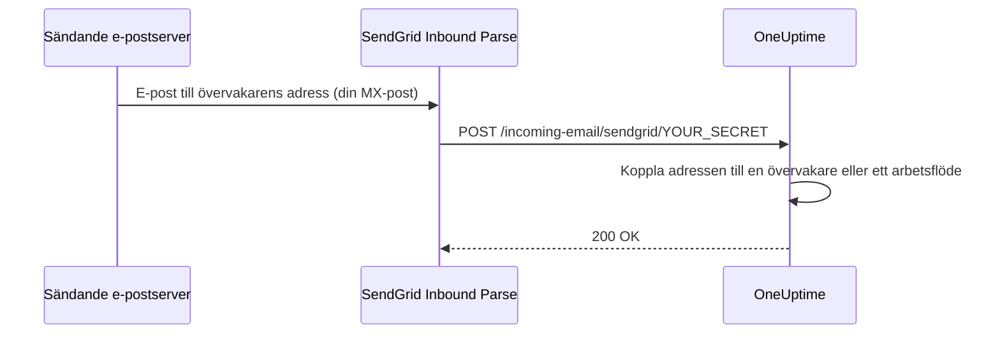

# SendGrid inkommande e-post

Med OneUptimes **Incoming Email Monitor** kan du skapa och lösa larm utifrån e-post som skickas till unika, övervakarspecifika e-postadresser. Det är användbart för att integrera äldre system, larmverktyg eller vilken tjänst som helst som kan skicka e-post.

Samma konfiguration låter också arbetsflöden ta emot e-post: ett arbetsflöde med utlösaren **Incoming Email** får en egen adress på samma domän, och varje e-postmeddelande till den startar arbetsflödet. Se [Utlösare](/docs/workflows/triggers#incoming-email).

Den här guiden förklarar hur du konfigurerar SendGrid Inbound Parse så att inkommande e-post vidarebefordras till din egeninstallerade OneUptime-instans. OneUptime Cloud behöver inget av detta: där fungerar adresserna direkt.

:::cards
- [Innan du börjar](#förutsättningar): Ett SendGrid-konto, en domän och en publik HTTPS-adress.
- [Konfigurera](#konfigurationsanvisningar): Sju steg, från MX-posten till ett testmeddelande.
- [Miljövariabler](#referens-för-miljövariabler): De tre inställningarna och deras standardvärden.
- [Felsökning](#felsökning): E-post som aldrig kommer fram och webhooks som misslyckas.
:::

## Så fungerar det



1. Du skapar en **Incoming Email Monitor** i OneUptime
2. OneUptime genererar en unik e-postadress för den övervakaren (t.ex. `monitor-abc123@inbound.yourdomain.com`)
3. När ett e-postmeddelande skickas till den adressen tar SendGrid emot det och vidarebefordrar det till OneUptime via webhook
4. OneUptime bedömer e-postmeddelandet utifrån dina konfigurerade kriterier för att skapa eller lösa larm

## Förutsättningar

- Ett SendGrid-konto med åtkomst till Inbound Parse
- En domän som du kontrollerar, med åtkomst till DNS-inställningarna
- En publik HTTPS-slutpunkt som vidarebefordrar SendGrids webhooks till din OneUptime-instans

## Nätverksåtkomst

Med Inbound Parse är det SendGrid som öppnar anslutningen till OneUptime. Det räcker inte att bara tillåta utgående internetåtkomst från OneUptime.

| Riktning | Mål | Protokoll / port | Syfte |
| --- | --- | --- | --- |
| SendGrid → OneUptime | `https://your-oneuptime-domain.com/incoming-email/sendgrid/YOUR_SECRET` | HTTPS / TCP 443 | Leverera det tolkade e-postmeddelandet som en multipart-POST. |
| Sändande e-postservrar → SendGrid | `mx.sendgrid.net`, vald av den publika MX-posten för din inkommande domän | SMTP / TCP 25 | Ta emot e-post hos SendGrid; den här anslutningen går inte till din OneUptime-server. |
| OneUptime → SendGrid, bara när utskick av e-post via SendGrid-leverantören är konfigurerat separat | `api.sendgrid.com` | HTTPS / TCP 443 | Skicka aviseringsmejl via Mail Send API. |

Publicera DNS för webhookens värdnamn och leverera ett certifikat som publika klienter litar på. En privat OneUptime-installation kan exponera enbart webhooksökvägen via en publik omvänd proxy eller gateway som når OneUptime internt. Bevara sökvägen, hemligheten, innehållstypen och multipart-begärans innehåll, och släpp igenom POST-anropet utan interaktiv inloggning eller webbläsarutmaning. OneUptime-servern behöver ingen inkommande SMTP-lyssnare. Se [SendGrids konfiguration av Inbound Parse](https://www.twilio.com/docs/sendgrid/for-developers/parsing-email/setting-up-the-inbound-parse-webhook).

Sätt `INBOUND_EMAIL_WEBHOOK_SECRET` till ett starkt slumpmässigt värde och ersätt `YOUR_SECRET` i URL:en med det värdet. Routen kräver det sista sökvägssegmentet. OneUptime kontrollerar dess värde när hemligheten är konfigurerad; en tom variabel stänger av kontrollen. Håll hela URL:en och övervakarnas e-postadresser hemliga, även i proxyloggar. OneUptime validerar i dag varken SendGrids signerade Inbound Parse-huvuden eller OAuth-token. Behöver du de mekanismerna kan du konfigurera en gateway som validerar dem innan den vidarebefordrar till OneUptime, enligt [SendGrids dokumentation om webhooksäkerhet](https://www.twilio.com/docs/sendgrid/for-developers/parsing-email/securing-your-parse-webhooks).

SendGrid tillhandahåller ingen tillförlitlig lista över statiska käll-IP-adresser för Inbound Parse. SendGrids IP-adresser för e-postutskick och adresserna som slås upp för `mx.sendgrid.net` är ingen tillåtelselista för webhooks. Följ [SendGrids vägledning om brandväggar](https://support.sendgrid.com/hc/en-us/articles/44375457225371-How-to-Configure-Firewall-Settings-for-SendGrid-Webhook-and-Inbound-Parse-IPs) i stället för att låsa ett aktuellt DNS-resultat.

Inbound Parse är skilt från utskick av utgående e-post. För att ta emot övervakarnas e-post behöver OneUptime inte anropa SendGrids API. Om du också väljer SendGrid för att skicka aviseringar tillåter du DNS-uppslag och utgående HTTPS till `api.sendgrid.com`; [Mail Send](https://www.twilio.com/docs/sendgrid/api-reference/mail-send/mail-send) behöver inget inkommande återanrop för att skicka. Använder du SMTP i stället tillåter du den SMTP-server och port som är konfigurerade i OneUptime.

## Konfigurationsanvisningar

:::steps
### Välj din domän för inkommande e-post

Välj en underdomän som bara används för att ta emot e-post till OneUptime, till exempel `inbound.yourdomain.com`, `email.yourdomain.com` eller `monitor.yourdomain.com`. Den används bara för e-post till OneUptimes övervakare och arbetsflöden, så ingen av dina brevlådor ligger på den.

### Låt dess MX-post peka på SendGrid

Lägg till en MX-post som skickar e-posten för underdomänen till SendGrid:

| Typ | Värd/Namn | Prioritet | Värde |
| --- | --- | --- | --- |
| MX | inbound | 10 | mx.sendgrid.net |

Om din domän är `example.com` och du använder `inbound.example.com` blir posten:

```text
inbound.example.com.  IN  MX  10  mx.sendgrid.net.
```

DNS-ändringar kan ta upp till 48 timmar att spridas, men är oftast klara inom några timmar.

### Autentisera domänen i SendGrid

Den mottagande domänen måste höra till en av dina [autentiserade domäner i SendGrid](https://www.twilio.com/docs/sendgrid/ui/account-and-settings/inbound-parse). Gå i [SendGrid-instrumentpanelen](https://app.sendgrid.com) till **Settings** > **Sender Authentication**, klicka på **Authenticate Your Domain** och lägg till de DNS-poster den ber om (CNAME-poster för DKIM).

### Lägg till Inbound Parse-webhooken

Gå i SendGrid-instrumentpanelen till **Settings** > **Inbound Parse** och klicka på **Add Host & URL**. Fyll i formuläret enligt nedan och klicka sedan på **Add**:

| Fält | Värde |
| --- | --- |
| **Receiving Domain** | Din underdomän för inkommande e-post (t.ex. `inbound.yourdomain.com`) |
| **Destination URL** | `https://your-oneuptime-domain.com/incoming-email/sendgrid/YOUR_SECRET` |
| **Check incoming emails for spam** | Valfritt – aktivera om du vill |
| **Send raw, full MIME message** | Lämna omarkerad (krävs inte) |
| **POST the raw, full MIME message** | Lämna omarkerad (krävs inte) |

### Konfigurera OneUptime

Sätt variablerna för inkommande e-post, med samma hemlighet som i Destination URL:

:::tabs
@tab Docker Compose
```bash title="config.env"
INBOUND_EMAIL_PROVIDER=SendGrid
INBOUND_EMAIL_DOMAIN=inbound.yourdomain.com
INBOUND_EMAIL_WEBHOOK_SECRET=replace-with-a-strong-random-secret
```
@tab Kubernetes
```yaml title="values.yaml"
inboundEmail:
  provider: "SendGrid"
  domain: "inbound.yourdomain.com"
  webhookSecret: "replace-with-a-strong-random-secret"
```
:::

Tillämpa dem sedan: kör `npm run start` på Docker Compose, vilket återskapar containrarna med de nya värdena, eller uppgradera Helm-releasen på Kubernetes.

### Skapa en Incoming Email-övervakare

[Skapa en Incoming Email-övervakare](/docs/monitor/incoming-email-monitor#skapa-en-monitor-för-inkommande-e-post). Dess sida **Översikt** visar adressen, till exempel `monitor-abc123def456@inbound.yourdomain.com`, och dess kriterier avgör vilka e-postmeddelanden som skapar ett larm och vilka som löser det.

Arbetsflöden använder samma domän. Lägg till utlösaren **Incoming Email** i ett arbetsflöde och klicka på den: dess adress (`workflow-…@inbound.yourdomain.com`) står överst i dess inställningar. Tills variablerna för inkommande e-post ovan är satta säger utlösaren att servern inte är konfigurerad för att ta emot e-post.

### Skicka ett testmeddelande

Skicka ett e-postmeddelande till övervakarens adress, med ett ämne som matchar dess kriterier. Övervakarens sammanfattning visar meddelandet, och ett larm skapas när kriterierna matchar.
:::

## Referens för miljövariabler

| Variabel | Helm-värde | Beskrivning | Krävs | Standard |
| --- | --- | --- | --- | --- |
| `INBOUND_EMAIL_PROVIDER` | `inboundEmail.provider` | Leverantören av inkommande e-post. SendGrid är den enda. | Nej | `SendGrid` |
| `INBOUND_EMAIL_DOMAIN` | `inboundEmail.domain` | Underdomänen som är konfigurerad för inkommande e-post. Inkommande e-post är av tills den är satt. | Ja | Tom |
| `INBOUND_EMAIL_WEBHOOK_SECRET` | `inboundEmail.webhookSecret` | Hemlighet som jämförs med det sista segmentet i webhookens URL: `/incoming-email/sendgrid/YOUR_SECRET`. Konfigurera den för publika slutpunkter; ett tomt värde stänger av valideringen. | Rekommenderas | Tom |

Vad en Incoming Email-övervakare kan matcha på – ämnet, avsändaren, innehållet, mottagaren och om ett meddelande kom fram i tid – står i [Tillgängliga filtertyper](/docs/monitor/incoming-email-monitor#tillgängliga-filtertyper).

## Felsökning

:::details E-post tas inte emot
1. **Kontrollera DNS-spridningen:** `dig MX inbound.yourdomain.com` ska returnera `mx.sendgrid.net`.
2. **Kontrollera Inbound Parse-inställningarna i SendGrid:** kontrollera din domän och webhookens URL i SendGrid-instrumentpanelen under **Settings** > **Inbound Parse**.
3. **Kontrollera OneUptimes loggar:** leta efter webhookbegäranden för inkommande e-post, och eventuella fel, i loggarna för OneUptime-tjänsten `app`. SendGrid sparar inga detaljerade loggar för Inbound Parse, så de här loggarna är beskedet om vad som kom fram.
:::

:::details Webhooks misslyckas
1. **Kontrollera den publika webhookvägen:** hela URL:en, inklusive hemligheten, måste nå OneUptime från internet. URL:en utan sitt sista hemliga segment matchar inte routen.
2. **Kontrollera brandväggsreglerna:** tillåt HTTPS POST-begäranden till webhooksökvägen utan inloggningsomdirigeringar eller webbläsarutmaningar, och använd inte SendGrids IP-adresser för e-postutskick som tillåtelselista för webhookens källa.
3. **Kontrollera SSL-certifikatet:** använd ett giltigt, publikt betrott certifikat för webhookens värdnamn och inkludera dess certifikatkedja.
:::

:::details Övervakaren skapar inga larm
1. **Kontrollera kriterierna:** kontrollera att dina kriterier för att skapa larm matchar e-postens innehåll, och testa först med exakta strängar innan du använder mönster.
2. **Kontrollera övervakaren:** se till att den inte är inaktiverad och att dess typ är Incoming Email.
3. **Granska övervakarens sammanfattning:** kontrollera om meddelandet togs emot och bearbetades, och läs utvärderingsloggarna för hur kriterierna matchade.
:::

:::details Utlösaren säger att servern inte är konfigurerad för att ta emot e-post
`INBOUND_EMAIL_DOMAIN` är tom på servern. Sätt den, tillämpa ändringen och öppna arbetsflödets utlösare igen.
:::

## Bästa praxis för säkerhet

1. **Använd HTTPS:** använd alltid HTTPS för din webhookslutpunkt
2. **Webhookhemlighet:** konfigurera `INBOUND_EMAIL_WEBHOOK_SECRET` och ta med den i din webhook-URL (t.ex. `/incoming-email/sendgrid/your-secret`) som extra validering
3. **Domänverifiering:** verifiera din domän i SendGrid för bättre e-postsäkerhet
4. **Begränsa åtkomsten:** skapa bara övervakare för betrodda e-postkällor
5. **Övervaka loggar:** granska regelbundet loggarna för inkommande e-post efter misstänkt aktivitet

## Nästa steg

:::cards
- [Incoming Email Monitor](/docs/monitor/incoming-email-monitor): Kriterier, adressformat och exempel.
- [Utlösare för arbetsflöden](/docs/workflows/triggers): Starta ett arbetsflöde från ett e-postmeddelande.
- [Åtkomst till privat nätverk](/docs/self-hosted/private-network-access): Vad din server får nå i ditt eget nätverk.
- [Arkitektur](/docs/self-hosted/architecture): Var webhooken landar i en egeninstallation.
:::
