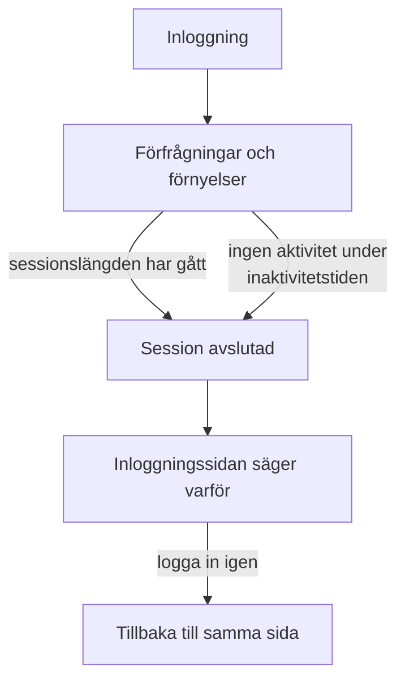

# Sessionslängd

Välj hur länge personer förblir inloggade i OneUptime innan de loggar in igen: en bestämd tid efter att de loggade in, en tid utan användning, eller båda. Det gäller varje inloggning i instrumentpanelen, Admin Dashboard och mobilappen, med lösenord, passnyckel, inloggning med Google, inloggning med Microsoft eller enkel inloggning. SSO-inloggningar kan ha egna längder.

> [!NOTE]
> Sessionslängd ingår i [OneUptime Enterprise Edition](/docs/self-hosted/enterprise). Community Edition har ingen sida **Sessionslängd**, och varje inloggning varar så som [Ingen gräns](#ingen-gräns) beskriver.

:::cards
- [Ange en sessionslängd](#ange-en-sessionslängd): Två inställningar i Admin Dashboard.
- [Hur en session slutar](#hur-en-session-slutar): Vad servern räknar, och när.
- [SSO-inloggningar](#sso-inloggningar): Egna längder för enkel inloggning.
- [Vad som inte är en inloggning](#vad-som-inte-är-en-inloggning): API-nycklar, MCP-anslutningar och läsare av statussidor.
:::

## Ingen gräns

Så länge du inte anger en längd har en inloggning ingen. Dess åtkomsttoken gäller i 15 minuter och förnyas i bakgrunden med en uppdateringstoken, som gäller i 30 dagar och börjar om varje gång den används. Den som öppnar OneUptime minst en gång var 30:e dag förblir inloggad; den som inte gör det loggar in igen.

## Ange en sessionslängd

:::steps
### Öppna Sessionslängd
Öppna **Inställningar** i Admin Dashboard och sedan **Sessionslängd** i sidomenyn.

### Välj längderna
- **Logga ut personer efter**: hur länge en inloggning varar från det ögonblick någon loggar in, oavsett hur aktiv personen är.
- **Logga ut personer efter inaktivitet i**: hur länge någon får gå utan att klicka, skriva eller skrolla i OneUptime.

Varje val sparas så snart du gör det.

### Bekräfta vem som loggas ut
En kortare längd gäller alla som är inloggade nu. När den loggar ut personer direkt säger OneUptime först hur många, och om du är en av dem. Välj **Spara och logga ut dem** för att fortsätta.
:::

| Inställning | Val | Standard |
| --- | --- | --- |
| **Logga ut personer efter** | 1 timme till 90 dagar | **Ingen gräns** |
| **Logga ut personer efter inaktivitet i** | 15 minuter till 14 dagar | 30 dagar, det längsta som finns |

Via API:et tar `sessionLengthInMinutes` emot alla heltal av minuter från 15 till 525600 (ett år) och `sessionIdleTimeoutInMinutes` från 15 till 43200 (30 dagar), i serverns globala konfiguration. Tomt är standard.

## Hur en session slutar

- Servern räknar båda längderna utifrån själva sessionen: när den loggade in, och när dess person senast var aktiv. Den kontrollerar dem vid varje förfrågan, varje förnyelse och varje liveuppdatering, och lämnar aldrig utloggningen åt webbläsaren.
- Inaktivitetstiden räknas från det senaste klicket, tangenttrycket eller skrollningen i valfri flik i instrumentpanelen eller Admin Dashboard. En flik som står öppen håller inte en session vid liv.
- Mobilappen räknas som aktiv varje gång den används.
- När en session slutar går webbläsaren till inloggningssidan, som säger varför. Efter att ha loggat in igen kommer personen tillbaka till sidan hen var på.

| Ändring | Vad som händer med dem som är inloggade nu |
| --- | --- |
| En kortare sessionslängd eller inaktivitetstid | Alla som har passerat den loggas ut direkt, de andra när de når den |
| En längre, eller ingen | Ingen loggas ut, och sessioner varar längre från sin nästa förnyelse |

## SSO-inloggningar

Inloggningar via enkel inloggning följer samma två inställningar. För att ge dem egna längder öppnar du **Fler inställningar** på sidan **Sessionslängd** och slår på **Separata längder för SSO-inloggningar**. De två inställningarna under den gäller då för inloggningar via ett projekts SAML- eller OpenID Connect-leverantör, eller serverns egen [globala SSO](/docs/identity/global-sso), och de två högst upp på sidan för alla andra inloggningar. De börjar med samma längder som alla andra inloggningar, så att slå på den ändrar ingenting förrän du väljer andra.

Ett projekt som kräver SSO släpper dessutom bara in en session så länge dess SSO-inloggning varar, och det är aldrig längre än den längd som SSO-inloggningar följer.

Via API:et är reglaget `useSeparateSsoSessionLengths`, och SSO-inloggningarnas längder är `ssoSessionLengthInMinutes` och `ssoSessionIdleTimeoutInMinutes`, med samma intervall.

## Vad som inte är en inloggning

- **API-nycklar** behåller den giltighetstid du ger dem.
- **MCP-anslutningar**, AI-assistenter som anslutits med OAuth, behåller sin egen livslängd. I ett projekt som kräver SSO varar en anslutning aldrig längre än den SSO-inloggning den godkändes med.
- **Privata statussidor** har en egen längd för sina läsare: se [Privata användare](/docs/status-pages/index#privata-användare).

## Utan licens

Efter provperioden eller anståndsperioden, utan giltig licens eller med en licens som inte omfattar sessionslängder, kan längderna inte anges eller ändras. De som redan har angetts loggar fortfarande ut personer, och du kan fortfarande ta bort dem. Med Community Edition-avbildningen gäller ingen längd: värdena finns kvar i databasen och gäller igen när du byter tillbaka.

## Nästa steg

:::cards
- [SSO](/docs/identity/sso): Logga in personer med din identitetsleverantör.
- [Global SSO](/docs/identity/global-sso): En identitetsleverantör för hela servern.
- [Enterprise Edition](/docs/self-hosted/enterprise): Vad Enterprise Edition lägger till, och dess licens.
:::
