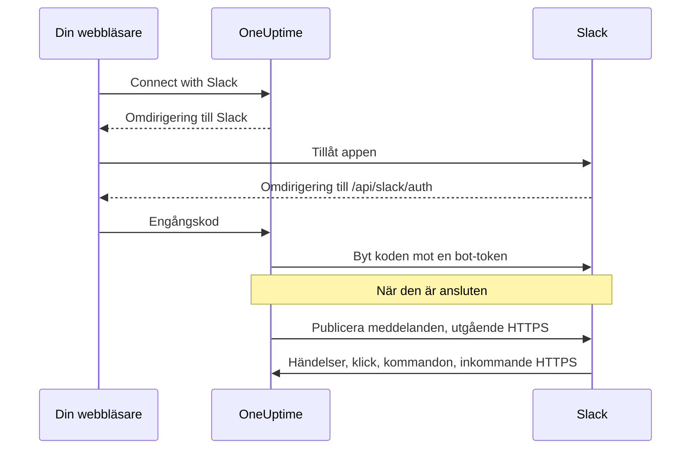
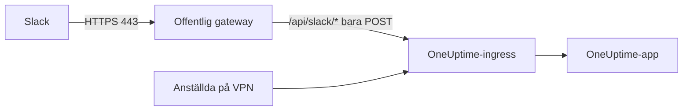

# Slack-integration

Anslut din egenvärdade OneUptime till Slack. Du skapar en Slack-app från manifestet som din server genererar, ger OneUptime appens inloggningsuppgifter och ansluter varje projekt till en arbetsyta. Sedan publicerar OneUptime incidenter, larm och planerat underhåll i dina kanaler, och ditt team hanterar dem direkt i Slack.

Den här sidan är till för den som driver OneUptime-servern. När Slack är anslutet ställs aviseringsregler in per projekt: se [Slack](/docs/workspace-connections/slack).

:::cards
- [Konfigurera Slack-appen](#konfigurera-slack-appen): Skapa appen från ditt manifest och anslut ett projekt.
- [Miljövariabler](#miljövariabler): De tre värden som OneUptime behöver från appen.
- [Nätverksåtkomst](#nätverksåtkomst-för-egenvärdade-installationer): De callbacks som Slack måste kunna nå.
- [Felsökning](#felsökning): Vad meddelandena på Slack-sidan betyder och vad du gör.
:::

## Så fungerar det

Slack-appen är din egen: den är installerad i din arbetsyta och pratar bara med din server. Trafiken går åt båda hållen, och varje riktning behöver sin egen nätverksåtkomst.



- **Utgående**: OneUptime anropar Slacks Web API för att publicera meddelanden, skapa kanaler och ladda upp bilder.
- **Inkommande**: Slack anropar fyra rutter på din server för händelser, klick på knappar, menyer och snedstreckskommandon. Varje begäran är signerad med appens signing secret. OneUptime avvisar en begäran vars signatur inte stämmer eller vars tidsstämpel är mer än fem minuter gammal.

## Innan du börjar

- En Slack-arbetsyta där du kan skapa och installera appar.
- Ett offentligt HTTPS-värdnamn för OneUptime som Slack kan nå. Se [Nätverksåtkomst](#nätverksåtkomst-för-egenvärdade-installationer).
- Åtkomst till serverns konfiguration: `config.env` för Docker Compose, eller dina Helm-values för Kubernetes.
- För att ansluta ett projekt: rollen **Project Owner**, **Project Admin** eller **Project Member** i det.

## Konfigurera Slack-appen

:::steps
### Ange den offentliga URL:en

OneUptime bygger appmanifestet och varje callback-URL från `HOST` och `HTTP_PROTOCOL`. Ställ in dem på värdnamnet som Slack kommer att anropa, över HTTPS:

:::tabs
@tab Docker Compose
```bash title="config.env"
HOST=oneuptime.example.com
HTTP_PROTOCOL=https
```
@tab Kubernetes
```yaml title="values.yaml"
host: oneuptime.example.com
httpProtocol: https
```
:::

De här värdena genererar bara URL:er. De skapar inga DNS-poster, certifikat eller brandväggsregler.

### Kopiera appmanifestet

Öppna **Projektinställningar > Arbetsyta > Slack**. Så länge Slack inte är konfigurerat på servern visar sidan **Integrating Slack with your OneUptime Project** med manifestet som genererats för ditt värdnamn. Det serveras också på `https://oneuptime.example.com/api/slack/app-manifest`.

Kontrollera att varje URL i manifestet börjar med ditt offentliga värdnamn. Om inte, rätta först `HOST` och `HTTP_PROTOCOL` och tillämpa ändringen.

### Skapa Slack-appen

Skapa en ny app från ett manifest på [api.slack.com/apps](https://api.slack.com/apps), välj din arbetsyta och klistra in manifestet. Använd alltid manifestet som din egen server genererar, så att dess URL:er stämmer med ditt värdnamn.

### Kopiera appens inloggningsuppgifter

Kopiera **Client ID**, **Client Secret** och **Signing Secret** på appens sida **Basic Information** under **App Credentials**.

### Lägg till inloggningsuppgifterna i OneUptime

:::tabs
@tab Docker Compose
```bash title="config.env"
SLACK_APP_CLIENT_ID=YOUR_SLACK_APP_CLIENT_ID
SLACK_APP_CLIENT_SECRET=YOUR_SLACK_APP_CLIENT_SECRET
SLACK_APP_SIGNING_SECRET=YOUR_SLACK_APP_SIGNING_SECRET
```
@tab Kubernetes
```yaml title="values.yaml"
slackApp:
  clientId: "YOUR_SLACK_APP_CLIENT_ID"
  clientSecret: "YOUR_SLACK_APP_CLIENT_SECRET"
  signingSecret: "YOUR_SLACK_APP_SIGNING_SECRET"
```

För att hålla värdena i en Kubernetes-Secret som du själv hanterar anger du i stället `slackApp.existingSecret`: dess `name` och nycklarna `clientIdKey`, `clientSecretKey` och `signingSecretKey`.
:::

### Tillämpa konfigurationen

:::tabs
@tab Docker Compose
```bash
npm run start
```

Det här återskapar containrarna med den nya `config.env`. `docker compose restart` läser inte in den igen.
@tab Kubernetes
```bash
helm upgrade my-oneuptime oneuptime/oneuptime -f values.yaml
```
:::

När OneUptime är igång igen visar **Projektinställningar > Arbetsyta > Slack** en knapp **Connect with Slack** i stället för manifestet.

### Verifiera begärande-URL:en för händelser

Verifiera begärande-URL:en under **Event Subscriptions** i Slack-appen. OneUptime svarar på Slacks challenge först när signing secret är angiven, så försök igen om det misslyckades medan du skapade appen.

### Anslut projektet

Välj **Connect with Slack** under **Projektinställningar > Arbetsyta > Slack** och tillåt appen i Slack. Slack skickar tillbaka dig till samma sida, som nu visar din arbetsyta.

### Anslut ditt eget Slack-konto

Knappar, formulär och kommandon agerar som den OneUptime-användare som är kopplad till Slack-kontot som använder dem. Varje person öppnar **Användarinställningar > Arbetsyta > Slack** och väljer **Connect my account with Slack**. Den som inte har anslutit ett konto får ett direktmeddelande från appen som ber om det.
:::

## Miljövariabler

| Docker Compose (`config.env`) | Helm (`values.yaml`) | Obligatorisk | Värde |
| --- | --- | --- | --- |
| `SLACK_APP_CLIENT_ID` | `slackApp.clientId` | Ja | Appens **Client ID**. Utan den visar Slack-sidan konfigurationsguiden i stället för **Connect with Slack**. |
| `SLACK_APP_CLIENT_SECRET` | `slackApp.clientSecret` | Ja | Appens **Client Secret**, som används för att byta koden som Slack returnerar mot en token. |
| `SLACK_APP_SIGNING_SECRET` | `slackApp.signingSecret` | Ja | Appens **Signing Secret**. Varje begäran från Slack kontrolleras mot den. |
| `HOST` | `host` | Ja | Ditt offentliga värdnamn, utan schema. |
| `HTTP_PROTOCOL` | `httpProtocol` | Ja | `https`. Slack anropar bara HTTPS-URL:er. |

## Vad appen kan göra

Manifestet konfigurerar de här funktionerna. Var och en når din server via den angivna rutten och fungerar därför bara när Slack kan nå den rutten.

| Funktion | Vad den gör | Rutt |
| --- | --- | --- |
| `/incident` och genvägen **Create New Incident** | Deklarera en incident från Slack | `POST /api/slack/interactive` |
| `/maintenance` och genvägen **Create Scheduled Event** | Schemalägg underhåll från Slack | `POST /api/slack/interactive` |
| `/oneuptime` | Fråga OneUptime AI om dina loggar, traces, mätvärden, incidenter och monitorer | `POST /api/slack/command` |
| Knappar och formulär i OneUptime-meddelanden | Kvittera, lös, lägg till en anteckning, ändra tillståndet, kör en jourpolicy | `POST /api/slack/interactive` och `POST /api/slack/options-load` |
| Händelser | Omnämnanden, meddelanden, reaktioner och fästningar, till exempel för att spara ett meddelande som en anteckning | `POST /api/slack/events` |

### Bilder i meddelanden

Beskrivningar av incidenter och larm kan innehålla skärmbilder, till exempel från en syntetisk monitor (se [Visa en skärmbild](/docs/monitor/incident-alert-templating#visa-en-skärmbild)). OneUptime visar dem i Slack-meddelanden genom att ladda upp var och en till din arbetsyta som en privat fil, vilket kräver bot-scopet `files:write`. Det genererade manifestet innehåller det.

Om du skapade din Slack-app från ett äldre manifest lägger du till `files:write` under **OAuth & Permissions > Bot Token Scopes** (eller uppdaterar appen från det aktuella manifestet). Välj sedan **Connect with Slack** igen under **Projektinställningar > Arbetsyta > Slack**, så att det nya scopet beviljas. Fram till dess visas varje skärmbild som sin alternativa text.

## Nätverksåtkomst för egenvärdade installationer

### Trafikriktning och slutpunkter

| Trafik | Nödvändig åtkomst |
| --- | --- |
| OneUptime till Slack | DNS och utgående HTTPS på TCP 443 till `slack.com` för Web API-anrop och utbyte av OAuth-token; `hooks.slack.com` för svars-URL:er från kommandon och aviseringar via incoming webhooks, när de används |
| Slack till OneUptime | Offentlig HTTPS på TCP 443 till de fyra POST-rutterna nedan, för den fullständiga integrationen |
| Användarens webbläsare till OneUptime | Åtkomst till dashboarden och OAuth-omdirigeringar till `/api/slack/auth/:projectId/:userId` och `/api/slack/auth/:projectId/:userId/user`; de kan fortsatt nås via användarens VPN |

De utgående domänerna beskriver OneUptimes Slack-integration, inte en fullständig tillåtelselista för Slack-klienter eller varje Slack-funktion. En Slack-*incoming webhook* drivs av Slack: OneUptime skickar till den, så den är ingen inkommande slutpunkt på din server. Se Slacks [guide för incoming webhooks](https://docs.slack.dev/messaging/sending-messages-using-incoming-webhooks/).

Vidarebefordra de här callbacks till OneUptime via dess ingress:

| Metod och sökväg | Syfte |
| --- | --- |
| `POST /api/slack/events` | Verifiering av Events API, reaktioner, fästningar, omnämnanden och meddelanden |
| `POST /api/slack/interactive` | Knappar, genvägar, inskickade modaler, `/incident` och `/maintenance` |
| `POST /api/slack/options-load` | Begäranden om alternativ i interaktiva menyer |
| `POST /api/slack/command` | Kommandot `/oneuptime` |

OAuth är en [omdirigering i webbläsaren följd av ett tokenutbyte på servern](https://docs.slack.dev/authentication/installing-with-oauth/). Manifestet registrerar `/api/slack/auth` som prefix för omdirigerings-URL:en, och OneUptime lägger till projekt- och användarsökvägarna när den startar auktoriseringen. Enbart åtkomst från webbläsaren låter inte Slack leverera händelser eller klick på knappar.

### Privata installationer och säkerhet för callbacks



Använd offentlig DNS och en gateway med ett offentligt betrott HTTPS-certifikat, en fullständig certifikatkedja och en privat rutt till din OneUptime-ingress. Tillåt inkommande TCP 443 till gatewayen och vidarebefordra bara de fyra callback-rutterna ovan. En privat `ClusterIP`, ett internt DNS-namn eller en anställds VPN-anslutning kan Slack inte nå. Med delad DNS kan dashboarden och OAuth-rutterna förbli privata under samma värdnamn.

Generera om manifestet och uppdatera Slack-appen efter ett byte av värdnamn.

Bevara genom gatewayen:

- metoden, sökvägen, frågesträngen och den ursprungliga bodyn;
- `Content-Type`, `X-Slack-Signature` och `X-Slack-Request-Timestamp`;
- den offentliga värden och HTTPS-schemat, via betrodda proxyhuvuden.

Undanta callback-rutterna från webbläsar-SSO, CAPTCHA och proxyns inloggningssidor, och behåll OneUptimes kontroller av signing secret och tidsstämpel. Håll serverns klocka synkroniserad: en begäran som avviker mer än fem minuter avvisas. Slack dokumenterar [verifiering av begärandens signatur](https://docs.slack.dev/authentication/verifying-requests-from-slack/); en kontroll av käll-IP ersätter den inte.

### Kontrollera åtkomsten och förstå begränsningarna

:::steps
1. Verifiera begärande-URL:en under **Event Subscriptions** i Slack-appen. Slack skickar en [POST-challenge och kontrollerar TLS](https://docs.slack.dev/apis/events-api/using-http-request-urls/).
2. Skicka en testavisering, kör ett snedstreckskommando, tryck på en knapp i ett incidentmeddelande och utlös en prenumererad händelse.
3. Kontrollera gatewayens och OneUptimes loggar efter misslyckade leveranser, utan att logga hemligheter.
:::

Slack förväntar sig snabba kvitteringar, bland annat [ett svar inom tre sekunder för interaktioner](https://docs.slack.dev/interactivity/handling-user-interaction/). En GET från webbläsaren eller ett lyckat utgående meddelande verifierar inte de här POST-callbacks.

> [!WARNING]
> Om all inkommande anslutning är förbjuden kan en redan auktoriserad app fortfarande skicka meddelanden med utgående HTTPS, men händelser, knappar, genvägar och kommandon kan inte fungera. OneUptimes manifest använder HTTP-callbacks och stänger av Socket Mode; att slå på Slacks Socket Mode är inte en ersättning som stöds för de här rutterna.

[Inställningarna för åtkomst till privata nätverk](/docs/self-hosted/private-network-access) styr utgående begäranden till privata mål. De gör inte callbacks nåbara för Slack.

## Felsökning

### Anslutningen slutfördes inte

När Slack skickar tillbaka dig och anslutningen inte gjordes visar Slack-sidan du började från (**Projektinställningar > Arbetsyta > Slack**, eller dina egna **Användarinställningar > Arbetsyta > Slack** om du anslöt ditt konto) **Slack anslöts inte**, med en mening på ditt språk som säger varför. Resten av sidan laddas som vanligt, så du kan ansluta igen direkt där. Den visar aldrig vad Slack själv svarade: det står i OneUptime-serverns logg, tillsammans med orsaken.

| Sidan säger | Vad du gör |
| --- | --- |
| **"Den här anslutningslänken är ogiltig, har gått ut eller har redan använts. Börja om."** | Länken fungerar en gång, i 15 minuter, i webbläsaren som startade den. Börja om från Slack-sidan och slutför i Slack inom 15 minuter, i samma webbläsare. |
| **"Du har inte behörighet att ansluta det här projektet till Slack."** | Att installera OneUptime i Slack kräver **Project Owner**, **Project Admin** eller **Project Member**. Det kontrolleras igen när Slack skickar tillbaka dig, så en roll som tagits bort under tiden avslutar också anslutningen här. |
| **"Du är inte längre medlem i det här projektet."** | För att ansluta ditt eget Slack-konto måste du vara medlem i projektet när Slack skickar tillbaka dig. |
| **"Det här projektet är ännu inte anslutet till någon Slack-arbetsyta."** | Installera först OneUptime i Slack från **Projektinställningar > Arbetsyta > Slack** och anslut sedan ditt eget konto. |
| **"Du loggade in i en annan Slack-arbetsyta än den som det här projektet är anslutet till."** | Anslut ditt konto medan du är inloggad i den Slack-arbetsyta som projektet är installerat i. |
| **"Anslutningen avbröts, så inget ändrades."** | Begäran tilläts inte i Slack. Börja om och tillåt den. |
| **"Slack är inte konfigurerat på den här OneUptime-servern."** | Ange `SLACK_APP_CLIENT_ID` och `SLACK_APP_CLIENT_SECRET` (se [Miljövariabler](#miljövariabler)) och starta om OneUptime. |
| **"OneUptime kunde inte slutföra anslutningen. Försök igen."** | Slack svarade med ett fel, eller så misslyckades en begäran eller en skrivning under slutförandet. OneUptime-serverns logg säger vilken. Försök igen; om det fortsätter, kontrollera loggen och Slack-appens inställningar. |

### Andra problem

:::details Slack kan inte verifiera begärande-URL:en för händelser
OneUptime svarar på Slacks challenge bara när `SLACK_APP_SIGNING_SECRET` är angiven och begäran når fram. Ange signing secret, tillämpa konfigurationen och försök verifiera igen. Om det fortfarande misslyckas, kontrollera att `POST /api/slack/events` kan nås från internet med ett offentligt betrott certifikat.
:::

:::details Knappar och snedstreckskommandon gör ingenting, men aviseringarna kommer fram
Aviseringar är utgående och fungerar därför utan inkommande åtkomst. Knappar, genvägar och kommandon är inkommande: kontrollera att Slack kan nå `POST /api/slack/interactive` och `POST /api/slack/command`, och att gatewayen bevarar bodyn och huvudena `X-Slack-Signature` och `X-Slack-Request-Timestamp`.
:::

:::details Appen säger att mitt Slack-konto inte är anslutet till OneUptime
Knappar, formulär och kommandon kräver att ditt Slack-konto är kopplat till din OneUptime-användare. Öppna **Användarinställningar > Arbetsyta > Slack** och välj **Connect my account with Slack**. Om du har tagits bort från projektet säger appen det i stället, och åtgärder från Slack avvisas.
:::

:::details Skärmbilder visas som text
Slack-appen saknar scopet `files:write`. Se [Bilder i meddelanden](#bilder-i-meddelanden).
:::

## Nästa steg

:::cards
- [Slack](/docs/workspace-connections/slack): Skapa aviseringsregler och sammanfattningar för projektet.
- [Microsoft Teams-integration](/docs/self-hosted/microsoft-teams-integration): Konfigurera även Teams-boten på din server.
- [Åtkomst till privat nätverk](/docs/self-hosted/private-network-access): Låt arbetsflöden och webhooks nå interna verktyg.
:::
