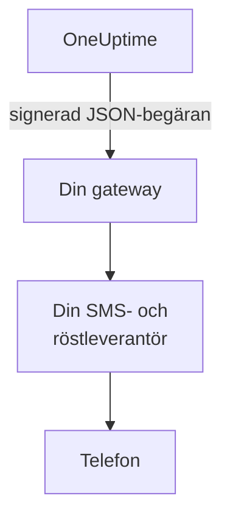

# SMS- och samtalsgateway

OneUptime kan skicka sina SMS och samtal via en gateway som du driver, i stället för via Twilio. Använd den när dina regler kräver att varje meddelande går via din egen SMS- och röstleverantör, eller via ett system som granskar det innan det lämnar ditt nätverk. OneUptime skickar varje SMS och samtal till din gateway som en signerad JSON-begäran, och din gateway levererar det.

:::cards
- [Konfigurera gatewayen](#konfigurera-gatewayen): En URL och en signeringshemlighet som skapas åt dig.
- [Vad din gateway tar emot](#vad-din-gateway-tar-emot): En signerad JSON-begäran per SMS eller samtal.
- [Agera på ett larm](#agera-på-ett-larm): Bekräfta, eskalera eller lös från ett samtal eller ett svar.
- [Leverans och nya försök](#leverans-och-nya-försök): Vad som händer när din gateway ligger nere.
:::

## Så fungerar det



Gatewayen ersätter serverns eget Twilio-konto för allt som annars skulle gå via det: jourlarm, aviseringar, verifieringskoder och SMS till statussidors prenumeranter. Projekt som lägger till en egen Twilio-konfiguration på kortet **Twilio-konfiguration** under **Projektinställningar > Aviseringar > Aviseringsinställningar** skickar fortfarande via den konfigurationen. Varje projekts reglage för SMS och samtal, och dess saldo där fakturering är påslagen, kontrolleras som för Twilio.

## Konfigurera gatewayen

:::steps
1. Gå i Admin Dashboard till **Inställningar > Samtal och SMS** och klicka på **Edit Provider** på kortet **SMS and Call Provider**.
2. Välj **Your own gateway** och ange **Gateway URL**. Gatewayen kan ligga i ditt privata nätverk.
3. Spara. OneUptime skapar en signeringshemlighet åt dig. Kopiera den från kortet till din gateway.
4. Klicka på **Send Test**. Din gateway ska svara med en 2xx-status och inte skicka något.
:::

Om du vill byta hemligheten tömmer du **Signing Secret** under **Fler fält** och sparar: OneUptime skapar en ny. Om du vill gå tillbaka till Twilio väljer du **Twilio** och sparar.

## Vad din gateway tar emot

Varje SMS och samtal är en `POST`-begäran med en JSON-body och de här huvudena:

| Huvud | Värde |
| --- | --- |
| `Content-Type` | `application/json` |
| `X-OneUptime-Event` | `sms`, `call` eller `test` |
| `X-OneUptime-Signature` | `sha256=` följt av HMAC-SHA256 för bodyn i hex, med signeringshemligheten som nyckel |
| `User-Agent` | `OneUptime-CallAndSmsGateway/1.0` |

```json title="An on-call page by SMS"
{
  "version": 1,
  "event": "sms",
  "id": "7c5b0d0e-3e5f-4d1a-9a4f-2b8e6c1d9f00",
  "sentAt": "2026-10-27T09:30:00.000Z",
  "to": "+15551234567",
  "message": "OneUptime: A new alert has been created. Alert #42: Database is down…",
  "isSensitive": false,
  "project": {
    "id": "0f6b8c3a-1d2e-4f5a-8b9c-0d1e2f3a4b5c",
    "name": "Production"
  },
  "actions": {
    "acknowledge": "https://oneuptime.example.com/api/custom-notification-channel/page/5f2c…/acknowledge?token=…",
    "escalate": "https://oneuptime.example.com/api/custom-notification-channel/page/5f2c…/escalate?token=…",
    "resolve": "https://oneuptime.example.com/api/custom-notification-channel/page/5f2c…/resolve?token=…"
  }
}
```

| Fält | Vad det är |
| --- | --- |
| `version` | Alltid `1` för den här formen. Fält läggs bara till i den. |
| `event` | `sms`, `call` eller `test`, som i `X-OneUptime-Event`. |
| `id` | Unikt för det här meddelandet och detsamma i varje försök att leverera det: använd det för att ignorera ett meddelande du redan har skickat. |
| `sentAt` | När OneUptime skickade det, i ISO 8601. |
| `to` | Telefonnumret, i E.164-format. `null` i ett test. |
| `message` | SMS:et, eller det som samtalet säger. Ett SMS är högst 1 600 tecken, och ett samtals text högst 16 384. En längre text kortas och slutar med en notering om att resten finns i OneUptime. |
| `isSensitive` | `true` för en verifieringskod. Håll meddelandet borta från dina egna loggar. |
| `project` | Projektets `id` och `name`, eller `null` när inget projekt skickade det. |
| `actions` | För ett jourlarm de länkar som agerar på det. Annars `null`. |

Ett samtal beskrivs i stället för att skrivas som ett manus: `message` är det som samtalet säger, utan Twilios "tryck 1 för att bekräfta". Erbjud åtgärderna på ditt eget sätt, till exempel med knapptryckningar, och anropa motsvarande länk.

### Kontrollera signaturen

Beräkna HMAC för begärans råa body, innan du tolkar den, och jämför den med huvudet. Kontrollen är densamma som för en [anpassad kanal](/docs/self-hosted/custom-notification-channels#kontrollera-signaturen), så en verifierare räcker för båda:

```javascript title="Node.js"
const crypto = require("crypto");

function isFromOneUptime(rawBody, signatureHeader, secret) {
  const expected =
    "sha256=" + crypto.createHmac("sha256", secret).update(rawBody).digest("hex");
  const received = String(signatureHeader || "");

  return (
    received.length === expected.length &&
    crypto.timingSafeEqual(Buffer.from(received), Buffer.from(expected))
  );
}
```

## Agera på ett larm

När personen svarar under ett samtal eller med ett svar skickar din gateway en `POST`-begäran till motsvarande länk i `actions`. Länkarna fungerar som en anpassad kanals länkar: de behöver ingen API-nyckel, var och en bär en token för just det larmet, giltig i 7 dagar, och åtgärden registreras som utförd av den person som larmades. Se [Agera på ett larm](/docs/self-hosted/custom-notification-channels#agera-på-ett-larm) för varje åtgärd och svaret.

```bash title="Acknowledge a page"
curl -X POST "https://oneuptime.example.com/api/custom-notification-channel/page/5f2c…/acknowledge?token=…"
```

## Leverans och nya försök

En begäran räknas som levererad när din gateway svarar med en 2xx-status inom 10 sekunder. En begäran som den inte svarade på, eller svarade på med 408, 429 eller en 5xx-status, skickas igen efter 1 sekund och efter ytterligare 4 sekunder: tre försök totalt. Vid någon annan 4xx-status skickas den inte igen.

SMS- eller samtalsloggen, och för ett jourlarm personens jourlogg, säger `Sent to the SMS and call gateway (HTTP 200).` eller varför meddelandet inte levererades, aldrig URL:en. OneUptime får inte veta om meddelandet nådde telefonen, så ett SMS visas som skickat så snart din gateway tar emot det, och numret det skickades från lämnas tomt.

## Testbegäranden

**Send test** skickar en begäran med `event` satt till `test`, och `to`, `project` och `actions` satta till `null`. Svara på den med en 2xx-status och skicka ingenting.

## Nästa steg

:::cards
- [Anpassade aviseringskanaler](/docs/self-hosted/custom-notification-channels): Larma personer via din egen app.
- [Push-aviseringar](/docs/self-hosted/push-notifications): Stäng av push för hela servern.
- [Twilio-integration](/docs/self-hosted/twilio-integration): Skicka via Twilio i stället.
- [Åtkomst till privat nätverk](/docs/self-hosted/private-network-access): Vad din server får nå i ditt eget nätverk.
:::
