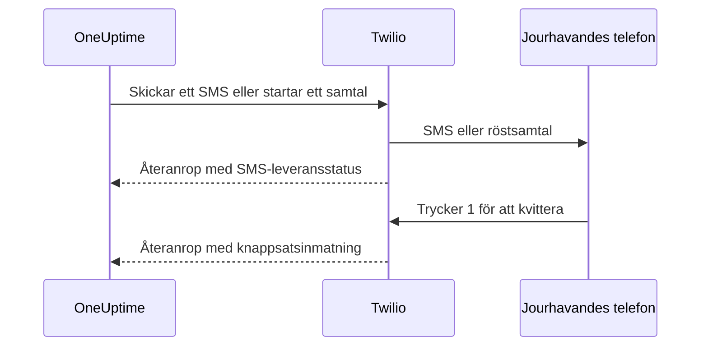

# Twilio-integration

En egenvärdad OneUptime skickar SMS- och röstlarm via ditt eget Twilio-konto, och du betalar Twilio direkt. Twilio-uppgifterna sparar du i OneUptimes dashboard, inte i miljövariabler: leveransen av aviseringar läser den sparade konfigurationen, och Helm-charten har inga värden för Twilio-uppgifter.

> [!NOTE]
> En gammal migrering importerade `TWILIO_ACCOUNT_SID`, `TWILIO_AUTH_TOKEN` och `TWILIO_PHONE_NUMBER`; att ändra de variablerna är inte sättet att uppdatera uppgifterna i en befintlig installation.

:::cards
- [Förbered ditt Twilio-konto](#1-förbered-ditt-twilio-konto): Autentiseringsuppgifter, ett telefonnummer och kontots gränser.
- [Spara autentiseringsuppgifterna](#2-spara-autentiseringsuppgifterna-i-oneuptime): För ett projekt, eller för hela installationen.
- [Konfigurera nätverksåtkomst](#3-konfigurera-nätverksåtkomst): Vad Twilio måste nå på din server, och när.
- [Verifiera telefonnummer](#5-verifiera-teammedlemmarnas-telefonnummer): Hur teammedlemmarnas nummer verifieras.
:::

## 1. Förbered ditt Twilio-konto

:::steps
### Kopiera dina autentiseringsuppgifter

Öppna [Twilio Console](https://console.twilio.com/) och kopiera ditt **Account SID** och din **Auth Token**.

### Skaffa ett telefonnummer

Skaffa ett Twilio-telefonnummer med de SMS- och/eller röstfunktioner du behöver. Använd formatet E.164 med landskod för avsändar- och mottagarnummer.

### Kontrollera kontots gränser

Kontrollera kontots saldo, behörigheterna för mottagarländer och de krav på registrering av avsändare som gäller. Testkonton har begränsningar för mottagare, geografi och annat som kan hindra riktiga larm från OneUptime att fungera; läs [Twilios dokumentation om konton och provperioden](https://www.twilio.com/docs/usage/tutorials/how-to-use-your-free-trial-account) innan du testar. Använd ett uppgraderat konto i produktion.
:::

## 2. Spara autentiseringsuppgifterna i OneUptime

Spara autentiseringsuppgifterna för ett projekt, eller en gång för hela installationen:

| | Projektkonfiguration | Konfiguration för hela installationen |
| --- | --- | --- |
| Var | Kortet **Twilio-konfiguration** under **Projektinställningar > Aviseringar > Aviseringsinställningar** | **Admin Dashboard > Inställningar > Samtal och SMS** |
| Vem kan ange den | **Project Owner**, **Project Admin** eller **Create Call and SMS** i en anpassad roll | En master admin |
| Används för | SMS och samtal till projektets medlemmar så länge den är projektstandard, de statussidor den är tilldelad och de policyer för inkommande samtal som använder den | SMS och samtal till medlemmarna i alla projekt som saknar standardkonfiguration |

Så lägger du till en projektkonfiguration:

:::steps
1. Gå till **Projektinställningar > Aviseringar > Aviseringsinställningar**.
2. Välj **Skapa Twilio-konfiguration** i **Twilio-konfiguration**.
3. Ange ett namn, **Twilio Account SID**, **Twilio Auth Token** och **Twilio primärt telefonnummer**. Du kan också ange kommaseparerade **Twilio sekundära telefonnummer** för andra länder.
4. **Ange som projektstandard** är påslaget för projektets första konfiguration, så SMS och samtal till projektets medlemmar, även jouraviseringar, går genom den så fort du sparar. Stäng av det om kontot bara är till för statussidor eller inkommande samtal. En senare konfiguration börjar med reglaget avstängt: slå på det, eller välj **Ange som projektstandard** i konfigurationens radmeny, för att flytta de meddelandena dit. En API-begäran som utelämnar `isProjectDefault` behandlas på samma sätt.
5. Spara. Bara en konfiguration kan vara projektstandard. Statussidor använder den konfiguration som uttryckligen har tilldelats varje statussida.

> [!IMPORTANT]
> **SMS** och **Telefonsamtal** är avstängda från början i varje projekt, och så länge de är avstängda kan ingen i projektet lägga till ett telefonnummer för dem. En projektägare, en **Billing Admin** eller någon med **Manage Billing** slår på dem i kortet **Aviseringskanaler** på samma sida.
:::

För en standard som gäller hela installationen kan en administratör i stället öppna **Admin Dashboard > Inställningar > Samtal och SMS**, redigera Twilio-uppgifterna och telefonnumren och spara. Medlemmarnas aviseringar använder den här globala konfigurationen när deras projekt saknar standard. Håll Auth Token hemlig.

## 3. Konfigurera nätverksåtkomst

Att skicka fungerar med enbart utgående åtkomst. Leveransuppdateringar, kvittering med knappsatsen och inkommande samtal kräver att Twilio når din server.

En privat installation behöver DNS-uppslag och utgående HTTPS över TCP 443 till Twilio för att skicka SMS och samtal. Twilio rekommenderar att tillåta utgående HTTPS till `*.twilio.com` eftersom API-adresserna är dynamiska; se [Twilios IP-adresser](https://help.twilio.com/articles/115015934048-All-About-Twilio-IP-Addresses). Tillämpa det på utgående trafik från OneUptime-applikationens arbetslast, inklusive Kubernetes NetworkPolicies och externa brandväggar.

Inkommande åtkomst beror på funktionen:

| Funktion | Måste Twilio nå OneUptime? |
| --- | --- |
| Skicka SMS | Nej. Uppdateringar av leveransstatus behöver dock ett återanrop. |
| Ett enkelt testsamtal med röst | Nej. OneUptime skickar de talade instruktionerna med den utgående API-begäran. |
| Trycka 1 för att kvittera ett jourlarm | Ja. Twilio skickar knappsatsinmatningen till OneUptime. |
| Policyer för inkommande samtal | Ja. Twilio hämtar samtalsinstruktioner och rapporterar resultatet av uppringningen. |

Det här är de externa sökvägarna via OneUptimes Nginx-gateway. Platshållarna skiljer sig för varje avisering:

| Metod | Sökväg | Syfte |
| --- | --- | --- |
| POST | `/notification/sms/status-callback/:smsLogId/:token` | SMS-leveransstatus |
| POST | `/api/user-notification-log-timeline/call/gather-input/:itemId?token=...` | Kvittering med knappsatsen |
| POST | `/notification/incoming-call/voice` | Valfria instruktioner för inkommande samtal |
| POST | `/notification/incoming-call/dial-status/:callLogId/:callLogItemId` | Valfria resultat av routning av inkommande samtal |

OneUptime skapar URL:erna för SMS och kvittering automatiskt. Ersätt inte deras token med en fast webhook-URL. För inkommande samtal följer du [policyer för inkommande samtal](/docs/on-call/incoming-call-policy), som konfigurerar numrets webhook när du kopplar ett nummer.

Twilio kräver [offentligt nåbara webhook-URL:er](https://www.twilio.com/docs/usage/webhooks/webhooks-overview). Använd ett offentligt betrott TLS-certifikat och bevara den ursprungliga värden, protokollet, sökvägen, frågeparametrarna, kroppen och headern `X-Twilio-Signature` genom proxyer. Hanterarna för inkommande samtal validerar Twilios signaturer; SMS-leverans använder en URL-token per meddelande, och kvittering med knappsatsen en signerad frågetoken. Visa inte token i delade loggar eller skärmbilder. Se [Twilios webhook-säkerhet](https://www.twilio.com/docs/usage/webhooks/webhooks-security).

### Publicera återanrop från en privat installation

:::steps
1. Publicera DNS för ditt OneUptime-värdnamn, till exempel `oneuptime.example.com`, så att det pekar på en omvänd proxy eller lastbalanserare som nås från internet. Tillåt inkommande TCP 443 och konfigurera ett offentligt betrott certifikat med fullständig kedja. En privat IP, DNS som bara fungerar internt eller en administratörs VPN-anslutning ger inte Twilio någon anslutning.
2. Ge gatewayen en nätverksväg till OneUptimes privata ingress, direkt eller via ditt eget site-to-site-VPN eller private link. Tillåt tjänstens uppströmsport. En Kubernetes-tjänst av typen `ClusterIP` behöver en nåbar ingress eller en annan väg från gatewayen. Håll databaser och andra interna tjänster privata.
3. Publicera bara de återanropssökvägar från tabellen ovan som du använder. Vidarebefordra dem via OneUptimes Nginx-gateway, som mappar det externa prefixet `/notification` till applikationen. Behåll `/api` på vägen för kvittering med knappsatsen. Bevara HTTP-metoden och begärans data; omdirigera inte till en annan URL. Bevara den offentliga `Host` och sätt betrodda vidarebefordringsheaders för den offentliga värden och HTTPS-schemat i din proxy.
4. Undanta de här vägarna från webbläsar-SSO, CAPTCHA och proxyns inloggningssidor. Låt OneUptimes autentisering av återanrop vara påslagen. Begränsa åtkomsten till det privata ursprunget till gatewayen och behöriga interna klienter.
5. Sätt `HOST=oneuptime.example.com` och `HTTP_PROTOCOL=https` i Docker Composes `config.env`, eller `host: oneuptime.example.com` och `httpProtocol: https` i Helm-values. Tillämpa ändringen i installationen och vänta tills applikationen har startat om. De här inställningarna skapar URL:er; de skapar inte DNS, certifikat eller brandväggsregler. OneUptime har ingen separat inställning för ett värdnamn för Twilio-återanrop. Om värdnamnet ändras uppdaterar du även webhooken för befintliga Twilio-telefonnummer.
:::

Dashboarden kan ligga kvar på en privat ingress: med delad DNS slår anställda upp samma värdnamn till den ingressen via företagsnätet eller VPN, medan Twilio slår upp det till gatewayen. Leverera ett certifikat som är giltigt för värdnamnet åt båda hållen. OneUptimes [inställningar för åtkomst till privata nätverk](/docs/self-hosted/private-network-access) styr utgående begäranden till interna tjänster; `ALLOW_PRIVATE_NETWORK_WEBHOOKS` publicerar ingen inkommande endpoint.

### IP-begränsningar och installationer utan inkommande åtkomst

Twilios vanliga källadresser för webhooks ändras, så använd inte SIP- eller medie-IP-intervall som tillåtelselista för återanrop. Kvalificerade Twilio-utgåvor erbjuder [Static Proxy for Webhooks](https://www.twilio.com/docs/iam/twilio-editions/twilio-static-proxy). Kontrollera att din utgåva är kvalificerad och vilka produkter som stöds, och konfigurera din brandvägg med de intervall som Twilio publicerar nu; fortsätt att validera återanrop även när du använder det.

> [!WARNING]
> Om en policy förbjuder inkommande anslutningar kan sändning av SMS och enkel inbyggd röstuppspelning fungera med utgående HTTPS. Uppdateringar av SMS-leverans, kvittering med knappsatsen och routning av inkommande samtal fungerar inte utan nåbara återanrop. En helt frånkopplad installation kan inte använda Twilio.

För utveckling beskriver Twilios [guide för att testa webhooks](https://www.twilio.com/docs/usage/webhooks/webhook-testing) hur man använder en offentlig tunnel: vidarebefordra den till en proxy som bara tillåter de nödvändiga vägarna, konfigurera värdnamnet du får som ovan och stoppa tunneln efter testet. En tunnel öppnar ändå för inkommande åtkomst.

## 4. Testa leverans och återanrop separat

:::steps
1. Kontrollera utanför företagsnätet och VPN att värdnamnet för återanrop slås upp till den offentliga gatewayen och levererar ett giltigt TLS-certifikat. En GET från webbläsaren testar inte de här POST-återanropen.
2. Använd **Skicka test-SMS** och **Skicka testsamtal** på projektets Twilio-konfiguration. Bekräfta att det kommer fram till mottagartelefonen. Båda kräver behörighet att lägga till Twilio-konfigurationer: **Project Owner**, **Project Admin** eller **Create Call and SMS** och **Read Call and SMS** i en anpassad roll.
3. Ställ in användarens verifierade SMS- eller samtalskontakt och aviseringsregler, och utlös sedan ett kontrollerat jourlarm. Tryck 1 och bekräfta kvitteringen i OneUptime. Om du använder policyer för inkommande samtal ringer du det konfigurerade numret och kontrollerar routningen och samtalsloggen.
4. Bekräfta SMS-leveransstatusen i OneUptime och i Twilios meddelandeloggar. En godkänd sändning bevisar inte leverans; [Twilio rapporterar senare statusändringar via återanrop](https://www.twilio.com/docs/messaging/guides/track-outbound-message-status).
:::

| Symtom | Var du ska titta |
| --- | --- |
| Inget skickas | Autentiseringsuppgifter, numrets funktioner, kontots begränsningar och den utgående anslutningen. |
| SMS:et eller samtalet kommer fram, men status eller kvittering uppdateras inte | Återanrops-URL:en och loggarna från den offentliga ingressen. Twilios [vägledning om fel vid HTTP-hämtning](https://www.twilio.com/docs/api/errors/11200) hjälper till med återanrop som inte nås, TLS-problem och HTTP-fel. |

Ett lyckat testsamtal bevisar inte ensamt att återanrop kan nås.

## 5. Verifiera teammedlemmarnas telefonnummer

När du lägger till ett telefonnummer för SMS eller samtal skickas dess verifieringskod direkt, och verifieringsdialogen öppnas. Den visar när koden skickades och hur länge den gäller, och skickar en ny kod på begäran, högst en gång per minut. Inget behöver skickas igen innan du verifierar.

När ingen kod kan skickas säger dialogen varför i stället för att påstå att en kod har skickats: till exempel att inget Twilio-konto är konfigurerat, så länge det varken finns en standardkonfiguration för projektet eller konfigurationen för hela installationen ovan. Ett nummer vars första kod inte kan skickas läggs inte till, och formuläret visar orsaken, till exempel att Twilio nekar ett mottagarland.

Ett nummer som är verifierat för SMS är också verifierat för samtal, utan en andra kod. Verifiering via samtal verifierar inte SMS, eftersom ett nummer som tar emot samtal, som en fast telefon, inte alltid kan ta emot textmeddelanden. Om Twilio accepterar en kod som aldrig kommer fram visar projektets SMS-logg dess leveransstatus.

## Nästa steg

:::cards
- [Policy för inkommande samtal](/docs/on-call/incoming-call-policy): Låt den som ringer nå dina jourhavande ingenjörer via ett Twilio-nummer.
- [Eskaleringsregler](/docs/on-call/escalation-rules): Bestäm vem som larmas på varje nivå, via SMS, samtal eller någon annan metod.
- [SMTP](/docs/emails/smtp): Skicka även e-post via din egen e-postserver.
- [Åtkomst till privata nätverk](/docs/self-hosted/private-network-access): Låt arbetsflöden och webhooks nå interna verktyg.
:::
