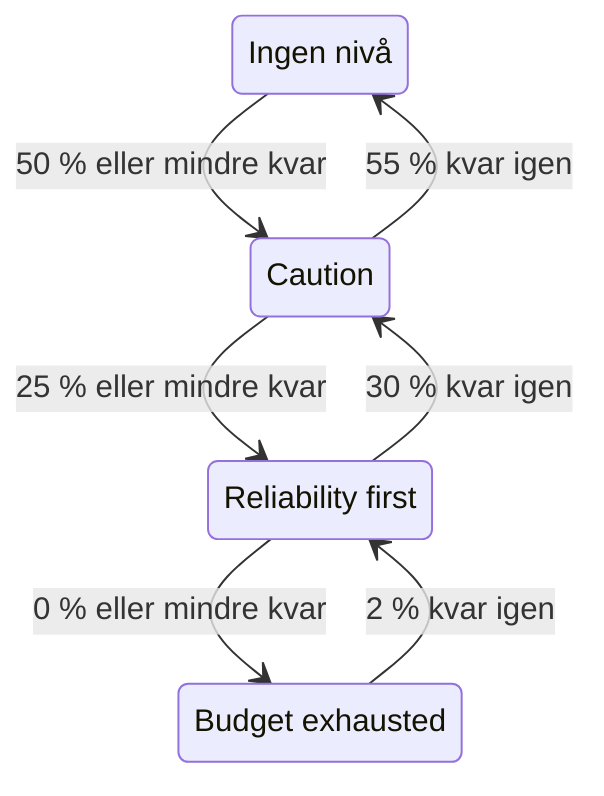

# Felbudgetpolicy

En felbudgetpolicy skriver ned vad ditt team har kommit överens om att göra medan ett SLO:s felbudget tar slut, till exempel att granska riskfyllda ändringar när hälften är förbrukad, eller att frysa releaser när allt är förbrukat. OneUptime placerar SLO:et i den nivå i policyn som budgeten har nått, visar teamets överenskommelse för nivån på SLO:ets sidor, kan utlösa ett larm eller deklarera en incident när SLO:et går in i en nivå, publicerar varje byte av nivå i de kanaler i Slack, Microsoft Teams eller Mattermost som du väljer och talar om för dina CI/CD-pipelines om de ska hålla tillbaka releaser. Det är praxisen med en felbudgetpolicy från [Google SRE Workbook](https://sre.google/workbook/error-budget-policy/).

:::cards
- [Så fungerar nivåer](#så-fungerar-nivåer): Vilken nivå som gäller, och när SLO:et lämnar den.
- [Ställ in en policy](#ställ-in-en-policy): Börja med den rekommenderade policyn, eller skriv dina egna nivåer.
- [Larm och incidenter](#larm-och-incidenter): Larma ditt team när SLO:et går in i en nivå.
- [Publicera i Slack, Microsoft Teams och Mattermost](#publicera-i-slack-microsoft-teams-och-mattermost): Meddela en kanal när ett SLO går in i en nivå, utan att larma någon.
- [Distributionsspärr](#distributionsspärr): Håll tillbaka releaser från CI/CD medan en nivå fryser distributioner.
- [Läs nivån via API:et](#läs-nivån-via-apiet): Kontrollera nivån från CI och skript.
:::

## Så fungerar nivåer

En policy är en uppsättning nivåer. Varje nivå har tre fält:

| Fält | Vad det innehåller |
| --- | --- |
| **Namn** | Vad teamet kallar nivån, till exempel "Reliability first". |
| **Tröskel för kvarvarande budget (%)** | Den andel av återstående felbudget vid eller under vilken nivån gäller. Från 0 till 100, decimaler tillåtna. Varje nivå i ett SLO har en egen tröskel. |
| **Vad vi gör** | Vad teamet har kommit överens om att göra medan SLO:et är i nivån, i Markdown. Obligatoriskt, upp till 10 000 tecken. |

En nivå gäller så länge återstående budget är vid eller under dess tröskel, så en nivå på 0 % är nivån för en förbrukad budget. När flera nivåer gäller är SLO:et i den med lägst tröskel: den allvarligaste. När ingen gäller är SLO:et inte i någon nivå. Med nivåer på 50 %, 25 % och 0 % är ett SLO med 30 % av budgeten kvar i nivån på 50 %, och ett med 10 % kvar är i nivån på 25 %.

En nivå kan också frysa distributioner medan SLO:et är i den: se [Distributionsspärr](#distributionsspärr).

### Att gå in i en nivå och lämna den

Nivån följer återstående budget så som SLO:ets status gör:

- Att gå in i en nivå sker direkt: den utvärdering som hittar budgeten vid eller under en nivås tröskel placerar SLO:et i den nivån. En budget som faller förbi flera trösklar på en gång går direkt till den allvarligaste nivån.
- Att lämna en nivå för en mindre allvarlig väntar tills budgeten tydligt är tillbaka. En nivå på 0 % lämnas när 2 % av budgeten finns kvar igen. Alla andra nivåer lämnas när budgeten ligger 5 punkter över tröskeln.

En nivå på 0 % följer alltså statusen **Budget förbrukad**, och en nivå vid SLO:ets tröskel för riskzon följer **I riskzonen**: se [Statusändringar och tröskeln för riskzon](/docs/slo/error-budget#statusändringar-och-tröskeln-för-riskzon). Ett rullande fönster som pendlar kring en tröskel får inte nivån att växla fram och tillbaka.



## Ställ in en policy

Du behöver behörighet att skapa nivåer i SLO:ers felbudgetpolicy.

:::steps
### Öppna Felbudgetpolicy

Öppna SLO:et och gå till **Felbudgetpolicy** i avsnittet **Regler** i dess sidomeny. Sidan listar SLO:ets nivåer, var och en med sitt namn, den återstående budget den gäller vid och vad teamet gör.

### Börja med den rekommenderade policyn

Så länge SLO:et inte har några nivåer erbjuder sidan **Använd den rekommenderade policyn**. Klicka på den, kontrollera de tre nivåer den listar och bekräfta. Anpassa sedan varje nivås text till ditt teams egen överenskommelse.

### Eller lägg till en nivå själv

Klicka på **Skapa SLO-felbudgetpolicynivå**. Ange ett **Namn** och en **Tröskel för kvarvarande budget (%)**, och skriv teamets överenskommelse i **Vad vi gör**. Slå på **Frys distributioner** om pipelines ska hålla tillbaka releaser medan SLO:et är i nivån.

### Välj vad nivån utlöser

En nivå registrerar och visar överenskommelsen. För att också larma någon när SLO:et går in i nivån öppnar du de hopfällda inställningarna för larm och incident och slår på ett larm, en incident eller båda. Båda är avstängda som standard. Se [Larm och incidenter](#larm-och-incidenter).
:::

Att lägga till, redigera eller ta bort en nivå gäller direkt: OneUptime utvärderar SLO:et igen inom ungefär en minut. Ligger budgeten redan vid eller under en nivås tröskel hamnar SLO:et då i den nivån, och nivån utlöser det den är inställd att utlösa. Att stänga av en nivå eller ta bort den löser det nivån utlöste, och SLO:et flyttar till den nivå där budgeten ligger. Att stänga av en nivås larm eller incident löser det larmet eller den incidenten.

### Den rekommenderade policyn

**Använd den rekommenderade policyn** lägger till tre nivåer, vid halva budgeten, en fjärdedel och noll, med den här engelska texten:

| Nivå | Gäller vid | Vad teamet gör | Distributioner |
| --- | --- | --- | --- |
| **Caution** | 50 % kvar eller mindre | Half of the error budget is spent. Review risky changes before they ship, and find out what has been spending the budget. | Tillåtna |
| **Reliability first** | 25 % kvar eller mindre | Reliability comes first. Only reliability improvements and critical fixes ship until the budget recovers. | Tillåtna |
| **Budget exhausted** | 0 % kvar eller mindre | The error budget is spent. Freeze non-critical releases: only fixes for this SLO's reliability and security fixes ship until the budget is back. | Frysta |

Ingen av dem utlöser ett larm eller deklarerar en incident förrän du slår på det. **Budget exhausted** fryser distributioner, som dess överenskommelse säger, och bekräftelsen visar det: se [Distributionsspärr](#distributionsspärr). Nivåer som lades till innan spärren fanns fryser ingenting förrän du slår på frysningen för dem. Bara de nivåer som SLO:et saknar läggs till: en nivå med samma namn, eller med samma tröskel, räknas som befintlig, oavsett om den är på eller av. Att be om det två gånger, från en andra flik eller via API:et, lägger alltså inte till något två gånger. Om en av nivåerna inte kan läggas till läggs ingen till: SLO:et förblir som det var, och du kan försöka igen. Varje nivå som läggs till så registreras i SLO:ets granskningsloggar som tillagd av dig.

## Var nivån visas

- SLO:ets **Översikt** visar nivån det är i och vad teamet har kommit överens om att göra där, så att alla som öppnar SLO:et ser den överenskommelse som gäller nu. Medan nivån fryser distributioner visar en röd etikett under nivåns namn sedan när de är frysta.
- Diagrammet **Nedbränning av felbudget** ritar en linje med etikett vid varje nivås tröskel, bredvid linjen för tröskeln för riskzon.
- SLO:ets **Feed** visar varje byte av nivå: nivån som SLO:et lämnade och nivån det gick in i, återstående budget, vad teamet har kommit överens om att göra i den nya nivån och om bytet frös distributioner eller tillät dem igen.
- De kanaler i Slack, Microsoft Teams och Mattermost som dina regler anger får samma inlägg: se [Publicera i Slack, Microsoft Teams och Mattermost](#publicera-i-slack-microsoft-teams-och-mattermost).
- SLO:ets **Granskningsloggar** registrerar varje byte av nivå, och varje gång distributioner fryses eller tillåts igen, som en ändring som OneUptime själv har gjort, och visar dem därför bara med **Lagra systemhändelser** påslaget: se [Slå på granskningsloggar](/docs/slo/feed-and-audit-logs#slå-på-granskningsloggar). Att lägga till, redigera och ta bort en nivå registreras på den person som gjorde det.
- SLO:ets läs-API returnerar nivån och om distributioner är tillåtna: se [Läs nivån via API:et](#läs-nivån-via-apiet) och [Distributionsspärr](#distributionsspärr).

## Larm och incidenter

Varje nivå kan utlösa ett larm, deklarera en incident eller båda när SLO:et går in i den. De har samma alternativ som larmet och incidenten för en regel för förbrukningstakt: allvarlighetsgrad, jourpolicyer, mallar för rubrik, beskrivning och åtgärdsanteckningar, sekretess, automatisk lösning, etiketter, ägarteam och ägaranvändare och att lägga till SLO:ets ägare som ägare. Se [Vad en regel deklarerar](/docs/slo/burn-rate-alerts#vad-en-regel-deklarerar). Båda är avstängda som standard, så en nivå larmar ingen förrän du slår på något av dem.

- Att gå in i en allvarligare nivå löser det som den föregående nivån utlöste, oavsett dess inställning för automatisk lösning, eftersom den nya nivån ersätter den. Därför är högst en nivås larm och incident öppna åt gången, och de hör till den nivå SLO:et är i.
- Att återhämta sig till en mindre allvarlig nivå, eller ut ur alla nivåer, löser dem när nivåns automatiska lösning är påslagen, som den är som standard. Med automatisk lösning avstängd förblir de öppna tills någon löser dem.
- Det finns ingen undertryckning av nya utlösningar. En nivå utlöser igen först när SLO:et tydligt har lämnat den och gått in i den igen, så den kan inte fladdra. Om någon manuellt löser det nivån utlöste medan SLO:et fortfarande är i nivån, förblir det löst.
- Så länge någon monitor i SLO:et är i planerat underhåll utlöser nivåerna ingenting. Själva nivån byts ändå, och det som är öppet löses fortfarande. Är SLO:et fortfarande i nivån när underhållet tar slut, utlöser nivån då det den är inställd att utlösa.

Precis som för en regel för förbrukningstakt listar ett larm eller en incident som en nivå utlöser SLO:et under **Berörda resurser**, och en incident visas aldrig på statussidor. SLO:ets flöde visar varje larm och incident, och när de löses.

### Vad de säger

En nivås rubrik, beskrivning och åtgärdsanteckningar tar mallvariabler, precis som en regels: se [Vad varje larm och incident säger](/docs/slo/burn-rate-alerts#vad-varje-larm-och-incident-säger). En nivås fält erbjuder variablerna för SLO:et och dess budget, och tre av nivåns egna: `{{sloName}}`, `{{sloId}}`, `{{sloLink}}`, `{{sloStatus}}`, `{{policyTier}}`, `{{policyTierThresholdPercentage}}`, `{{policyTierWhatWeDo}}`, `{{targetPercentage}}`, `{{currentSliPercentage}}`, `{{errorBudgetRemainingPercentage}}`, `{{errorBudgetRemaining}}`, `{{errorBudgetRemainingMinutes}}` och `{{windowDescription}}`. En regels egna variabler, som `{{ruleName}}` och förbrukningstakterna, erbjuds inte och är tomma i en nivås mallar.

De tre nivåvariablerna fungerar också i mallarna för regler för förbrukningstakt:

| Variabel | Vad den innehåller |
| --- | --- |
| `{{policyTier}}` | Namnet på den nivå SLO:et är i efter utvärderingen, eller `None` när det inte är i någon nivå. |
| `{{policyTierThresholdPercentage}}` | Nivåns tröskel, till exempel `25`. Tom när SLO:et inte är i någon nivå. |
| `{{policyTierWhatWeDo}}` | Vad teamet har kommit överens om att göra i nivån. Tom när SLO:et inte är i någon nivå. |

En nivå vars rubrik lämnas tom använder den inbyggda rubriken:

```text
SLO error budget policy: {{sloName}} — {{policyTier}}
```

Den inbyggda beskrivningen nämner nivån, ställer återstående budget mot nivåns tröskel och säger vad teamet har kommit överens om att göra i den.

## Publicera i Slack, Microsoft Teams och Mattermost

En regel kan publicera varje ändring i ett SLO:s felbudgetpolicy i de kanaler i Slack, Microsoft Teams eller Mattermost som ditt team läser, utan att larma någon: när SLO:et går in i en nivå, återhämtar sig till en mindre allvarlig nivå eller lämnar alla nivåer, och när dess distributioner fryses eller tillåts igen. Varje regel väljer vilka SLO:er och vilka ändringar den publicerar. Anslut först arbetsytan till projektet: se [Slack](/docs/workspace-connections/slack), [Microsoft Teams](/docs/workspace-connections/microsoft-teams) eller [Mattermost](/docs/workspace-connections/mattermost).

:::steps
### Öppna avsnittet Arbetsyta för SLO:er

Gå till **SLOs** → **Arbetsyta** → **Slack**, eller **Microsoft Teams**, eller **Mattermost**. Avsnittet **Arbetsyta** visar bara de chattarbetsytor som ditt projekt har anslutit.

### Skapa en regel

Klicka på **Skapa Aviseringsregel för SLO:er** och ge den ett **Regelnamn**. Under **Vilka SLO:er** behåller du **Alla SLO:er**, eller väljer **Endast SLO:er som uppfyller villkoren** och lägger till villkor: se [Vad en regel matchar](#vad-en-regel-matchar).

### Välj var den publicerar

Under **Sedan i Slack** anger du de kanaler som regeln publicerar i. I Microsoft Teams väljer du ett team och dess kanaler, eller chattar som OneUptime-appen har lagts till i. Ett SLO får ingen egen kanal, så en regel publicerar bara i kanaler och chattar som du redan har.
:::

Meddelandet beskriver ändringen med samma ord som SLO:ets **Feed**: nivån som SLO:et lämnade och nivån det gick in i, hur distributionerna påverkades, återstående felbudget, den nya nivåns tröskel och vad teamet har kommit överens om att göra där, så som teamet skrev det. Ett omnämnande i den överenskommelsen, till exempel `<!channel>`, publiceras som text och aviserar ingen.

- En ändring publiceras en gång, efter att utvärderingen som orsakade den har sparats. En utvärdering som inte sparas publicerar ingenting, och nästa utvärdering publicerar ändringen.
- Ingenting publiceras medan SLO:et stannar i sin nivå, hur länge budgeten än pendlar kring en tröskel: se [Att gå in i en nivå och lämna den](#att-gå-in-i-en-nivå-och-lämna-den).
- Att slå på eller av **Frys distributioner** för den nivå SLO:et är i publicerar ett eget meddelande.
- Ett pausat, felkonfigurerat, inaktiverat eller arkiverat SLO behåller sin nivå och publicerar ingenting.
- Ett meddelande som inte kan skickas loggas, och utvärderingen, SLO:ets flöde och det som nivån utlöser fortsätter utan det.

### Vad en regel matchar

| Villkor | Vad det matchar |
| --- | --- |
| **SLOs** | De SLO:er som du väljer, eller alla SLO:er utom dem. |
| **SLO-etiketter** | SLO:ets etiketter: någon av dem som du väljer, alla, eller ingen av dem. |
| **SLO-namn** | SLO:ets namn: lika med din text eller inte, innehåller den eller inte, börjar eller slutar med den. |
| **Ändring i felbudgetpolicy** | Vad som ändrades: **Gick in i en allvarligare nivå**, **Återhämtade sig till en mindre allvarlig nivå**, **Lämnade alla nivåer**, **Distributioner frysta** eller **Distributioner tillåtna igen**. |
| **Ägare av SLO** | De personer och team som är registrerade som SLO:ets ägare: någon av dem som du väljer, eller ingen av dem. Att vara med i ett team som äger SLO:et räknas inte. |

Ett byte av nivå som frös distributioner, eller tillät dem igen, är ett enda meddelande som rymmer båda ändringarna. En regel för **Distributioner frysta** publicerar alltså också bytet till en nivå som fryser dem: en kanal för releaser får veta om varje frysning.

## När budgeten inte mäts

- Ett SLO som är **Pausad** eller **Felkonfigurerad** mäter ingen budget, så dess nivå stannar där den var, och det nivån utlöste förblir öppet tills mätningen återupptas. Regler för förbrukningstakt löser däremot då det de har öppet.
- Att stänga av utvärderingen av SLO:et, eller att arkivera SLO:et, löser det dess nivåer utlöste. Den nivå SLO:et är i förblir som den var.
- Att ta bort SLO:et tar bort dess nivåer och löser det de utlöste.
- I vart och ett av dessa fall behåller SLO:et det svar det gav om distributioner, eftersom det behåller sin nivå: se [Distributionsspärr](#distributionsspärr).

## Distributionsspärr

En nivå kan frysa distributioner. Medan SLO:et är i en nivå där **Frys distributioner** är påslaget har SLO:ets fält `deploymentsAllowed` värdet `false`, så en CI/CD-pipeline som kontrollerar det före en release håller tillbaka releasen. Annars är det `true`: när SLO:et inte har någon policy, medan dess budget ligger över alla nivåer, och i en nivå som inte fryser distributioner. Den rekommenderade policyns nivå **Budget exhausted** fryser distributioner.

:::steps
### Slå på Frys distributioner

Öppna SLO:ets **Felbudgetpolicy**, redigera nivån, slå på **Frys distributioner** och spara. Nivåns kolumn **Distributioner** i tabellen visar **Frysta**.

### Ge pipelinen en nyckel

Skapa en [API-nyckel](/docs/api-reference/api-reference) för projektet som kan läsa SLO:et, och spara den som en hemlighet i pipelinen med namnet `ONEUPTIME_API_KEY`.

### Kontrollera SLO:et före releasen

Lägg till kontrollen nedan som ett steg före det steg som distribuerar, med SLO:ets ID i stället för `<slo-id>`.
:::

:::tabs
@tab Shell
```bash
ALLOWED=$(curl -sS -X POST 'https://oneuptime.com/api/service-level-objective/<slo-id>/get-item' \
  -H "ApiKey: $ONEUPTIME_API_KEY" \
  -H 'Content-Type: application/json' \
  -d '{ "select": { "deploymentsAllowed": true } }' | jq -r '.deploymentsAllowed')
[ "$ALLOWED" = "true" ]
```
@tab GitHub Actions
```yaml title=".github/workflows/deploy.yml"
name: Deploy
on:
  push:
    branches: [main]

jobs:
  deploy:
    runs-on: ubuntu-latest
    steps:
      - uses: actions/checkout@v4
      - name: Stop while the error budget policy freezes deployments
        env:
          ONEUPTIME_API_KEY: ${{ secrets.ONEUPTIME_API_KEY }}
          SLO_ID: <slo-id>
        run: |
          SLO=$(curl -sS -X POST "https://oneuptime.com/api/service-level-objective/$SLO_ID/get-item" \
            -H "ApiKey: $ONEUPTIME_API_KEY" \
            -H 'Content-Type: application/json' \
            -d '{ "select": { "deploymentsAllowed": true, "currentErrorBudgetPolicyTierName": true } }')
          if [ "$(echo "$SLO" | jq -r '.deploymentsAllowed')" != "true" ]; then
            echo "Not deploying: $SLO"
            exit 1
          fi
      - name: Deploy
        run: ./deploy.sh
```
@tab GitLab CI
```yaml title=".gitlab-ci.yml"
error-budget-gate:
  stage: test
  image: alpine:3.20
  variables:
    SLO_ID: <slo-id>
  before_script:
    - apk add --no-cache curl jq
  script:
    - >
      SLO=$(curl -sS -X POST "https://oneuptime.com/api/service-level-objective/$SLO_ID/get-item"
      -H "ApiKey: $ONEUPTIME_API_KEY"
      -H 'Content-Type: application/json'
      -d '{ "select": { "deploymentsAllowed": true, "currentErrorBudgetPolicyTierName": true } }')
    - echo "$SLO"
    - test "$(echo "$SLO" | jq -r '.deploymentsAllowed')" = "true"
```
:::

Kontrollen går bara igenom när svaret är `true`. Steget stoppas av ett fryst SLO, av ett svar utan fältet (nyckeln kan inte läsa SLO:et, eller ID:t är fel) och av att inget svar kommer alls, så att en pipeline aldrig gör en release på ett svar den inte har fått. I GitLab CI körs jobbet i stadiet test, så ett fryst SLO stoppar stadiet deploy som kommer efter det; lägg till `ONEUPTIME_API_KEY` som en maskerad CI/CD-variabel. På en egenhostad installation använder du dess egen adress i stället för oneuptime.com.

SLO:et svarar med två fält, som läses med SLO:ets egen läsbehörighet:

| Fält | Vad det innehåller |
| --- | --- |
| `deploymentsAllowed` | `false` medan SLO:et är i en nivå som fryser distributioner, annars `true`. |
| `deploymentsFrozenAt` | När distributionerna frystes. Tomt medan de är tillåtna. |

Så ändras svaret:

- Distributioner fryses av den utvärdering som placerar SLO:et i en nivå som fryser dem, och tillåts igen av den som tar SLO:et ut ur nivån, med nivåns egna marginaler för återhämtning: se [Att gå in i en nivå och lämna den](#att-gå-in-i-en-nivå-och-lämna-den). Från en nivå som fryser till en annan förblir de frysta, och `deploymentsFrozenAt` behåller sin tid.
- Att slå på eller av **Frys distributioner** för den nivå SLO:et är i gäller inom ungefär en minut. För att göra en release innan budgeten har återhämtat sig slår du av det: ändringen registreras i SLO:ets granskningsloggar som din.
- Ett SLO som är **Pausad** eller **Felkonfigurerad** behåller det svar det hade, precis som det behåller sin nivå: ett underhållsfönster som pausar alla monitorer varken häver en frysning eller startar en. Ett inaktiverat eller arkiverat SLO utvärderas inte alls, så det behåller också sitt svar.
- Medan distributioner är frysta visar SLO:ets **Översikt** sedan när, och dess **Feed** visar när de fryses och tillåts igen.

## Läs nivån via API:et

SLO:ets eget läs-API returnerar den nivå det är i, så att ett CI-jobb eller ett skript kan kontrollera den innan det agerar, till exempel före en release. Alla tre fälten är tomma så länge SLO:et inte är i någon nivå:

| Fält | Vad det innehåller |
| --- | --- |
| `currentErrorBudgetPolicyTierId` | Nivåns ID. |
| `currentErrorBudgetPolicyTierName` | Nivåns namn. |
| `currentErrorBudgetPolicyTierEnteredAt` | När SLO:et gick in i nivån. |

De läses med SLO:ets egen läsbehörighet, samma som dess budget också kräver. Till exempel med en [API-nyckel](/docs/api-reference/api-reference) för projektet:

```bash
curl -X POST 'https://oneuptime.com/api/service-level-objective/<slo-id>/get-item' \
  -H "ApiKey: $ONEUPTIME_API_KEY" \
  -H 'Content-Type: application/json' \
  -d '{ "select": { "name": true, "errorBudgetRemainingPercentage": true, "currentErrorBudgetPolicyTierName": true, "currentErrorBudgetPolicyTierEnteredAt": true } }'
```

Själva nivåerna är en egen resurs, `/api/service-level-objective-error-budget-policy-tier`, med de förfrågningar för att lista, läsa, skapa, ändra och ta bort som varje resurs har. Två förfrågningar till betjänar den rekommenderade policyn. Båda tar `{ "serviceLevelObjectiveId": "..." }` och svarar med nivåerna i `tiers`:

| Förfrågan | Vad den gör |
| --- | --- |
| `POST /api/service-level-objective-error-budget-policy-tier/recommended-policy` | Listar de rekommenderade nivåer som SLO:et saknar. Den skriver ingenting. |
| `POST /api/service-level-objective-error-budget-policy-tier/recommended-policy/add` | Lägger till dem och listar vad den lade till. Att fråga igen lägger inte till något. |

## Behörigheter

| Behörighet | Låter en roll |
| --- | --- |
| **Read SLO Error Budget Policy Tier** | Se ett SLO:s nivåer. |
| **Create SLO Error Budget Policy Tier** | Lägga till nivåer, manuellt eller med **Använd den rekommenderade policyn**. |
| **Edit SLO Error Budget Policy Tier** | Ändra nivåer och slå på eller av dem. |
| **Delete SLO Error Budget Policy Tier** | Ta bort nivåer. |

Dessa behörigheter finns i en rolls SLO-grupp. Rollerna Project Owner och Project Admin har alla, och rollerna Project Member och Viewer kan läsa nivåer.

## Inte tillgängligt än

Vissa delar av en felbudgetpolicy finns inte ännu: en egen arbetsflödesutlösare för varje nivå, en policy som flera SLO:er delar, att kvittera en nivå eller ge ett undantag från den, och nivåer som bygger på budgetens räckvidd i stället för återstående budget. OneUptime stoppar inte en release själv: det gör en pipeline som kontrollerar `deploymentsAllowed`, som [Distributionsspärr](#distributionsspärr) visar.

## Nästa steg

:::cards
- [Felbudgetar](/docs/slo/error-budget): Vad budgeten är, och hur statusen följer den.
- [Larm och incidenter för förbrukningstakt](/docs/slo/burn-rate-alerts): Larma ditt team när budgeten förbrukas för snabbt.
- [SLO-flöde och granskningsloggar](/docs/slo/feed-and-audit-logs): Varje byte av nivå, och vad nivåerna utlöste.
:::
