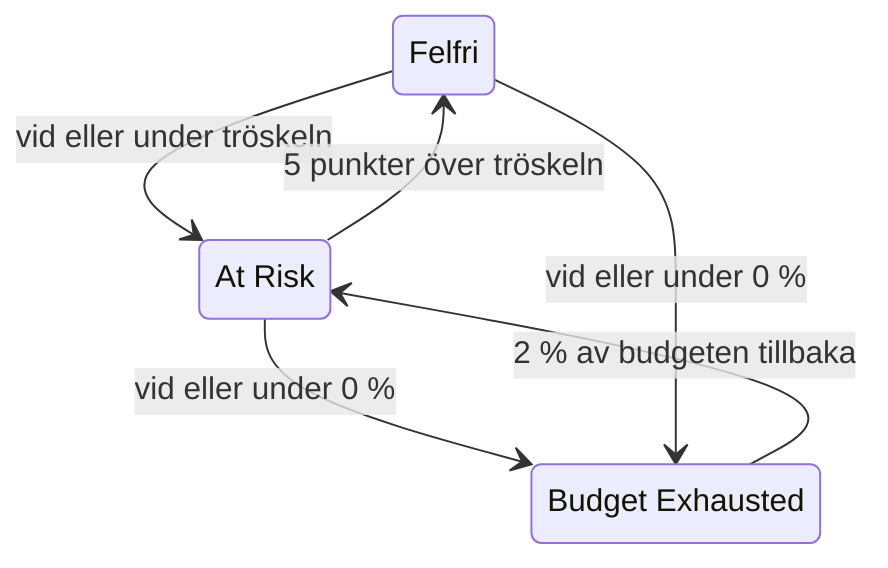

# Felbudgetar

Felbudgeten är det driftstopp som ett SLO:s mål tillåter. Ett mål på 99,9 % betyder inte ”gå aldrig ner”: det betyder ”du får vara nere i upp till 43 minuter på 30 dagar, så använd dem klokt”. Den här sidan förklarar hur OneUptime räknar budgeten, hur länge den räcker, hur den kommer tillbaka och vem som får höra om den.

:::cards
- [Hur budgeten beräknas](#hur-budgeten-beräknas): Formeln och budgeten för vanliga mål.
- [Budgetens räckvidd](#budgetens-räckvidd): Hur länge budgeten räcker i nuvarande takt.
- [Hur budgeten återhämtar sig](#hur-budgeten-återhämtar-sig): Rullande fönster och kalendermånader.
- [Aviseringar till ägare](#aviseringar-till-ägare): Vem som får höra när budgeten börjar ta slut.
:::

## Hur budgeten beräknas

Den totala budgeten är den del av fönstret som ditt mål inte lovar:

```text
total budget = (100% − target) × window length
```

| Mål | Fönster på 7 dagar | Fönster på 28 dagar | Fönster på 30 dagar | Fönster på 90 dagar |
| --- | --- | --- | --- | --- |
| 99% | 1h 40m 48s | 6h 43m 12s | 7h 12m | 21h 36m |
| 99.5% | 50m 24s | 3h 21m 36s | 3h 36m | 10h 48m |
| 99.9% | 10m 5s | 40m 19s | 43m 12s | 2h 9m 36s |
| 99.95% | 5m 2s | 20m 10s | 21m 36s | 1h 4m 48s |
| 99.99% | 1m 0s | 4m 2s | 4m 19s | 12m 58s |

SLO:ets sida **Inställningar** visar budgeten som målet tillåter bredvid målet, till exempel ”43m 12s driftstopp per fönster på 30 dagar”.

### Budgeten för ett SLO med flera monitorer

I läget **Any Monitor Down** är budgeten `(100% − target) × window`, oavsett hur många monitorer SLO:et mäter: fönstret är en enda tidslinje.

I läget **Monitor Seconds Average** räknas budgeten i monitorsekunder, summerade över monitorerna, så den växer med antalet monitorer: ett SLO med tre monitorer på 99,9 % under 30 dagar har ungefär 129 minuters budget i stället för 43. Procentsatserna (SLI, återstående budget, förbrukningstakt) betyder samma sak; bara varaktigheterna ändras.

### Budgeten för en kalendermånad

Ett SLO med kalendermånad har hela månadens budget från första dagen: ett SLO på 99,9 % i en månad med 31 dagar har alla sina 44m 38s den 1:a. Budgeten fördelas inte efter hur stor del av månaden som har gått, så ett avbrott på en minut på morgonen den 1:a förbrukar en minut av månadens budget.

## Återstående budget

Allteftersom driftstoppet ökar visar **Översikt** den återstående budgeten i rutan **Error budget left**:

- som en procentandel av totalen, som också avgör SLO:ets status och fyller stapeln. Stapeln har en markering vid SLO:ets tröskel för riskzon;
- som en varaktighet, till exempel "31m 4s left of 43m 12s".

När budgeten är slut visar rutan **No budget left**. När driftstoppet överskrider den visar rutan **Budget exceeded** och överskridandet som tid, till exempel "4d 23m over budget · 5m 47s allowed": SLO:et har använt alla 5 minuter och 47 sekunder av sin budget, och 4 dagar och 23 minuter till. Stapeln förblir tom och röd.

Den återstående budgeten lagras som ett tal med tecken för beräkningar och historikdiagram, så där visas en överskriden budget som en negativ procentandel. En starkt negativ procentandel betyder att överskridandet är stort i förhållande till budgeten; det är inte den andel av tiden som tjänsten var nere.

Vilka sekunder som räknas som driftstopp avgörs av SLO:ets driftstoppsstatusar och, för ett SLO med flera monitorer, av dess läge för flera monitorer, båda under **Inställningar** → **Downtime Calculation**. Se [SLO:er – Översikt](/docs/slo/introduction).

## Budgetens räckvidd

Rutan **Budget runway** i **Översikt** svarar på ”om det fortsätter så här, när tar budgeten slut?”. Den delar den återstående budgeten med förbrukningstakten under de senaste 60 minuterna:

```text
runway = budget left ÷ (burn rate × (100% − target))
```

| Rutan visar | Vad det betyder |
| --- | --- |
| En varaktighet, som **~2d 5h** | I nuvarande takt tar budgeten slut om ungefär så lång tid. Gul, och röd vid en dag eller mindre. **Under 1m** betyder mindre än en minut. |
| **Not burning** | Ingen budget har förbrukats under de senaste 60 minuterna. |
| **Sustainable** | Bara rullande fönster: räckvidden är minst ett helt fönster, så budgeten förbrukas inte snabbare än gammalt driftstopp faller ur fönstret. I den här takten tar den inte slut. |
| **Lasts until reset** | Bara kalendermånader: budgeten nollställs i början av nästa månad innan den tar slut. |
| **Overspent** | Budgeten är redan förbrukad. Rutan säger hur mycket den har överskridits med. |

För SLO:er med kalendermånad säger rutan också när budgeten nollställs.

Räckvidden är en rak framskrivning. I ett rullande fönster ger gammalt driftstopp som faller ur fönstret tillbaka budget, vilket framskrivningen bortser från: läs den som den kortaste tid du har kvar. Den visas inte före den första utvärderingen, och inte heller för SLO:er i läget **Monitor Seconds Average**, vars budget räknas i monitorsekunder och inte i klocktid.

## Felbudgetens förbrukning

Diagrammet **Error budget burn-down** i **Översikt** visar den återstående budgeten, i procent, över det aktuella efterlevnadsfönstret:

- En linje vid 0 % markerar var budgeten tar slut, och en streckad linje markerar SLO:ets tröskel för riskzon.
- För SLO:er med kalendermånad sjunker en svag linje jämnt från en full budget i början av månaden till en tom vid nollställningen. Under den linjen förbrukar månaden sin budget för snabbt.
- En punkt registreras vid varje utvärdering, var 5:e minut, så ett nytt SLO:s diagram är tomt fram till dess första utvärdering.
- Dra över diagrammet för att zooma in på en del av fönstret. Dubbelklicka, eller klicka på **Reset zoom**, för att se hela fönstret igen.

**Open metrics** öppnar SLO:ets sida **Mätvärden**, vars flik **Error Budget History** går upp till 400 dagar bakåt. Se [SLO-metriker och -instrumentpaneler](/docs/slo/metrics).

## Hur budgeten återhämtar sig

Hur budgeten kommer tillbaka beror på SLO:ets fönstertyp:

:::tabs
@tab Rolling
Ett rullande fönster tittar alltid lika långt bakåt från nu, så driftstopp faller till slut ur det: ett avbrott slutar räknas exakt ett fönster efter att det inträffade. Ett avbrott på 30 minuter den 1 juni faller ur beräkningen för ett SLO på 30 dagar den 1 juli, och budgeten kommer tillbaka gradvis, allteftersom varje sekund av driftstopp lämnar fönstret, inte allt på en gång.

Återhämtning förtjänas alltså, den schemaläggs inte. Fortsätter små avbrott att komma faller gammalt driftstopp ut medan nytt kommer in, och budgeten står still i stället för att återhämta sig.
@tab Calendar Month
Ett SLO med kalendermånad nollställs vid midnatt den första i varje månad, i sin tidszon. Hela budgeten kommer tillbaka på en gång och föregående månad stängs. Inget förs över från en månad till nästa, i någon riktning: en dålig månad skadar inte nästa, och en bra månad ger den inget extra utrymme.
:::

### Unga SLO:er

Ett SLO med rullande fönster som är yngre än sitt fönster mäts över de data som finns hittills, och dess totala budget växer med dem: ett SLO på 30 dagar som skapades för en vecka sedan har tills vidare en budget för 7 dagar. Tills fönstret är fullt visar **Översikt** hur fullt det är, med en indikator **Window 23% full** och samma anteckning i rutan **Error budget left**. Räkna med att siffrorna stabiliseras när fönstret fylls.

## Statusändringar och tröskeln för riskzon

Den återstående budgeten avgör SLO:ets status:

| Status | När |
| --- | --- |
| **Felfri** | Mer budget finns kvar än tröskeln för riskzon. |
| **At Risk** | Den återstående budgeten ligger på tröskeln för riskzon eller lägre: 20 % som standard. |
| **Budget Exhausted** | Den återstående budgeten är noll eller lägre. |

Ange tröskeln för riskzon under **Inställningar** → **Objective**.

Rullande fönster återhämtar sig en sekund i taget, så ett SLO nära en gräns skulle kunna hoppa fram och tillbaka mellan två statusar. För att varje statusändring ska betyda något lämnar ett SLO en status först när det tydligt har passerat gränsen:



Med standardtröskeln på 20 % blir ett SLO i riskzonen felfritt igen vid 25 % återstående budget, och ett SLO med förbrukad budget hamnar i riskzonen igen vid 2 %. Varje statusändring visas i SLO:ets **Feed**, med den SLI, den budget och den förbrukningstakt som förklarar den.

## Aviseringar till ägare

När ett SLO går över till **At Risk** eller **Budget Exhausted** aviserar OneUptime dess ägare:

- Ägarna är de användare och teammedlemmar på SLO:ets sida **Ägare** som fortfarande är medlemmar i projektet. Ett SLO utan ägare aviserar i stället projektets ägare.
- Varje ägare får ett e-postmeddelande som standard, och aviseringen i alla andra kanaler som hen slår på för **SLO status changed** under **Användarinställningar** → **Aviseringsinställningar** → **Övervakning**.
- E-postmeddelandets ämne anger statusen och SLO:et, till exempel `[SLO At Risk] API Availability`.

För att ett SLO nära en gräns inte ska avisera hela tiden får dess ägare högst en avisering i timmen. En övergång till **Budget Exhausted** skickas alltid, även inom den timmen.

> [!TIP]
> Aviseringar till ägare berättar för dem som ansvarar för ett SLO att dess budget är i knipa. För att larma ditt jourteam via eskaleringspolicyer använder du [Larm och incidenter för förbrukningstakt](/docs/slo/burn-rate-alerts). En regel för förbrukningstakt kan också lägga till SLO:ets ägare på varje larm och incident som den skapar.

## Nästa steg

:::cards
- [Larm och incidenter för förbrukningstakt](/docs/slo/burn-rate-alerts): Larma ditt team när budgeten förbrukas för snabbt.
- [SLO-metriker och -instrumentpaneler](/docs/slo/metrics): Visa budgeten över tid i ett diagram.
- [SLO:er – Översikt](/docs/slo/introduction): Mål, fönster och driftstoppsstatusar.
:::
