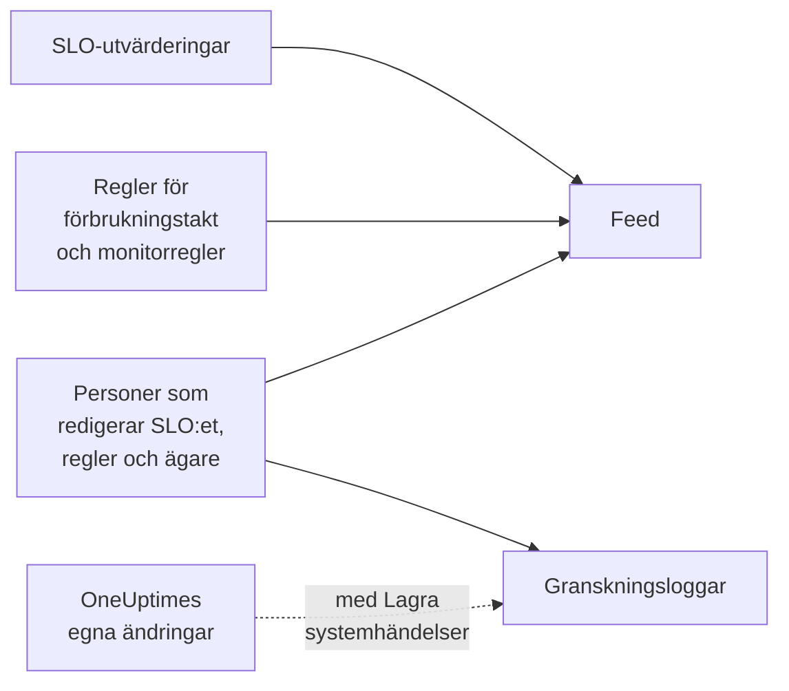

# SLO-flöde och granskningsloggar

Ett SLO för två register över sin historik, och de svarar på olika frågor. **Feed** svarar på ”vad har hänt med det här SLO:et?”, skrivet för dem som tar hand om det. **Granskningsloggar** svarar på ”vem ändrade vad, exakt?”, fält för fält, för granskning och regelefterlevnad.

## Flöde eller granskningsloggar?

| | **Feed** | **Granskningsloggar** |
| --- | --- | --- |
| Svarar på | Vad som har hänt med SLO:et | Vem som ändrade vad, och när |
| Registrerar | Statusändringar, larm och incidenter för förbrukningstakt, och ändringar av SLO:et, dess regler, monitorer och ägare | Varje ändring som personer gjort i SLO:et, dess regler för förbrukningstakt, monitorregler och ägare, med gammalt och nytt värde |
| Tar med OneUptimes eget arbete | Ja: utvärderingar och monitorregler som kopplar monitorer | Bara med **Lagra systemhändelser** påslaget |
| Abonnemang | Alla abonnemang | Enterprise-abonnemanget på OneUptime Cloud, eller Enterprise Edition på en egenhostad installation |
| Sparas | Tre år på OneUptime Cloud | 7 dagar som standard, upp till 180 |

## SLO:ets flöde

Flödet finns på SLO:ets sida **Feed**, och dess senaste poster under **Recent activity** i SLO:ets **Översikt**. Posterna länkar till det SLO, de monitorer, larm och incidenter som de nämner, och de flesta har ett avsnitt **More Information** med siffrorna eller de gamla och nya värdena.

| Händelse | Publiceras när |
| --- | --- |
| SLO skapat | SLO:et skapas. Anger dess mål, efterlevnadsfönster, SLI, tröskel för riskzon, beskrivning och de standardregler för förbrukningstakt som det började med. |
| SLO uppdaterat | Namnet, beskrivningen, etiketterna, målet, efterlevnadsfönstret, tidszonen, tröskeln för riskzon, läget för flera monitorer eller driftstoppsstatusarna ändras. Visar varje gammalt och nytt värde. |
| SLO aktiverat eller inaktiverat | Utvärderingen slås på eller av. |
| SLO arkiverat eller återställt | SLO:et arkiveras eller avarkiveras. |
| Status ändrad | En utvärdering flyttar SLO:et till en ny status. Visar den SLI, den felbudget, den förbrukningstakt och den tröskel för riskzon som förklarar den, och orsaken vid **Pausad** eller **Misconfigured**. |
| Larm för förbrukningstakt utlöst | En regel för förbrukningstakt skapar ett larm. Länkar till det och visar de förbrukningstakter som utlöste det. |
| Incident för förbrukningstakt deklarerad | En regel för förbrukningstakt deklarerar en incident. Länkar till den och visar de förbrukningstakter som utlöste den. |
| Larm eller incident för förbrukningstakt löst | En regels larm eller incident stängs: löst automatiskt, eller för hand medan automatisk lösning var avstängd. |
| Regel för förbrukningstakt tillagd, ändrad eller borttagen | Någon skapar, redigerar eller raderar en regel för förbrukningstakt. Standardreglerna för ett nytt SLO finns i stället i dess post ”SLO skapat”. |
| Monitorregel tillagd, ändrad eller borttagen | Någon skapar, redigerar eller raderar en monitorregel. En sparning som inte ändrar något av betydelse publiceras inte. |
| Monitorer kopplade eller bortkopplade | Monitorer läggs till i SLO:et eller tas bort från det, för hand eller av en monitorregel. Långa listor nämner de första monitorerna ”och N till”. |
| Ägare tillagd eller borttagen | En användare eller ett team läggs till bland SLO:ets ägare eller tas bort. |
| Etikettregel tillämpad | En etikettregel kopplade etiketter till SLO:et, när det skapades eller när någon körde regeln. Namnger de regler som matchade. Se [Etikett- och ägarregler](/docs/slo/label-and-owner-rules). |
| Ägarregel tillämpad | En ägarregel lade till ägare på SLO:et. Namnger de regler som matchade; varje ägare som den lade till får också en egen post ”Ägare tillagd”. |

Några detaljer:

- Posterna anger vem som gjorde en ändring när det var en person. Ändringar som OneUptime gör själv, som en utvärdering eller en monitorregel som kopplar en monitor, och ändringar via API:et eller en automatisering har ingen användare.
- Ett larm eller en incident som en regel plockar upp igen eftersom det fortfarande var öppet publiceras inte två gånger.
- För ett privat larm eller en privat incident utelämnar posten rubriken, numret och länken, eftersom alla som kan läsa SLO:et kan läsa dess flöde. Den säger ändå att en privat post skapades, och visar de förbrukningstakter som utlöste den.
- Ingen kan redigera eller radera poster i flödet. På OneUptime Cloud tas poster som är äldre än tre år bort.

## Granskningsloggar

SLO:ets sida **Granskningsloggar** listar ändringar i:

- själva SLO:et: dess uppgifter, inställningar, etiketter, monitorer och arkivering;
- dess regler för förbrukningstakt;
- dess monitorregler;
- dess ägaranvändare och ägarteam.

Ändringar i regler och ägare registreras på regeln eller ägaren och samlas på SLO:et, så att dess sida visar hela historiken på ett ställe, och varje post länkar till sidan den hör till. Relaterade objekt som etiketter och monitorer registreras med sina namn, inte bara med sina ID:n.

Två saker utelämnas:

- **Utvärderingsresultat.** SLI:n, felbudgeten, förbrukningstakten, statusen och utvärderingstiderna ändras med några minuters mellanrum. Deras historik finns i **Översikt**, på sidan **Mätvärden** och i **Feed**.
- **Ändringar som OneUptime gör själv**, som en monitorregel som kopplar eller kopplar bort en monitor, om inte **Lagra systemhändelser** är påslaget för projektet. **Feed** registrerar kopplingar och bortkopplingar av monitorer i vilket fall som helst.

### Slå på granskningsloggar

Granskningsloggar är en Enterprise-funktion: de kräver **Enterprise**-abonnemanget på OneUptime Cloud, eller Enterprise Edition på en egenhostad installation. På andra abonnemang förklarar SLO:ets sida **Granskningsloggar** hur du skaffar den. På en egenhostad installation slutar granskningsloggen registrera utan en giltig licens (efter provperioden på 14 dagar, eller 30 dagar efter att en licens löper ut), och den fortsätter så snart en licens aktiveras (se [When a license expires or is missing](/docs/self-hosted/enterprise#when-a-license-expires-or-is-missing)). Sidorna **Granskningsloggar** talar om när den inte registrerar.

Granskningsloggar är också avstängda som standard i varje projekt. Så här slår du på dem:

:::steps
### Öppna inställningarna för granskningsloggar

Gå till **Projektinställningar**, öppna **Granskningsloggar** i sidomenyn och klicka på **Inställningar**.

### Redigera inställningarna

Klicka på **Edit Audit Log Settings** och slå på **Aktivera granskningsloggar**.

### Välj vad som ska sparas

Ange **Lagring (dagar)**, från 7 (standard) till 180, och slå på **Lagra systemhändelser** för att också registrera de ändringar som OneUptime gör själv. Spara. Ändringen gäller inom ungefär en minut.
:::

Medan granskningsloggen är avstängd står det **Audit logging is off** på SLO:ets sida **Granskningsloggar**, med en länk för att slå på den. Poster som registrerades innan den stängdes av är fortfarande synliga. Projektets hela granskningslogg, för alla resurser, finns under **Projektinställningar** → **Granskningsloggar** → **Granskningsloggar**.

## Nästa steg

:::cards
- [SLO:er – Översikt](/docs/slo/introduction): Varje sida som ett SLO har.
- [Monitorer och monitorregler](/docs/slo/monitor-rules): Vad som kopplar och kopplar bort monitorer.
- [Larm och incidenter för förbrukningstakt](/docs/slo/burn-rate-alerts): Vad som utlöser och löser larmen och incidenterna i flödet.
- [Etikett- och ägarregler](/docs/slo/label-and-owner-rules): Vad som lägger till etiketter och ägare automatiskt.
:::
