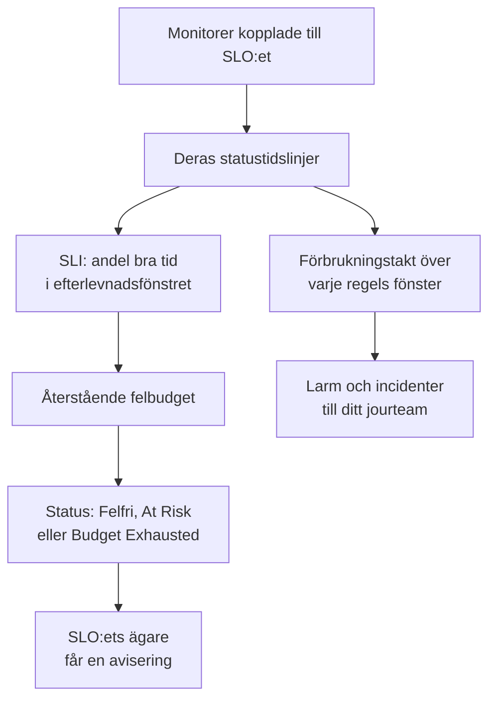

# SLO:er – Översikt

Ett service level objective (SLO) är ett tillförlitlighetsmål för det du övervakar, som ”tillgängligt 99,9 % av tiden under rullande 30 dagar”. OneUptime mäter varje SLO mot sitt mål var 5:e minut, så i stället för ”fungerar det just nu?” kan du svara på ”har vi varit tillräckligt tillförlitliga, under ett fönster som betyder något för våra användare, och hur mycket utrymme för fel har vi kvar?”.

:::cards
- [Skapa ett SLO](#skapa-ett-slo): Ett namn och ett mål. Allt annat börjar med ett standardvärde.
- [Monitorer och monitorregler](/docs/slo/monitor-rules): Välj de monitorer som ett SLO mäter.
- [Felbudgetar](/docs/slo/error-budget): Hur mycket driftstopp ett mål tillåter och hur budgeten återhämtar sig.
- [Larm och incidenter för förbrukningstakt](/docs/slo/burn-rate-alerts): Larma ditt team när budgeten förbrukas för snabbt.
:::

## Så fungerar det

Ett SLO läser statustidslinjerna för de monitorer som är kopplade till det: samma data som dina statussidor visar. Utifrån dem beräknar OneUptime hur stor del av efterlevnadsfönstret som var bra tid, hur mycket av felbudgeten som finns kvar och hur snabbt den förbrukas.

## Nyckelbegrepp

| Begrepp | Betydelse |
| --- | --- |
| **SLI** (service level indicator) | Mätningen: den procentandel av efterlevnadsfönstret då SLO:ets monitorer var tillgängliga. |
| **SLO** (service level objective) | Ett mål för SLI:n, till exempel ”minst 99,9 % de senaste 30 dagarna”. |
| **Felbudget** | Det driftstopp som målet tillåter: `(100% − target) × window`. Vid 99,9 % under 30 dagar är det 43 minuter och 12 sekunder. |
| **Förbrukningstakt** | Hur snabbt budgeten används jämfört med en jämn takt. Med förbrukningstakten 1 tar budgeten slut precis när fönstret tar slut. |

En felbudget gör tillförlitlighet till något du kan spendera. Finns det mycket kvar kan du släppa snabbare och ta risker; finns det lite kvar bör du sakta ner och investera i stabilitet. SLO:et ger det samtalet en siffra som alla ser.

## Skapa ett SLO

Du behöver en roll som får skapa SLO:er: Project Owner, Project Admin eller en anpassad roll med behörigheten Create Service Level Objective.

:::steps
### Öppna SLO:er

Öppna **SLOs** från menyn **Produkter** i det övre fältet. Det ligger i den första gruppen, bredvid monitorer och incidenter. Klicka på **Skapa Service Level Objective**.

### Ge det ett namn och ett mål

Ange ett **Namn**, till exempel ”API Availability”, och ett **Target (%)**: den andel av tiden som dess monitorer ska vara tillgängliga. Målet börjar på `99.9`. Det måste vara större än 0 och högst 99,999, eftersom ett mål på 100 % inte lämnar någon felbudget att följa.

### Kontrollera standardvärdena under Fler fält

**Fler fält** är hopfällt, med en rad som berättar vad standardvärdena gör: SLO:et mäts över ett rullande fönster på 30 dagar och hamnar i riskzonen när mindre än 20 % av felbudgeten återstår. Fäll ut det för att ändra något av fälten i tabellen nedan.

### Spara SLO:et

Klicka på **Skapa Service Level Objective**. OneUptime öppnar det nya SLO:et. Dess **Översikt** visar **Choose what this SLO measures**, eftersom ett nytt SLO ännu inte har några monitorer.

### Koppla monitorer

Klicka på **Create a monitor rule** för att koppla alla monitorer som matchar, nu och framöver, eller på **Add monitors** för att välja dem för hand. Se [Monitorer och monitorregler](/docs/slo/monitor-rules).

### Se de första siffrorna komma in

OneUptime utvärderar aktiverade SLO:er var 5:e minut. SLI:n, felbudgeten och förbrukningsdiagrammet visas efter den första utvärderingen som har monitorer att mäta.
:::

Fälten under **Fler fält**:

| Fält | Det du anger | Standard |
| --- | --- | --- |
| **Beskrivning** | Vad SLO:et är till för. | Tom |
| **Tröskel för riskzon (%)** | Den andel av den återstående felbudgeten där SLO:et går över till **At Risk**. Ett heltal från 0 till 100. | 20 |
| **Window Type** | **Rolling**: de senaste N dagarna, som återhämtar sig när gammalt driftstopp faller ur fönstret. **Calendar Month**: varje månad för sig, nollställd den 1:a. | **Rolling** |
| **Window (Days)** | Bara rullande fönster: hur många dagar bakåt som räknas, från 1 till 366. Vanligt är 28 eller 30. | 30 |
| **Tidszon** | Bara kalendermånader: tidszonen där varje månad börjar och slutar. | UTC |
| **Etiketter** | Etiketter för att organisera och filtrera SLO:er. | Inga |

Allt som avgör hur SLO:et mäter börjar med ett standardvärde som du ändrar senare:

| Inställning | Ett nytt SLO börjar med | Ändras under |
| --- | --- | --- |
| Monitorer | Inga | **Monitorer** eller **Monitor Rules** |
| Driftstoppsstatusar | Alla projektets icke-operativa statusar | **Inställningar** → **Downtime Calculation** |
| Läge för flera monitorer | **Any Monitor Down** | **Inställningar** → **Downtime Calculation** |
| Utvärdering | På | **Inställningar** → **Utvärdering** |
| Regler för förbrukningstakt | En regel **Fast burn** och en regel **Slow burn**, anpassade till fönstret | **Burn Rate Rules** |

## Vad ett SLO består av

| Del | Vad den avgör |
| --- | --- |
| Monitorer | Var SLI:n kommer ifrån. Koppla dem för hand eller med monitorregler: se [Monitorer och monitorregler](/docs/slo/monitor-rules). |
| Mål | Den andel bra tid som SLO:et lovar, större än 0 och högst 99,999. |
| Efterlevnadsfönster | Perioden som SLI:n och budgeten mäts över: ett rullande fönster på 1 till 366 dagar, eller en kalendermånad. |
| Tröskel för riskzon | Den andel av den återstående budgeten där SLO:et går över till **At Risk**. |
| Driftstoppsstatusar | Vilka monitorstatusar som räknas som driftstopp. |
| Läge för flera monitorer | Hur driftstopp från flera monitorer kombineras. |

### Vilka statusar som räknas som driftstopp

Varje SLO har en egen lista över monitorstatusar som räknas som driftstopp. Ett nytt SLO börjar med alla projektets statusar som inte är markerade som operativa, som Degraded och Offline, precis som dina statussidor gör. Ändra listan under **Inställningar** → **Downtime Calculation**. Lämna den tom för att räkna alla icke-operativa statusar, även de som läggs till i projektet senare.

> [!TIP]
> Mät samma monitorer på två sätt med två SLO:er: ett strikt tillgänglighets-SLO där både Degraded och Offline räknas, och ett mildare SLO för totalavbrott där bara Offline räknas.

### Efterlevnadsfönster

| Fönstertyp | Hur den beter sig |
| --- | --- |
| **Rolling** | Tittar ett fast antal dagar bakåt från nu. Gammalt driftstopp faller ur fönstret, så budgeten kommer tillbaka gradvis. |
| **Calendar Month** | Mäter från den första i månaden, i SLO:ets tidszon (UTC som standard). Hela budgeten kommer tillbaka i början av varje månad. |

### Flera monitorer i ett SLO

När ett SLO mäter mer än en monitor avgör dess **Multi Monitor Mode** hur deras driftstopp kombineras. Ett nytt SLO använder **Any Monitor Down**.

| Läge | Hur driftstopp räknas | Använd det när |
| --- | --- | --- |
| **Any Monitor Down** | Varje ögonblick då minst en monitor är nere räknas som driftstopp för hela SLO:et. Överlappande avbrott räknas en gång. | Monitorerna tillsammans är en enda tjänst: går någon av dem ner märker användarna det. |
| **Monitor Seconds Average** | Varje monitors driftstopp räknas för sig, i genomsnitt över all övervakad tid: SLI = 1 − (sekunder nere för alla monitorer ÷ övervakade sekunder för alla monitorer). | Monitorerna är en flotta av likadana resurser och en delvis påverkan ska räknas delvis. |

Säg att monitor A är nere från 10:00 till 11:00 medan monitor B är tillgänglig. **Any Monitor Down** registrerar 60 minuters driftstopp; **Monitor Seconds Average** registrerar motsvarande 30 minuter, eftersom en av två monitorer var nere i en timme. I det läget räknas även budgeten i monitorsekunder: se [Felbudgetar](/docs/slo/error-budget).

## SLO-status

OneUptime ger varje utvärderat SLO en status:

| Status | Vad den betyder |
| --- | --- |
| **Felfri** | Mer budget finns kvar än tröskeln för riskzon. |
| **At Risk** | Den återstående budgeten har sjunkit till tröskeln för riskzon eller lägre: 20 % som standard. |
| **Budget Exhausted** | Budgeten är helt förbrukad, eller överskriden. |
| **Misconfigured** | SLO:et kan inte mätas: det har inga monitorer, dess monitorer finns inte längre eller har ännu inte registrerat någon status i fönstret, eller dess mål ligger utanför intervallet. |
| **Pausad** | Alla monitorer som det mäter är arkiverade eller har aktiv övervakning avstängd, för hand, av en manuell incident eller av planerat underhåll. Det fortsätter av sig självt så snart någon av dem övervakas igen. |

Ett inaktiverat eller arkiverat SLO utvärderas inte, så dess status står kvar som den var; SLO-listan visar i stället en etikett **Inaktiverad** eller **Arkiverad**. Ett SLO:s ägare får en avisering när statusen ändras till **At Risk** eller **Budget Exhausted**: se [Felbudgetar](/docs/slo/error-budget).

## SLO-listan

Sidan **SLOs** visar varje SLO som inte är arkiverat, med status, SLI, återstående budget, förbrukningstakt, mål, fönster, monitorer, etiketter och ägare.

- Rutorna ovanför listan räknar SLO:er per status: **Felfri**, **At Risk**, **Budget Exhausted**, **Misconfigured**, **Pausad** och **Inaktiverad**. Klicka på en ruta för att bara se de SLO:erna, och igen för att se alla.
- Markera SLO:er för att lägga till eller ta bort etiketter och ägare, arkivera dem eller radera dem, alla på en gång.
- Sidomenyns avsnitt **Inställningar** innehåller **Etikettregler** och **Ägarregler**, som sätter etiketter på nya SLO:er och ger dem ägare: se [Etikett- och ägarregler](/docs/slo/label-and-owner-rules).
- Sidomenyns avsnitt **Avancerad** innehåller **Arkiverad**, listan över arkiverade SLO:er.

## Ett SLO:s sidor

Öppna ett SLO för att se dess sidor i sidomenyn:

| Sida | Vad den visar |
| --- | --- |
| **Översikt** | Statusen, nyckeltalen, felbudgetens förbrukning, senaste aktiviteten, öppna larm och incidenter och reglerna för förbrukningstakt. |
| **Mätvärden** | SLO:ets `oneuptime.slo.*`-metriker, dess långsiktiga felbudgethistorik och metrikerna för de incidenter och larm som påverkar det. Se [SLO-metriker och -instrumentpaneler](/docs/slo/metrics). |
| **Incidenter** | De incidenter som dess regler för förbrukningstakt har deklarerat. Märket räknar de öppna. |
| **Varningar** | De larm som dess regler för förbrukningstakt har utlöst. Märket räknar de öppna. |
| **Feed** | Vad som har hänt med SLO:et, som en tidslinje. Se [SLO-flöde och granskningsloggar](/docs/slo/feed-and-audit-logs). |
| **Monitorer** | De monitorer som det mäter, och om var och en kopplades av en person eller en regel. |
| **Monitor Rules** | Reglerna som kopplar monitorer som matchar. |
| **Burn Rate Rules** | Reglerna som utlöser larm och deklarerar incidenter när budgeten förbrukas för snabbt. |
| **Ägare** | De användare och team som får höra om dess statusändringar. |
| **Inställningar** | Målet, efterlevnadsperioden, beräkningen av driftstopp, utvärderingsreglaget och arkivkortet. |
| **Granskningsloggar** | Vem som ändrade SLO:et, dess regler och dess ägare, och när. |
| **Delete SLO** | Raderar SLO:et permanent och löser de larm och incidenter för förbrukningstakt som det hade öppna. |

**Monitorer**, **Monitor Rules** och **Burn Rate Rules** ligger i ett avsnitt **Konfiguration**, och **Ägare**, **Inställningar**, **Granskningsloggar** och **Delete SLO** i ett avsnitt **Management**. Båda börjar hopfällda, precis som ett avsnitt **Utvecklare** för att hantera SLO:et från kod: klicka på ett avsnitts rubrik för att öppna det.

När något hindrar ett SLO från att mäta talar en banner högst upp på var och en av dess sidor om vad som är fel och länkar till sidan som åtgärdar det: se [Felsökning](#felsökning).

### Översikten

**Översikt** svarar på ”håller vi oss inom budgeten?”, uppifrån och ned:

- **Sammanfattningen**: statusen, en mening om vad den betyder och beskrivningen. Bredvid finns **Uppdatera** och när SLO:et senast utvärderades. Under finns målet, **Compliance window** (med en fyllnadsindikator medan ett ungt rullande fönster fylls: se [Unga SLO:er och fönstrets fyllnadsindikator](#unga-sloer-och-fönstrets-fyllnadsindikator)), antalet monitorer och ägarna.
- **Nyckeltalen**:
  - **SLI**: andelen bra tid i fönstret, och hur mycket den ligger över eller under målet.
  - **Error budget left**: en procentandel, en varaktighet som "12m 30s left of 43m 12s" och en stapel med en markering vid tröskeln för riskzon. När budgeten är överskriden visar den **Budget exceeded** och med hur mycket.
  - **Burn rate**: hur snabbt budgeten används under de senaste 60 minuterna, den period som standardregeln för snabb förbrukning använder. Blir gul över 1× och röd, med **Rule threshold reached**, vid den lägsta tröskeln bland SLO:ets aktiverade regler för förbrukningstakt.
  - **Budget runway**: hur länge budgeten räcker i den takten. Se [Felbudgetar](/docs/slo/error-budget#budgetens-räckvidd).
- **Error budget burn-down**: den återstående budgeten över det aktuella fönstret. Se [Felbudgetar](/docs/slo/error-budget#felbudgetens-förbrukning).
- **Recent activity**: de senaste posterna i SLO:ets flöde.
- **SLO Details**: namnet, beskrivningen och etiketterna, de enda inställningar som redigeras i översikten.
- **Open alerts & incidents**: det som reglerna för förbrukningstakt har öppet just nu.
- **Burn rate rules**: tröskeln för varje aktiverad regel bredvid den aktuella förbrukningstakten, och vad regeln deklarerar.

### Inställningar

Sidan **Inställningar** samlar hur ett SLO mäter, med ett kort för varje sak:

| Kort | Det du ändrar | Bra att veta |
| --- | --- | --- |
| **Objective** | **Target (%)** och **Tröskel för riskzon (%)**, med **Edit Objective**. | Visar det driftstopp som målet tillåter, till exempel ”43m 12s driftstopp per fönster på 30 dagar”. |
| **Compliance Period** | **Window Type**, **Window (Days)** och **Tidszon**, med **Edit Period**. | Regler för förbrukningstakt behåller sina trösklar när fönstret ändras, så gå igenom dem efteråt. |
| **Downtime Calculation** | **Multi Monitor Mode** och **Statusar för driftstoppsövervakare**, med **Edit Downtime Calculation**. | Utan statusar räknas alla icke-operativa statusar, även de som läggs till senare. |
| **Utvärdering** | Reglaget **Utvärdera det här SLO:et**, som sparar så snart du slår om det. | Att stänga av det kräver bekräftelse, eftersom det också löser SLO:ets öppna larm och incidenter för förbrukningstakt. |
| **Archive SLO** | **Arkivera** eller **Avarkivera**. | Se [Arkivera ett SLO](#arkivera-ett-slo). |

Efter en ändring av målet, perioden eller beräkningen av driftstopp utvärderar OneUptime SLO:et igen vid nästa körning.

## Arkivera ett SLO

Arkivera ett SLO som du inte längre mäter men vill behålla, som en avvecklad tjänst eller förra årets mål. Arkivera det från **Inställningar** → **Archive SLO**, eller markera SLO:er i listan och välj **Arkivera**.

Ett arkiverat SLO:

- döljs i SLO-listan, dess statusrutor och instrumentpanelernas SLO-väljare och -listor;
- utvärderas inte: dess siffror står kvar som vid den senaste utvärderingen, dess regler för förbrukningstakt utlöses inte och det skickar inga metriker;
- får sina öppna larm och incidenter för förbrukningstakt lösta;
- behåller sina inställningar, sin historik, sina regler och sina ägare. Dess monitorregler håller monitorlistan uppdaterad, så det fortsätter med rätt monitorer.

Arkiverade SLO:er finns på sidan **Arkiverad**, under **Avancerad** i SLO-listans sidomeny. Markera dem där och välj **Avarkivera** för att få tillbaka dem: de utvärderas igen vid nästa körning, med SLI och budget omräknade från deras monitorers historik.

Arkivering och utvärdering är två separata reglage. Ett SLO som var inaktiverat innan det arkiverades förblir inaktiverat när du avarkiverar det: slå på det igen med **Slå på utvärdering** i dess banner, eller med **Utvärdera det här SLO:et** under **Inställningar** → **Utvärdering**.

| Du vill | Gör så här |
| --- | --- |
| Sluta mäta ett tag och behålla det i listan | Stäng av utvärderingen |
| Avveckla det, men behålla dess historik och inställningar | Arkivera det |
| Ta bort det för gott | Radera det |

## SLO:er i larm, incidenter och monitorer

Varje larm och incident som en regel för förbrukningstakt skapar är kopplad till sitt SLO:

- Sidan för larmet eller incidenten visar SLO:et under **Berörda resurser**, med en länk till det.
- Listorna över larm och incidenter visar SLO:et bland de berörda resurserna, och filtret **Berörda resurser** begränsar en lista till ett SLO.
- SLO:ets sidor **Varningar** och **Incidenter** visar dem, och deras märken i sidomenyn räknar de öppna.

OneUptime skapar den här kopplingen när en regel skapar larmet eller incidenten; du kan inte lägga till den för hand, och att redigera larmet eller incidenten tar aldrig bort den.

En monitors sidomeny har också en sida **SLOs**: de SLO:er som mäter den monitorn, så att du vet vilka mål som beror på den innan du pausar eller ändrar den.

## Unga SLO:er och fönstrets fyllnadsindikator

Ett SLO med rullande fönster som är yngre än sitt fönster mäts över de data som finns hittills: ett SLO på 30 dagar som skapades i går har en dags data. Dess felbudget börjar liten och växer när fönstret fylls, så dess första siffror svänger mer än de kommer att göra senare.

Så länge det är så säger **Översikt** det: sammanfattningen visar en indikator **Window 23% full** (**Window under 1% full** den första dagen), och rutan **Error budget left** upprepar det under sin siffra. Båda försvinner när fönstret är fullt. SLO:er med kalendermånad visar dem aldrig, eftersom deras budget täcker hela månaden från första dagen, och det gör inte heller SLO:er i läget **Monitor Seconds Average**, vars budget räknas över alla monitorer.

## Felsökning

En banner högst upp på SLO:ets sidor talar om vad som hindrar det från att mäta:

| Banner | Vad den betyder | Vad du gör |
| --- | --- | --- |
| **No monitors attached** | SLO:et har inga monitorer, så det finns inget att mäta. | Koppla monitorer eller skapa en monitorregel. |
| **Waiting for SLO evaluation** | Monitorer är kopplade, men den senaste utvärderingen hade inga statusdata från dem. | Kontrollera att monitorerna kontrolleras. Siffrorna visas efter nästa utvärdering med data. |
| **Measurement is paused** | Alla monitorer som det mäter är arkiverade eller har aktiv övervakning avstängd. | Slå på övervakningen igen för minst en monitor, eller vänta tills underhållet är klart. |
| **The target is out of range** | Målet är inte större än 0 och mindre än 100. | Ange ett mål som 99,9 under **Inställningar** → **Objective**. |
| **This SLO is disabled** | Utvärderingen är avstängd. | Klicka på **Slå på utvärdering**. |
| **This SLO is archived** | SLO:et är arkiverat. | Avarkivera det under **Inställningar**. |
| **Not evaluated yet** | SLO:et har precis skapats. | Vänta på den första utvärderingen, högst några minuter. |

## Nästa steg

:::cards
- [Monitorer och monitorregler](/docs/slo/monitor-rules): Koppla monitorer för hand eller med regler.
- [Felbudgetar](/docs/slo/error-budget): Budgetberäkningen, räckvidden och hur budgeten kommer tillbaka.
- [Larm och incidenter för förbrukningstakt](/docs/slo/burn-rate-alerts): Larma ditt jourteam när budgeten förbrukas för snabbt.
- [SLO-metriker och -instrumentpaneler](/docs/slo/metrics): Visa SLO:er i diagram och bygg en SLO-instrumentpanel.
:::
