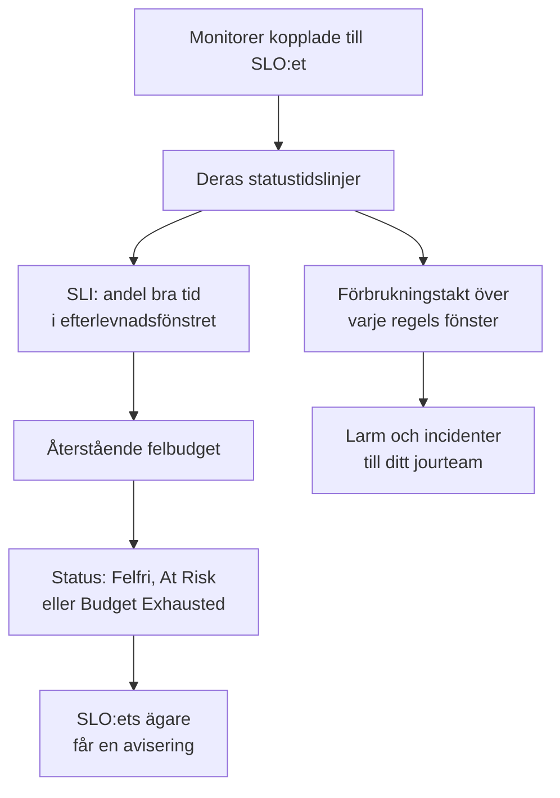

# SLO:er – Översikt

Ett service level objective (SLO) är ett tillförlitlighetsmål för det du driver, som ”tillgängligt 99,9 % av tiden under rullande 30 dagar” eller ”99,9 % av begärandena till kassan lyckas”. OneUptime mäter varje SLO mot sitt mål var 5:e minut, så i stället för ”fungerar det just nu?” kan du svara på ”har vi varit tillräckligt tillförlitliga, under ett fönster som betyder något för våra användare, och hur mycket utrymme för fel har vi kvar?”. Sidan [Ordlista](/docs/introduction/glossary#slo) ställer SLO:er bredvid de andra orden som OneUptime använder.

:::cards
- [Skapa ett SLO](#skapa-ett-slo): Vad det mäter, ett namn och ett mål. Allt annat börjar med ett standardvärde.
- [Monitorer och monitorregler](/docs/slo/monitor-rules): Välj de monitorer som ett SLO mäter.
- [SLO:er för begäranden och latens](/docs/slo/request-slos): Mät tjänsters begäranden utifrån deras spår.
- [Felbudgetar](/docs/slo/error-budget): Hur mycket driftstopp ett mål tillåter och hur budgeten återhämtar sig.
- [Larm och incidenter för förbrukningstakt](/docs/slo/burn-rate-alerts): Larma ditt team när budgeten förbrukas för snabbt.
:::

## Så fungerar det

Ett SLO mäter en av två saker. Ett SLO för monitorernas drifttid läser statustidslinjerna för de monitorer som är kopplade till det: samma data som dina statussidor visar. Ett SLO för begäranden räknar de begäranden som dess tjänster besvarar, utifrån deras spår: se [SLO:er för begäranden och latens](/docs/slo/request-slos). Resten av den här sidan beskriver SLO:er för monitorernas drifttid, och SLO:er för begäranden fungerar på samma sätt om inget annat anges. Utifrån dem beräknar OneUptime hur stor del av efterlevnadsfönstret som var bra tid, hur mycket av felbudgeten som finns kvar och hur snabbt den förbrukas. Tid då en monitors övervakning är avstängd utelämnas: ingenting kontrollerar monitorn då, så den tiden varken förbrukar felbudgeten eller räknas som bra tid. Detsamma gäller tiden före en monitors första kontroll: tills något har kontrollerat en monitor är dess status bara den fungerande som varje monitor skapas med, så ett SLO mäts från dess monitorers första kontroller, och ett SLO vars monitorer ingenting har kontrollerat än har ingenting att mäta förrän de kontrolleras.



## Nyckelbegrepp

Orden som används i hela OneUptime finns samlade på sidan [Ordlista](/docs/introduction/glossary).

| Begrepp | Betydelse |
| --- | --- |
| **SLI** (service level indicator) | Mätningen: den procentandel av efterlevnadsfönstret då SLO:ets monitorer var tillgängliga, eller av dess tjänsters begäranden som var bra. |
| **SLO** (service level objective) | Ett mål för SLI:n, till exempel ”minst 99,9 % de senaste 30 dagarna”. |
| **Felbudget** | Det driftstopp som målet tillåter: `(100% − target) × window`. Vid 99,9 % under 30 dagar är det 43 minuter och 12 sekunder. För ett SLO för begäranden är det de dåliga begäranden som målet tillåter: en av 1 000 vid 99,9 %. |
| **Förbrukningstakt** | Hur snabbt budgeten används jämfört med en jämn takt. Med förbrukningstakten 1 tar budgeten slut precis när fönstret tar slut. |

En felbudget gör tillförlitlighet till något du kan spendera. Finns det mycket kvar kan du släppa snabbare och ta risker; finns det lite kvar bör du sakta ner och investera i stabilitet. SLO:et ger det samtalet en siffra som alla ser.

## Skapa ett SLO

Du behöver en roll som får skapa SLO:er: Projektägare, Projektadministratör eller en anpassad roll med behörigheten Create Service Level Objective.

:::steps
### Öppna SLO:er

Öppna **SLOs** från menyn **Produkter** i det övre fältet. Det ligger i den första gruppen, bredvid monitorer och incidenter. Klicka på **Skapa Tjänstenivåmål**.

### Välj vad SLO:et mäter

Under **Vad den mäter** behåller du **Monitorernas drifttid** för att mäta den andel av tiden som monitorerna är tillgängliga. Välj **Lyckade begäranden** eller **Latens för begäranden** för att i stället mäta tjänsters begäranden, och välj tjänsterna under **Tjänster**: se [SLO:er för begäranden och latens](/docs/slo/request-slos). Välj **Mätvärde** för att räkna de bra händelserna i en räknare eller ett histogram som dina tjänster skickar: se [SLO:er från ett mätvärde](/docs/slo/request-slos#sloer-från-ett-mätvärde). Klicka på **Nästa**.

### Ge det ett namn och ett mål

Ange ett **Namn**, till exempel ”API Availability”, och ett **Mål (%)**: den andel av tiden, eller av begärandena, som måste vara bra. Målet börjar på `99.9`. Det måste vara större än 0 och högst 99,999, eftersom ett mål på 100 % inte lämnar någon felbudget att följa.

### Kontrollera standardvärdena under Fler fält

**Fler fält** är hopfällt, med en rad som berättar vad standardvärdena gör: SLO:et mäts över ett rullande fönster på 30 dagar och hamnar i riskzonen när mindre än 20 % av felbudgeten återstår. Fäll ut det för att ändra något av fälten i tabellen nedan.

### Spara SLO:et

Klicka på **Skapa Tjänstenivåmål**. OneUptime öppnar det nya SLO:et. Ett SLO för monitorernas drifttid visar **Choose what this SLO measures** i sin **Översikt**, eftersom det ännu inte har några monitorer.

### Koppla monitorer

För ett SLO för monitorernas drifttid klickar du på **Skapa en monitorregel** för att koppla alla monitorer som matchar, nu och framöver, eller på **Lägg till monitorer** för att välja dem för hand. Se [Monitorer och monitorregler](/docs/slo/monitor-rules).

### Se de första siffrorna komma in

OneUptime utvärderar aktiverade SLO:er var 5:e minut. SLI:n, felbudgeten och förbrukningsdiagrammet visas efter den första utvärderingen som har monitorer att mäta, eller begäranden att räkna.
:::

Fälten under **Fler fält**:

| Fält | Det du anger | Standard |
| --- | --- | --- |
| **Beskrivning** | Vad SLO:et är till för. | Tom |
| **Tröskel för riskzon (%)** | Den andel av den återstående felbudgeten där SLO:et går över till **I riskzonen**. Ett heltal från 0 till 100. | 20 |
| **Fönstertyp** | **Rullande**: de senaste N dagarna, som återhämtar sig när gammalt driftstopp faller ur fönstret. **Kalendermånad**: varje månad för sig, nollställd den 1:a. | **Rullande** |
| **Fönster (dagar)** | Bara rullande fönster: hur många dagar bakåt som räknas, från 1 till 366. Vanligt är 28 eller 30. | 30 |
| **Tidszon** | Bara kalendermånader: tidszonen där varje månad börjar och slutar. | UTC |
| **Etiketter** | Etiketter för att organisera och filtrera SLO:er. | Inga |

Allt som avgör hur SLO:et mäter börjar med ett standardvärde som du ändrar senare:

| Inställning | Ett nytt SLO börjar med | Ändras under |
| --- | --- | --- |
| Monitorer | Inga | **Monitorer** eller **Monitorregler** |
| Driftstoppsstatusar | Alla projektets icke-operativa statusar | **Inställningar** → **Beräkning av driftstopp** |
| Läge för flera monitorer | **Valfri monitor nere** | **Inställningar** → **Beräkning av driftstopp** |
| Utvärdering | På | **Inställningar** → **Utvärdering** |
| Regler för förbrukningstakt | En regel **Fast burn**, en regel **Slow burn** och en regel **Slow leak**, anpassade till fönstret | **Förbrukningstaktsregler** |

## Vad ett SLO består av

| Del | Vad den avgör |
| --- | --- |
| Vad det mäter | **Monitorernas drifttid**, **Lyckade begäranden** eller **Latens för begäranden**. |
| Monitorer eller tjänster | Var SLI:n kommer ifrån: monitorer, kopplade för hand eller med monitorregler (se [Monitorer och monitorregler](/docs/slo/monitor-rules)), eller de tjänster vars begäranden ett SLO för begäranden räknar. |
| Mål | Den andel bra tid som SLO:et lovar, större än 0 och högst 99,999. |
| Efterlevnadsfönster | Perioden som SLI:n och budgeten mäts över: ett rullande fönster på 1 till 366 dagar, eller en kalendermånad. |
| Tröskel för riskzon | Den andel av den återstående budgeten där SLO:et går över till **I riskzonen**. |
| Driftstoppsstatusar | Vilka monitorstatusar som räknas som driftstopp. |
| Läge för flera monitorer | Hur driftstopp från flera monitorer kombineras. |

### Vilka statusar som räknas som driftstopp

Varje SLO har en egen lista över monitorstatusar som räknas som driftstopp. Ett nytt SLO börjar med alla projektets statusar som inte är markerade som operativa, som Degraded och Offline, precis som dina statussidor gör. Ändra listan under **Inställningar** → **Beräkning av driftstopp**. Lämna den tom för att räkna alla icke-operativa statusar, även de som läggs till i projektet senare.

> [!TIP]
> Mät samma monitorer på två sätt med två SLO:er: ett strikt tillgänglighets-SLO där både Degraded och Offline räknas, och ett mildare SLO för totalavbrott där bara Offline räknas.

### Efterlevnadsfönster

| Fönstertyp | Hur den beter sig |
| --- | --- |
| **Rullande** | Tittar ett fast antal dagar bakåt från nu. Gammalt driftstopp faller ur fönstret, så budgeten kommer tillbaka gradvis. |
| **Kalendermånad** | Mäter från den första i månaden, i SLO:ets tidszon (UTC som standard). Hela budgeten kommer tillbaka i början av varje månad. |

### Flera monitorer i ett SLO

När ett SLO mäter mer än en monitor avgör dess **Läge för flera monitorer** hur deras driftstopp kombineras. Ett nytt SLO använder **Valfri monitor nere**.

| Läge | Hur driftstopp räknas | Använd det när |
| --- | --- | --- |
| **Valfri monitor nere** | Varje ögonblick då minst en monitor är nere räknas som driftstopp för hela SLO:et. Överlappande avbrott räknas en gång. | Monitorerna tillsammans är en enda tjänst: går någon av dem ner märker användarna det. |
| **Genomsnitt av monitorsekunder** | Varje monitors driftstopp räknas för sig, i genomsnitt över all övervakad tid: SLI = 1 − (sekunder nere för alla monitorer ÷ övervakade sekunder för alla monitorer). | Monitorerna är en flotta av likadana resurser och en delvis påverkan ska räknas delvis. |

Säg att monitor A är nere från 10:00 till 11:00 medan monitor B är tillgänglig. **Valfri monitor nere** registrerar 60 minuters driftstopp; **Genomsnitt av monitorsekunder** registrerar motsvarande 30 minuter, eftersom en av två monitorer var nere i en timme. I det läget räknas även budgeten i monitorsekunder: se [Felbudgetar](/docs/slo/error-budget).

## SLO-status

OneUptime ger varje utvärderat SLO en status:

| Status | Vad den betyder |
| --- | --- |
| **Felfri** | Mer budget finns kvar än tröskeln för riskzon. |
| **I riskzonen** | Den återstående budgeten har sjunkit till tröskeln för riskzon eller lägre: 20 % som standard. |
| **Budget förbrukad** | Budgeten är helt förbrukad, eller överskriden. |
| **Felkonfigurerad** | SLO:et kan inte mätas: det har inga monitorer, dess monitorer finns inte längre, ingenting har kontrollerat dem än eller de har ännu inte registrerat någon status i fönstret, eller dess mål ligger utanför intervallet. Ett SLO för begäranden är felkonfigurerat utan tjänster, utan latensgräns eller innan dess tjänster har besvarat en begäran i fönstret. |
| **Pausad** | Alla monitorer som det mäter är arkiverade eller har aktiv övervakning avstängd, för hand, av en manuell incident eller av schemalagt underhåll. Det fortsätter av sig självt så snart någon av dem övervakas igen. |

Ett inaktiverat eller arkiverat SLO utvärderas inte, så dess status står kvar som den var; SLO-listan visar i stället en etikett **Inaktiverad** eller **Arkiverad**. Ett SLO:s ägare får en avisering när statusen ändras till **I riskzonen** eller **Budget förbrukad**: se [Felbudgetar](/docs/slo/error-budget).

## SLO-listan

Sidan **SLOs** visar varje SLO som inte är arkiverat, med status, SLI, återstående budget, förbrukningstakt, mål, fönster, monitorer, etiketter och ägare. Kolumnen **Vad den mäter** visar tjänsterna för ett SLO för begäranden där den visar monitorerna för ett drifttids-SLO, och filtret **Tjänster** hittar de SLO:er som mäter en tjänst.

- Rutorna ovanför listan räknar SLO:er per status: **Felfri**, **I riskzonen**, **Budget förbrukad**, **Felkonfigurerad**, **Pausad** och **Inaktiverad**. De visas så snart det finns ett SLO som inte är arkiverat. Klicka på en ruta för att bara se de SLO:erna, och igen för att se alla.
- Markera SLO:er för att lägga till eller ta bort etiketter och ägare, aktivera eller inaktivera dem, ge dem de [rekommenderade reglerna för förbrukningstakt](/docs/slo/burn-rate-alerts#lägg-till-dem-i-många-sloer-på-en-gång) som de saknar, arkivera dem eller radera dem, alla på en gång.
- Sidomenyns avsnitt **Inställningar** innehåller **Etikettregler** och **Ägarregler**, som sätter etiketter på nya SLO:er och ger dem ägare: se [Etikett- och ägarregler](/docs/slo/label-and-owner-rules).
- Sidomenyns avsnitt **Avancerad** innehåller **Arkiverad**, listan över arkiverade SLO:er.

## Ett SLO:s sidor

Öppna ett SLO för att se dess sidor i sidomenyn:

| Sida | Vad den visar |
| --- | --- |
| **Översikt** | Statusen, nyckeltalen, felbudgetens förbrukning, senaste aktiviteten, öppna larm och incidenter och reglerna för förbrukningstakt. |
| **Mätvärden** | SLO:ets `oneuptime.slo.*`-metriker, dess långsiktiga felbudgethistorik och metrikerna för de incidenter och larm som påverkar det. Se [SLO-metriker och -instrumentpaneler](/docs/slo/metrics). |
| **Månadsrapport** | Hur SLO:et klarade sig varje kalendermånad och över hela perioden. Se [Månadsrapporten](#månadsrapporten). |
| **Incidenter** | De incidenter som dess regler för förbrukningstakt och dess felbudgetpolicy har deklarerat. Märket räknar de öppna. |
| **Larm** | De larm som dess regler för förbrukningstakt och dess felbudgetpolicy har utlöst. Märket räknar de öppna. |
| **Feed** | Vad som har hänt med SLO:et, som en tidslinje. Se [SLO-flöde och granskningsloggar](/docs/slo/feed-and-audit-logs). |
| **Monitorer** | De monitorer som det mäter, och om var och en kopplades av en person eller en regel. Bara SLO:er för monitorernas drifttid. |
| **Monitorregler** | Reglerna som kopplar monitorer som matchar. Bara SLO:er för monitorernas drifttid. |
| **Förbrukningstaktsregler** | Reglerna som utlöser larm och deklarerar incidenter när budgeten förbrukas för snabbt. |
| **Felbudgetpolicy** | Vad teamet har kommit överens om att göra medan felbudgeten tar slut, och de larm och incidenter som varje nivå i policyn utlöser. Se [Felbudgetpolicy](/docs/slo/error-budget-policy). |
| **Ägare** | De användare och team som får höra om dess statusändringar. |
| **Inställningar** | Vad det mäter, målet, efterlevnadsperioden, beräkningen av driftstopp, utvärderingsreglaget och arkivkortet. |
| **Granskningsloggar** | Vem som ändrade SLO:et, dess regler och dess ägare, och när. |
| **Ta bort SLO** | Raderar SLO:et permanent och löser de larm och incidenter för förbrukningstakt som det hade öppna. |

**Monitorer** ligger i avsnittet **Översikt**, under **Översikt**; **Monitorregler**, **Förbrukningstaktsregler** och **Felbudgetpolicy** i ett avsnitt **Regler**; och **Ägare**, **Inställningar**, **Granskningsloggar** och **Ta bort SLO** i ett avsnitt **Hantering**. **Regler** och **Hantering** börjar hopfällda, precis som ett avsnitt **Utvecklare** för att hantera SLO:et från kod: klicka på ett avsnitts rubrik för att öppna det.

När något hindrar ett SLO från att mäta talar en banner högst upp på var och en av dess sidor om vad som är fel och länkar till sidan som åtgärdar det: se [Felsökning](#felsökning).

### Översikten

**Översikt** svarar på ”håller vi oss inom budgeten?”, uppifrån och ned:

- **Sammanfattningen**: statusen, en mening om vad den betyder och beskrivningen. Bredvid finns **Uppdatera** och när SLO:et senast utvärderades. Under finns målet, **Efterlevnadsfönster** (med en fyllnadsindikator medan ett ungt rullande fönster fylls: se [Unga SLO:er och fönstrets fyllnadsindikator](#unga-sloer-och-fönstrets-fyllnadsindikator)), antalet monitorer (eller tjänsterna för ett SLO för begäranden) och ägarna, med **Lägg till ägare** för att lägga till en direkt där.
- **Nyckeltalen**:
  - **SLI**: andelen bra tid i fönstret, och hur mycket den ligger över eller under målet.
  - **Felbudget kvar**: en procentandel, en varaktighet som "12 min 30 s kvar av 43 min 12 s" (för ett SLO för begäranden ett antal dåliga begäranden) och en stapel med en markering vid tröskeln för riskzon. När budgeten är överskriden visar den **Budgeten överskriden** och med hur mycket.
  - **Förbrukningstakt**: hur snabbt budgeten används under de senaste 60 minuterna, den period som standardregeln för snabb förbrukning använder. Blir gul över 1× och röd, med **Regeltröskel nådd**, vid den lägsta tröskeln bland SLO:ets aktiverade regler för förbrukningstakt som ser högst 6 timmar bakåt. En timme säger lite om en regel som ser flera dagar bakåt, som **Slow leak**, så den jämförs inte med en sådan regel.
  - **Budgetens räckvidd**: hur länge budgeten räcker i den takten. Se [Felbudgetar](/docs/slo/error-budget#budgetens-räckvidd).
- **Nedbränning av felbudget**: den återstående budgeten över det aktuella fönstret. Se [Felbudgetar](/docs/slo/error-budget#felbudgetens-förbrukning).
- **Senaste aktivitet**: de senaste posterna i SLO:ets flöde.
- **SLO-detaljer**: namnet, beskrivningen och etiketterna, de enda inställningar som redigeras i översikten.
- **Öppna larm och incidenter**: det som reglerna för förbrukningstakt har öppet just nu.
- **Burn rate rules**: tröskeln för varje aktiverad regel bredvid den aktuella förbrukningstakten, för regler som ser högst 6 timmar bakåt, och vad regeln deklarerar.

När SLO:et är i en nivå i sin felbudgetpolicy visar **Översikt** också den nivån och vad teamet har kommit överens om att göra i den: se [Felbudgetpolicy](/docs/slo/error-budget-policy).

Kortet **Används av** listar förbrukningstaktsreglerna och nivåerna i felbudgetpolicyn som verkar på SLO:n, och instrumentpanelerna som visar den. När du arkiverar eller tar bort SLO:n sägs de först: dess regler och nivåer försvinner med den.

### Inställningar

Sidan **Inställningar** samlar hur ett SLO mäter, med ett kort för varje sak:

| Kort | Det du ändrar | Bra att veta |
| --- | --- | --- |
| **Vad den mäter** | **Vad den mäter**, **Tjänster**, **Latensgräns (ms)**, **Begäransfilter** och **Mätvärde**, med **Redigera vad den mäter**. | Ett SLO för begäranden räknar om sina begäranden från början efter en ändring. |
| **Mål** | **Mål (%)** och **Tröskel för riskzon (%)**, med **Redigera mål**. | Visar det driftstopp som målet tillåter, till exempel ”43 min 12 s driftstopp per fönster på 30 dagar”. |
| **Efterlevnadsperiod** | **Fönstertyp**, **Fönster (dagar)** och **Tidszon**, med **Redigera period**. | Regler för förbrukningstakt behåller sina trösklar när fönstret ändras, så gå igenom dem efteråt. |
| **Beräkning av driftstopp** | **Läge för flera monitorer** och **Monitorstatusar för driftstopp**, med **Redigera beräkning av driftstopp**. | Bara SLO:er för monitorernas drifttid. Utan statusar räknas alla icke-operativa statusar, även de som läggs till senare. |
| **Utvärdering** | Reglaget **Utvärdera det här SLO:et**, som sparar så snart du slår om det. | Att stänga av det kräver bekräftelse, eftersom det också löser SLO:ets öppna larm och incidenter för förbrukningstakt. |
| **Arkivera SLO** | **Arkivera** eller **Avarkivera**. | Se [Arkivera ett SLO](#arkivera-ett-slo). |

Efter en ändring av vad det mäter, målet, perioden eller beräkningen av driftstopp utvärderar OneUptime SLO:et igen vid nästa körning.

### Månadsrapporten

**Månadsrapport** visar hur SLO:et klarade sig i varje kalendermånad de senaste **3 månader**, **6 månader**, **9 månader** eller **12 månader**, eller under ett kalenderår. Varje månad visar sin SLI, sitt driftstopp (för ett begärande-SLO de misslyckade eller långsamma begärandena, för ett mätvärdes-SLO de underkända händelserna), den andel av felbudgeten den använde och sitt resultat:

| Resultat | Vad det betyder |
| --- | --- |
| Uppfyllt | Månaden är slut och dess SLI nådde målet. |
| Ej uppnått | Månaden är slut och nådde inte målet, eller månaden pågår fortfarande och har redan mer driftstopp än hela månaden tillåter. |
| I fas | Månaden pågår fortfarande och dess SLI hittills når målet. |
| Under målet | Månaden pågår fortfarande och dess SLI hittills ligger under målet. |
| Inga data | Ingenting mättes den månaden. |

Raden **Totalt** mäter hela perioden som en. Ett SLO med flera monitorer får också en tabell **Per monitor**: varje monitors egen SLI i varje månad, med den monitor som kostade SLO:et mest först. **Ladda ner CSV** sparar rapporten som en fil för ett kalkylblad.

Inget extra sparas för rapporten. Varje månad beräknas från monitorernas statushistorik när du öppnar den, med SLO:ets monitorer, driftstoppsstatusar och mål som de är nu, så den sträcker sig tillbaka till innan SLO:et skapades. Ett begärande-SLO:s månader kommer från de begäranden som OneUptime räknade för det, och ett mätvärdes-SLO:s från händelserna i dess mätvärde, som OneUptime sparar i 400 dagar. Månaderna följer SLO:ets tidszon, eller UTC när det inte har någon.

API:et svarar med samma rapport:

```bash
curl -sS "https://oneuptime.com/api/service-level-objective/<slo-id>/monthly-report?months=12" \
  -H "ApiKey: $ONEUPTIME_API_KEY"
```

Be med `months` om 1 till 24 månader som slutar med den aktuella månaden, eller om ett kalenderår med `year`, till exempel `year=2025`.

## Arkivera ett SLO

Arkivera ett SLO som du inte längre mäter men vill behålla, som en avvecklad tjänst eller förra årets mål. Arkivera det från **Inställningar** → **Arkivera SLO**, eller markera SLO:er i listan och välj **Arkivera**.

Ett arkiverat SLO:

- döljs i SLO-listan, dess statusrutor och instrumentpanelernas SLO-väljare och -listor;
- utvärderas inte: dess siffror står kvar som vid den senaste utvärderingen, dess regler för förbrukningstakt utlöses inte och det skickar inga metriker;
- får sina öppna larm och incidenter för förbrukningstakt lösta;
- behåller sina inställningar, sin historik, sina regler och sina ägare. Dess monitorregler håller monitorlistan uppdaterad, så det fortsätter med rätt monitorer.

Arkiverade SLO:er finns på sidan **Arkiverad**, under **Avancerad** i SLO-listans sidomeny. Markera dem där och välj **Avarkivera** för att få tillbaka dem: de utvärderas igen vid nästa körning, med SLI och budget omräknade från deras monitorers historik.

Arkivering och utvärdering är två separata reglage. Ett SLO som var inaktiverat innan det arkiverades förblir inaktiverat när du avarkiverar det: slå på det igen med **Slå på utvärdering** i dess banner, eller med **Utvärdera det här SLO:et** under **Inställningar** → **Utvärdering**.

| Du vill | Gör så här |
| --- | --- |
| Sluta mäta ett tag och behålla det i listan | Stäng av utvärderingen |
| Avveckla det, men behålla dess historik och inställningar | Arkivera det |
| Ta bort det för gott | Radera det |

## SLO:er i larm, incidenter och monitorer

Varje larm och incident som en regel för förbrukningstakt skapar är kopplad till sitt SLO:

- Sidan för larmet eller incidenten visar SLO:et under **Berörda resurser**, med en länk till det.
- Listorna över larm och incidenter visar SLO:et bland de berörda resurserna, och filtret **Berörda resurser** begränsar en lista till ett SLO.
- SLO:ets sidor **Larm** och **Incidenter** visar dem, och deras märken i sidomenyn räknar de öppna.

OneUptime skapar den här kopplingen när en regel skapar larmet eller incidenten; du kan inte lägga till den för hand, och att redigera larmet eller incidenten tar aldrig bort den.

En monitors sidomeny har också en sida **SLOs**: de SLO:er som mäter den monitorn, så att du vet vilka mål som beror på den innan du pausar eller ändrar den.

## Unga SLO:er och fönstrets fyllnadsindikator

Ett SLO med rullande fönster som är yngre än sitt fönster mäts över de data som finns hittills: ett SLO på 30 dagar som skapades i går har en dags data. Dess felbudget börjar liten och växer när fönstret fylls, så dess första siffror svänger mer än de kommer att göra senare.

Så länge det är så säger **Översikt** det: sammanfattningen visar en indikator **Fönstret är 23 % fyllt** (**Fönstret är under 1 % fyllt** den första dagen), och rutan **Felbudget kvar** upprepar det under sin siffra. Båda försvinner när fönstret är fullt. SLO:er med kalendermånad visar dem aldrig, eftersom deras budget täcker hela månaden från första dagen, och det gör inte heller SLO:er i läget **Genomsnitt av monitorsekunder**, vars budget räknas över alla monitorer. Ett SLO för begäranden visar dem medan OneUptime fortfarande räknar dess tjänsters äldre begäranden: se [SLO:er för begäranden och latens](/docs/slo/request-slos#så-räknas-begäranden).

## Felsökning

En banner högst upp på SLO:ets sidor talar om vad som hindrar det från att mäta:

| Banner | Vad den betyder | Vad du gör |
| --- | --- | --- |
| **Inga monitorer kopplade** | SLO:et har inga monitorer, så det finns inget att mäta. | Koppla monitorer eller skapa en monitorregel. |
| **Väntar på SLO-utvärdering** | Monitorer är kopplade, men den senaste utvärderingen hade inga statusdata från dem. | Kontrollera att monitorerna kontrolleras. Siffrorna visas efter nästa utvärdering med data. |
| **Väntar på första kontrollen** | Monitorer är kopplade, men inget har kontrollerat dem ännu: en monitor som skapades för en minut sedan, eller en egenhostad sond som inte är ansluten. | Inget: SLO:et mäts från deras första kontroll. Kommer den inte, öppna monitorerna för att se varför. |
| **Mätningen är pausad** | Alla monitorer som det mäter är arkiverade eller har aktiv övervakning avstängd. | Slå på övervakningen igen för minst en monitor, eller vänta tills underhållet är klart. |
| **Målet ligger utanför det tillåtna intervallet** | Målet är inte större än 0 och mindre än 100. | Ange ett mål som 99,9 under **Inställningar** → **Mål**. |
| **Denna SLO är inaktiverad** | Utvärderingen är avstängd. | Klicka på **Slå på utvärdering**. |
| **Denna SLO är arkiverad** | SLO:et är arkiverat. | Avarkivera det under **Inställningar**. |
| **Inte utvärderad ännu** | SLO:et har precis skapats. | Vänta på den första utvärderingen, högst några minuter. |
| **Inga tjänster valda** | Ett SLO för begäranden har inga tjänster, så det har inga begäranden att räkna. | Välj dess tjänster under **Inställningar** → **Vad den mäter**. |
| **Ingen latensgräns** | Ett latens-SLO har ingen gräns, så ingen begäran kan räknas som tillräckligt snabb. | Ange **Latensgräns (ms)** under **Inställningar** → **Vad den mäter**. |
| **Väntar på begäranden** | Ingen av tjänsterna för ett SLO för begäranden har besvarat en begäran i fönstret ännu. | Kontrollera att tjänsterna skickar spår till OneUptime. Siffrorna visas efter nästa utvärdering som räknar en begäran. |
| **Inget mätvärde att räkna** | Ett mätvärdesbaserat SLO har inget mätvärde som det kan räkna: inget är valt, eller så saknas det som avgör vilka av dess händelser som är bra. | Välj mätvärdet, och dess villkor eller värde för bra händelser, under **Inställningar** → **Vad den mäter**. |
| **Väntar på mätvärdet** | Ingen av tjänsterna för ett mätvärdesbaserat SLO har skickat någon händelse från dess mätvärde i fönstret ännu. | Kontrollera att tjänsterna skickar mätvärdet till OneUptime, under det namn som SLO:et räknar. Siffrorna visas efter nästa utvärdering som räknar en händelse. |

## Nästa steg

:::cards
- [Monitorer och monitorregler](/docs/slo/monitor-rules): Koppla monitorer för hand eller med regler.
- [SLO:er för begäranden och latens](/docs/slo/request-slos): Mät en tjänsts begäranden utifrån dess spår.
- [Felbudgetar](/docs/slo/error-budget): Budgetberäkningen, räckvidden och hur budgeten kommer tillbaka.
- [Releasekontroller](/docs/slo/release-checks): Rulla tillbaka en release som förbrukar felbudgeten.
:::
