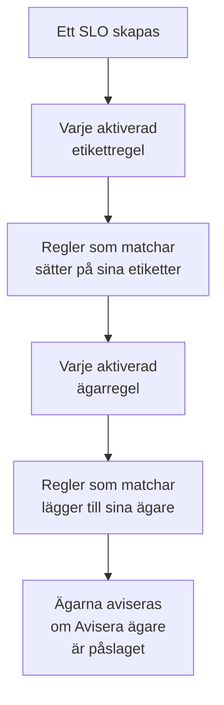

# Etikett- och ägarregler

Etikettregler och ägarregler håller ordning på dina SLO:er åt dig. En **etikettregel** sätter etiketter på varje nytt SLO som den matchar, och en **ägarregel** lägger till ägaranvändare och -team på det, så att ett nytt checkout-SLO får etiketten _Checkout_ och ägs av checkoutteamet, utan att någon behöver komma ihåg det. Båda fungerar som etikett- och ägarreglerna för alla andra produkter: se [Etikett- och ägarregler](/docs/configuration/label-and-owner-rules) för det de har gemensamt.

## Så fungerar det

Reglerna körs när ett SLO skapas, från instrumentpanelen eller via API:et. Etikettregler körs först, så att en ägarregel kan matcha en etikett som en etikettregel nyss har satt på.

Båda typerna gäller för hela projektet. Du hittar dem i SLO-listans sidomeny, under **Inställningar**: **Etikettregler** och **Ägarregler**. Avsnittet **Inställningar** börjar hopfällt; klicka på dess rubrik för att öppna det.

## Skapa en regel

:::steps
### Öppna regellistan

Öppna **SLOs**, sedan **Inställningar** → **Etikettregler** eller **Inställningar** → **Ägarregler** i sidomenyn, och klicka på **Skapa SLO Label Rule** eller **Skapa SLO Owner Rule**.

### Välj vad regeln matchar

I steget **Matcha** klickar du på **Lägg till villkor** för varje villkor som ett SLO måste uppfylla (se [Matchningskriterier](#matchningskriterier)). Med två eller fler väljer du **Matcha alla** eller **Matcha något**. En regel utan villkor matchar varje nytt SLO.

### Välj vad regeln lägger till

En etikettregels andra steg är **Etiketter**, där du väljer **Etiketter att lägga till**. En ägarregels är **Ägare**, där du väljer de **Ägare** som ska läggas till — personer och team, valda från en enda lista med **Lägg till ägare**. En regel måste lägga till minst en etikett eller ägare.

### Kontrollera namnet och de hopfällda fälten

**Namn** fylls i utifrån det du väljer, som _Lägg till Checkout, Production_ eller _Lägg till Checkout team som ägare_, och följer dina val tills du skriver ett eget namn. **Fler fält** innehåller den valfria **Beskrivning** och, för en ägarregel, **Avisera ägare**.

### Spara regeln

Klicka på **Skapa SLO Label Rule** eller **Skapa SLO Owner Rule** igen i det sista steget. Regeln börjar aktiverad.
:::

**Avisera ägare** (under **Fler fält**) är påslaget som standard: de ägare som en ägarregel lägger till får samma avisering ”du har lagts till som ägare” som en ägare som lagts till för hand. Stäng av det för att lägga till ägare utan att avisera dem.

För att pausa en regel utan att radera den stänger du av **Aktiverad** i dess redigeringsformulär. Redigeringsformuläret kräver aldrig etiketter eller ägare: en äldre regel som inte lägger till något kan fortfarande byta namn, stängas av eller raderas, och listan markerar den med **Lägger inte till något**.

När en regel matchar ett SLO:

- En etikettregel sätter på varje etikett i **Etiketter att lägga till**. Etiketter som SLO:et redan har läggs inte till två gånger, och när flera regler matchar får SLO:et alla deras etiketter.
- En ägarregel lägger till varje användare och team på regeln som ägare. Ägare som SLO:et redan har hoppas över, och när flera regler matchar får SLO:et alla deras ägare. En användare som inte längre är medlem i projektet, eller ett team från ett annat projekt, läggs aldrig till; regelns övriga ägare läggs ändå till.

Ett SLO:s ägare är de personer som får höra om dess statusändringar: se [Felbudgetar](/docs/slo/error-budget).

## Matchningskriterier

Varje villkor jämför ett fält hos SLO:et:

| Fält | Jämförs med | Operatorer |
| --- | --- | --- |
| **SLO-etiketter** | SLO:ets etiketter. | **Har någon av**, **Har alla**, **Har ingen av** |
| **SLO-namn** | SLO:ets namn. | **Innehåller**, **Innehåller inte**, **Lika med**, **Inte lika med**, **Börjar med**, **Slutar med**, **Matchar mönster**, **Matchar inte mönster** |
| **SLO-beskrivning** | SLO:ets beskrivning. | Samma som för **SLO-namn** |

Ett nytt villkor på namn eller beskrivning börjar på **Innehåller**. Ett mönster är ett reguljärt uttryck, som `^checkout-.*`, eller ett `*`-jokertecken, som `*checkout*`, och skiljer inte på stora och små bokstäver. Ett mönster som inte är något av dem, som `checkout-(01`, avvisas när du sparar, i stället för att i tysthet inte matcha något.

| Du vill ha | Villkor |
| --- | --- |
| Varje SLO för checkouttjänsten | **SLO-namn** innehåller `checkout` |
| Varje produktions-SLO | **SLO-etiketter** har någon av _Production_ |
| Checkout-SLO:er, men inte de i staging | **Matcha alla**: **SLO-namn** innehåller `checkout`, och **SLO-etiketter** har ingen av _Staging_ |

## När regler körs

- **När ett SLO skapas**, från instrumentpanelen eller via API:et: varje aktiverad etikettregel, sedan varje aktiverad ägarregel.
- **När du kör en regel** med **Run Now**: se nedan.

Att redigera ett SLO tillämpar inte reglerna igen, och en regel tar aldrig bort något: varken etiketter eller ägare som någon lagt till för hand, eller sådana som den själv lagt till. En avstängd regel gör ingenting.

## Kör en regel på befintliga SLO:er

En regel som du skriver i dag gäller för de SLO:er som skapas efter den. För att tillämpa den på de SLO:er du redan har klickar du på **Run Now** på regelns rad, eller på **Visa** och sedan **Run Now** på regelns egen sida. Du kan också markera flera regler och köra dem från tabellens massåtgärder.

En körning kontrollerar varje SLO i projektet, även de arkiverade, och rapporterar hur många den matchade och hur många den ändrade. Ägare som en körning lägger till aviseras bara när du väljer att avisera dem i körningsdialogen och regeln har **Avisera ägare** påslaget. Se [Köra regler på befintliga resurser](/docs/configuration/run-rules-now).

Etikettregler kan också kopieras mellan projekt: se [Importera och exportera etikettregler](/docs/configuration/label-rule-import-export).

## Historik

När en regel ändrar ett SLO registrerar SLO:ets **Feed** vilka regler som gjorde det. Varje ägare som en regel lägger till får också en egen post ”tillagd som ägare” i flödet, så att flödet säger vem som lades till och varför. Se [SLO-flöde och granskningsloggar](/docs/slo/feed-and-audit-logs).

## Behörigheter

| För att | Behöver du |
| --- | --- |
| Arbeta med etikettregler | **Create SLO Label Rule**, **Edit SLO Label Rule**, **Delete SLO Label Rule** eller **Read SLO Label Rule** |
| Arbeta med ägarregler | **Create SLO Owner Rule**, **Edit SLO Owner Rule**, **Delete SLO Owner Rule** eller **Read SLO Owner Rule** |
| Köra en etikettregel | **Edit SLO Label Rule** och **Edit Service Level Objective** |
| Köra en ägarregel | **Edit SLO Owner Rule**, **Edit Service Level Objective**, **Create SLO User Owner** och **Create SLO Team Owner** |

Behörigheterna finns i en rolls SLO-grupp, och rollerna Project Owner och Project Admin har alla. En körning ändrar varje SLO i projektet, så en behörighet som är begränsad till vissa etiketter, eller till de SLO:er du äger, räcker inte för att köra en regel.

## Nästa steg

:::cards
- [Etikett- och ägarregler](/docs/configuration/label-and-owner-rules): Hur alla produkters etikett- och ägarregler fungerar.
- [Köra regler på befintliga resurser](/docs/configuration/run-rules-now): Hur Run Now fungerar för varje typ av regel.
- [SLO:er – Översikt](/docs/slo/introduction): Varje sida som ett SLO har, och SLO-listan.
:::
