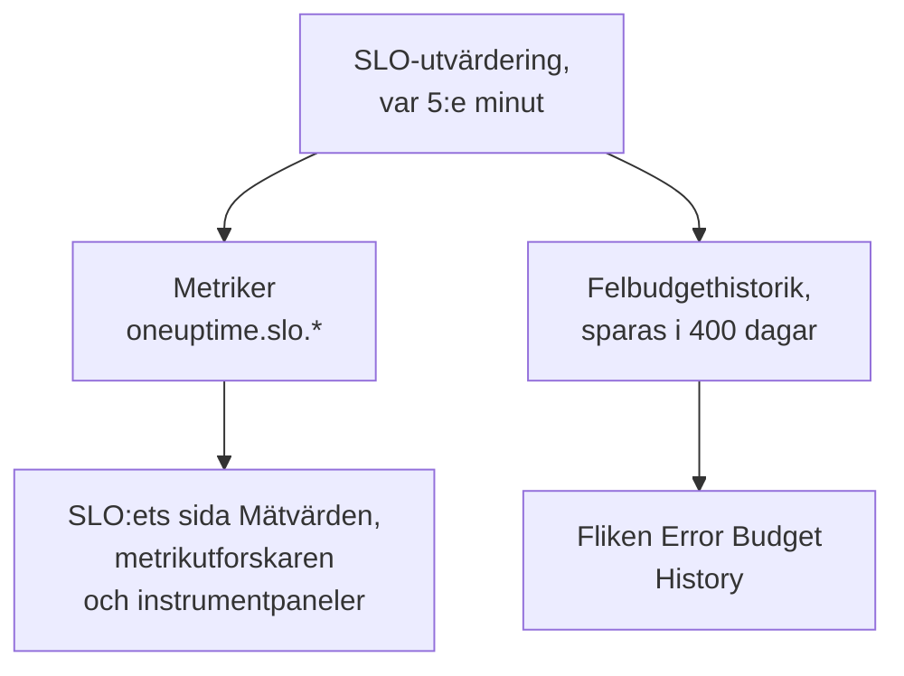

# SLO-metriker och -instrumentpaneler

Varje gång OneUptime utvärderar ett SLO, var 5:e minut, skriver det resultaten som metriker med namnet `oneuptime.slo.*`. De ligger i samma metriklager som dina monitormetriker, så du kan visa ett SLO i ett diagram på dess sida **Mätvärden**, öppna det i metrikutforskaren och lägga det på valfri instrumentpanel, filtrerat och grupperat som vilken annan serie som helst.

:::cards
- [Metrikerna](#metrikerna): Sex serier, deras enheter och hur de aggregeras.
- [Sidan Mätvärden](#sidan-mätvärden): Ett SLO:s diagram, historik och incident- och larmmetriker.
- [SLO:er på instrumentpaneler](#sloer-på-instrumentpaneler): SLO-widgeten och mallen SLO Dashboard.
:::

## Så fungerar det

## Metrikerna

| Metrik | Enhet | Aggregering | Vad den innehåller |
| --- | --- | --- | --- |
| `oneuptime.slo.sli.percent` | `%` | Avg | SLI:n över SLO:ets efterlevnadsfönster: den andel av den uppmätta tiden som var bra. |
| `oneuptime.slo.target.percent` | `%` | Avg | SLO:ets mål, skickat vid varje utvärdering så att ett diagram kan rita det över SLI:n. |
| `oneuptime.slo.error.budget.remaining.percent` | `%` | Avg | Den andel av felbudgeten som ännu inte förbrukats i fönstret. Negativ när budgeten är överskriden. |
| `oneuptime.slo.error.budget.remaining.seconds` | `seconds` | Avg | Det driftstopp som SLO:et fortfarande tål innan det bryts. Negativ när budgeten är överskriden. |
| `oneuptime.slo.burn.rate` | `x` | Max | Hur snabbt budgeten förbrukas, under de senaste 60 minuterna. 1x förbrukar budgeten precis under fönstret. |
| `oneuptime.slo.status` | — | Max | SLO:ets status vid varje utvärdering: `0` är Felfri, `1` är At Risk, `2` är Budget Exhausted. |

Aggregeringen är hur SLO:ets egna diagram och mallen SLO Dashboard kombinerar de punkter som hamnar i ett och samma diagramintervall. Procentsatser och varaktigheter tas som medelvärde. Förbrukningstakt och status tar maxvärdet, så att en kort förbrukningstopp eller ett kort besök i Budget Exhausted inte försvinner i medelvärdet.

För ett SLO i läget **Monitor Seconds Average** räknar `oneuptime.slo.error.budget.remaining.seconds` monitorsekunder, summerade över dess monitorer, precis som dess felbudget: se [Felbudgetar](/docs/slo/error-budget).

### När ingen punkt skrivs

- Ett inaktiverat eller arkiverat SLO utvärderas inte, så det skickar ingenting.
- Ett SLO som är **Pausad** eller **Misconfigured** mäter ingenting, så det skickar bara `oneuptime.slo.target.percent`, som är konfiguration och inte en mätning. Dess diagram för SLI, budget, förbrukningstakt och status visar ett glapp.
- Ett värde som inte är ett riktigt tal, som en förbrukningstakt över ett fönster utan data, hoppas över och skrivs aldrig som 0.

### Attribut

Varje punkt har de här attributen:

| Attribut | Värde |
| --- | --- |
| `sloId` | SLO:ets ID. SLO:ets egna sidor filtrerar på det, så att byta namn på ett SLO delar aldrig upp dess diagram. |
| `sloName` | SLO:ets namn när punkten skrevs. |
| `projectId` | Projektets ID. |
| `oneuptime.label.<key>` | Ett attribut per SLO-etikett. En etikett med namnet `Tier 1` blir `oneuptime.label.tier_1` = `true`, och en etikett med namnet `product:checkout` blir `oneuptime.label.product` = `checkout`. Nycklar skrivs med gemener, och blanksteg och skiljetecken blir `_`. |

Serierna hör till SLO:et, inte till någon av dess monitorer, och räknas inte som telemetrianvändning.

Incident- och larmmetriker har två motsvarande attribut, `serviceLevelObjectiveIds` och `serviceLevelObjectiveNames`: kommaseparerade listor över de SLO:er som incidenten eller larmet påverkar.

### Lagring

`oneuptime.slo.*`-metriker sparas lika länge som monitormetriker: **30 dagar** som standard. På en egenhostad installation kan en huvudadministratör ändra det med **Monitor Metric Retention (Days)** i inställningarna för **Datalagring** i Admin Dashboard.

Det begränsar inte fliken **Error Budget History** på SLO:ets sida **Mätvärden**. Den historiken lagras separat och sparas i 400 dagar.

## Sidan Mätvärden

Ett SLO:s sida **Mätvärden** har fyra flikar:

| Flik | Vad den visar |
| --- | --- |
| **SLO Metrics** | `oneuptime.slo.*`-serierna i tre kort som delar ett och samma tidsintervall, som standard det senaste dygnet: **Objective** (SLI:n med målet ovanpå, och den återstående budgeten), **Burn** (förbrukningstakt och återstående budgettid) och **Status**. |
| **Error Budget History** | SLI:n, den återstående budgeten och förbrukningstakten över den långsiktiga historiken, med linjer vid målet, vid gränserna för riskzon och förbrukad budget och vid tröskeln för varje aktiverad regel för förbrukningstakt. |
| **Incidentstatistik** | Antalet, tiden till kvittering, tiden till lösning och varaktigheten för de incidenter som påverkar det här SLO:et, som standard den senaste veckan. Incidenter som dess regler för förbrukningstakt har deklarerat ingår. |
| **Larmstatistik** | Samma sak för larm. Larm som dess regler för förbrukningstakt har utlöst ingår. |

Flikarna **SLO Metrics**, **Incidentstatistik** och **Larmstatistik** läser metriklagret, vilket kräver behörighet att läsa telemetri. En anpassad roll som får läsa SLO:er men inte telemetri ser de flikarna tomma, medan **Error Budget History** fortfarande fungerar.

## SLO:er på instrumentpaneler

### Visa valfri SLO-metrik i ett diagram

:::steps
#### Lägg till ett diagram

I en instrumentpanels redigeringsläge lägger du till en diagram- eller värdewidget och väljer en av `oneuptime.slo.*`-metrikerna.

#### Gruppera eller filtrera

Gruppera på `sloName` och `sloId` för en linje per SLO; `sloId` håller isär två SLO:er med samma namn. Eller filtrera på `sloName`, eller på ett `oneuptime.label.*`-attribut.

#### Välj aggregeringen

Använd aggregeringen från tabellen ovan: Avg för procentsatserna och varaktigheterna, Max för förbrukningstakt och status.
:::

### SLO-widgeten

[SLO-widgeten](/docs/dashboards/widgets#slo) visar ett SLO:s SLI, återstående budget eller förbrukningstakt som en ruta eller ett diagram. Den får sitt SLO på ett av två sätt:

| Inställning | Hur den beter sig |
| --- | --- |
| **Service Level Objective** | Fäster widgeten vid ett SLO. Väljaren listar SLO:er som inte är arkiverade. |
| **Follow SLO Variable** | Visar det SLO som valts i en variabel på instrumentpanelen: en variabel av typen **Telemetry Attribute** på nyckeln `sloName`. Ignoreras så länge ett SLO är fäst. |

På en [offentlig instrumentpanel](/docs/dashboards/sharing) låter en widget som följer en variabel tittarna välja vilket icke-arkiverat SLO som helst i projektet efter namn. En fäst widget visar bara sitt eget SLO, och fortsätter att visa de senaste siffrorna för ett SLO som arkiveras senare.

### Mallen SLO Dashboard

När du skapar en instrumentpanel väljer du mallen **SLO Dashboard** för att få en färdig tavla med alla SLO:er i projektet, i tre band:

1. **Service Level Objectives**: en lista över varje icke-arkiverat SLO med dess status, SLI mot målet, budgetstapel och förbrukningstakt, och en räkning av SLO:er per status. Aktiverade SLO:er kommer först, den med minst budget först; ett inaktiverat SLO kommer sist som **Inaktiverad**, med sina senaste siffror nedtonade.
2. **Error Budget & Burn Rate**: rutorna **Lowest Error Budget Remaining**, **Least Error Budget Time Left** och **Peak Burn Rate**, och diagrammen **Error Budget Remaining by SLO** och **Burn Rate by SLO** med en linje per SLO, grupperade på `sloName` och `sloId`.
3. **Selected SLO**: rutorna **SLI**, **Error Budget Remaining** och **Burn Rate** och diagrammen **SLI History**, **Error Budget History** och **Burn Rate History** för ett SLO.

En SLO-variabel i verktygsfältet avgränsar hela tavlan. Det är en variabel av typen Telemetry Attribute på `sloName`, så dess alternativ är de SLO-namn som finns i metrikerna. Att välja ett SLO begränsar listan till det, avgränsar bandets diagram och rutor och fyller i widgetarna under **Selected SLO**, som följer variabeln. Tills du väljer ett ber de dig välja ett SLO i verktygsfältet.

## Felsökning

:::details Ett SLO saknas i verktygsfältets SLO-väljare
Väljaren listar de SLO-namn som skickats det senaste dygnet. Ett nytt SLO dyker upp efter sin första utvärdering; ett SLO som är **Pausad** eller **Misconfigured** går fortfarande att välja eftersom det fortfarande skickar sitt mål; ett inaktiverat eller arkiverat SLO försvinner ungefär ett dygn efter sin senaste punkt.
:::

:::details Att välja ett namn visar två SLO:er
Två SLO:er har det namnet. Listan och diagrammen visar båda, och widgetarna under **Selected SLO** säger att namnet är tvetydigt. Ge SLO:er olika namn.
:::

:::details Fliken SLO Metrics är tom
Din roll får inte läsa telemetri, eller så har SLO:et inte utvärderats än. **Error Budget History** läser själva SLO:et och fungerar fortfarande.
:::

## Nästa steg

:::cards
- [Instrumentpanels-widgetar](/docs/dashboards/widgets): Alla widgetar, även SLO-widgeten.
- [Instrumentpanelsvariabler](/docs/dashboards/variables): Avgränsa en hel tavla med en enda väljare.
- [Felbudgetar](/docs/slo/error-budget): Vad budgetsiffrorna betyder.
:::
