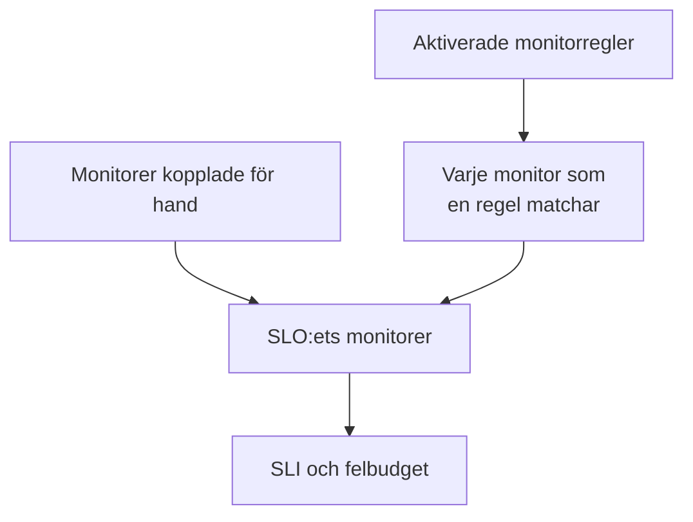

# Monitorer och monitorregler

Ett SLO mäter tillgängligheten hos de monitorer som är kopplade till det. Koppla dem för hand, låt monitorregler koppla varje monitor som matchar, eller gör både och. Den här sidan handlar om ett SLO:s sidor **Monitorer** och **Monitor Rules**, som båda ligger under **Konfiguration** i dess sidomeny.

:::cards
- [Välj monitorer för hand](#koppla-monitorer-för-hand): Bäst för en liten, fast uppsättning.
- [Koppla monitorer med en regel](#koppla-monitorer-med-en-regel): ”Varje monitor med etiketten Production”, hålls uppdaterat åt dig.
- [Matchningskriterier](#matchningskriterier): De fält och operatorer som en regel kan matcha på.
:::

## Vilka monitorer ett SLO mäter

Ett SLO mäter unionen av de monitorer som du har kopplat för hand och varje monitor som minst en av dess aktiverade monitorregler matchar.

Ett nytt SLO har inga monitorer, eftersom formuläret för att skapa det inte frågar efter några. Tills det har en kan det inte utvärderas: dess sidor visar **No monitors attached**, och dess **Översikt** erbjuder båda sätten att koppla monitorer.

## Koppla monitorer för hand

Du behöver behörighet att redigera SLO:et.

:::steps
### Öppna sidan Monitorer

Öppna SLO:et och gå till **Monitorer**.

### Välj monitorerna

Klicka på **Add Monitors** och välj monitorer från projektet. Bara monitorer som inte redan är kopplade visas.

### Spara listan

Klicka på **Add Monitors**. Monitorerna visas i listan med källan **Manual** och räknas in i SLI:n från nästa utvärdering.
:::

Klicka på **Ta bort** på en monitors rad för att ta ut den ur SLO:et. Själva monitorn ändras inte; den slutar bara räknas in i SLO:ets SLI och felbudget.

Sidan **Monitorer** visar för varje monitor:

| Kolumn | Vad den visar |
| --- | --- |
| **Aktuell status** | Monitorns aktuella status, eller **Arkiverad**, **Inaktiverad**, **Sonder inte aktiverade**, **Sonder frånkopplade** eller **Okänd** när den inte kontrolleras eller ännu inte har rapporterat något. |
| **Källa** | **Rule** om en av SLO:ets monitorregler kopplade den, **Manual** om någon kopplade den för hand. |
| **Etiketter** | Monitorns etiketter. |

## Koppla monitorer med en regel

En monitorregel beskriver de monitorer som ett SLO ska mäta, som ”varje monitor med etiketten Production” eller ”varje monitor vars namn börjar med api-”. Varje monitor som matchar kopplas, nu och varje gång monitorer skapas eller ändras, så att ingen behöver komma ihåg den monitor som någon lägger till nästa månad.

:::steps
### Öppna Monitor Rules

Öppna SLO:et, gå till **Monitor Rules** och klicka på **Skapa SLO Monitor Rule**.

### Ge regeln ett namn

Under **Grundläggande information** anger du ett **Namn** och, om du vill, en **Beskrivning** av varför de här monitorerna hör till det här SLO:et.

### Välj vad den matchar

Under **Matchningskriterier** klickar du på **Lägg till villkor**, väljer ett fält och en operator och anger eller väljer värdet. Med två eller fler villkor väljer du **Matcha alla** eller **Matcha något**. En monitorregel behöver minst ett villkor.

### Spara regeln

Klicka på **Skapa SLO Monitor Rule**. Regeln börjar aktiverad och SLO:ets monitorer bedöms om direkt: varje monitor som matchar kopplas med källan **Rule**.
:::

Regeltabellen visar för varje regel namnet, matchningskriterierna i klartext och om den är aktiverad. För att pausa en regel stänger du av **Aktiverad** i dess redigeringsformulär. **View Monitors** öppnar SLO:ets sida **Monitorer**.

### Matchningskriterier

Varje villkor jämför ett fält hos en monitor:

| Fält | Jämförs med | Operatorer |
| --- | --- | --- |
| **Övervakningsetiketter** | Monitorns etiketter. | **Har någon av**, **Har alla**, **Har ingen av** |
| **Monitortyp** | Monitorns typ, vald från listan över typer. | **Lika med**, **Inte lika med** |
| **Övervakningsnamn** | Monitorns namn. | **Innehåller**, **Innehåller inte**, **Lika med**, **Inte lika med**, **Börjar med**, **Slutar med**, **Matchar mönster**, **Matchar inte mönster** |
| **Övervakningsbeskrivning** | Monitorns beskrivning. | Samma som för **Övervakningsnamn** |

Ett mönster är ett reguljärt uttryck, som `^api-.*`, eller ett `*`-jokertecken, som `*checkout*`, och skiljer inte på stora och små bokstäver. Ett mönster som inte är något av dem, som `api-(01`, avvisas när du sparar, i stället för att i tysthet inte matcha något. För att koppla alla monitorer i projektet lägger du till ett villkor på **Övervakningsnamn** som matchar mönstret `.*`.

| Du vill ha | Villkor |
| --- | --- |
| Varje produktionsmonitor | **Övervakningsetiketter** har någon av _Production_ |
| Varje API-monitor | **Monitortyp** lika med _API_ |
| Varje monitor utom de manuella | **Monitortyp** inte lika med _Manual_ |
| Varje monitor vars namn börjar med api- | **Övervakningsnamn** matchar mönstret `^api-` |
| Checkout-monitorerna, men inte de i staging | **Matcha alla**: **Övervakningsnamn** matchar mönstret `*checkout*`, och **Övervakningsetiketter** har ingen av _Staging_ |

### När regler körs

- När du skapar, redigerar, slår på, stänger av eller raderar en regel bedöms SLO:ets monitorer om direkt.
- När en monitor skapas, eller dess etiketter, namn eller beskrivning ändras, kontrollerar alla monitorregler i projektet den, även de etiketter som dina regler för monitoretiketter ger den.
- När en etikett raderas bedöms de SLO:er vars regler använde den om.
- Reglerna håller ett SLO:s monitorlista uppdaterad även medan SLO:et är inaktiverat eller arkiverat, så att det fortsätter med rätt monitorer.

Reglerna synkroniseras om vid varje sparning, så **Run Now** är till för att ta igen det som SLO:et har missat. Den finns på varje rad, på regelns egen sida (**Visa**) och bland tabellens massåtgärder. Att köra en regel bedömer om alla SLO:ets aktiverade monitorregler tillsammans, och sedan berättar dialogen hur många monitorer som kopplades och kopplades bort. Att köra en regel kräver behörighet att redigera SLO-monitorregler. Se [Köra regler på befintliga resurser](/docs/configuration/run-rules-now).

### Vilka monitorer en regel äger

- En monitor förblir kopplad så länge en aktiverad regel matchar den, och kopplas bort så snart ingen gör det längre.
- Att stänga av eller radera en regel kopplar bara bort de monitorer som ingen annan aktiverad regel fortfarande matchar.
- Regler kopplar bara bort monitorer som en regel har kopplat. En monitor som kopplats för hand tas aldrig över av en regel som råkar matcha den, och kopplas inte bort när den slutar matcha. Dess källa förblir **Manual**.

## Välja för hand medan regler är på

Så länge minst en regel är aktiverad är det reglerna som hanterar SLO:ets monitorer:

- monitorer kan inte läggas till för hand: **Add Monitors** är inaktiverad, och en banner säger **This SLO's monitors are managed by its monitor rules**, med en länk **Manage Monitor Rules**;
- monitorer som en regel har kopplat kan inte tas bort för hand, eftersom regeln skulle koppla dem igen: deras knapp **Ta bort** är låst och knappbeskrivningen förklarar varför;
- monitorer som kopplades för hand innan regler slogs på kan fortfarande tas bort.

Det gäller även API:et. Stäng av alla regler för att välja monitorerna själv igen.

## SLO:erna som en monitor räknas in i

En monitors sida visar de SLO:er som mäter den: öppna monitorn och gå till **SLOs** i dess sidomeny. Titta där innan du pausar eller ändrar en monitor, för att se vilka mål som beror på den. Arkiverade SLO:er visas inte, eftersom de inte utvärderas.

## Från Auto-Add Monitors With Labels

Tidigare versioner hade en inställning **Auto-Add Monitors With Labels** i SLO-formuläret. Vid uppgraderingen får varje SLO som använde den en aktiverad monitorregel med namnet **Auto-add monitors with labels** som matchar samma etiketter, så att det fortsätter att mäta exakt samma monitorer. Fältet `monitorLabels` i SLO-API:et är föråldrat: använd SLO-monitorregler i stället.

:::details Vad händer om något fortfarande sparar den gamla inställningen?
En flik i instrumentpanelen som öppnades före uppgraderingen, eller en API-klient eller ett arbetsflöde som skrevs för den tidigare versionen, kan fortfarande spara den gamla inställningen. För att ett SLO inte i tysthet ska förlora monitorer på det sättet:

- **Ett SLO utan monitorregler** gör de sparade etiketterna till en regel **Auto-add monitors with labels**, och dess monitorer bedöms om direkt. Att spara en tom lista kopplar bort de monitorer som inställningen hade kopplat, som tidigare.
- **Ett SLO som har monitorregler**, på eller av, ignorerar etiketter som sparats via den gamla inställningen, eftersom det är dess regler som avgör vad det mäter.
- **Att skapa den första monitorregeln** för ett SLO vars monitorer kopplades av den gamla inställningen konverterar först inställningen till en regel, så att den nya regeln läggs till bredvid i stället för att ersätta den.

En konverterad regel som du raderar förblir raderad, såvida inte dess monitorer fortfarande är kopplade efteråt, till exempel för att en server som fortfarande kör den tidigare versionen kopplade dem igen under uppgraderingen: nästa monitorändring eller nästa nya regel konverterar då etiketterna igen. Radera den regeln igen när uppgraderingen är klar.
:::

## Historik

Varje koppling och bortkoppling, och varje regel som skapas, redigeras eller raderas, visas i SLO:ets **Feed**. Regeländringar registreras också i dess **Granskningsloggar**. Se [SLO-flöde och granskningsloggar](/docs/slo/feed-and-audit-logs).

## Felsökning

:::details Add Monitors är inaktiverad
Minst en av SLO:ets monitorregler är aktiverad, så det är reglerna som hanterar dess monitorer. Ändra reglerna, eller stäng av alla för att välja monitorer för hand.
:::

:::details En monitors knapp Ta bort är låst
En monitorregel kopplade den monitorn och skulle koppla den igen. Ändra eller stäng av regeln som matchar den.
:::

:::details En monitor som en regel borde matcha är inte kopplad
Kontrollera att regeln är aktiverad och att varje villkor är uppfyllt med **Matcha alla**. Etiketter som en regel för monitoretiketter lägger till räknas också. Klicka på **Run Now** på regeln för att synkronisera om SLO:et.
:::

:::details Det går inte att spara en regel på grund av ett mönsterfel
Värdet är varken ett reguljärt uttryck eller ett `*`-jokertecken, till exempel på grund av en parentes som inte stängs. Rätta mönstret, eller använd **Innehåller**.
:::

## Nästa steg

:::cards
- [SLO:er – Översikt](/docs/slo/introduction): Hur driftstopp från flera monitorer kombineras.
- [Felbudgetar](/docs/slo/error-budget): Vad monitorernas driftstopp förbrukar.
- [Köra regler på befintliga resurser](/docs/configuration/run-rules-now): Hur Run Now fungerar för varje typ av regel.
:::
