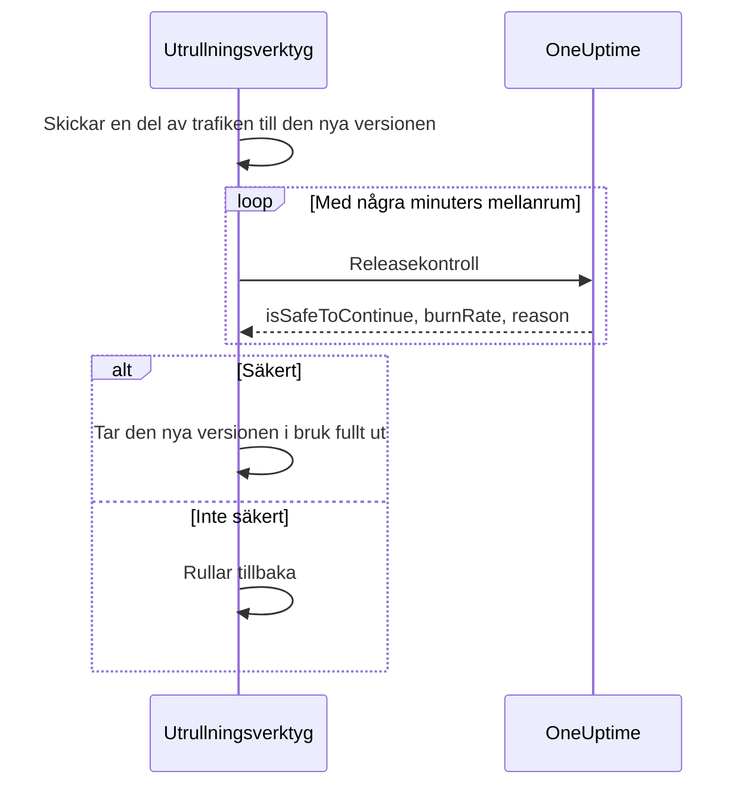

# Releasekontroller

En releasekontroll frågar ett SLO ”är det säkert att fortsätta rulla ut den här releasen?” medan releasen rullas ut, och svarar utifrån hur snabbt SLO:et förbrukade sin felbudget under de senaste minuterna. Argo Rollouts, Flagger eller en distributionspipeline frågar medan en canary tar emot trafik och rullar tillbaka releasen vid ett nej. OneUptime distribuerar ingenting själv: ditt utrullningsverktyg sköter fortfarande utrullningen, och OneUptime talar om för det hur det går för releasen.

:::cards
- [Fråga kontrollen](#fråga-kontrollen): En begäran med en API-nyckel, och vad den svarar.
- [Argo Rollouts](#argo-rollouts): En analys som avbryter utrullningen.
- [Flagger](#flagger): En webhook som stoppar canaryn.
- [GitHub Actions](#github-actions): Ett steg som rullar tillbaka efter en distribution.
:::

## Så fungerar det

[Distributionsspärren](/docs/slo/error-budget-policy#distributionsspärr) svarar före en release, utifrån felbudgeten för hela efterlevnadsfönstret. En release som förstör något har förbrukat nästan ingenting av en månads budget under sina första tio minuter, så releasekontrollen läser det som releasen förändrar: förbrukningstakten under de senaste minuterna.



Kontrollen svarar med en av tre bedömningar:

| Bedömning | När | `isSafeToContinue` |
| --- | --- | --- |
| `Pass` | Fönstret förbrukade felbudgeten i takten `maxBurnRate` eller långsammare. | `true` |
| `Fail` | Det förbrukade den snabbare, eller SLO:ets felbudgetpolicy fryser distributioner. | `false` |
| `NotEnoughData` | Fönstret hade färre begäranden än `minimumRequestCount`, eller SLO:ets monitorer registrerade ingen status i det. För lite för att kalla releasen säker. | `false` |

Vid förbrukningstakten 1 nådde fönstret exakt SLO:ets mål, så standardvärdet `1` för `maxBurnRate` underkänner en release som presterar sämre än målet.

Vad kontrollen läser beror på vad SLO:et mäter:

- Ett [SLO för begäranden](/docs/slo/request-slos) bedöms utifrån dess tjänsters begäranden i fönstret, lästa från deras spans när de kommer in. Lägg till `serviceVersion` för att bara bedöma den nya versionens begäranden: OneUptime matchar den mot resursattributet `service.version` på spansen, som en OpenTelemetry-SDK sätter från `OTEL_RESOURCE_ATTRIBUTES=service.version=1.4.2`. På så sätt bedöms canaryn på sina egna begäranden, utan att spädas ut av den gamla versionens.
- Ett SLO för monitorernas drifttid bedöms utifrån dess monitorers statustidslinjer över fönstret. `minimumRequestCount` gäller inte för det, och en kontroll med `serviceVersion` avvisas: monitorer har inga versioner.

## Innan du börjar

Du behöver ett SLO som mäter det som releasen påverkar. Ett SLO för begäranden för den tjänst du släpper bedömer en canary bäst, eftersom det läser just den tjänstens egna begäranden.

## Ställ in en releasekontroll

:::steps
### Ge utrullningen en nyckel

Skapa en [API-nyckel](/docs/api-reference/api-reference) för projektet med en roll som får läsa SLO:er, och spara den som en hemlighet i ditt utrullningsverktyg eller din pipeline.

### Kopiera SLO:ets ID

Öppna SLO:et och kopiera dess ID från adressen: `/slos/<slo-id>`.

### Fråga kontrollen en gång för hand

Kör begäran under [Fråga kontrollen](#fråga-kontrollen) med nyckeln och ID:t. Den svarar med `isSafeToContinue` och en `reason`.

### Lägg till den i din utrullning

Fråga kontrollen från [Argo Rollouts](#argo-rollouts), [Flagger](#flagger) eller [GitHub Actions](#github-actions), och rulla tillbaka när `isSafeToContinue` är `false`.
:::

## Fråga kontrollen

Kontrollen är `GET` eller `POST` mot SLO:ets `release-check`-adress. Skicka alternativen i frågesträngen, eller som en JSON-kropp med `POST`:

```bash
curl -sS "https://oneuptime.com/api/service-level-objective/<slo-id>/release-check?windowInMinutes=10&serviceVersion=1.4.2" \
  -H "ApiKey: $ONEUPTIME_API_KEY"
```

Den svarar med bedömningen först och sedan med det som den bygger på:

```json
{
  "isSafeToContinue": false,
  "verdict": "Fail",
  "reason": "The last 10 minutes burned the error budget at 3.2x, faster than the 1x this check allows (SLI 99.68% against the 99.9% target).",
  "sloId": "<slo-id>",
  "sloName": "Checkout requests",
  "sliType": "Request Success",
  "targetPercentage": 99.9,
  "windowInMinutes": 10,
  "maxBurnRate": 1,
  "burnRate": 3.2,
  "sliPercentage": 99.68,
  "deploymentsAllowed": true,
  "errorBudgetPolicyTier": null,
  "sloStatus": "Healthy",
  "checkedAt": "2026-11-15T12:00:00.000Z",
  "goodRequestCount": 2492,
  "totalRequestCount": 2500,
  "minimumRequestCount": 1,
  "serviceVersion": "1.4.2"
}
```

Alternativen:

| Alternativ | Standard | Vad det gör |
| --- | --- | --- |
| `windowInMinutes` | `10` | Hur långt bakåt kontrollen tittar, i hela minuter från 1 till 360. |
| `maxBurnRate` | `1` | Den högsta förbrukningstakt som godkänns. `2` låter fönstret förbruka budgeten dubbelt så snabbt som målet tillåter. |
| `minimumRequestCount` | `1` | SLO:er för begäranden: det minsta antal begäranden som kontrollen bedömer. Med `0` godkänns ett fönster utan begäranden. |
| `serviceVersion` | Ingen | SLO:er för begäranden: bedöm bara de begäranden vars spans bär denna `service.version`. |
| `includeDeploymentGate` | `true` | Svara nej medan SLO:ets felbudgetpolicy fryser distributioner. Med `false` avgör bara förbrukningstakten. |
| `failWithStatusCode` | `false` | Svara på ett nej med HTTP-status 412 i stället för 200, för verktyg som bara läser statuskoden. |

Svarets fält:

| Fält | Vad det innehåller |
| --- | --- |
| `isSafeToContinue` | `true` för att fortsätta utrullningen, `false` för att rulla tillbaka den. |
| `verdict` | `Pass`, `Fail` eller `NotEnoughData`. |
| `reason` | En mening för utrullningens logg, som säger vad som mättes och varför kontrollen svarade som den gjorde. |
| `burnRate` och `sliPercentage` | Hur snabbt fönstret förbrukade felbudgeten, och SLI:n över fönstret. |
| `goodRequestCount` och `totalRequestCount` | SLO:er för begäranden: de begäranden som fönstret innehöll, och hur många av dem som var bra. |
| `deploymentsAllowed` och `errorBudgetPolicyTier` | Om SLO:ets felbudgetpolicy tillåter distributioner, och den nivå som SLO:et är i. |
| `checkedAt` | När kontrollen mättes. |

Ett SLO som inte kan mätas – ett SLO för begäranden utan tjänster, ett latens-SLO utan gräns, ett SLO för monitorernas drifttid utan monitorer – besvaras med HTTP 400 och vad som behöver åtgärdas, så att en utrullning stoppar på ett tydligt fel i stället för på en gissning. På en egenhostad installation använder du dess egen adress i stället för oneuptime.com.

## Argo Rollouts

En analys med en `web`-metrik frågar kontrollen vid varje steg i en canary, och Argo Rollouts avbryter utrullningen och skalar ner canaryn när den misslyckas. Spara först API-nyckeln som en hemlighet:

```bash
kubectl create secret generic oneuptime --from-literal=api-key="$ONEUPTIME_API_KEY"
```

Lägg sedan till mallen och kör den efter canaryns första steg:

:::tabs
@tab AnalysisTemplate
```yaml title="oneuptime-release-check.yaml"
apiVersion: argoproj.io/v1alpha1
kind: AnalysisTemplate
metadata:
  name: oneuptime-release-check
spec:
  args:
    - name: version
    - name: api-key
      valueFrom:
        secretKeyRef:
          name: oneuptime
          key: api-key
  metrics:
    - name: slo-burn-rate
      interval: 2m
      count: 5
      failureLimit: 0
      successCondition: result == true
      provider:
        web:
          url: "https://oneuptime.com/api/service-level-objective/<slo-id>/release-check?windowInMinutes=10&serviceVersion={{args.version}}"
          headers:
            - key: ApiKey
              value: "{{args.api-key}}"
          jsonPath: "{$.isSafeToContinue}"
```
@tab Rollout
```yaml title="rollout.yaml"
apiVersion: argoproj.io/v1alpha1
kind: Rollout
metadata:
  name: checkout
spec:
  strategy:
    canary:
      steps:
        - setWeight: 10
        - analysis:
            templates:
              - templateName: oneuptime-release-check
            args:
              - name: version
                value: "1.4.2"
        - setWeight: 50
        - pause: { duration: 10m }
```
:::

Analysen frågar fem gånger, med två minuters mellanrum, och det första nejet avbryter utrullningen. Skicka med samma version som canaryns poddar sätter i `OTEL_RESOURCE_ATTRIBUTES`. Om canaryn kan sakna trafik vid sin första vikt lägger du till `&minimumRequestCount=0` i adressen, annars underkänner en tyst canary analysen med `NotEnoughData`.

## Flagger

Flagger anropar en `rollout`-webhook vid varje steg i sin analys och stoppar och rullar tillbaka canaryn när webhooken fortsätter att misslyckas. Flaggers webhooks skickar inga huvuden, så fråga kontrollen via Flaggers lasttestare, som kör ett kommando åt webhooken:

```yaml title="canary.yaml"
apiVersion: flagger.app/v1beta1
kind: Canary
metadata:
  name: checkout
spec:
  analysis:
    interval: 1m
    threshold: 2
    maxWeight: 50
    stepWeight: 10
    webhooks:
      - name: oneuptime-release-check
        type: rollout
        url: http://flagger-loadtester.test/
        timeout: 30s
        metadata:
          type: bash
          cmd: "curl -sSf -H \"ApiKey: $ONEUPTIME_API_KEY\" 'https://oneuptime.com/api/service-level-objective/<slo-id>/release-check?windowInMinutes=5&failWithStatusCode=true'"
```

Med `failWithStatusCode=true` är ett nej HTTP 412, så `curl -f` avslutas med ett fel och webhooken misslyckas. Ge lasttestaren nyckeln som `ONEUPTIME_API_KEY` i dess miljö, från en Kubernetes-hemlighet. När `threshold` kontroller har misslyckats rullar Flagger tillbaka canaryn.

## GitHub Actions

En pipeline som distribuerar allt på en gång kan ändå bevaka releasen: distribuera, fråga kontrollen några gånger och rulla tillbaka när den svarar nej.

```yaml title=".github/workflows/deploy.yml"
name: Deploy
on:
  push:
    branches: [main]

jobs:
  deploy:
    runs-on: ubuntu-latest
    steps:
      - uses: actions/checkout@v4
      - name: Deploy
        run: ./deploy.sh
      - name: Watch the release against the SLO
        env:
          ONEUPTIME_API_KEY: ${{ secrets.ONEUPTIME_API_KEY }}
          SLO_ID: <slo-id>
          VERSION: ${{ github.sha }}
        run: |
          for attempt in 1 2 3 4 5; do
            sleep 120
            CHECK=$(curl -sS "https://oneuptime.com/api/service-level-objective/$SLO_ID/release-check?windowInMinutes=10&serviceVersion=$VERSION" \
              -H "ApiKey: $ONEUPTIME_API_KEY")
            echo "$CHECK" | jq -r '.reason'
            if [ "$(echo "$CHECK" | jq -r '.isSafeToContinue')" != "true" ]; then
              exit 1
            fi
          done
      - name: Roll back
        if: failure()
        run: ./rollback.sh
```

Steget misslyckas vid ett nej, och vid varje svar utan `isSafeToContinue: true` – ett felaktigt ID, en nyckel som inte kan läsa SLO:et, inget svar alls – så att pipelinen aldrig fortsätter på ett svar den inte har fått. Sätt `service.version` till committen (`${{ github.sha }}`) när tjänsten startar, så att kontrollen bara bedömer den nya versionen.

## Nästa steg

:::cards
- [SLO:er för begäranden och latens](/docs/slo/request-slos): Mät en tjänsts begäranden, den SLI som bedömer en canary bäst.
- [Felbudgetpolicy](/docs/slo/error-budget-policy): Frys distributioner medan budgeten är låg.
- [Larm och incidenter för förbrukningstakt](/docs/slo/burn-rate-alerts): Larma ditt team när budgeten förbrukas för snabbt.
:::
