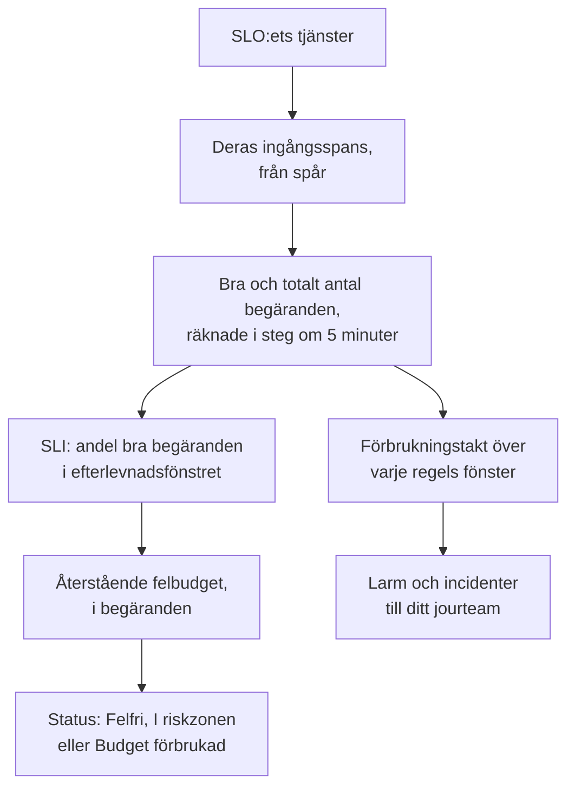

# SLO:er för begäranden och latens

Ett SLO för begäranden mäter vad dina användare får av en tjänst: andelen av dess begäranden som lyckas, eller som besvaras tillräckligt snabbt. OneUptime räknar dem utifrån de spår som dina tjänster redan skickar, så det finns ingen monitor att ställa in: välj tjänsterna och ett mål, så mäter OneUptime dem var 5:e minut.

:::cards
- [Skapa ett SLO för begäranden](#skapa-ett-slo-för-begäranden): Tjänsterna, en latensgräns och ett mål.
- [Räkna bara vissa begäranden](#räkna-bara-vissa-begäranden): En slutpunkt, eller alla begäranden utom hälsokontroller.
- [SLO:er från ett mätvärde](#sloer-från-ett-mätvärde): En räknare eller ett histogram, för tjänster som inte skickar några spår.
- [Så räknas begäranden](#så-räknas-begäranden): Vilka spans som räknas, och när.
- [Releasekontroller](/docs/slo/release-checks): Rulla tillbaka en release som förbrukar felbudgeten.
:::

## Lyckade begäranden och latens för begäranden

| Vad det mäter | En begäran är dålig när | Dess felbudget räknar |
| --- | --- | --- |
| **Lyckade begäranden** | Statusen för dess span är `Error`. Ett span utan status räknas som bra, så som OpenTelemetry menar det. | Misslyckade begäranden |
| **Latens för begäranden** | Den tog längre tid än SLO:ets **Latensgräns (ms)**, oavsett status. | Långsamma begäranden |

SLI:n är andelen bra begäranden i efterlevnadsfönstret, och felbudgeten är de dåliga begäranden som målet tillåter: vid 99,9 % en av 1 000. Ett latens-SLO räknar en begäran som misslyckades snabbt som bra, så mät en viktig tjänst på båda sätten: ett SLO för att den fungerar och ett för att den är snabb.

## Så fungerar det

En begäran är ett ingångsspan för en av SLO:ets tjänster: det span där en begäran eller ett meddelande kommer in i tjänsten, så som listan [Spår](/docs/telemetry/traces-explorer#spår-och-spans) visar dem som standard. En begäran som passerar två av SLO:ets tjänster räknas en gång i var och en av dem.

Därifrån fungerar ett SLO för begäranden som alla andra. Dess status, regler för förbrukningstakt, felbudgetpolicy, ägare och aviseringar är desamma, men felbudgeten räknas i begäranden i stället för i minuter.

## Innan du börjar

- Tjänsterna skickar spår till OneUptime: se [OpenTelemetry](/docs/telemetry/open-telemetry). Var och en finns i [tjänstekatalogen](/docs/telemetry/services) under sitt `service.name`.
- En roll som får skapa SLO:er: Projektägare, Projektadministratör eller en anpassad roll med behörigheten Create Service Level Objective.

## Skapa ett SLO för begäranden

:::steps
### Öppna SLO:er

Öppna **SLOs** från menyn **Produkter** i det övre fältet och klicka på **Skapa Tjänstenivåmål**.

### Välj vad SLO:et mäter

Under **Vad den mäter** väljer du **Lyckade begäranden** eller **Latens för begäranden**, och sedan under **Tjänster** de tjänster vars begäranden det ska räkna. För **Latens för begäranden** anger du också **Latensgräns (ms)**: en begäran som besvaras inom gränsen räknas som tillräckligt snabb, till exempel `300`. Vill du bara räkna en del av deras begäranden anger du ett **Begäransfilter**: se [Räkna bara vissa begäranden](#räkna-bara-vissa-begäranden). Klicka på **Nästa**.

### Ge det ett namn och ett mål

Ange ett **Namn**, till exempel ”Checkout requests”, och ett **Mål (%)**: den andel av begärandena som måste vara bra. Klicka på **Skapa Tjänstenivåmål**.

### Se de första siffrorna komma in

Den första utvärderingen, inom 5 minuter, räknar begärandena från de senaste 6 timmarna, så SLO:et har siffror direkt. Utvärderingarna efter den räknar även äldre begäranden, tills hela efterlevnadsfönstret är täckt.
:::

En tjänsts egen sida **SLOs** visar de SLO:er som mäter den, och dess **Skapa Tjänstenivåmål** öppnar samma formulär med tjänsten redan vald. För att senare ändra vad ett SLO mäter, dess tjänster, dess gräns eller dess filter öppnar du dess **Inställningar** och klickar på **Redigera vad den mäter**.

## Räkna bara vissa begäranden

Ett SLO för begäranden räknar alla begäranden från sina tjänster. Ett **Begäransfilter** räknar bara de som spelar roll, som checkout-slutpunkten, eller utesluter några, som hälsokontroller som skulle få SLI:n att se bättre ut än det användarna får. Skriv det som en spårsökning, med samma [söksyntax](/docs/telemetry/search-syntax#matcha-värden) som i spårutforskaren:

| Begäransfilter | Räknar |
| --- | --- |
| `@http.route:/checkout*` | Begäranden vars route börjar med `/checkout`. |
| `-@http.route:/health` | Alla begäranden utom hälsokontroller. |
| `@http.request.method:[POST, PUT]` | POST- och PUT-begäranden. |
| `name:"POST /checkout"` | Begäranden vars span heter `POST /checkout`. |

Alla villkor måste matcha, så `@http.route:/checkout* -@http.route:/checkout/health` räknar checkout-begärandena utom deras hälsokontroll. Ett villkor med `@` är ett attribut för begärandens span, och `name:` är spannets namn. Fritext och utforskarens andra fält, som `status:` och `duration:`, är inte filter här: SLO:et avgör redan vilka begäranden som är dåliga eller långsamma. Ett filter rymmer upp till 10 villkor på 500 tecken.

**Översikt** visar filtret under SLO:ets tjänster, och **Inställningar** visar det under **Vad den mäter**. Att ändra det gör att SLO:ets begäranden räknas om från början.

## SLO:er från ett mätvärde

När dina tjänster redan räknar sina begäranden som mätvärden, eller inte skickar några spår, mäter du i stället SLO:et utifrån en räknare eller ett histogram. Under **Vad den mäter** väljer du **Mätvärde** och under **Tjänster** de tjänster som skickar det, och sedan fyller du i steget **Mätvärde**:

| Fält | Vad du anger |
| --- | --- |
| **Mätvärde** | Mätvärdets namn, valt bland ditt projekts mätvärden eller inskrivet, till exempel `http_requests_total` eller `http.server.request.duration`. |
| **Godkända händelser** | **En räknare, utifrån ett villkor** eller **Ett histogram, utifrån ett värde**. |
| **Godkänd när** | För en räknare: de händelser som är bra, som en sökning på dess attribut, till exempel `@http.response.status_code:<500`. |
| **Godkänd på eller under** | För ett histogram: det värde som en bra observation ligger på eller under, i mätvärdets egen enhet, till exempel `0.3` för 300 ms i ett histogram i sekunder. Använd en av histogrammets bucketgränser. |
| **Mätvärdesfilter** | Valfritt: de serier som räknas, till exempel `-@http.route:/health`. |

En räknares händelser är det som den har ökat med i varje steg om 5 minuter, så som Prometheus `increase()` läser en räknare: en räknare som startar om räknas från noll igen, och både kumulativa räknare och deltaräknare räknas. Ett histograms händelser är dess observationer, och de bra är observationerna i de buckets som ligger på eller under värdet. Bara mätvärdets egna punkter räknas, från SLO:ets tjänster: en gauge med samma namn räknas inte alls. En SLO på en gauge, vilket varje molnmätvärde är, säger det på sin sida, och det gör mätvärdesväljaren också: mät ett molnmätvärde med en mätvärdesmonitor och en SLO av den monitorns drifttid.

Därifrån fungerar ett mätvärdesbaserat SLO som ett SLO för begäranden, med felbudget, regler för förbrukningstakt och releasekontroller räknade i händelser. Att ändra mätvärdet gör att dess händelser räknas om från början.

## Så räknas begäranden

OneUptime räknar varje SLO:s bra begäranden och totala antal begäranden i steg om 5 minuter och sparar antalen, så att SLO:et läser sitt fönster ur sina egna antal i stället för ur varje span varje gång:

- Ett steg räknas 2 minuter efter att det har tagit slut, så att spans som kommer in sent kommer med, och nästa utvärdering räknar om de två senaste stegen för spans som kommer in ännu senare.
- Ett nytt SLO börjar med de senaste 6 timmarna. Varje utvärdering därefter räknar upp till ett dygns äldre begäranden, de nyaste först, tills fönstret är täckt.
- Bara begäranden som fortfarande ligger inom din [lagringstid för telemetri](/docs/telemetry/data-retention#hur-länge-telemetri-sparas) kan räknas. Räknade steg sparas i 400 dagar, längre än något efterlevnadsfönster, så ett fönster som är längre än lagringstiden fylls i takt med att SLO:et blir äldre.
- Att ändra vad SLO:et mäter, dess tjänster, dess latensgräns eller dess begäransfilter gör att dess begäranden räknas om från början. Ett längre efterlevnadsfönster fylls genom att räkna längre bakåt.

Så länge antalen bara täcker en del av efterlevnadsfönstret säger **Översikt** det med indikatorn **Fönstret är 23 % fyllt**, och rutan **Felbudget kvar** upprepar det under sin siffra. Båda försvinner när antalen täcker hela fönstret.

## Felbudgeten i begäranden

Budgeten är de dåliga begäranden som målet tillåter bland de begäranden som har räknats i fönstret, så den växer med trafiken: vid 99,9 % tillåter ett fönster med 2 000 000 begäranden 2 000 misslyckade. I **Översikt**:

- **Felbudget kvar** visar hur många dåliga begäranden som återstår av hur många, eller hur många begäranden SLO:et ligger över budgeten.
- **Budgetens räckvidd** visar hur länge budgeten räcker med den aktuella förbrukningstakten, så länge trafiken förblir som den var.
- Sammanfattningen räknar SLO:ets tjänster, och ett latens-SLO visar sin gräns under sitt mål.

Larm för förbrukningstakt, aviseringar och flödet anger också budgeten i begäranden. Metriken `oneuptime.slo.error.budget.remaining.seconds` skickas inte för ett SLO för begäranden; visa `oneuptime.slo.error.budget.remaining.percent` i ett diagram i stället.

Ett SLO för begäranden får samma regler **Fast burn**, **Slow burn** och **Slow leak** som alla nya SLO:er. Under en lugn timme med en handfull begäranden kan ett enda fel ge en snabb förbrukning, så en regel kan bortse från fönster med för få begäranden: ange regelns **Minsta antal begäranden**, så hoppar regeln över ett långt fönster med färre begäranden än så.

## Felsökning

:::details SLO:et visar Väntar på begäranden
Ingen av dess tjänster har besvarat en begäran i fönstret ännu. Kontrollera att tjänsterna skickar spår till OneUptime och att deras spans innehåller ingångsspans: en tjänst vars spans alla är interna har inga begäranden att räkna. Om SLO:et har ett **Begäransfilter** söker du med det i utforskaren [Spår](/docs/telemetry/traces-explorer): ett filter som inte matchar någon begäran där lämnar inga begäranden åt SLO:et att räkna.
:::

:::details SLI:n ändrades efter att jag ändrade tjänsterna
Att ändra vad SLO:et mäter, dess tjänster, dess latensgräns eller dess begäransfilter gör att dess begäranden räknas om, med början i de senaste 6 timmarna, så SLI:n och budgeten börjar om därifrån. Indikatorn **Fönstret är 23 % fyllt** visar hur stor del av fönstret som har räknats hittills.
:::

## Nästa steg

:::cards
- [Releasekontroller](/docs/slo/release-checks): Låt Argo Rollouts, Flagger eller en pipeline rulla tillbaka en release som förbrukar budgeten.
- [Larm och incidenter för förbrukningstakt](/docs/slo/burn-rate-alerts): Larma ditt team när budgeten förbrukas för snabbt.
- [Felbudgetpolicy](/docs/slo/error-budget-policy): Kom överens om vad teamet gör medan budgeten tar slut.
:::
