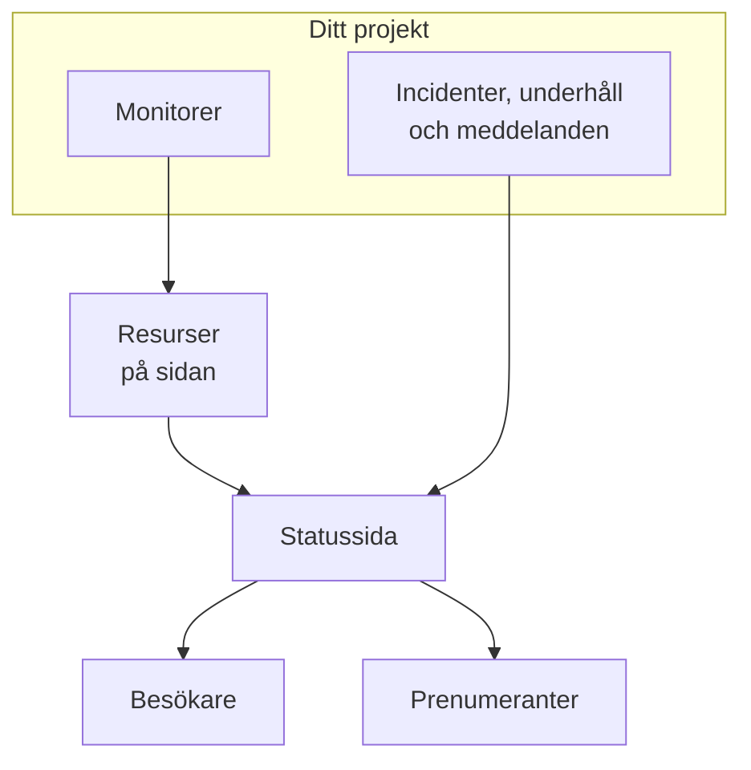

# Statussidor – Översikt

En statussida är det offentliga ansiktet för allt du övervakar: en enda URL som dina kunder kan öppna i stället för att skriva till dig och fråga om problemet bara finns hos dem. Den visar aktuell status för de tjänster du väljer att visa, incidenterna du arbetar med, underhållet du har planerat och alla meddelanden du vill fästa högst upp.

När något går sönder klockan 2 på natten är statussidan det första din supportkö hänvisar till. Det är också därifrån dina prenumeranter aviseras, så det lönar sig att sätta upp den innan du behöver den, inte mitt under driftstoppet.

:::cards
- [Skapa en statussida](#skapa-en-statussida): Två fält för att komma igång, allt annat efteråt.
- [Välj vad den visar](#välja-vad-som-visas-på-sidan): Incidenter, episoder, meddelanden, underhåll och upptid, på ett kort.
- [Bestäm vem som får se den](#begränsa-vem-som-kan-se-sidan): Alla med länken, bara personer som loggar in eller alla med lösenordet.
- [Arkivera en statussida](#arkivera-en-statussida): Ta en sida offline utan att ta bort den.
:::

## Så fungerar det

Statussidor finns under **Statussidor** i menyn **Produkter** i det översta fältet, bland de viktigaste. Allt på den här sidan gäller per statussida: ett projekt kan ha hur många som helst — en offentlig för kunder, en privat för en intern publik, en per region för en viss marknad.

Sidan visar monitorerna du lägger på den som resurser. Incidenter och schemalagt underhåll når sidan via de monitorerna, och meddelanden publiceras direkt på den. Besökare läser sidan, och prenumeranter aviseras om varje ändring i de kanaler de har valt.

## I korthet

- **Skapas med två fält.** En ny statussida frågar bara efter **Namn** och **Beskrivning**. Resurser, varumärke och domäner ställer du in efteråt.
- **Resurser är det besökarna ser.** Varje rad på sidan är en **Statussida Resurs**: en monitor (eller monitorgrupp) med eget visningsnamn, egen knappbeskrivning och egna upptidsval. Grupper delar upp en lång sida i sektioner och kan kapslas.
- **En förhandsgransknings-URL från första dagen.** Varje statussida får en förhandsgranskningslänk, så att du kan se den innan det finns en anpassad domän.
- **Rutterna för besökare beror på inställningar.** Incidenter, episoder, meddelanden och schemalagda händelser visas bara så länge deras reglage i **Vad din statussida visar** (under **Avancerade inställningar**) är på, och prenumerationssidan bara så länge **Visa prenumerantsida** är på.
- **Vem som får se den är ett enda val.** Alla med länken, bara personer som loggar in (privata användare, SAML- eller OIDC-SSO) eller alla med lösenordet, på sidans skärm **Åtkomst**, med en valfri IP-tillåtelselista under **Fler inställningar**.
- **Prenumeranter aviseras automatiskt.** Prenumeranter via e-post, SMS, Slack, Microsoft Teams och webhook kan följa en sida, varje kanal bakom sitt eget reglage.

## Nyckelbegrepp

| Begrepp | Vad det betyder |
| --- | --- |
| **Statussida** | En offentlig (eller privat) sida, med eget varumärke, egna domäner, resurser och prenumeranter. Modellen `StatusPage`. |
| **Resurs** | En rad som besökarna ser: en monitor eller monitorgrupp som visas på sidan med ett visningsnamn och upptidsval. |
| **Grupp** | En namngiven sektion som innehåller resurser. Grupper kapslas i grupper, och varje nivå sammanfattar statusen för allt under den. |
| **Meddelande** | Ett meddelande du publicerar på en eller flera statussidor, med en starttid och en valfri sluttid. |
| **Prenumerant** | Någon (eller något) som följer sidan via e-post, SMS, Slack, Microsoft Teams eller en webhook. |
| **Anpassad domän** | En domän du äger, `status.example.com`, som pekar på sidan med en CNAME-post. OneUptime utfärdar dess SSL-certifikat kostnadsfritt och förnyar det. |
| **Privat användare** | Ett konto som kan logga in på en privat statussida. Skilt från användarna i ditt OneUptime-projekt. |

## Skapa en statussida

:::steps
### Öppna formuläret

Öppna **Statussidor → Alla statussidor** och klicka på **Skapa statussida**.

### Ge sidan ett namn

Fyll i **Namn** (obligatoriskt, minst två tecken) i fönstret **Skapa ny: Statussida** och, om du vill, **Beskrivning**, och klicka på **Skapa statussida**.

Det är hela formuläret. Listan du kommer tillbaka till visar **Namn**, **Beskrivning**, **Etiketter** och **Ägare**, och kan filtreras på **Statussidans ID**, **Namn** och **Beskrivning**.

### Öppna den nya sidan

Öppna den nya sidan så hamnar du på dess skärm **Översikt**, som har två kort: **Status Page Preview URL**, med en länk till själva sidan, och **Detaljer för statussida**, där du kan redigera namnet, beskrivningen och etiketterna du just angav. När projektet har anpassade fält för statussidor följer ett kort **Anpassade fält**.
:::

En sida som skapas med API:et eller med Terraform omfattas av samma abonnemang som inställningarna nedan. På OneUptime Cloud avvisas skapandet av en sida med en påslagen inställning som ditt abonnemang inte omfattar (till exempel privat, en dold lista, anpassad HTML, CSS eller JavaScript, e-postrapporter, prenumeranter via SMS, Slack, Microsoft Teams eller webhook, en IP-tillåtelselista) med `402 Payment Required`, och meddelandet nämner abonnemanget. Varje inställnings abonnemang anges vid inställningen nedan. Inställningar som står kvar på standard, som det här formuläret lämnar dem, fungerar på alla abonnemang.

Därefter, ungefär i ordning efter nytta:

- Lägg till resurser så att sidan visar något: se [Statussidans resurser och grupper](/docs/status-pages/resources-and-groups).
- Ange sidans titel, favicon, logotyp och omslagsbild, och koppla sedan en anpassad domän: se [Statussidans varumärke och domäner](/docs/status-pages/branding-and-domains).
- Bestäm vilka kanaler folk kan prenumerera via: se [Prenumeranter och meddelanden](/docs/status-pages/subscribers).
- Finjustera vad som visas på sidan under **Avancerade inställningar**.

## Var allt finns

När du har öppnat en statussida är dess egen vänstermeny indelad i nio sektioner. Använd den som karta för resten av den här delen av dokumentationen.

| Sektion | Vad den innehåller |
| --- | --- |
| **Grundläggande** | **Översikt**, **Meddelanden**, **Ägare**. |
| **Resurser** | En enda skärm **Resurser** (grupperna till vänster, den valda gruppens monitorer till höger) och **Monitor Rules**. |
| **Prenumeranter** | **E-postprenumeranter**, **SMS-prenumeranter**, **Slack-prenumeranter**, **MS Teams-prenumeranter**, **Webhook-prenumeranter**, **Prenumerantinställningar**. |
| **Aviseringsloggar** | **Aviseringsloggar**: vad som har skickats till prenumeranterna. |
| **Varumärke** | **Varumärke** (logotyp, titel, favicon, länkar, sidfot, färger och språk, på en sida), **Anpassade domäner**, **HTML, CSS och JavaScript**. |
| **Säkerhet** | **Åtkomst** (vem som får se sidan), **Privata användare**, **SSO**, **OIDC**, **SCIM**. |
| **AI** | **MCP**. |
| **Utvecklare** | **Terraform**, **API**, **AI-assistenter**: sidan som kod. |
| **Avancerad** | **Inbäddad status**, **Rapporter**, **Anpassade fält**, **Avancerade inställningar**, **Granskningsloggar**, **Ta bort statussida**. |

Bara **Grundläggande** och **Resurser**, det sidan visar, börjar öppna. Alla andra sektioner börjar ihopfällda, som de sällan använda sektionerna i alla OneUptimes menyer: klicka på en sektions rubrik för att visa dess sidor. En sektion öppnas av sig själv när du är på en av dess sidor, till exempel **Avancerade inställningar** eller **E-postprenumeranter**.

Två egenheter i namnen som är bra att känna till innan du letar:

- Objektet **Resurser** heter bara **Resurser** när projektet har aktiverat monitorgrupper. Annars heter det **Monitorer**. Det är samma skärm i båda fallen.
- Det finns ingen separat gruppsida. Grupper och resurser har slagits ihop, och den gamla rutten `/groups` omdirigerar nu till resursskärmen.

Utanför en enskild sida listar själva sektionen **Statussidor** **Alla statussidor**, och en sektion **Mer** innehåller **Meddelanden**. En ihopfälld sektion **Inställningar** innehåller **Meddelandemallar**, **Prenumerantmallar**, **Anpassade fält**, **Ägarregler** och **Etikettregler**, som gäller hela projektet och delas av alla statussidor. En ihopfälld sektion **Avancerad** innehåller **Arkiverad**: statussidorna du har tagit offline (se [Arkivera en statussida](#arkivera-en-statussida)).

**Etikettregler** och **Ägarregler** ger nya statussidor etiketter och tilldelar dem ägare. En regel har två steg (**Matcha**, villkoren en statussida måste uppfylla, och sedan **Etiketter** eller **Ägare**, det regeln lägger till) och dess **Namn** fylls i utifrån det du väljer. En ny regel måste lägga till minst en etikett eller ägare; vid redigering krävs det aldrig, och listan markerar en gammal regel som inte lägger till något med **Lägger inte till något**. Se [Etikett- och ägarregler](/docs/configuration/label-and-owner-rules).

## Vad besökare ser

Den offentliga sidan är en egen applikation, med en liten uppsättning rutter:

- `/`: **Översikt**.
- `/incidents` och `/incidents/:id`: listan över incidenter och en enskild incident.
- `/announcements` och `/announcements/:id`.
- `/scheduled-events` och `/scheduled-events/:id`.
- `/subscribe/email`, `/subscribe/sms`, `/subscribe/slack`, `/subscribe/microsoft-teams`, `/subscribe/webhooks`.
- `/confirm-subscription/:id`, `/update-subscription/:id` och `/unsubscribe/:token`: länkarna i meddelandena prenumeranterna får.
- `/rss`: flödet.
- `/login`, `/sso` och `/master-password`: bara relevanta på en privat sida.

Navigeringsfältet högst upp visar alltid **Översikt**; resten visas bara när det är påslaget. **Incidenter**, **Meddelanden** och **Planerade händelser** behöver var sitt reglage; **Prenumerera** behöver både **Visa prenumerantsida** och minst en påslagen prenumerationskanal. En privat sida har också ett objekt **Logga ut**.

En enskild incident, episod, ett enskilt meddelande eller en enskild schemalagd händelse öppnas bara om sidan skulle lista den, oavsett historikfönster: en privat incident eller episod, en som är dold på statussidor, en schemalagd händelse som är dold på statussidor eller ett meddelande som är schemalagt till senare hittas inte heller via sin länk.

### Översiktssidan

Översikten är sidan de flesta besökare ser. Uppifrån och ned visar den:

1. **Pågående meddelanden**: meddelanden vars starttid har passerat och vars sluttid inte har det.
2. **En banner med övergripande status**: en enda rad som sammanfattar om alla resurser påverkas eller bara några.
3. **En total upptidsprocent**, om du har slagit på den: i slutet av bannern med övergripande status, så länge alla resurser är i drift. Av som standard.
4. **Resursgrupperna**, var och en med sina resurser, deras aktuella status och deras staplar med upptidshistorik.
5. **Aktiva incidenter**, med aktiva episoder.
6. **Planerade underhållshändelser**.

En nyskapad sida utan innehåll visar ett tomt läge som ber dig lägga till resurser från instrumentpanelen — signalen att gå till skärmen **Resurser**.

Översikten en besökare ser är högst 15 sekunder gammal, och allt du tar bort från sidan försvinner från den inom en sekund: en incident, episod eller schemalagd händelse som du döljer på statussidor, gör privat, begränsar till andra sidor eller tar bort, ett meddelande som du avslutar, skjuter upp eller tar bort, en offentlig anteckning som du tar bort, och en resurs, grupp eller monitor som du tar bort från sidan eller raderar. Andra ändringar, som en ny titel, syns inom de 15 sekunderna.

Vad som sätter en incident på den här sidan och vad som tar bort den kan du läsa om i [Incidentstatusar och allvarlighetsgrader](/docs/incidents/states-and-severities).

## Välja vad som visas på sidan

Vad besökarna ser anges på ett enda kort: **Vad din statussida visar**, under **Statussidor → din sida → Avancerad → Avancerade inställningar**. Det har en rad för varje lista sidan kan visa, sedan **Upptidshistorik** (med den totala upptidsprocenten och statusarna som räknas som driftstopp) och raden "Powered by OneUptime". Det finns ingen redigeringsknapp: ett reglage sparas så fort du slår om det, ett antal dagar när du lämnar fältet eller trycker på Enter, och ett val i en lista så fort du gör det.

- **Visa incidenter** (`showIncidentsOnStatusPage`): på som standard. Under den bestämmer **Visa de senaste … dagarna** (`showIncidentHistoryInDays`, standard 14) hur långt bakåt incidentlistan går, och **Visa incidentetiketter** (`showIncidentLabelsOnStatusPage`) är av som standard.
- **Visa bara incidenter som är begränsade till den här sidan** (`onlyShowScopedIncidents`): också på incidentraden, av som standard. Slå på den så visar sidan, och aviserar sina prenumeranter om, bara de incidenter som är begränsade till den med **Begränsa till dessa statussidor**. Incidenter som inte är begränsade till någon sida, även de som en monitor, Slack, Microsoft Teams, API:et eller AI öppnar av sig själv, når aldrig sidan förrän någon lägger till sidan i dem. Den avgör också vilka incidenter som tar med sina episoder till sidan, och därför finns den kvar när **Visa incidenter** är av. För sidor som delar monitorer men betjänar olika målgrupper, se [En statussida per målgrupp](/docs/status-pages/one-status-page-per-audience).
- **Visa episoder** (`showEpisodesOnStatusPage`): på som standard, med **Visa de senaste … dagarna** (`showEpisodeHistoryInDays`, standard 14) och **Visa episodetiketter** (`showEpisodeLabelsOnStatusPage`, av som standard). Episoder är en egen modell med egna slutpunkter, inte en vy av incidenter.
- **Visa meddelanden** (`showAnnouncementsOnStatusPage`): på som standard, med **Visa de senaste … dagarna** (`showAnnouncementHistoryInDays`, standard 14).
- **Visa schemalagda underhållshändelser** (`showScheduledMaintenanceEventsOnStatusPage`): på som standard, med **Visa de senaste … dagarna** (`showScheduledEventHistoryInDays`, standard 14) och **Visa händelseetiketter** (`showScheduledEventLabelsOnStatusPage`, av som standard).
- **Upptidshistorik**: allt om sidans upptid, på en rad:
  - **Visa de senaste … dagarna** (`showUptimeHistoryInDays`) är längden på upptidsstapeln bredvid varje resurs. Den är 90 som standard och måste vara mellan 1 och 90. Alla val för **Visa upptid %** och **Visa statushistorikdiagram** för en resurs eller grupp läser det här talet, och det gör även den totala upptidsprocenten.
  - **Visa total upptidsprocent** (`showOverallUptimePercentOnStatusPage`): av som standard. Slå på den så avslutas bannern med övergripande status med en upptidsprocent för hela sidan, medelvärdet av dess resurser och grupper, så länge allt är i drift. Medan den är på väljer **Precision** (`overallUptimePercentPrecision`) hur många decimaler den visar: `99%`, `99.9%`, `99.99%` (standard) eller `99.999%`. Varje resurs och varje grupp har sin egen precision.
  - **Räknas som driftstopp** (`downtimeMonitorStatuses`): monitorstatusarna vars tid räknas mot varje upptidsprocent på sidan: varje resurs, varje grupps och den totala. Varje status är en etikett i sin egen färg. Lägg till en från listan eller ta bort en med dess **×**, och ändringen sparas direkt. En ny statussida börjar med alla projektets statusar som inte är i drift. Det finns alltid minst en status kvar: den sista kan inte tas bort, eftersom all upptid på sidan annars skulle visa 100%.
- **Visa "Powered By OneUptime"-varumärke**: på som standard, så sidfoten för besökare säger "Powered by OneUptime". Slå av den för att dölja raden. Kolumnen sparar det omvänt, som `hidePoweredByOneUptimeBranding`.

**En avslagen lista** försvinner från sidan, tillsammans med sitt objekt i navigeringsfältet om den har ett; dess offentliga slutpunkt avvisar begäran, och sidans prenumeranter aviseras inte om den sortens händelse. Raden visar då bara sitt reglage: hur långt bakåt en dold lista går, och om den visar etiketter, ändrar ingenting.

**Abonnemang.** På OneUptime Cloud visar en inställning som ditt abonnemang inte kan ändra det abonnemang den behöver bredvid sig. De fyra listreglagen, de tre etikettreglagen och episodernas historik kräver **Growth**; att visa den totala upptidsprocenten och att dölja raden "Powered by OneUptime" kräver **Scale**. De andra historikfönstren, **Upptidshistorik**, **Precision**, **Räknas som driftstopp** och **Visa bara incidenter som är begränsade till den här sidan** kan ändras på alla abonnemang, och var och en sparas för sig: en sida vars totala upptidsprocent redan är på kan ändra dess precision på vilket abonnemang som helst. Att återställa en inställning till hur den är på en ny sida (visa en lista igen, dölja etiketterna eller den totala upptidsprocenten, visa raden "Powered by OneUptime", återställa episodernas historik till 14 dagar) fungerar på alla abonnemang, så inget som en provperiod ändrade blir kvar så i brist på abonnemang: reglaget säger att det fortfarande kan gå tillbaka, och vilket abonnemang som krävs för att ändra det igen.

Om sidan visar ett objekt **Prenumerera** (**Visa prenumerantsida**, `showSubscriberPageOnStatusPage`, på som standard) och vilka kanaler besökare kan prenumerera via anges inte på den här skärmen: båda finns på kortet **Kanaler** under **Prenumeranter → Prenumerantinställningar** (se [Prenumerationskanaler](/docs/status-pages/subscribers#prenumerationskanaler)).

Under kortet finns **Exportera Statussida som JSON**, som laddar ned statussidans egna inställningar till en fil du kan importera igen, och **Archive status page** (se [Arkivera en statussida](#arkivera-en-statussida)). Den totala upptidsprocenten och driftstoppsstatusarna var tidigare två egna kort här, vart och ett bakom en knapp **Redigera**; nu är de rader på kortet.

**Var färgerna finns.** Upptidsstaplarnas färger finns inte här: **Standardfärg för stapel** och färgreglerna för staplarna finns under **Fler inställningar** i **Statussidor → din sida → Varumärke → Varumärke**. Det finns ingen inställning för tema eller varumärkesfärg någonstans; allt utöver de kontrollerna gör du med **Anpassad CSS**.

## Förhandsgranska innan du går live

Skärmen **Översikt** för varje statussida har ett kort **Status Page Preview URL** med en direktlänk till sidan. Använd den medan du fortfarande lägger till resurser och innan det finns en anpassad domän.

Bakom kulisserna har varje offentlig rutt en förhandsgranskningstvilling under `/status-page/{statusPageId}/...`: en förhandsgranskad översikt, en förhandsgranskad incidentlista, en förhandsgranskad prenumerationssida och så vidare. En URL eller skärmbild från instrumentpanelens förhandsgranskning stämmer därför inte med det en kund ser när en anpassad domän är kopplad, så kontrollera alla länkar du klistrar in i en runbook eller ett e-postmeddelande.

## Begränsa vem som kan se sidan

Alla statussidor är inte till för allmänheten. Vem som får se en sida är ett enda val, det första kortet på **Statussidor → din sida → Säkerhet → Åtkomst**, **Vem som kan se den här statussidan**:

- **Alla med länken**: sidan är offentlig. Alla nya statussidor börjar här.
- **Bara personer som loggar in**: besökare hamnar på `/login` och loggar in som privat användare eller med din SSO- eller OIDC-leverantör (se nedan). Under valet listar kortet inloggningen som är inställd för sidan (hur många privata användare den har och om SSO och OIDC är på, var och en med en länk till sin skärm) och varnar, så länge det här är valet, när ingen ännu kan logga in.
- **Alla med lösenordet**: besökare hamnar på `/master-password` och låser upp sidan med ett lösenord som du delar med dem. Ingen behöver ett konto. När du väljer det frågar samma dialogruta efter lösenordet om sidan inte har något; har den redan ett kan du behålla det eller skriva ett nytt. Därefter ersätter **Ändra lösenord** under valet det. Lösenordet lagras som hash och kan inte visas igen, och de som angav det gamla kan fortsätta se sidan i upp till 7 dagar.

Att välja ett alternativ ber om bekräftelse och säger vad som ändras för besökarna, och sparas direkt. Det finns ingen redigeringsknapp.

**Bilder.** En bild i det sidan visar (en offentlig anteckning, ett meddelande, en beskrivning) öppnas på sin egen långa adress som inte går att gissa, och som fungerar utan inloggning, så att e-postmeddelandena till dina prenumeranter också kan visa den. Själva sidan kräver fortfarande inloggning eller lösenordet.

**Vad som sparas.** Valet består av tre kolumner, som API:et och Terraform läser och skriver som tidigare: `isPublicStatusPage`, `enableMasterPassword` och `masterPassword`. Besökare tillfrågas bara om lösenordet på en sida som inte är offentlig, med `enableMasterPassword` på och ett angivet lösenord; en privat sida med reglaget på men utan lösenord är en inloggningssida. Att välja **Alla med länken** slår också av `enableMasterPassword`, eftersom en offentlig sida aldrig frågar efter det. Skärmen **Åtkomst** skriver bara de kolumner som ett val ändrar.

**Abonnemang.** På OneUptime Cloud kräver det abonnemanget **Growth** att göra en sida privat: på ett lägre abonnemang visar de två privata alternativen abonnemanget de behöver och kan inte väljas. Att göra den offentlig igen (**Alla med länken**) fungerar på alla abonnemang, så en sida som blev kvar som privat när en provperiod tog slut, eller efter ett byte till ett lägre abonnemang, alltid kan öppnas igen; dialogrutan säger att det kräver **Growth** att göra den privat igen. Att byta från **Bara personer som loggar in** till **Alla med lösenordet** fungerar på alla abonnemang, liksom **Ändra lösenord**.

### Privata användare

Lägg till personerna som får logga in under **Statussidor → din sida → Säkerhet → Privata användare**. Det finns en åtgärd **Lägg till i bulk**: klistra in en lista med e-postadresser så får varje adress ett inbjudningsmejl. Privata användare har ett eget flöde för glömt lösenord och återställning, skilt från kontona i ditt OneUptime-projekt.

**Privata användare och lösenordet läggs inte ihop.** Så länge **Alla med lösenordet** är valet kan privata användare inte logga in (de anger också lösenordet), och skärmen **Privata användare** säger det, med en länk tillbaka till **Åtkomst**.

### SSO och OIDC

För en privat sida som är kopplad till din identitetsleverantör ställer **Statussidor → din sida → Säkerhet → SSO** in SAML: du anger inloggnings-URL:en, utfärdaren och x509-certifikatet, och signerings- och digest-metoderna fylls i under **Fler fält**. **Statussidor → din sida → Säkerhet → OIDC** ställer in OpenID Connect: du anger utfärdaren, klient-ID:t och hemligheten, och discovery-URL:en, scopes och claim-namnen fylls i under **Fler fält**. **SCIM** skapar privata användare automatiskt från IdP:n. På OneUptime Cloud kräver alla tre abonnemanget Scale eller högre. I en egendriftad installation ingår SSO och OIDC i alla utgåvor, och SCIM kräver [Enterprise Edition](/docs/self-hosted/enterprise).

Att stänga av eller ta bort en statussidas SSO- eller OIDC-leverantör loggar ut de privata användare som den loggade in: deras sessioner upphör vid nästa begäran, och att slå på leverantören igen återställer dem inte; de loggar in via den på nytt. Ett nytt certifikat eller en ny klienthemlighet, andra URL:er eller ett nytt namn håller alla inloggade. På en sida som kräver SSO stänger det ute alla att stänga av dess sista leverantör, tills du slår på en igen eller stänger av **Kräv SSO för inloggning**; för att byta till en annan leverantör ställer du in och testar den nya innan du stänger av den gamla.

Under leverantörerna innehåller kortet **SSO-inställningar** reglaget **Kräv SSO för inloggning** (`requireSsoForLogin`, av som standard), som sparas så fort du slår om det. Att slå på det ber först om bekräftelse, eftersom privata användare därefter inte kan logga in med e-post och lösenord: bara personerna som din SSO- eller OIDC-leverantör släpper in kan se sidan. Testa SSO med länken på den skärmen innan du slår på det. Det spelar bara roll så länge **Bara personer som loggar in** är valet, och skärmen **Åtkomst** visar det som **SSO krävs** under det valet. Medan det är på loggas även en privat användare som loggade in med e-post och lösenord ut vid nästa begäran: bara sessioner som en SSO- eller OIDC-leverantör startade räknas. På OneUptime Cloud kräver det abonnemanget **Scale** att slå på det, och att stänga av det fungerar på alla abonnemang. En sida som fortfarande kräver SSO efter att en provperiod med Scale har tagit slut, eller efter ett byte till ett lägre abonnemang, fortsätter med det tills någon stänger av det: dess sidor **SSO** och **OIDC** visar reglaget för det under abonnemangserbjudandet.

### IP-tillåtelselista

Under **Fler inställningar** på **Åtkomst** begränsar sektionen **IP-tillåtelselista** (kolumnen `ipWhitelist`) en sida till kända nätverk. Den gäller oavsett sidans publik: en besökare från vilken annan adress som helst avvisas, även med lösenordet eller ett konto som privat användare. Skriv en post per rad: en IPv4- eller IPv6-adress, eller ett IPv4-intervall som `10.0.0.0/8`; en rad som inte är något av dem avvisas när du sparar. Lämna den tom för att tillåta alla adresser. Medan listan gäller visar den ihopfällda rubriken **Fler inställningar** **IP-tillåtelselista** med antalet poster i den. På OneUptime Cloud kräver det abonnemanget **Scale** att ändra den; att tömma den fungerar på alla abonnemang.

## Den inbäddbara brickan och RSS-flödet

Två sätt att visa status någon annanstans än på själva sidan.

**Inbäddad statusbricka.** Under **Statussidor → din sida → Avancerad → Inbäddad status** slår du på **Aktivera inbäddad statusbricka** (`enableEmbeddedOverallStatus`, av som standard) och klickar sedan på **Generera om token** på kortet **Säkerhetstoken** för att ge brickan dess token (`embeddedOverallStatusToken`). Brickan levereras från `/api/status-page/badge/<status-page-id>?token=<token>`, och skärmen visar den i **Märkesförhandsgranskning** med kodsnuttar att kopiera, så att du kan lägga in den aktuella övergripande statusen i din dokumentation, i sidfoten i din app eller på en marknadsföringssida.

**RSS-flöde.** Varje statussida levererar `/rss`: ett flöde med titeln "{sidtitel} Updates", med den **Sidtitel** som anges under **Varumärke**, eller sidans namn om den inte har någon, och vars poster börjar med `Incident: `, `Announcement: ` och `Scheduled Maintenance: `. Användbart för den som hellre hämtar dina uppdateringar till en flödesläsare eller en chattbot än prenumererar via e-post.

Om du hellre hämtar data själv bygger statussidan på offentliga lässlutpunkter för översikten, incidenterna, de schemalagda underhållshändelserna, meddelandena och episoderna: se [Offentligt API](/docs/status-pages/public-api).

## Arkivera en statussida

Arkivera en statussida för att ta den offline utan att ta bort den. En arkiverad statussida:

- **Är offline.** Dess URL, dess anpassade domäner, dess inbäddade bricka, dess offentliga API och dess MCP-server svarar som om sidan inte fanns ("Status Page not found"), så en besökare kan inte skilja en arkiverad sida från en som aldrig har funnits. Instrumentpanelens förhandsgranskningslänk slutar också att fungera.
- **Skickar ingenting till sina prenumeranter.** Inga aviseringar om incidenter, episoder, underhåll eller meddelanden, inga rapporter och inga prenumerationsbekräftelser. Ingen kan prenumerera på den.
- **Försvinner från listan över statussidor.** Du hittar den under **Statussidor → Avancerad → Arkiverad**.
- **Behåller allt.** Dess resurser, grupper, varumärke, domäner, privata användare och prenumeranter behålls, så när du avarkiverar den kommer sidan tillbaka online precis som den var.

För att arkivera en statussida öppnar du den och går till **Avancerad → Avancerade inställningar → Archive status page**. För att arkivera flera markerar du dem i listan **Statussidor** och väljer **Arkivera**. För att få tillbaka en öppnar du **Statussidor → Avancerad → Arkiverad**, markerar den och väljer **Avarkivera**, eller öppnar den och klickar på **Avarkivera** i bannern högst upp på dess sidor.

## Nästa steg

:::cards
- [Statussidans resurser och grupper](/docs/status-pages/resources-and-groups): Lägg monitorer på sidan och ordna dem i sektioner.
- [Statussidans varumärke och domäner](/docs/status-pages/branding-and-domains): Din logotyp och dina färger, och sidan på din egen domän.
- [Prenumeranter och meddelanden](/docs/status-pages/subscribers): De fem prenumerationskanalerna och publicering av meddelanden.
- [En statussida per målgrupp](/docs/status-pages/one-status-page-per-audience): En sida per kund, plats eller region, och vilka som aviseras om varje incident.
:::
