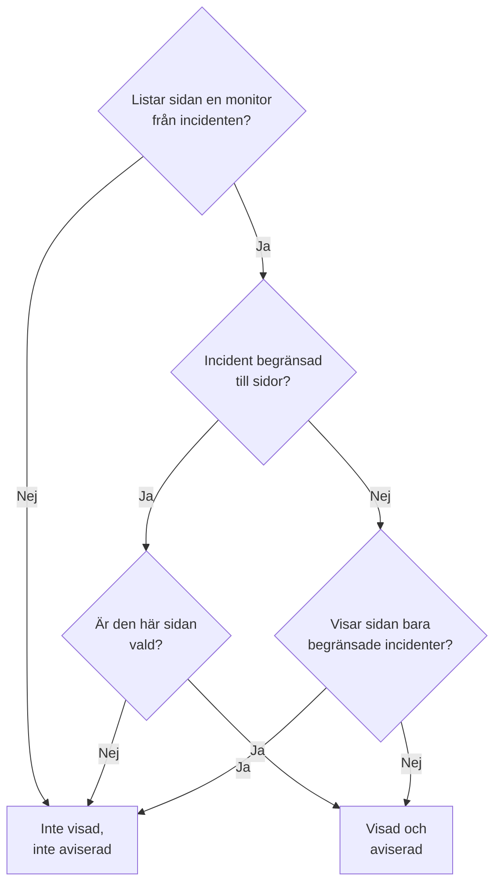

# En statussida per målgrupp

Olika människor behöver olika nyheter. En kund vill inte höra om en annan kunds driftstopp, och personalen på en plats vill inte ha ett e-postmeddelande varje gång en annan plats tappar sitt nätverk. I OneUptime är enheten för en målgrupp statussidan: varje sida har sina egna prenumeranter, sitt eget varumärke och sin egen sekretess. Ge därför varje målgrupp en egen sida, och bestäm incident för incident vilka sidor som får veta om den.

Delad infrastruktur gjorde det svårt. En incident når en statussida via sina monitorer, så en monitor som delades av tio platssidor berättade för alla tio platser om ett driftstopp som drabbade två. Den enda lösningen var en sida, eller en monitor, för varje kombination av platser. Den här sidan tar upp inställningarna som löser det:

- **Begränsa till dessa statussidor** på en incident, så att den bara visas på, och aviserar, de sidor du väljer.
- **Visa bara incidenter som är begränsade till den här sidan** på en statussida, så att en incident som ingen har begränsat ännu inte når någon av de här sidorna förrän någon bestämmer sig. Det gäller även de incidenter som en monitor, Slack, Microsoft Teams, API:et eller AI öppnar av sig själv.
- En registrering av vilka sidor som fick veta att en incident skapades, så att en sida du lägger till senare aviseras en gång och de andra inte aviseras igen.
- En sammanfattning **Meddelar** som visar vem som får veta om en incident innan du deklarerar den eller publicerar en offentlig anteckning, och **Förhandsgranskning**, som visar vad varje sidas prenumeranter kommer att få.

:::cards
- [Sätt upp det](#sätta-upp-en-sida-per-målgrupp): En sida per målgrupp, och reglaget som håller obegränsade incidenter borta från dem.
- [Begränsa en incident](#begränsa-en-incident-till-statussidor): Välj sidorna när du deklarerar den, eller senare.
- [Lägg till eller ta bort sidor](#lägga-till-och-ta-bort-statussidor): Vem som aviseras om en sida du lägger till, och vad det drar tillbaka att ta bort en.
- [Vad varje meddelande innehåller](#vad-varje-meddelande-innehåller): Värdena varje sida får, och vad de berättar för varje målgrupp.
:::

## När du ska använda det

- **En managed service provider** med en statussida per kund, på monitorer som kunderna delar.
- **En organisation med platser, fabriker eller regioner**, var och en med egen personal att avisera.
- **Intern IT** med en sida per avdelning eller byggnad.

Om din målgrupp gärna väljer själv kan en sida räcka: låt prenumeranterna välja de resurser de bryr sig om (se [Prenumeranter och meddelanden](/docs/status-pages/subscribers)). Använd en sida per målgrupp när du gör valet åt dem, incident för incident, eller när en målgrupp inte får se en annan målgrupps incidenter över huvud taget.

## Så når en incident en statussida

En incident når en statussida via sina monitorer. En sida visar en incident, och aviserar sina prenumeranter om den, när en av sidans resurser är en av incidentens monitorer, direkt eller via en monitorgrupp på sidan. Två inställningar begränsar det:

- **Begränsa till dessa statussidor** på incidenten (`statusPages`). Lämnas den tom når incidenten varje sida som listar dess monitorer, som den alltid har gjort. Med valda sidor når den bara de valda sidorna **bland** dem som listar dess monitorer.
- **Visa bara incidenter som är begränsade till den här sidan** på statussidan (`onlyShowScopedIncidents`, av som standard). Med den påslagen visar sidan aldrig en incident som inte är begränsad till vissa statussidor, och aviserar aldrig någon om den.



För en sida som listar en av incidentens monitorer:

| Incidenten är | Sida med **Visa bara incidenter som är begränsade till den här sidan** av | Sida med den på |
| --- | --- | --- |
| Inte begränsad till någon statussida | Visad och aviserad | Inte visad, inte aviserad |
| Begränsad till statussidor, och den här sidan är vald | Visad och aviserad | Visad och aviserad |
| Begränsad till statussidor, men inte den här | Inte visad, inte aviserad | Inte visad, inte aviserad |

En sida som inte listar någon av incidentens monitorer visar den aldrig, vad du än väljer, och en incident utan monitorer aviserar inga statussideprenumeranter alls. De vanliga reglerna gäller fortfarande ovanpå: incidenten måste vara **Synlig på statussidan** och inte privat, sidan måste ha **Visa incidenter** på, och en prenumerant som bara valde vissa resurser eller händelsetyper får bara det hen valde.

Samma regler avgör allt som beror på vilka sidor en incident når:

- incidentlistorna, översikten och incidentens egen sida på den offentliga statussidan, och statussidans [Offentligt API](/docs/status-pages/public-api);
- meddelandena via e-post, SMS, Slack, Microsoft Teams och webhook som skickas när incidenten skapas, byter tillstånd, får en offentlig anteckning eller får en efteranalys;
- antalet incidenter i statussiderapporter som skickas via e-post, som bara räknar de incidenter som sidan visar.

En incidentepisod når en sida när minst en av dess incidenter gör det. Dess aviseringar går till varje sida som dess incidenter når, och dess sida på en statussida som ingen av dem når hittas inte. En privat incident når ingen sida, så den tar aldrig med sin episod till någon, och en privat episod visas inte på någon sida alls.

## Sätta upp en sida per målgrupp

:::steps
### Skapa en statussida för varje målgrupp

Skapa en sida per målgrupp, till exempel `Site 01` till `Site 10`. Gör dem privata om målgruppen är intern (se [Begränsa vem som kan se sidan](/docs/status-pages/index#begränsa-vem-som-kan-se-sidan)). Prenumeranter på en privat sida kan fortfarande avregistrera sig utan att logga in, via länken i varje meddelande (se [Hantera och avsluta en prenumeration](/docs/status-pages/subscribers#hantera-och-avsluta-en-prenumeration)). Ge dem etiketter som `Region East`, så att väljaren kan lägga till alla sidor med en etikett med ett klick.

### Lägg den delade monitorn på varje sida

Lägg till den delade monitorn på varje sida som en resurs (se [Statussidans resurser och grupper](/docs/status-pages/resources-and-groups)). En regel under **Resurser → Monitor Rules** kan göra det åt dig utifrån monitorns etiketter.

### Slå på Visa bara incidenter som är begränsade till den här sidan

Slå på den på var och en av de sidorna. Den finns på kortet **Vad din statussida visar** under **Statussidor → din sida → Avancerad → Avancerade inställningar**, under **Visa incidenter**, och sparas i samma ögonblick som du slår om den. Därefter når ingenting en platssida om inte någon väljer den.

### Lägg till varje målgrupps prenumeranter

För personal använder du **Lägg till i bulk** under **E-postprenumeranter**, och föredrar varje persons egen adress framför en e-postlista som `site03-all@`: vem som helst på listan kan avregistrera den för alla som finns på den. Om en prenumerant som du lade till avregistrerar sig får sidans ägare och den som lade till prenumeranten ett e-postmeddelande (se [Delade adresser och e-postlistor](/docs/status-pages/subscribers#delade-adresser-och-e-postlistor)).

### Låt dem som hanterar incidenter läsa statussidor

Väljaren listar bara de statussidor som personen kan läsa, och incidentrollerna kan inte läsa statussidor. Ge dem som hanterar incidenter rollen **Status Page Viewer** bredvid deras incidentroll; den kan begränsas till sidor med vissa etiketter. Utan den är väljaren tom.

### Bestäm vad varje meddelande säger

Under **Incidenter → Inställningar → Anpassade fält** definierar du de anpassade incidentfält som ditt team svarar på varje gång, till exempel `Impact` (en listruta), `Expected Resolution` (ett datum och en tid) och `Acknowledgement` (ett ja/nej-reglage). Dra dem i den **Ordning** du vill att de ska efterfrågas och listas i, och slå på **Visa vid skapande** så att formuläret för att deklarera frågar efter dem, **Obligatoriskt vid skapande** där ett svar är ett måste, och **Ta med i aviseringar till prenumeranter** för dem som alla målgrupper får läsa. De finns då med i varje sidas standardmeddelande via e-post. Se [Anpassade fält](/docs/incidents/settings#anpassade-fält).

### Ge varje sidas e-post ett eget varumärke (valfritt)

På abonnemanget **Scale** ger du varje sida en **Anpassad SMTP-konfiguration** och kopplar anpassade mallar till incidenthändelserna; de kan placera vilket fält som helst med `{{incident.customFields.<key>}}`. Medan du skriver en mall visar **Förhandsgranskning i realtid** under den mallen ifylld med exempelvärden. Se [Vad en anpassad mall behöver](/docs/status-pages/subscribers#vad-en-anpassad-mall-behöver), och [Vad varje meddelande innehåller](#vad-varje-meddelande-innehåller) innan du använder `{{affectedStatusPages}}`.

### Spara incidentmallar med valda sidor (valfritt)

En mall `Region East outage` kan ha sidorna för platserna i öst, och standardsvar för de anpassade fälten.

### Kontrollera varje sidas e-post före det första driftstoppet

Starta **Deklarera incident** med den delade monitorn och två av platssidorna valda, och öppna **Förhandsgranskning** bredvid **Ja** i sammanfattningen innan du skickar: den visar e-postmeddelandet som varje sidas prenumeranter skulle få, och vilken mall det använder och varför. **Skicka test till mig** skickar ett till din egen inkorg. Ingen annan får något förrän du deklarerar incidenten, så lämna formuläret utan att skicka det när du är klar. Se [Vem som kommer att aviseras](#vem-som-kommer-att-aviseras).
:::

## Begränsa en incident till statussidor

### När du deklarerar den

På **Incidenter → Alla incidenter → Deklarera incident** har steget **Berörda resurser** fältet **Begränsa till dessa statussidor** under **Fler fält**, efter monitorerna och de andra resurserna. Dess exempeltext, **Alla statussidor som listar monitorerna**, är vad det betyder att lämna det tomt. Välj sidor efter namn, eller öppna väljarens flik **Etiketter** och välj en etikett för att lägga till alla sidor som har den.

Formuläret varnar dig:

- när en vald sida inte listar någon av incidentens monitorer, eller ingen monitor alls är kopplad. Incidenten kommer inte att visas på den sidan eller avisera dess prenumeranter;
- när du också anger **Ändra övervakningsstatus till**, direkt under monitorerna i samma steg. Se [Monitorstatus delas](#monitorstatus-delas);
- när du också kryssar i **Privat incident**, under **Fler fält** i steget **Incidentdetaljer**. Privata incidenter är dolda på alla statussidor, även de du valde.

Steget **Detaljer**, direkt efter **Berörda resurser**, frågar efter de anpassade incidentfält som är markerade med **Visa vid skapande** (se [Deklarera en incident](/docs/incidents/declaring-incidents)). Dess svar går till varje sida som incidenten når: värden i anpassade fält tillhör incidenten, inte en statussida.

**Skapa från mall** fyller i fältet från mallen. En malls sidor anges i dess steg **Berörda resurser** när du skapar den, och efteråt på dess kort **Statussideomfång** (**Incidenter → Inställningar → Incidentmallar**). Som med mallens andra fält vinner en lista som du anger själv. En malls sidor fylls i även för den som hanterar incidenter och inte kan läsa statussidor: den som satte upp mallen valde dem åt alla som deklarerar utifrån den.

### Vem som kommer att aviseras

Under **Meddela statussideprenumeranter**, direkt under väljaren under **Fler fält** i steget **Berörda resurser**, och igen i sammanfattningen innan du skickar, visar formuläret vem incidenten kommer att nå:

> Meddelar:
>
> - Site 03 (upp till 41 via e-post)
> - Site 07 (upp till 18 via e-post)

Under det, under **Meddelas inte:**, listar det de sidor som listar monitorerna men inte kommer att aviseras, och varför: den är inte en av sidorna som incidenten är begränsad till, det är en sida som bara visar incidenter som är begränsade till den, eller det är en sida som inte visar incidenter.

När ingen kommer att aviseras visar sammanfattningen ingenting: incidenten har inga monitorer, ingen statussida listar dem, sidorna har inga prenumeranter ännu, **Meddela statussideprenumeranter** är av, eller incidenten är privat. Den varnar bara när statussideomfånget är orsaken, och anger de sidor den utelämnar: incidenten är inte begränsad och sidorna som listar dess monitorer visar bara incidenter som är begränsade till dem, den är begränsad till andra sidor, eller sidorna den är begränsad till listar ingen av dess monitorer. I sammanfattningen lyder **Meddela statussideprenumeranter** **Ja** eller **Nej** som alla andra rutor, med **Förhandsgranskning** bredvid **Ja**; den erbjuds inte medan rutan är av, incidenten är privat eller ingen monitor är kopplad.

Samma sammanfattning visas under **Meddela statussideprenumeranter** när du skriver en anteckning på incidentens sida **Offentliga anteckningar**, för incidenten som den är. Där säger den också när incidenten är dold på statussidor, eftersom inget kommer att skickas då.

Antalen är "upp till". De räknar per kanal de bekräftade prenumeranterna på varje sida som inte har avregistrerat sig, och en prenumerant som bara valde vissa resurser eller händelsetyper kanske inte får det här meddelandet. Sidor som du inte kan läsa anges inte. De räknas som "statussidor till som du inte har åtkomst till".

**Förhandsgranskning**, bredvid **Ja** i sammanfattningen och bredvid anteckningens kryssruta, visar vad de kommer att få: välj en sida för att se dess e-postmeddelande som dess prenumeranter kommer att få det, med ämnet, och vilken mall det använder och varför, till exempel att en sidas anpassade mall inte används eftersom sidan inte har någon **Anpassad SMTP-konfiguration**. **Skicka test till mig** skickar sidans e-postmeddelande till ditt kontos e-postadress, och till ingen annan. Sidor som du inte kan läsa räknas men förhandsgranskas inte. Se [Förhandsgranska e-postmeddelandet innan det skickas](/docs/status-pages/subscribers#förhandsgranska-e-postmeddelandet-innan-det-skickas).

### Efter att den har deklarerats

Öppna incidenten och gå till **Avancerad → Inställningar**. Kortet **Statussideomfång** listar sidorna som incidenten är begränsad till, och **Redigera statussideomfång** ändrar dem. Incidentens **Översikt** visar samma lista som **Statussideomfång**, skrivskyddad, med en länk **Ändra under Inställningar**.

På **Incidenter → Alla incidenter** hittar filtret **Statussida** de incidenter som är begränsade till sidorna du väljer, eller de som inte är begränsade till någon sida.

### Via API:et

`statusPages` är en lista med statussidors ID:n, på `POST /api/incident` och vid uppdateringar av en incident, och på incidentmallar. Varje sida måste tillhöra incidentens projekt; en sida från ett annat projekt avvisas. Varje sida du lägger till måste också vara en som du kan läsa, som i väljaren, annars avvisas begäran. Sidor som incidenten eller mallen redan har behålls oavsett om du kan läsa dem, och en sida från en incidentmall som du kan läsa kan väljas när du deklarerar en incident. Två kolumner till följer av det, och ingen av dem är din att ange:

- `isScopedToStatusPages` härleds från `statusPages`. Allt du skickar för den ignoreras.
- `statusPagesNotifiedOnCreation` är registreringen av de sidor som fick veta att incidenten skapades. Se [Lägga till statussidor](#lägga-till-statussidor).

För att se vem en incident skulle nå utan att skicka något anropar du målgruppsslutpunkten:

```bash
curl -X POST https://oneuptime.com/api/incident/subscriber-audience \
  -H "apikey: $ONEUPTIME_API_KEY" \
  -H "Content-Type: application/json" \
  -d '{
    "monitorIds": ["<monitor-id>"],
    "statusPageIds": ["<status-page-id>"]
  }'
```

Skicka i stället `{"incidentId": "<incident-id>"}` för en incident som redan finns. Svaret listar varje sida som kommer att aviseras med ett antal per kanal (`email`, `sms`, `slack`, `microsoftTeams`, `webhook`), sidorna som utelämnas och varför, och `hiddenStatusPageCount` för sidorna som anroparen inte kan läsa. Det returnerar aldrig en adress.

## Incidenter som ingen har begränsat ännu

Monitorvillkor, Slack, Microsoft Teams, API:et och AI kan alla öppna en incident av sig själva, och ingen av dem vet vilka platser ett fel på en delad monitor drabbar. En sådan incident är inte begränsad till någon sida, så varje sida som listar monitorn skulle visa den, och avisera sina prenumeranter, inom ungefär en minut. När ett e-postmeddelande väl har skickats till en prenumerant kan det inte tas tillbaka.

**Visa bara incidenter som är begränsade till den här sidan** är det som stoppar det. En sida med den påslagen ignorerar varje obegränsad incident. Incidenten öppnas fortfarande, jourpolicyerna larmar fortfarande dem som hanterar incidenter, och dess ägare aviseras fortfarande, men ingen av de här sidorna får veta om den. Den som hanterar incidenten tar sedan reda på vem som drabbas och lägger till de sidorna på incidentens flik **Inställningar**, med **Skicka meddelandet om skapad incident till nyligen tillagda sidor** ikryssat. Deras prenumeranter aviseras inom ungefär en minut.

## Lägga till och ta bort statussidor

### Lägga till statussidor

Prenumeranterna på en sida får en gång veta att en incident skapades. Så när du lägger till sidor på kortet **Statussideomfång** erbjuder redigeringsformuläret **Skicka meddelandet om skapad incident till nyligen tillagda sidor**, ikryssat som standard:

- Ikryssat köas incidentens avisering om "skapad" igen, och den går bara till de sidor som inte har aviserats än. Incidenten håller en registrering av sidorna som aviserades, så att de andra inte får den två gånger.
- Urkryssat börjar de tillagda sidorna visa incidenten, och får veta allt från och med nu, men får inte veta att den skapades.

Kryssrutan visas bara när en bock skulle skicka något: minst en sida du lägger till har inte aviserats än, och incidenten deklarerades med **Meddela statussideprenumeranter** på, är synlig på statussidor och är inte privat. Vissa fall hanteras åt dig:

- **Aviseringen står fortfarande i kö, eller skickas just nu.** Ett köat utskick läser sidorna när det går ut, och ett utskick som körs läser dem igen när det är klart och aviserar sedan sidorna som lades till under tiden. Så det finns ingen kryssruta: sidorna du lägger till aviseras i vilket fall som helst. (Om det utskicket misslyckas finns sidorna som lades till under tiden bland dem som dess **Försök igen** skickar till.)
- **Varje sida du lägger till har redan aviserats**, till exempel en sida som du tog bort och lägger till igen, eller en incident som nådde alla platser och nu har begränsats till två av dem. Ingen aviseras igen, så det finns ingen kryssruta.
- **Incidenten meddelades aldrig.** När den publicerades utan **Meddela prenumeranter att denna incident har skapats**, eller deklarerades utan monitorer, aviserades ingen. En bock i rutan aviserar bara sidorna du lägger till, inte sidorna som den redan var begränsad till.
- **Incidenten deklarerades innan den här funktionen släpptes.** Dess avisering om "skapad" gick till varje sida som listade dess monitorer, och det finns ingen registrering av de sidorna. Att lägga till sidor skickar den inte igen, så kryssrutan erbjuds inte.
- **Incidenten är dold.** Inget skickas medan den är dold. När du slår på **Synlig på statussidan** igen erbjuder kortet **Incidentinställningar** **Meddela prenumeranter att denna incident har skapats** för de sidor i dess omfång som aldrig aviserades, som de som lades till medan den var dold.

En sida som läggs till senare får veta vad som händer härnäst: senare offentliga anteckningar, tillståndsändringar och efteranalysen. Den får inte de anteckningar och tillståndsändringar som skickades innan den lades till. Om den behöver komma ikapp publicerar du en offentlig anteckning.

Samma registrering gör att **Försök igen** på en misslyckad avisering om "skapad" fortsätter där den stoppades: sidor som redan har aviserats hoppas över. En sida räknas som aviserad först när alla dess prenumeranter har fått meddelandet; en sida där ett meddelande misslyckades, eller där utskicket stoppades halvvägs, får det igen i sin helhet. Registreringen skrivs allteftersom varje sida blir klar, så det gäller även för ett utskick som avbröts. Den hålls per sida, inte per prenumerant: prenumeranterna på en sida där utskicket stoppades halvvägs och som redan hade fått meddelandet får det en gång till.

För att i stället börja om, till exempel efter att ha rättat en mall eller en SMTP-inställning, kryssar du i **Skicka det igen till alla statussidor, även sidorna som redan har nåtts** i bekräftelsen av **Försök igen**: knappen blir **Skicka igen till alla sidor**, registreringen töms, och varje sida som incidenten når nu får den igen. Efter en avisering som gick ut i sin helhet erbjuder **Prenumerantaviseringsstatus** på incidentens **Översikt** **Skicka igen**, som gör samma sak. Båda bekräftelserna listar de sidor den skulle nå nu, eller säger att den inte skulle nå någon; den vanliga bekräftelsen av **Försök igen** listar sidorna som redan har nåtts som inte skickade igen, eftersom den hoppar över dem. Ingen av dem erbjuds för en avisering som hoppades över, eller som fortfarande står i kö eller håller på att skickas, och inte heller till någon som inte får redigera incidenten.

Via API:et skickar du `"miscDataProps": {"notifyAddedStatusPagesOfIncidentCreated": true}` med uppdateringen som ändrar `statusPages`. Att själv sätta tillbaka `subscriberNotificationStatusOnIncidentCreated` till `Pending` skickar fortfarande aviseringen om "skapad" igen till varje sida som incidenten når, som den alltid har gjort: registreringen töms samtidigt. Efter ett fel fortsätter den i stället där det misslyckade utskicket stoppades. För att även skicka den till varje sida efter ett fel lägger du till `"miscDataProps": {"resendIncidentCreatedToAllStatusPages": true}` i den uppdateringen. Den begäran avvisas för en avisering som hoppades över, eller som står i kö eller håller på att skickas.

Att skriva `shouldStatusPageSubscribersBeNotifiedOnIncidentCreated` är inte ett av de här fallen. Den väljs när incidenten deklareras, och ingen projektroll kan ändra den via API:et efteråt. Ett arbetsflöde, som skriver som systemet, och en instans huvudadministratör kan det, men det sparar bara det nya värdet. Att skriva tillbaka den oförändrad, som ett arbetsflöde som kopierar hela incidenten gör, skickar ingenting igen, och att slå på den senare skickar inte aviseringen om "skapad" som incidenten deklarerades utan. Avslagen innan den aviseringen har skickats hoppas den över.

### Ta bort statussidor

Att ta bort en sida drar inte tillbaka något. Sidan slutar visa incidenten, och dess prenumeranter får inte veta något mer om den, inte ens att den löstes. När du tar bort en sida som redan har aviserats om incidenten varnar redigeringsformuläret dig och föreslår en avslutande offentlig anteckning. Publicera den anteckningen först, medan sidan fortfarande finns i listan, och ta sedan bort sidan.

Att tömma hela listan är något annat än att ta bort sidor: incidenten är då inte begränsad alls. Den visas igen på, och aviserar, varje sida som listar dess monitorer, utom de sidor som bara visar incidenter som är begränsade till dem. Formuläret varnar dig för det också.

### När en vald statussida tas bort

Att ta bort en statussida tar bort den från varje incident som var begränsad till den. En incident vars valda sidor alla har tagits bort förblir begränsad, till ingenting: den är dold på varje statussida i stället för att visas på varje sida som listar dess monitorer. Kortet **Statussideomfång** säger det. Välj andra sidor, eller töm listan, för att visa den igen.

Incidentmallar fungerar på samma sätt. En mall vars sidor alla har tagits bort förblir begränsad: en incident som ett [formulär](/docs/forms/on-submit#incidentmallen) eller ett arbetsflödes steg **Create One Incident** deklarerar utifrån den är dold på varje statussida, mallens kort **Statussideomfång** varnar dig, och **Deklarera incident** börjar utan någon vald sida och ber dig välja de sidor som incidenten gäller. Välj andra sidor i mallen, eller spara dess lista tom för att sluta begränsa de incidenter som deklareras utifrån den.

## Ett e-postmeddelande per person

För en incident som är begränsad till vissa statussidor får en e-postadress eller ett telefonnummer som prenumererar på mer än en av de sidorna ett e-postmeddelande eller SMS per utskick, inte ett per sida. Sidorna gås igenom i namnordning, så den första sidans mall, varumärke och avregistreringslänk är det som personen får.

Meddelanden via webhook, Slack och Microsoft Teams slås aldrig ihop. Deras payloads anger statussidan de gäller, och en integration som lyssnar per sida måste se varje sida.

Det gäller bara inom ett utskick. Någon som prenumererar på `Site 03` och `Site 05` och som fick e-postmeddelandet om "skapad" via `Site 03` får det igen när `Site 05` läggs till senare. En incident som inte är begränsad till någon sida skickar ett meddelande per prenumeration, som den alltid har gjort.

## Vad varje meddelande innehåller

Varje sida som incidenten når får samma värden: de tillhör incidenten, inte en statussida.

- **Anpassade fält i standardmeddelandena.** Anpassade incidentfält med **Ta med i aviseringar till prenumeranter** på listas i varje sidas meddelanden om skapande, tillståndsändring, offentlig anteckning och efteranalys, i sin **Ordning**: e-post, Slack, Microsoft Teams och webhooks, men inte SMS. Det kräver varken abonnemanget Scale eller anpassad SMTP. Se [Anpassade incidentfält i aviseringar](/docs/status-pages/subscribers#anpassade-incidentfält-i-aviseringar).
- **Uppdateringar.** Att bara ändra ett anpassat fält aviserar ingen. Nästa offentliga anteckning eller tillståndsändring har de aktuella värdena, så för att tala om för platserna att `Expected Resolution` har flyttats ändrar du fältet och publicerar sedan en offentlig anteckning.
- **Anteckningsmallar.** Att välja en anteckningsmall fyller i platshållare som `{{incident.title}}` och `{{incident.customFields.<key>}}` med incidentens aktuella värden, och du kan fortfarande redigera anteckningen innan du publicerar den. Se [Anteckningsmallar](/docs/incidents/settings#anteckningsmallar).
- **Namnen på de andra målgrupperna.** `{{affectedStatusPages}}` i en anpassad prenumerantmall, och `{{incident.affectedStatusPages}}` i en anteckningsmall, listar sidorna som incidenten når, och alla som meddelandet går till läser listan: prenumeranterna på `Site 03` får veta att även `Site 07` påverkas. Mellan platser i en och samma organisation kan det vara vad du vill. Mellan kunder berättar det för en kund om en annan, så utelämna båda i mallarna och anteckningarna som de sidorna får.

## Så skiljer sig det från schemalagt underhåll

Schemalagda underhållshändelser har också en lista **Statussidor**, men den fungerar annorlunda:

- **Schemalagt underhåll ersätter.** Händelsen visas på exakt sidorna i dess lista, oavsett om de listar dess monitorer.
- **En incident begränsar.** Dess lista väljer bara bland de sidor som redan listar dess monitorer. Att välja en sida som inte listar någon av dem gör ingenting, och formuläret säger det. Lägg monitorn på den sidan först.

Det hindrar att ett felaktigt val placerar en incident på en sida som handlar om något helt annat. Det betyder också att en incident utan monitorer inte når någon statussida, hur många du än väljer.

## Monitorstatus delas

En monitor har en enda status, och varje statussida som listar monitorn visar den. Att begränsa en incident ändrar inte det. Om incidenten anger **Ändra övervakningsstatus till**, eller monitorn går ned av sig själv, blir monitorn röd på varje sida som listar den, även sidor som incidenten inte är begränsad till och sidor som bara visar incidenter som är begränsade till dem. Formuläret för att deklarera varnar dig när du kombinerar en statusändring med valda sidor.

**När varje plats behöver en egen status, ge varje plats en manuell monitor.** Skapa en [Manuell övervakning](/docs/monitor/manual-monitor) per plats, till exempel `Site 03 network`, och lista den bara på den platsens sida. Koppla de drabbade platsernas manuella monitorer till incidenten, med **Ändra övervakningsstatus till** om du vill att deras status ska ändras, och lämna den delade monitorn åt sidorna som ska se den. Incidenten når då exakt de platser vars monitorer den har, och en statusändring visas bara på deras sidor.

## Vad som registreras

- **Incidentflödet.** Posten om "skapad" för en begränsad incident listar sidorna den är begränsad till. Varje ändring av listan lägger till en post som listar sidorna som lagts till och tagits bort, och om de tillagda sidorna kommer att få aviseringen om "skapad".
- **Varje prenumerantavisering.** Posten **Prenumerantavisering skickad** i incidentflödet har en panel **More Information** som listar varje sida som utskicket gick till: hur många meddelanden som skickades och hur många som misslyckades i varje kanal, och ämnet som dess e-postmeddelande skickades med. Den listar också sidorna som det hoppade över och varför (redan aviserade, eller visar inte incidenter), sidorna som omfånget utelämnade, och om e-post och SMS skickades en gång per adress. När utskicket lade in värden från anpassade fält i ett meddelande avslutas panelen med dem, under **Custom fields sent**.
- **Aviseringens status.** Varje aviserings statusmeddelande säger, för varje sida, hur många meddelanden som skickades och hur många som misslyckades i varje kanal, och efter ett fel vad **Försök igen** kommer att göra. Ett utskick som avbröts halvvägs, för att dess server startade om eller slutade svara, markeras som misslyckat med ett meddelande som börjar med `Interrupted:`, i stället för att bli kvar som pågående. Se [Kontrollera vad som skickades](/docs/status-pages/subscribers#kontrollera-vad-som-skickades).
- **Aviseringsloggar** på varje statussida visar varje meddelande som den sidan har skickat.

Se [Incidentanteckningar, ägare och flöde](/docs/incidents/notes-owners-and-feed) för själva flödet.

## Behörigheter

- **Att välja en statussida kräver läsbehörighet till den.** Statussidor läses under statussiderollerna, inte incidentrollerna, och en statussida kan begränsas efter etikett. Ge dem som hanterar incidenter **Status Page Viewer**, begränsad till etiketter om du vill. Utan den är väljaren tom, och API:et avvisar en sida som anroparen inte kan läsa, både på incidenter och på incidentmallar.
- **Sidor som redaktören inte kan se behålls.** En redaktör som bara kan läsa några av en incidents sidor ser bara dem i väljaren, och när hen sparar behålls sidorna hen inte kan se.
- **Sidorna som en incident är begränsad till är en del av incidenten.** Liksom dess monitorer ser alla som kan läsa incidenten deras namn, på kortet **Statussideomfång**, på översikten och i incidentflödet, oavsett om de kan läsa de statussidorna.
- **Det ett utskick nådde är också en del av incidenten.** När en avisering har gått ut anger dess statusmeddelande och dess post i flödet varje statussida den gick till, med vad som skickades och vad som misslyckades på var och en, och alla som kan läsa incidenten ser dem, oavsett om de kan läsa de statussidorna. Bara sammanfattningen och förhandsgranskningen nedan, som blickar framåt, håller sig till de sidor som personen kan läsa.
- **Målgruppssammanfattningen** är öppen för rollerna som kan deklarera eller redigera en incident eller publicera en offentlig anteckning på en. Den anger bara de sidor som personen kan läsa. Andra sidor som incidenten kommer att avisera räknas som "statussidor till som du inte har åtkomst till", och den visar aldrig adresser.
- **Förhandsgranskning** är öppen för samma roller och förhandsgranskar bara de sidor som personen kan läsa, högst sextio gånger var tionde minut. Liksom sammanfattningen visar den aldrig en adress. **Skicka test till mig** skickar bara till personens eget kontos e-postadress, när den är verifierad, högst tio gånger var 15:e minut.
- **Att skicka en avisering igen** kräver behörigheten att redigera incidenten, för dess avisering om "skapad", och både behörigheten att redigera offentliga anteckningar och behörigheten att publicera offentliga anteckningar som aviserar prenumeranter, för en anteckning — och detsamma gäller för att avisera prenumeranter om en redigering av en anteckning. Ingen av dem godtas medan den aviseringen håller på att skickas.

## Uppgradera en egendriftad server

Workers som skickar prenumerantaviseringar är det som håller en incident till de sidor den är begränsad till. Medan en uppgradering till en version med den här funktionen rullas ut skickar en worker som fortfarande kör den tidigare versionen de aviseringar den plockar upp som den alltid har gjort: till varje statussida som listar incidentens monitorer, även sidor som bara visar incidenter som är begränsade till dem. Låt därför worker-deploymenten rullas ut färdigt, eller skala ned de gamla workerna till noll, innan någon begränsar en incident till statussidor eller slår på **Visa bara incidenter som är begränsade till den här sidan**. Med Helm kör `migrate.hook: true` även databasmigreringarna innan någon ny pod startar.

## Nästa steg

:::cards
- [Prenumeranter och meddelanden](/docs/status-pages/subscribers): Prenumerantkanalerna, och vad varje händelse skickar.
- [Deklarera en incident](/docs/incidents/declaring-incidents): Formuläret för att deklarera, steg för steg.
- [Incidentstatusar och allvarlighetsgrader](/docs/incidents/states-and-severities): Vad som annars håller en incident borta från en statussida.
- [Manuell övervakning](/docs/monitor/manual-monitor): Monitorer vars status du anger själv.
:::
